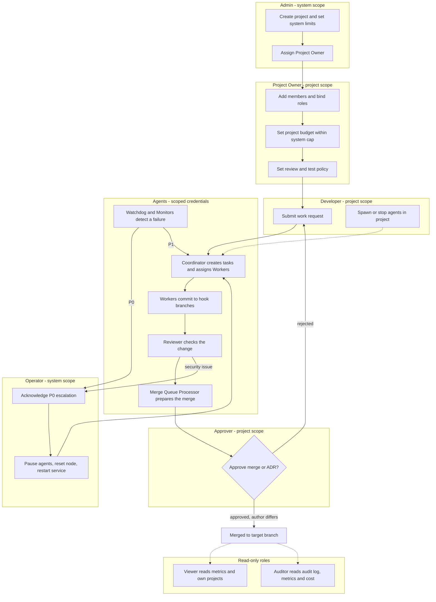

# Modularisation Assessment: Unified Multi-Agent Development System

Merged from two assessments: Bob (IBM), written 2026-10-18 and updated 2026-10-21, and Claude, written 2026-10-19 and updated 2026-10-20. Where they disagree, both views are shown.

Reviewed against the state of the repo on 2026-10-21: 12 library specs, 8 content-pack specs, the section 12 reference-code appendices, and the dashboard decision record.

Every file is linked once, in the tables of section 2 and the decisions table in section 6. Everywhere else it is named in backticks.

## Status legend

| Symbol | Meaning |
|---|---|
| Done | Extracted as a dedicated spec and matches the recommendation |
| Partial | Extracted or decided, with a gap worth noting |
| Not done | Not extracted or not acted on |
| Merged | Absorbed into another item; the right call |
| Changed | Done differently from what was proposed |
| Superseded | A later decision replaced the recommendation |
| Not decided | Waiting on an answer from you |

---

## 1. Diagnosis and approach

The 10 modules in the spec are feature domains, not reusable components. Both assessments cut horizontally instead: by what can stand alone, in tiers where each tier depends only on the tiers above it.

| Tier | Contents | State |
|---|---|---|
| 0. Contracts | Event schema, hook layout and `STATE.md`, commit trailers, error record, CLI/daemon JSON-RPC surface | Partial. The contracts live inside the libs rather than as a separate set; the JSON-RPC surface is not specified anywhere. The SQL schema was dropped from the libs on purpose (files or git only). |
| 1. Libraries | Code with no UMAS dependency | Done. 12 specs. |
| 2. Content packs | Prompts, rules, skills (not code) | Done as specs. No `SKILL.md` has been built yet. |
| 3. UMAS glue | Coordinator, Scheduler, Project Monitors, Triage, Patrol | Not done. Still in the original specs. |
| 4. Shells | CLI, dashboard, installers | Partial. Only the dashboard is decided. |

Tier 1 and Tier 2 is a cleaner cut than Bob's original five categories, because it separates how things are built from what agents do. The independence rules (no UMAS names, no cross-library imports, no database, language-neutral contract, versioned formats, safe-by-default, observable via callbacks) are enforced by the two README files, and that is what makes "each tier depends only on the tiers above" true.

---

## 2. Component breakdown

### 2.1 Tier 1 libraries

| Library | Origin (Bob / Claude name) | Status | Notes |
|---|---|---|---|
| [hook-store](libs/hook-store.md) | `worktree-manager` / `hook-store` | Done | Renamed because a worktree is a hook holding a unit of work. Adds leases, `STATE.md`, GC and recovery. |
| [event-log](libs/event-log.md) | `event-log` / `event-log` | Done | Adds cursor polling, rotation, repair and redaction. Unifies the two inconsistent envelope shapes in the source. Open question: is a pure-file design enough at 20-30 concurrent writers, or should SQLite WAL be an alternative backend? |
| [budget-meter](libs/budget-meter.md) | `token-budget` / `budget-meter` | Done | Adds reservations, multi-process ledger, live limit changes, and `pack()` for context fitting. The mechanical half of Bob's `context-compressor` lives here. |
| [merge-queue](libs/merge-queue.md) | `umas-merge-queue` / `merge-queue` | Done | Prefix-bisect replaces split-half (which misses combination failures). Adds crash recovery, baseline check, persisted state. The original code is flagged defective (CAS issue, no conflict handling, in-memory queue). **No adopt-or-build evaluation**, although Claude suggested GitHub merge queue or Mergify. |
| [test-adapters](libs/test-adapters.md) | `umas-test-runner` / `test-adapters` | Done | Framework detection, normalised `TestResult`, flaky tracking, adapter interface. Policy is deliberately left out. |
| [llm-gateway](libs/llm-gateway.md) | `llm-gateway` / `llm-gateway` | Done | Written "adopt first" with an evaluation checklist, which matches Claude's buy advice. Forbids hard-coded model IDs. Has the no-blind-retry rule, circuit breaker, and per-class error taxonomy. |
| [watchdog](libs/watchdog.md) | `umas-daemon` / `watchdog` | Done | A generic supervision library. The three-tier Daemon, Triage, Patrol design is three levels of it. The Rust Daemon is demoted to reference code. |
| [decision-artifacts](libs/decision-artifacts.md) | not in Bob's plan / `decision-artifacts` | Done | PRFAQ/ADR/Spec/GLOSSARY templates and shortcut-debt tracking. |
| [error-classifier](libs/error-classifier.md) | `error-classifier` / not in plan | Done | Added after Bob's review found the gap. A shared record format with deterministic rules, not a shared import. Adds redaction, `retry_plan`, agent and human renderings, fingerprinting and pattern alerts. Ships no catalog. Five open questions in its section 11 (for example whether unmatched errors default to P2 or P1). The other libs map to it by data only (see section 8). |
| [agent-platform](libs/agent-platform.md) | `CodingAgentAdapter` plugin registry (Category D) / platform adapters in Tier 4 | Done, Changed | Moved from Tier 4 to Tier 1. Harness adapters only, never LLM providers. `assign` writes files and does not spawn processes. `read_signal` is non-blocking. Context packs carry a SHA-256 checksum and reject path traversal. Built-in adapters: `claude-code`, `ibm-bob`, `copilot`. Bob's original advice to unify it with `llm-gateway` was wrong: one routes work to harnesses, the other routes inference calls. |
| [agent-session](libs/agent-session.md) | `agent-session` / not in plan | Done | Shared lifecycle skeleton for all six agent types (`spawned`, `active`, `handoff`, `crashed`, `done`), durable `STATE.md`, checkpoint commits, handoff packets, token thresholds. Reference code for `WorkerAgent` and `CoordinatorAgent` is in its section 12. |
| [metrics-store](libs/metrics-store.md) | `umas-metrics-collector` / not in plan | Done | Two backends behind one interface: JSONL ledger (Phase 1-2), then a relational table in SQLite or PostgreSQL (Phase 3+). TimescaleDB is an optional one-line upgrade, not a dependency. Source adapters turn `budget-meter`, `event-log` and `test-adapters` callbacks into metric rows. |

Merged, with no library of their own:

| Item | Where it went |
|---|---|
| `signal-bus` (Bob) | Split between `hook-store` (commit message format) and `event-log` (JSONL appends). Each half belongs with the library that owns the transport. |
| `context-compressor` (Bob) | Two concerns: fitting content into a limit is `budget-meter` `pack()`; deciding what goes in a handoff packet is the Developer prompt in `specialist-agents`. |
| `minimalism-enforcer` (Bob) | Moved to Tier 2 as `minimalism-ladder`. Bob's original placement in agent infrastructure was wrong; the ladder is a prompt and rule set. |

Not extracted:

| Item | State |
|---|---|
| `structured-output-parser` (Bob) | Not done. Each pack defines its own output schema but nothing specifies how an agent validates and extracts a structured response. Pydantic may be enough; a short decision record either way is needed. |
| Scheduler capacity and dispatch half (`task-queue`) | Not done. The budget half is `budget-meter`. The semaphore, queue and dispatch half is in no spec. Either extract it or document it as a deliberate UMAS-internal component composing `budget-meter` and `watchdog`. |

### 2.2 Tier 2 content packs

| Pack | Covers | Assessment |
|---|---|---|
| [minimalism-ladder](packs/minimalism-ladder.md) | 6-rung ladder, three enforcement levels, shortcut format | Correct tier. |
| [anti-slop](packs/anti-slop.md) | 7-category slop definition, two-pass review, forbidden-phrase linter | Novel addition, high value. Split from the ladder into its own pack. |
| [communication-modes](packs/communication-modes.md) | Compact (agent to agent) and plain (human-facing) registers | Novel addition. Addresses token waste. |
| [two-axis-review](packs/two-axis-review.md) | Standards and Spec passes, finding schema, severity gate | Replaces the `CodeReviewAgent` stub. |
| [specialist-agents](packs/specialist-agents.md) | Analyst, PM, UX, Architect, Developer prompts and output contracts | Done as prompt packs, not code. The original Python stubs sit in its section 12. Covers the 35M-token cost driver. |
| [router-heuristic](packs/router-heuristic.md) | Scoring rubric, weights, route bands, classification prompt | Fixes the keyword-matching Router gap. The deterministic scorer keeps arithmetic out of the model. The Router itself is still to be built. |
| [grilling](packs/grilling.md) | Bounded questioning protocol, alignment summary, trigger rules | Correct extraction. |
| [test-policy](packs/test-policy.md) | Selective vs strict modes, risky-logic classifier, trivial-change exemption | Policy correctly separated from `test-adapters`. |

Open points on the packs:
- Shipping "as Claude Code skills on day one" is **not done**. Each pack describes how it becomes a `SKILL.md`, but none has been built.
- "Tier 2 gives the most reuse for the least cost" is plausible but untested. The packs have fixtures and acceptance criteria and have not been run against a model.
- "Specialist agents are cheaper as prompt packs" is unverified. The 35M-token estimate has not been re-costed.

### 2.3 Tier 4 shell: dashboard

[ADR-0001](docs/decisions/ADR-0001-minimal-html-dashboard.md) chose a minimal read-only static HTML page that polls the REST API. It has no React and no build step, and it uses the same API definition as the CLI. This was option B; neither assessment's own recommendation (Bob: a terminal UI first; Claude: pick FastAPI with WebSocket or SSE) was adopted as written. Bob's React component list (`AgentCard`, `WorkBundleTree`, `MergeQueueView`, `MetricsPanel`, `EventStream`, `EscalationBanner`) is **superseded** and was kept only so the decision can be reviewed. The React stack stays in the stack spec marked as superseded for the first release.

Still open: no spec exists for the page or for the REST endpoints it reads; the CLI and installers are untouched.

---

## 3. Technology stack review

| # | Item | Status | Notes |
|---|---|---|---|
| 1 | Three languages and four IPC mechanisms (JSON-RPC socket, stdio JSONL, polled `events.jsonl`, shared database) | Partial | The libs use files only, with no database, and `events.jsonl` is the shared transport. The system-wide choice of one database owner and one control channel is not made, and the SQL blocks are still in the original specs. Bob adds that there is no broker between the Rust and Python processes; file-based IPC is fine for Phase 1-2, but the Phase 3 bottleneck risk remains. Recommendation: design the broker interface now, implement it when scale demands it. |
| 2 | Rust: justified or not | Resolved: Rust removed from the stack | Earlier views: Bob wanted to keep Rust for Daemon, Scheduler, TestRunner and CLI; Claude wanted Python-first with Rust only for a thin supervisor. The decision is to drop Rust because its learning curve is too high for the team. It is not part of any later comparison. The remaining choice is among Java, Go, TypeScript and Python (section 4). |
| 3 | Dashboard backend inconsistent (FastAPI or Express, Socket.io) | Partial | ADR-0001 removes the Socket.io question. FastAPI vs Express is still open and the single shared OpenAPI definition is not written. Claude recommends FastAPI. |
| 4 | Heavy observability and data stores | Partial | The libs need no OpenTelemetry, Prometheus or database. TimescaleDB is resolved (optional upgrade, see `metrics-store`). Claude's view that SQLite plus OpenTelemetry as the instrumentation API is enough at this scale still stands; Prometheus, Jaeger and Loki are not decided. Bob agrees OpenTelemetry is the right vendor-neutral choice. |
| 5 | Build versus buy | Partial | `llm-gateway` is adopt-first. `merge-queue` is a full build spec with no evaluation (see 2.1). Build only what carries the design's novelty: hooks, signalling, minimalism, handoff. |
| 6 | Stale model and pricing basis | Partial | `llm-gateway` forbids hard-coded IDs and `budget-meter` takes the pricing table from the caller. The original specs still pin `claude-3-5-sonnet-20241022` and the cost estimate is not re-based. |
| 7 | External CLI agents or in-process LLM loop | Not decided | `agent-platform` is written as if agents are external harnesses. That is a stance in the spec, not your answer. If agents are external, the Python agent runtime is mostly a subprocess orchestrator and the Agent Execution estimate shrinks. |
| 8 | JWT/RBAC deferred to Phase 4 although the PRD requires RBAC from the start | Not done | No lib or pack addresses authentication. A proposed role set, permission model and data model are in section 5; the roles and model are approved, but nothing is built yet. A security risk until the Phase 1 skeleton lands. |
| 9 | SQLite to PostgreSQL path; Python for agent logic | Holds up | Pragmatic; LLM SDKs are Python-first. |

---

## 4. Technology assessment (Rust removed)

Scope: Rust is out of the stack because its learning curve is too high. The candidate languages are Java, Go, TypeScript and Python. The candidate brokers are RabbitMQ, ActiveMQ Classic and ActiveMQ Artemis ("Apache MQ" is read as the two Apache brokers; Kafka, Pulsar, NATS and IBM MQ are not assessed).

Caveat: the language and broker facts below come from general knowledge. They were not checked against current release notes, because web search was unavailable when this was written. Check versions, licences and client maintenance before deciding.

### 4.1 Languages

| Language | Pros | Cons | Considerations |
|---|---|---|---|
| Java | Mature, strongly typed, very good concurrency (virtual threads in recent LTS releases). JMS is native, so an ActiveMQ or Artemis broker fits without an adapter. Good fit for enterprise and IBM environments. Official LLM SDKs and frameworks exist (Anthropic and OpenAI Java SDKs, Spring AI, LangChain4j). | Heavier runtime and slower start than Go. Needs a JRE unless built with GraalVM native image, which adds build effort. Verbose. The agent and prompt tooling community is smaller than Python's. | Choose it if an enterprise constraint (for example Bob or IBM) needs the JVM, or if the broker is Artemis or Classic. Native image is worth testing for the CLI and watchdog. |
| Go | One static binary per tool, cross-compiled; fast start; low memory. Goroutines suit process supervision and many concurrent git subprocesses. Strong standard library. Simple to ship a CLI that any harness can call. | Fewer LLM and agent libraries than Python or TypeScript. Verbose error handling. Weaker schema validation than Pydantic or zod (struct tags and a validator library). Less natural for prompt templating and text processing. | The natural replacement for the Rust slot: Daemon, watchdog, CLI, merge-queue. A single binary matches the "non-intrusive install" goal. |
| TypeScript | Official Anthropic SDK, Claude Agent SDK and MCP SDKs. Async I/O fits the I/O-bound workload. One language for the API, tooling and any front end. Packages ship as npm modules and Claude Code skills. | Needs Node (or Bun/Deno) at runtime; single-binary packaging is less mature. Types vanish at runtime, so inputs need zod or similar. Single-threaded for CPU work. Process supervision is workable but not a strength. | Good for skills, the API server and glue. The dashboard decision (static HTML, no build step) removes the main reason to pick it for the front end. |
| Python | Best LLM ecosystem: provider SDKs, Claude Agent SDK, Pydantic, test tooling (pytest). Fastest iteration, and the language models generate most reliably. Fits text-heavy work (decision artifacts, classification, prompt packs). | No single binary (PyInstaller and similar are awkward). Environment and packaging friction (venv, pipx). GIL limits CPU parallelism, though the workload is I/O-bound and asyncio copes. Slower start than Go. Types are optional. | Best for agent logic, `llm-gateway`, `agent-platform`, `agent-session` and the packs. A long-running daemon is fine if a service manager restarts it. |

### 4.2 Language fit per module

Modules are those of the summary document. The libraries listed are the standalone specs that cover each module.

| Module (libraries) | Workload | Best fit | Alternative | Consideration |
|---|---|---|---|---|
| 1. Context persistence (`hook-store`, `event-log`, `decision-artifacts`) | Git subprocesses, file I/O, text | Go for `hook-store` and `event-log`; Python or TypeScript for `decision-artifacts` | Python for all | Every harness calls these by CLI, so a static binary helps. Formats are language-neutral, so mixing languages is safe. |
| 2. Orchestration (Coordinator, Router, Scheduler; `budget-meter`, `router-heuristic`) | LLM calls, queues, arithmetic | Python | TypeScript or Java | Coordinator and Router are LLM-heavy. The Scheduler capacity half is unspecified (gap 2), so decide its language when it is specified. |
| 3. Agent execution (`agent-session`, `specialist-agents`, `minimalism-ladder`) | LLM loop or harness driver, state files | Python | TypeScript | Depends on the open question of external CLI agents versus an in-process loop (stack item 7). If agents are external, this layer is mostly a subprocess driver and Go also fits. |
| 4. Verification (`merge-queue`, `test-adapters`, `two-axis-review`) | Git, test-runner subprocesses, report parsing | Go for `merge-queue` and `test-adapters` | Python | Merge queue must be reliable and runnable in CI with no agents. A binary suits that. Review is a prompt pack, so it needs no language. |
| 5. Monitoring (`watchdog`, Triage, Patrol, Project Monitors) | Supervision, heartbeats, restarts | Go for the daemon level; Python for the AI-judgement callbacks | Java | The watchdog must outlive what it supervises. A static binary under launchd or systemd is the most robust. Intelligence stays in callbacks. |
| 6. Human interface (CLI, API, dashboard) | CLI, REST API, static page | Go for the CLI; Python (FastAPI) or TypeScript for the API; plain HTML for the page | Java (Spring) for the API | Keep one API definition (OpenAPI) shared by the CLI and the page. The backend choice follows the agent layer so that it can read the same state. |
| 7. Multi-agent platform (`agent-platform`, `llm-gateway`) | Provider and harness SDKs, file formats | Python | TypeScript or Java | Adopt an existing gateway first. Both Python and TypeScript have the SDKs. |
| 8. Error handling (`error-classifier`) | Pure functions over data files | Any (same record schema everywhere) | Go library plus CLI | Rules are data, so one implementation can serve all languages through its CLI. Do not reimplement it per language. |
| 9. Installation and deployment | Packaging, updates, rollback | Go binaries plus pip or npm for the agent layer | Java with jlink/native image | Two languages means two distribution channels. A single language makes installation simpler. |
| 10. Handoff and token management (`budget-meter`, `metrics-store`) | Ledger files, arithmetic, SQL | Python or Go | Any | Both are file and arithmetic work. Put them in the language of whichever process owns the ledger. |

### 4.3 Stack options

| Option | Languages | Pros | Cons | Fits when |
|---|---|---|---|---|
| A. Go core, Python agents | Go for CLI, watchdog, hook-store, merge-queue, event-log, test-adapters; Python for agents, gateway, API | Static binaries where robustness matters; best LLM tooling where it matters. Two languages with a clean CLI/file contract between them (the libs already require it). | Two toolchains, two release channels, and a language boundary through the middle. | You want the Rust benefits (single binary, supervisor) without Rust, and agents are LLM-heavy. |
| B. Python only | Python everywhere | One toolchain; fastest build; lowest token cost to build; simplest install. | No static binary; weaker supervisor story (needs launchd/systemd to restart the watchdog); the packaging friction lands on every user. | Single-developer or small-team first release; you accept a service manager for restarts. |
| C. TypeScript only | TypeScript everywhere | One toolchain; official SDKs; skills ship through npm. | Node dependency; weaker single-binary story; Python-first LLM tooling is out of reach. | The team is TypeScript-first and the harnesses are Claude Code and MCP-based. |
| D. Java only | Java everywhere | Strong typing and concurrency; native JMS if using ActiveMQ; fits enterprise constraints. | Heavier runtime; the LLM and agent ecosystem is thinner; slower iteration. | An enterprise rule requires the JVM, or Java is already the team's language. |

Decision: option A. The earlier suggestion was option A if single-binary distribution matters, otherwise option B first. The split by library is in 4.6. The libs are language-neutral and expose a `<name> <command> --json` CLI, so a library can be re-implemented in another language without changing its consumers. Java is only worth the cost with an enterprise requirement.

### 4.4 Messaging

Today there is no broker. The libs use files (`events.jsonl`, heartbeat files, signal files) and callbacks, and an independence rule forbids requiring a server. A broker would be an optional transport, added at Tier 3 scale (20-30 agents, event-log open question 1).

#### Which flows a broker would carry

| Flow | Semantics needed | Broker fit |
|---|---|---|
| Task dispatch (Scheduler to workers) | Work queue, acknowledgement, retry, dead-letter, priority | Strong. This is what queue brokers are for. |
| Audit and event history (`event-log`) | Append-only log, replay, cursor | Weak for classic queues, because a consumed message is gone. Needs a log-style feature (RabbitMQ Streams) or a different product. |
| Handoff and escalation requests | One consumer, durable, at-least-once | Good. |
| Heartbeats (`watchdog`) | Cheap, frequent, ephemeral | Poor. The watchdog would depend on a broker that it should be able to supervise. Keep files or direct pings. |
| Live updates to the dashboard | Fan-out to readers | Not needed. The page polls the API, and the API can read the event log. |

#### Broker comparison

| Broker | Pros | Cons | Considerations |
|---|---|---|---|
| RabbitMQ | Broad protocol and client support (AMQP 0-9-1 with native AMQP 1.0 in 4.x, MQTT, STOMP). Flexible routing (exchanges, topics, headers). Quorum queues for replicated durable queues. Streams give a replayable append-only log, which is the closest match to `event-log`. Per-message ack, TTL, dead-letter, management UI. Mature clients in all four languages. | Runs on Erlang/OTP, which is an extra runtime to operate and debug. Streams and quorum queues each have their own limits and tuning. Owned by Broadcom, so check licence and support terms. Not a JMS broker (JMS needs a plugin or client adapter). | The default if a broker is added and the languages are mixed. Smallest ops step for a laptop-to-server path (single node, then cluster). |
| ActiveMQ Classic | Apache 2.0. Long history and large installed base. JMS native, plus OpenWire, AMQP 1.0, MQTT, STOMP. Simple to embed on the JVM. | JVM only on the server side. Older architecture; the project positions Artemis as the next-generation broker. Non-Java clients rely on generic protocol libraries (STOMP, AMQP 1.0) with less polish than RabbitMQ's. No built-in replayable log. Throughput and HA options trail Artemis. | Pick only with an existing Classic estate or a JMS requirement. For a new build there is little reason to start on it. |
| ActiveMQ Artemis | Apache 2.0. Modern non-blocking journal; high throughput and low latency. JMS 2.0 / Jakarta Messaging native, plus AMQP 1.0, MQTT, STOMP and OpenWire (accepts Classic clients). HA with live/backup and replication. Enterprise support exists (for example Red Hat AMQ is based on it). | JVM server to run and tune. Non-Java clients use generic protocol libraries, not Artemis-specific ones. Queue semantics only: no replayable log like a stream. Smaller community than RabbitMQ for polyglot use. | Pick with a Java stack (option D), a JMS requirement, or an enterprise support need. It is the better ActiveMQ choice for new work. |

#### Client support by language

| Broker | Java | Go | TypeScript | Python |
|---|---|---|---|---|
| RabbitMQ | Official client, Spring AMQP | `amqp091-go`, stream client | `amqplib` | `pika`, `aio-pika` |
| ActiveMQ Classic | JMS / OpenWire (native) | Via STOMP or AMQP 1.0 libraries | Via STOMP or AMQP 1.0 (`rhea`) | Via STOMP or AMQP 1.0 (`qpid-proton`) |
| ActiveMQ Artemis | JMS / core (native) | Via AMQP 1.0 or MQTT libraries | Via AMQP 1.0 (`rhea`) or MQTT | Via AMQP 1.0 (`qpid-proton`) or MQTT |

#### Considerations and recommendation

- **Keep files as the source of truth.** The libs must work with no server. A broker should be a Tier 3 adapter that reads the event log and publishes (an outbox), so losing the broker loses speed and not data.
- **Do not put the supervisor on the broker.** The watchdog must be able to restart the broker, so its heartbeats stay on files or direct checks.
- **A queue is not a log.** `event-log` needs replay and cursors. Only RabbitMQ Streams offers that among the three candidates. If replay at scale is needed, include Kafka in the assessment.
- **Install weight.** A broker is a server to install, secure and monitor, which conflicts with the non-intrusive install goal and a five-agent MVP. Defer it to Phase 3-4.
- **Language link.** RabbitMQ is neutral across all four languages. Artemis and Classic favour Java.
- **Default if one is needed:** RabbitMQ, for task dispatch (queues) and, if replay is wanted, the event history (streams). Artemis only with option D or a JMS requirement. Classic only for an existing estate.
- **Define the transport interface now** (publish, subscribe, ack, dead-letter) and keep the file implementation for Phase 1-2. This is the "design the broker interface now" recommendation already in the decisions table.

### 4.5 Effects on the existing specs

- Rust appears in five code blocks in section 12 of `hook-store` (2), `budget-meter`, `test-adapters` and `watchdog`. They stay as non-normative reference code but now describe a language the stack no longer uses. Replace or mark them.
- The implementation-language table in the libs README lists "Rust or Go" for `watchdog` and treats the language as an open decision. Update it once the stack option is chosen.
- The summary document, the stack spec and the build assessment still list Rust for the Daemon, CLI, Scheduler and Test Runner. The 162M-token estimate was built on that stack and needs re-basing.

### 4.6 Language decision (Option A)

Decided: Go core, Python agents. The two halves meet only through files and each lib's `<name> <command> --json` CLI, never through imports.

| Language | Components |
|---|---|
| Go | `hook-store`, `event-log`, `merge-queue`, `test-adapters`, `watchdog`, `budget-meter`, the CLI |
| Python | `llm-gateway`, `agent-platform`, `agent-session`, `decision-artifacts`, `metrics-store`, the API, the agent logic and the packs' tooling |
| One implementation, exposed by CLI | `error-classifier`. Its language is not chosen; other languages call its CLI and do not reimplement it |

Consequences:
- The Rust reference code in section 12 of `hook-store`, `budget-meter`, `test-adapters` and `watchdog` becomes Go. The `event-log` and `merge-queue` reference code must be checked for the language it uses.
- The libs README language table needs updating to Go and Python.
- Two toolchains and two release channels: Go binaries, and pip packages for the Python half.
- The Go-versus-Python placement of `budget-meter` and `metrics-store` follows the process that owns the ledger. Revisit if that owner turns out to be Python.

### 4.7 Message broker decision

Decided: the recommendation in 4.4 is accepted.

- Files remain the source of truth (`events.jsonl`, heartbeat files, signal files). No lib requires a server.
- No broker ships in Phase 1-2.
- If scale needs one (Phase 3-4, around 20-30 agents), it is **RabbitMQ**, added as a Tier 3 optional transport that publishes from the event log (an outbox). Losing the broker loses speed, not data. Its clients exist in both Go (`amqp091-go`) and Python (`pika`, `aio-pika`), so it fits option A.
- Task dispatch would use queues. Replay of event history would use RabbitMQ Streams, and only if replay at scale is needed.
- Watchdog heartbeats stay on files or direct checks and never go through a broker.
- ActiveMQ Classic and Artemis are not chosen. Revisit only if a JMS requirement or an existing ActiveMQ estate appears, which would also reopen the language decision.

Work this creates: define the transport interface (publish, subscribe, ack, dead-letter) with the file implementation, and decide which spec owns it. `event-log` is the likely owner for the event flows, but dispatch is Scheduler territory and the Scheduler capacity half is still unspecified (gap 2).

---

## 5. RBAC data model and roles

Gap 1 in section 7 and stack item 8. This section proposes the roles, the permissions behind them and the data model. The roles and data model are approved; the open questions in 5.9 are not yet answered. RBAC is UMAS-specific (Tier 0 contract plus Tier 3 enforcement). It is not a library, because the standalone libs must stay free of identity and authorisation (see 5.7).

### 5.1 What the existing specs already say

| Source | Requirement |
|---|---|
| PRD, Access Control | RBAC with three roles. **Admin**: manage agents, view all projects, modify system configuration. **Developer**: spawn agents, view own projects, submit work requests. **Viewer**: view metrics, view own projects, read-only. The section is marked "(optional)" but the requirement is written as MUST. |
| PRD, Audit Logging | Log all agent operations with timestamp, user and action. The log is immutable (append-only) and kept at least 90 days. |
| PRD, Least Privilege | Agents get minimum permissions, file access limited to project directories, network access limited to the LLM providers. |
| Stack spec, API | JWT Bearer tokens between the dashboard and the API. The RBAC data model is listed as an open item. |
| PRD, escalation | P0 goes to a human, P1 to the Coordinator. Security issues found in review "escalate to human immediately". Someone must own that inbox. |
| PRD, platform config | Per-platform `roles` (`architect`, `reviewer`, `developer`, `security-reviewer`). These are **agent job roles** for routing, not access roles. Do not conflate the two. |
| PRD, enterprise platform | The IBM Bob adapter lists `audit-logging`, `rbac` and `secret-management` as enterprise features, so a compliance mode is expected. |

Conflicts to settle: the PRD marks access control optional, while the stack spec, summary and build assessment treat it as required. Section 5.9 asks this as a question.

### 5.2 Principals

RBAC has to cover three kinds of principal, not only people.

| Principal | Examples | How it authenticates | Note |
|---|---|---|---|
| Human user | Developer, admin, auditor | Login that issues a short-lived JWT; CLI uses a token or the local OS user (5.8) | Roles are granted per scope. |
| Agent identity | Worker `w-17`, Coordinator, Reviewer | A credential scoped to one worktree and one session, issued by the Coordinator at spawn and revoked at handoff or end | The specs say sessions are ephemeral while identity persists, so the identity row persists and credentials do not. |
| Service account | Daemon, dashboard poller, CI runner, Merge Queue Processor | A long-lived key kept in a secret store, rotated on a schedule | Never used by a person. |

An agent can act on behalf of a user. Record that as `acting_for` on the audit event, so an agent action is traceable to the request that caused it. An agent's effective permission is the **intersection** of its role and the requesting user's permissions, so a Viewer cannot get an agent to do what a Viewer cannot do.

### 5.3 Human roles

The PRD's three roles are kept as written. Four more are proposed because the specs describe duties that none of the three covers.

| Role | Scope | Purpose | Source | Phase |
|---|---|---|---|---|
| Admin | System | Manage users, providers, model mapping, limits and system configuration; see all projects | PRD | 1 |
| Project Owner | Project | Run one project: members, budget within the system cap, review policy, escalation handling. This is what makes "own projects" mean something and keeps the Admin out of daily work | Proposed; implied by "own projects" | 1 |
| Developer | Project | Submit work requests, spawn and stop agents in assigned projects, read everything in those projects | PRD | 1 |
| Viewer | Project | Read-only access to metrics and assigned projects. Cannot see secrets or raw agent prompts | PRD | 1 |
| Approver | Project | Human gate for merges, ADR acceptance and review overrides, separate from the person who requested the work (two-person rule) | Proposed; PRD "required reviewers" and "auto-merge rules" | 2 |
| Operator | System | Respond to P0 escalations: acknowledge, pause or resume agents, reset a failed watchdog node, restart services. No access to project content or configuration | Proposed; PRD P0 "human intervention" | 3 |
| Auditor | System | Read the audit log, metrics and cost only. No access to code or the ability to change anything | Proposed; PRD audit and enterprise compliance mode | 3 |

Why not more roles: a `security-reviewer` role is a routing label for agents and a responder tag on escalations, not a separate access role. Budget owner is a permission held by Project Owner and Admin. A small number of roles with named permissions is easier to audit than many overlapping roles.

For a single developer (the 5-agent MVP) only one local Admin exists. Section 5.8 describes that mode.

### 5.4 Human permissions by role

S means system-wide, P means within the projects the user is bound to, and a dash means no access.

| Capability | Admin | Project Owner | Developer | Approver | Operator | Auditor | Viewer |
|---|---|---|---|---|---|---|---|
| View agents, tasks, work bundles, merge queue | S | P | P | P | S | - | P |
| View metrics and cost | S | P | P | P | S | S | P |
| Submit a work request | S | P | P | - | - | - | - |
| Spawn an agent | S | P | P | - | - | - | - |
| Stop or pause an agent | S | P | P (own) | - | S | - | - |
| Approve a merge, accept an ADR, override a review finding | S | P | - | P | - | - | - |
| Set a project budget | S (any) | P (up to the system cap) | - | - | - | - | - |
| Change project configuration (review policy, test policy) | S | P | - | - | - | - | - |
| Change system configuration (providers, model mapping, limits) | S | - | - | - | - | - | - |
| Acknowledge or resolve a P0 escalation | S | P | - | - | S | - | - |
| Reset a failed watchdog node, restart a service | S | - | - | - | S | - | - |
| Create or delete a project | S | - | - | - | - | - | - |
| Manage users and role bindings | S | P (members, up to Developer) | - | - | - | - | - |
| Read the audit log | S | P | - | - | - | S | - |
| Read or write secrets through the API | never | never | never | never | never | never | never |

Secrets are not reachable through any role. They live in the environment or a vault and the API can only report whether one is set.

#### 5.4.1 Process flow for the human roles

The diagram shows who acts at each step of a normal work item, from project set-up to merge, plus the escalation and read-only paths. Each lane is a role from 5.3. Agent steps are shown in the middle lane so the hand-offs between people and agents are visible. Every arrow that crosses a lane is checked by the middleware (5.7) and writes an audit event.

Reading the diagram:
- **Set-up (top lanes).** Only the Admin creates a project; the Project Owner then runs it. The Admin does not appear again unless system configuration changes.
- **Normal flow.** A Developer submits the request. From there agents do the work and the Approver is the only human gate before the merge. The two-person rule means the Approver cannot be the person who submitted the request (open question 4 in 5.9).
- **Escalation.** P0 events and review-found security issues go to the Operator, who acts on agents and services but never sees project content. P1 stays inside the agent layer with the Coordinator.
- **Read-only.** Viewer and Auditor have no write path. The dotted lines show they observe results and are not part of the approval chain.

### 5.5 Agent roles

An agent role is a set of permissions bound to one agent identity and one scope (project and worktree). This is the PRD's least-privilege requirement made concrete. Names follow the existing agent types.

| Agent role | Code in own worktree | Target branch | Decision artifacts | Tasks and bundles | Spawn or stop agents | Config and budget | Events | Escalate |
|---|---|---|---|---|---|---|---|---|
| Coordinator | read | - | read | create, assign | spawn, stop | read | append, read | P1 handling, raise P0 |
| Worker (Developer) | read, write, commit to own hook branch | - | read | update own task | - | read own budget | append | raise P0, P1 |
| Specialist (Analyst, PM, UX, Architect) | read | - | write (PRFAQ, ADR, spec, glossary) | update own task | - | - | append | raise P1 |
| Reviewer | read the change under review | - | read | - | - | - | append | raise P0 (security) |
| Merge Queue Processor | merge in its permanent worktree | merge, publish | read | update PR status | - | - | append | raise P1 |
| Monitor (Triage, Patrol, Project Monitor) | read | - | read | read | restart, nudge | read | read, append | raise P0, P1 |
| Watchdog daemon (service account) | - | - | - | - | restart processes | - | read, append | raise P0 |

Rules that follow from the table:
- No agent role both writes code and merges it. The Worker commits to its hook branch and only the Merge Queue Processor writes to the target branch.
- A Reviewer cannot commit to the branch under review and cannot approve a change it authored.
- Only the Coordinator creates and assigns tasks, and only the Coordinator and Monitors can stop another agent.
- No agent can read or write configuration, budget limits or secrets beyond its own remaining budget.
- Network access is limited to the providers configured in `llm-gateway`. Filesystem access is limited to the project directory and, for Workers, the one worktree.

### 5.6 Data model

Permissions are fixed in code, because middleware must check known names. Roles, bindings and principals are data.

| Entity | Fields | Notes |
|---|---|---|
| `principal` | `id`, `kind` (`user`, `agent`, `service`), `name`, `status` (`active`, `disabled`), `created_at`, `external_id` (identity provider subject, optional) | One table for all three kinds, so audit and bindings work the same way. |
| `role` | `id`, `name`, `kind` (`human`, `agent`), `builtin` (bool), `description` | Built-in roles cannot be edited or deleted. Custom roles are allowed only in a later phase. |
| `permission` | `id`, `resource`, `action` | Written as `resource:action`, for example `agent:spawn`, `merge:approve`, `config:write`, `audit:read`. Seeded by code. |
| `role_permission` | `role_id`, `permission_id`, `limit` (optional JSON) | The limit expresses caps such as a budget ceiling. |
| `project` | `id`, `name`, `owner_principal_id`, `created_at` | Existing entity; only the owner link is new. |
| `role_binding` | `id`, `principal_id`, `role_id`, `scope_type` (`system`, `project`, `worktree`), `scope_id`, `granted_by`, `granted_at`, `expires_at` (optional) | The core table. A principal holds many bindings. An agent binding sets `scope_type = worktree` and a short `expires_at`. |
| `credential` | `id`, `principal_id`, `kind` (`jwt_session`, `api_key`, `agent_session`), `hash`, `issued_at`, `expires_at`, `revoked_at`, `last_used_at` | Only a hash of any key is stored. |
| `audit_event` | `id`, `ts`, `actor_id`, `acting_for_id` (optional), `action` (`resource:action`), `resource_type`, `resource_id`, `scope`, `decision` (`allow` or `deny`), `reason`, `correlation_id` | Append-only. Stored through `event-log`, not a mutable table (5.7). |

Authorisation check, in order:
1. Resolve the principal from the credential. Deny if it is disabled, expired or revoked.
2. Collect the bindings whose scope contains the target resource (system, then project, then worktree).
3. Allow only if a bound role grants `resource:action` and its limit holds. **Deny by default.**
4. For an agent acting for a user, require both the agent's role and the user's permission to allow.
5. Write an `audit_event` for every decision, including denials.

JWT contents are kept small: `sub` (principal id), `iat`, `exp`, `jti`. Roles and permissions are resolved server-side on each request, so a role change or revocation takes effect at once and a stolen token is limited by its short expiry.

### 5.7 Where enforcement lives

| Place | Rule |
|---|---|
| API middleware | Every route declares the permission it needs. The middleware resolves the principal and checks it before the handler runs. This is the "middleware hook point" the earlier reviews asked for. |
| CLI | The CLI calls the same API, so it uses the same checks. Local use is covered in 5.8. |
| Agents | Enforced by the harness and the sandbox: scoped credential, worktree-only filesystem, provider-only network, and branch protection so only the Merge Queue Processor can write to the target. The Coordinator issues and revokes agent credentials. |
| Standalone libs | **No RBAC inside any lib.** The independence rules forbid identity concepts in the libs. The consuming application authorises first, then passes a plain `actor` string that the lib writes into its events (`event-log` already carries a source on each event). |
| Audit | The immutable log is `event-log` with `retain_days` of at least 90, append-only by construction. An optional hash chain over entries makes tampering detectable if the enterprise compliance mode requires it. |
| Errors | A denial is an error record with a `permanent` recoverability, so `error-classifier` gives it a stable code (for example `PERMISSION_DENIED`) and a message for both the agent and the human. |

### 5.8 Phasing

| Phase | What ships |
|---|---|
| 1 (MVP, single developer, SQLite) | The permission names, the middleware hook and deny-by-default are in place. One local principal holds Admin. The CLI trusts the local OS user. Agent credentials are scoped per worktree. Audit events are written through `event-log`. Roles Project Owner, Developer and Viewer exist as data but have no second user to use them. |
| 2 (small team, PostgreSQL) | Login and JWT for the dashboard and API; multiple users; project scoping; Approver role and the two-person rule for merges. |
| 3 (scale and compliance) | Operator and Auditor roles; optional identity provider (OIDC or SSO); audit hash chain; credential rotation. |
| Later | Custom roles; per-resource grants; delegation beyond user-to-agent. |

Doing the Phase 1 items early costs little and avoids adding an authorisation layer to a finished API later, which is the risk the earlier reviews flagged.

### 5.9 Open questions

1. Is access control mandatory for the first release? The PRD marks it optional and every other document treats it as required.
2. Do you want an identity provider (OIDC, SSO) from the start, or local users first? An enterprise or IBM deployment will probably need the provider.
3. Does Viewer see only assigned projects, or all projects? The PRD says "own projects", which implies assignment.
4. Is the two-person rule (author cannot approve their own merge) required, or is a single developer allowed to self-approve in the MVP?
5. Should agents be able to act with a user's full permission, or only the intersection described in 5.2?
6. Build or adopt? Policy engines and identity servers exist in Go, Java, Python and Node ecosystems (for example Casbin, Open Policy Agent and Keycloak). Their licences, fit and maintenance have not been checked. The model above is small enough to build, but the choice depends on the language decision in section 4.
7. Who receives a "security issue found" escalation: Operator, Project Owner or a separate security role?

---

## 6. Decisions required

| Decision | Options | Recommendation | Status |
|---|---|---|---|
| Rust in the stack | Keep, optional, or remove | Claude: Python-first. Bob: keep Rust. | Resolved: Rust removed (learning curve too high). Language and messaging options are assessed in section 4 and are not yet chosen |
| Implementation languages | Option A (Go core, Python agents), B (Python only), C (TypeScript only), D (Java only) | Section 4.3 | Decided: Option A. Go for the CLI and the file, git and process libs; Python for the agent layer and API. Split in 4.6 |
| Message broker | None (files), RabbitMQ, ActiveMQ Classic, ActiveMQ Artemis | Section 4.4: keep files as the source of truth; RabbitMQ if a broker is added | Decided: files are the source of truth and no broker ships in Phase 1-2. If one is added (Phase 3-4), it is RabbitMQ as an optional outbox transport. ActiveMQ is not chosen. See 4.7 |
| External CLI agents or in-process SDK loop | See stack item 7 | None given | Not decided (`agent-platform` assumes external) |
| Publish Tier 1 and 2 as separate packages, or keep internal seams | Monorepo of independent packages, or separate repos | None given | Not decided. The independence rules keep both options open. |
| Dashboard | Terminal UI, minimal HTML, full React | Bob: TUI first, React in Phase 4 | Resolved: minimal read-only HTML |
| TimescaleDB | Hard dependency, or optional upgrade | Optional | Resolved: JSONL ledger, then PostgreSQL, then TimescaleDB as a one-liner |
| Router design | Keyword stub, or scoring heuristic | Interface now, keyword match fine for v1 | Resolved: scoring heuristic pack |
| `CodingAgentAdapter` and `LLMGateway` | Two abstractions, or unified | Keep separate | Resolved. IBM Bob registers in both with separate credentials. Stakeholder sign-off still pending. |
| IPC mechanism | Filesystem, or message broker | Broker interface now, filesystem implementation for Phase 1-2 | Decided with the message broker row: filesystem implementation for Phase 1-2 behind a transport interface (4.7). The broker itself stays deferred. `event-log` open question 1 (is a pure-file design enough at 20-30 writers) is still open |
| Auth | Defer to Phase 4, or RBAC skeleton in Phase 1 | RBAC data model and middleware hook in Phase 1; roles and model in section 5 | Approved: the roles and data model in section 5 are accepted. The seven questions in 5.9 remain open and do not block the Phase 1 skeleton |

---

## 7. Open gaps, in priority order

1. **RBAC data model.** A security gap. The roles and model are approved in section 5 (seven human roles, seven agent roles, a binding-based data model). The open questions (5.9) still need answers, and the skeleton should land in Phase 1, not Phase 4.
2. **Scheduler capacity extraction (`task-queue`)**, or a statement that it is a UMAS-internal component.
3. **`structured-output-parser` decision record.**
4. **IBM Bob sign-off** on registering in both `agent-platform` and `llm-gateway`, needed before Phase 2.
5. **Follow-ups from closed items:**
   - Re-base the 25M dashboard token estimate for the HTML page, and decide whether it ships in Phase 2.
   - Choose the dashboard backend framework and write the shared OpenAPI definition.
   - Re-cost the build assessment's token estimates and redraw the phase plan around the tiers (offered by Claude, not done).
   - Add an adopt-or-build evaluation to `merge-queue`.
   - Build the `SKILL.md` files for the packs, and run them against a model.
   - Specify the CLI/daemon JSON-RPC surface and the REST endpoints.
6. **Cross-library mention to check:** `metrics-store` names `error-classifier` as the source of two metrics (`error.p0_count`, `error.p1_count`). Check this against the no-import rule; it is acceptable only if it stays a data-format reference.

Closed since the earlier reviews: `error-classifier`, `agent-session`, `metrics-store`, the dashboard decision, the TimescaleDB question, and the library count (the READMEs said "nine" while the folder had ten; the main spec and summary tables were missing `agent-platform`).

---

## 8. Work beyond the original proposals

- Moved implementation code from the three technical design files into a non-normative "12. Reference implementation" section of each matching lib and pack (20 blocks, verbatim, with pointers left behind). Code with no standalone home stayed in place. The `agent-session` and `metrics-store` sections 12 were added separately.
- Added a "source material and deviations" section (section 10) to every spec.
- Wired the other libs to `error-classifier` by data only: each keeps its own typed errors, and its failure-modes section ends with an "Error records" table of suggested `recoverability`, with `llm-gateway` having an equivalent note on its error taxonomy. Severity stays the consumer's policy. No imports were added.

## 9. Corrections to the earlier assessments

- Claude's earlier claim that `llm-gateway` contradicted the "buy" advice was an overstatement. The spec is adopt-first. The real gap is `merge-queue`.
- Bob's recommendation to unify `CodingAgentAdapter` with `LLMGateway` was wrong, as above.
- Bob's note that `error-classifier` was "not yet wired into the other libs" is out of date; see section 8.
- Claude's note that the metrics store was undecided is out of date; see `metrics-store`.
- `agent-platform` was added to the repo by someone other than Claude. It, `agent-session` and `metrics-store` were not in Claude's plan.
