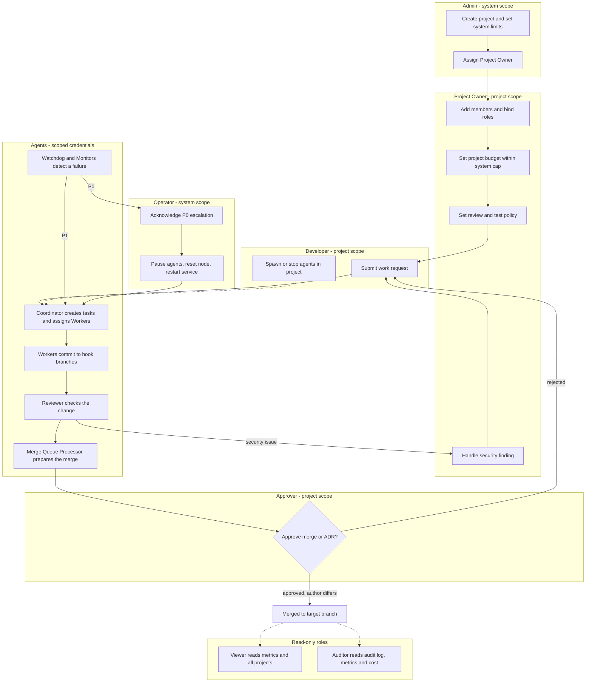

# Technical Design Specification: Unified Multi-Agent Development System

> **Stack note (2026-10-25):** The stack is Python, with TypeScript only where no Python option exists and the reason is recorded in the decision it affects. Rust, Go and Java are not in the stack. Where Rust code or a Rust crate appears below, it is the source design and is ported to Python. See [Appendix A.4](#a4-technology-assessment-python-or-typescript-only).

**Version:** 2.0
**Date:** October 21, 2026
**Status:** Active — Unified
**Based on:** [unified-multi-agent-system-prd.md](./unified-multi-agent-system-prd.md)
**Supersedes:** TECHNICAL-DESIGN-SPEC.md v1.1 · TECHNICAL-DESIGN-SPEC-PART2.md · TECHNICAL-DESIGN-SPEC-PART3.md · UMAS-TECH-DESIGN-SPEC.md
**Old versions:** the four v1 files were deleted. Their last full text is at commit `cc5570e`, at the repository root (for example `git show cc5570e:TECHNICAL-DESIGN-SPEC-PART3.md`). Citations in `libs/` and `packs/` such as "Source: `TECHNICAL-DESIGN-SPEC-PART3.md` §5.4.2" or "See UMAS-TECH-DESIGN-SPEC.md §3.4" use v1 section numbers and refer to that version, not to this file. Section numbers in this file are v2 numbers.

> **Before reading this document, read [UMAS-DNA.md](./UMAS-DNA.md) — the project DNA.** It encodes the six non-negotiable principles, architecture invariants, shared vocabulary, and signal protocol that govern every module. This spec is the *how*; the DNA is the *why* and the *never*.
>
> This is the single authoritative technical design document. The four-file split from v1.x has been collapsed here.
> All code that was inline in the previous documents has been moved into `libs/` and `packs/` reference appendices.
> **Reusable components:** [libs/README.md](../libs/README.md) (14 libraries) · [packs/README.md](../packs/README.md) (9 content packs)
> **Product requirements:** [unified-multi-agent-system-prd.md](./unified-multi-agent-system-prd.md)

---

## Table of Contents

1. [Technology Stack](#1-technology-stack)
2. [System Architecture](#2-system-architecture)
3. [Reusable Components](#3-reusable-components)
4. [Data Model](#4-data-model)
5. [Component Design](#5-component-design)
   - 5.1 Context Persistence System
   - 5.2 Orchestration System
   - 5.3 Agent Execution System
   - 5.4 Verification System
   - 5.5 Monitoring System
   - 5.6 Token Budget and Handoff
   - 5.7 Model Policy
   - 5.8 Scalability Roadmap
   - 5.9 CLI Design
6. [Exception Flows](#6-exception-flows)
7. [API Specifications](#7-api-specifications)
8. [Security Architecture](#8-security-architecture)
9. [Performance and Scalability](#9-performance-and-scalability)
10. [Testing Strategy](#10-testing-strategy)
11. [Deployment Architecture](#11-deployment-architecture)
12. [Implementation Phases](#12-implementation-phases)
13. [Key Metrics](#13-key-metrics)
14. [Open Questions](#14-open-questions)

[Appendix A: Modularisation, Stack and RBAC Decisions](#appendix-a-modularisation-stack-and-rbac-decisions)

---

## 1. Technology Stack

### 1.1 Core Languages

```yaml
daemon_and_cli:
  language: Python
  version: "3.10+"
  rationale: Same language as the agent runtime, so one toolchain. Strong asyncio support and a rich LLM and CLI ecosystem. The daemon runs under launchd or systemd for restarts.
  key_dependencies:
    typer: "CLI framework"
    pydantic: "2.4+"
    sqlalchemy: "2.0+"
    structlog: "structured logging"

agent_runtime:
  language: Python
  version: "3.10+"
  rationale: Rich AI/ML ecosystem, LLM SDK support, strong async.
  key_dependencies:
    anthropic: "0.7+"
    openai: "1.3+"
    google-generativeai: "0.3+"
    pydantic: "2.4+"
    aiofiles: "23.2+"
    gitpython: "3.1+"
    sqlalchemy: "2.0+"
    alembic: "1.12+"
```

**Alternative (Node.js):** TypeScript 18+ with `commander`, `prisma`, `zod` is a viable substitute for both layers if the team prefers one runtime. The lib specs are language-neutral.

### 1.2 Data Storage

```yaml
version_control:
  minimum: git 2.30+
  features: [worktree_support, hooks, sparse_checkout]
  worktree_base_path: ".umas/worktrees/"
  hooks_path: ".umas/hooks/"
  branch_prefix: "agent/"

database:
  tier_1_mvp:
    engine: SQLite 3.35+
    location: "~/.umas/database.db"
    features: [wal_mode, foreign_keys, json_support]
    max_concurrent_agents: 5
  tier_2_production:
    engine: PostgreSQL 14+
    connection_pool: {min: 5, max: 50, idle_timeout: 300}
    max_concurrent_agents: 30+

metrics_storage:
  # TimescaleDB is NOT a hard dependency. See libs/metrics-store.md §2.
  phase_1_2: JSONL file ledger (libs/metrics-store.md — JSONL backend)
  phase_3_plus: Standard PostgreSQL "metrics" table (libs/metrics-store.md — SQL backend)
  optional_upgrade: "SELECT create_hypertable('metrics', 'ts') — one statement, no app code change"
```

### 1.3 LLM Providers

> **Harness ≠ provider.** The harness is the CLI tool that runs an agent session (`claude-code`, `openai-codex`, `copilot`). The provider is the LLM API that generates tokens. They are registered and replaced independently. See [agent-platform](../libs/agent-platform/README.md) for harness adapters.

```yaml
# Providers are configuration. Replacing one is an edit to the llm-gateway alias table.
# Model IDs are never written in this spec or in code: they live in the alias table
# (see libs/llm-gateway section 3.2). The names below are aliases, not model IDs.
# llm-gateway alias: "google-gemini" → used by the openai-codex harness adapter (ADR-0002)
tier_1_full_integration:
  anthropic_claude:
    models: [default, deep]    # aliases resolved in configuration
    features: [hooks_support, streaming, function_calling]
    harness: claude-code
  openai_gpt:
    models: [openai-default, openai-small]   # aliases resolved in configuration
    features: [streaming, function_calling]
    harness: openai-codex
  google_gemini:
    alias: google-gemini                     # referenced by the openai-codex adapter config
    models: [gemini-default, gemini-small]   # aliases resolved in configuration
    features: [streaming]
    harness: openai-codex                    # Codex CLI runs Gemini models too (ADR-0002)

tier_2_basic_integration:
  local_llm:
    endpoint: "http://localhost:11434"
    models: [local-default, local-code]      # aliases resolved in configuration
    features: [offline_mode]
```

### 1.4 Observability

```yaml
protocol: OpenTelemetry 1.20+
logging:
  format: JSON (structured)
  libraries: {python: structlog}
  fields: [timestamp, level, service, agent_id, session_id, task_id, trace_id]
  # OpenTelemetry wiring (spans, exporters) belongs to the UMAS application layer.
  # The standalone libs do not import OpenTelemetry; they emit events through callbacks
  # and the application turns those into spans.
metrics:
  backend: Prometheus
  scrape_interval: 15s
tracing:
  backend: Jaeger
  sampling: {development: 1.0, production: 0.01}
  propagation: W3C Trace Context
```

### 1.5 Dashboard

> **Decision (ADR-0001):** The dashboard for the first release is a **minimal read-only HTML page** that polls the REST API. No React, no build step, no WebSocket requirement. See [ADR-0001](../docs/decisions/ADR-0001-minimal-html-dashboard.md).

The React + TypeScript stack described in v1.x is **superseded** and is not planned. TypeScript would be allowed here only if a later decision shows that the HTML page cannot meet a need and records why no Python or plain-HTML option works.

```yaml
dashboard:
  page: static read-only HTML, no build step     # ADR-0001
  backend: FastAPI (Python)                      # same REST API and OpenAPI definition as the CLI
  api: REST, polled by the page
  push_updates: not in the first release         # SSE or WebSocket via FastAPI if ever needed
```

---

## 2. System Architecture

### 2.1 Layered Architecture

```
┌─────────────────────────────────────────────────────────────────┐
│                     HUMAN INTERFACE LAYER                        │
│       CLI (Python)  ·  Dashboard (HTML/polling)  ·  Escalation  │
└────────────────────────────┬────────────────────────────────────┘
                             │ Unix Socket / JSON-RPC
┌────────────────────────────▼────────────────────────────────────┐
│                     ORCHESTRATION LAYER                          │
│       Coordinator (Python)  ·  Router  ·  Scheduler (Python)    │
└──────┬─────────────────────────────────────────┬────────────────┘
       │ Task Queue                               │ Resource Alloc
┌──────▼───────────────┐          ┌──────────────▼───────────────┐
│  AGENT EXECUTION     │          │    VERIFICATION SYSTEM       │
│  Worker · Specialized│          │ Merge Queue · Review · TDD   │
└──────┬───────────────┘          └──────────────┬───────────────┘
       │ Git Operations                           │ Test Execution
┌──────▼───────────────────────────────────────────▼─────────────┐
│                   CONTEXT PERSISTENCE LAYER                      │
│      Git Worktrees  ·  Decision Artifacts  ·  events.jsonl      │
└─────────────────────────────┬───────────────────────────────────┘
                              │ Heartbeat / Polls
┌─────────────────────────────▼───────────────────────────────────┐
│                     MONITORING LAYER                             │
│  Daemon (Python)  →  Triage Agent  →  System Patrol  →  Project │
└─────────────────────────────────────────────────────────────────┘
```

### 2.2 Component Communication Patterns

```yaml
cli_to_daemon:
  protocol: Unix Domain Socket (Linux/macOS) / Named Pipe (Windows)
  format: JSON-RPC 2.0
  timeout: 30s

daemon_to_agents:
  protocol: Process spawn with stdio
  format: JSON Lines (JSONL)

agents_to_git:
  protocol: Git CLI subprocess
  operations: [worktree add/remove/list, commit, checkout, merge, diff]

agents_to_database:
  protocol: SQL over connection pool
  orm: SQLAlchemy (Python) / Prisma (Node.js)

dashboard_to_api:
  protocol: HTTP/HTTPS polling (Phase 1–3) / WebSocket (Phase 4)
  format: JSON
  auth: OIDC access tokens issued by Keycloak (JWT Bearer)
  base_path: "/api/v1"

telemetry:
  protocol: OTLP (Protobuf)
  endpoints: {metrics: prometheus:9090, traces: jaeger:14268, logs: loki:3100}
```

### 2.3 Process Model

```yaml
daemon:
  type: long_running_service
  language: Python
  resource_limits: {memory: 512MB, cpu: 1_core}
  restart_policy: always

agents:
  type: ephemeral_workers
  language: Python
  lifecycle: task_scoped
  spawn_method: subprocess
  resource_limits: {memory: 2GB_per_agent, cpu: 2_cores, max_concurrent: 30}

cli:
  type: short_lived_client
  language: Python
  timeout: 300s
  communication: IPC_to_daemon
```

---

## 3. Reusable Components

Parts of the design are extracted as standalone units with no dependency on UMAS. The sections below describe how UMAS uses them; each standalone spec is the authority on behaviour. Where the two differ, the standalone spec records the difference in its "Source material and deviations" section.

### Tier 1 — Libraries ([index](../libs/README.md))

| Component in this doc | Standalone spec |
|-----------------------|-----------------|
| Hooks and worktree state (§5.1) | [hook-store](../libs/hook-store/README.md) |
| `.umas/events.jsonl` signalling (§5.1, §5.3) | [event-log](../libs/event-log/README.md) |
| Merge Queue Processor (§5.4) | [merge-queue](../libs/merge-queue/README.md) |
| Test Runner (§5.4) | [test-adapters](../libs/test-adapters/README.md) |
| Token budget, handoff packet (§5.6) | [budget-meter](../libs/budget-meter/README.md) |
| Provider failure handling (§5.7, §6.7) | [llm-gateway](../libs/llm-gateway/README.md) |
| Three-tier watchdog (§5.5) | [watchdog](../libs/watchdog/README.md) |
| Decision artifacts, shortcut ledger (§5.1) | [decision-artifacts](../libs/decision-artifacts/README.md) |
| Error severity, recoverability, escalation records (§6) | [error-classifier](../libs/error-classifier/README.md) |
| Platform adapters, work assignment, cross-platform transfer (§5.3) | [agent-platform](../libs/agent-platform/README.md) |
| Agent session lifecycle (§5.3) | [agent-session](../libs/agent-session/README.md) |
| Metrics recording, query, retention (§1.2) | [metrics-store](../libs/metrics-store/README.md) |
| Dependency graph, leased task queue, concurrency cap, retry (§5.2) | [task-queue](../libs/task-queue/README.md) |

### Tier 2 — Content Packs ([index](../packs/README.md))

| Component in this doc | Standalone spec |
|-----------------------|-----------------|
| Minimalism ladder, shortcut comments (§5.3) | [minimalism-ladder](../packs/minimalism-ladder/minimalism-ladder-spec.md) |
| Anti-slop principles | [anti-slop](../packs/anti-slop/anti-slop-spec.md) |
| Communication modes (compact vs. plain) | [communication-modes](../packs/communication-modes/communication-modes-spec.md) |
| Code Review, two-axis (§5.4) | [two-axis-review](../packs/two-axis-review/two-axis-review-spec.md) |
| Specialized Agents (§5.3) | [specialist-agents](../packs/specialist-agents/specialist-agents-spec.md) |
| Router scoring heuristic (§5.2) | [router-heuristic](../packs/router-heuristic/router-heuristic-spec.md) |
| Grilling and the propulsion rule (§5.2) | [grilling](../packs/grilling/grilling-spec.md) |
| Test coverage policy (§5.4) | [test-policy](../packs/test-policy/test-policy-spec.md) |
| Playbook engine — phase-gated workflow wrapper (§5.2) | [playbook-runner](../packs/playbook-runner/playbook-runner-spec.md) |

---

## 4. Data Model

### Projects

```sql
CREATE TABLE projects (
  id            TEXT PRIMARY KEY,   -- slug, e.g. "my-api"
  name          TEXT NOT NULL,
  path          TEXT NOT NULL UNIQUE,
  status        TEXT NOT NULL DEFAULT 'active',  -- active | orphaned | archived
  registered_at DATETIME NOT NULL,
  last_seen_at  DATETIME
);
```

### Work Bundles

```sql
CREATE TABLE work_bundles (
  id           TEXT PRIMARY KEY,
  project_id   TEXT REFERENCES projects(id),
  type         TEXT NOT NULL,   -- epic | story | task
  status       TEXT NOT NULL,   -- pending | in_progress | completed | failed
  parent_id    TEXT REFERENCES work_bundles(id),
  hook_path    TEXT,
  agent_id     TEXT,
  created_at   DATETIME NOT NULL,
  completed_at DATETIME
);
```

### Agent Sessions

```sql
CREATE TABLE agent_sessions (
  id             TEXT PRIMARY KEY,
  project_id     TEXT REFERENCES projects(id),
  bundle_id      TEXT REFERENCES work_bundles(id),
  status         TEXT NOT NULL,
    -- spawned         : created, not yet responsive
    -- active          : working normally
    -- handoff         : committed state, transferring to successor
    -- crashed         : unresponsive past heartbeat threshold
    -- done            : task completed
    -- budget_paused   : daily token budget exhausted
    -- provider_failed : primary + fallback providers unavailable
    -- machine_paused  : host machine shut down or suspended; session paused at last checkpoint
    -- auth_expired    : OIDC token expired while machine was off; re-authentication required before resume
  token_used     INTEGER DEFAULT 0,
  token_limit    INTEGER NOT NULL,
  last_heartbeat DATETIME,
  paused_at      DATETIME,          -- set when status enters machine_paused or auth_expired
  started_at     DATETIME NOT NULL,
  ended_at       DATETIME
);
```

Sessions in `budget_paused`, `provider_failed`, `machine_paused`, or `auth_expired` are resumable. They are not treated as failures unless they remain in that state beyond the configurable timeout (default: 24 hours for `budget_paused`/`provider_failed`; no timeout for `machine_paused`/`auth_expired` — they wait until the human acts).

---

## 5. Component Design

### 5.1 Context Persistence System

**Storage:** Each agent gets a Git worktree inside `.umas/worktrees/<hook-name>/`. The worktree is linked to the main repo but is a separate working directory — agents commit state directly to their worktree branch.

**State commit protocol:**
- Agent commits after every major step
- Commit message format: `[umas] <agent-id> <step-summary> [tokens: N]`
- A `STATE.md` file in the worktree root holds: current task, recent decisions (last 10), explicit next steps, and references to relevant files

**Session discovery:** All agent operations are appended to `.umas/events.jsonl` (append-only, one JSON object per line). On handoff or restart, the incoming agent queries this log filtered by `hook_path`.

```json
{ "ts": "2024-01-15T10:23:01Z", "agent": "alice", "hook": "auth-login/", "event": "step_complete", "summary": "validation logic done, email check pending" }
```

**Decision artifacts location:**

| Artifact | Location |
|----------|----------|
| PRFAQ | `docs/product/<feature>.prfaq.md` |
| ADR | `docs/decisions/ADR-<NNN>-<title>.md` |
| Spec | `docs/specs/<feature>.spec.md` |
| GLOSSARY | `GLOSSARY.md` (repo root) |

**Standalone libs:** [hook-store](../libs/hook-store/README.md) · [event-log](../libs/event-log/README.md) · [decision-artifacts](../libs/decision-artifacts/README.md)

---

### 5.2 Orchestration System

#### Coordinator

- Receives human requests via `umas request "<text>"`
- Runs grilling for human-initiated requests only — agent-to-agent handoffs execute immediately (propulsion principle)
- Creates a `work_bundle` record
- Delegates to Router for skill/workflow selection
- Delegates to Scheduler for agent dispatch
- Never writes application code

**State machine:**

```
IDLE → GRILLING → PLANNING → DISPATCHING → MONITORING → DONE
                                              ↑               |
                                              └── ESCALATED ──┘
```

| From | To | Trigger |
|------|----|---------|
| `IDLE` | `GRILLING` | Human submits request |
| `GRILLING` | `PLANNING` | Human confirms (or skipped for agent-to-agent) |
| `PLANNING` | `DISPATCHING` | Work bundle created and validated |
| `DISPATCHING` | `MONITORING` | All ready tasks dispatched |
| `MONITORING` | `DONE` | All tasks reach `completed` |
| `MONITORING` | `ESCALATED` | Any agent appends `escalate` event to `events.jsonl` |
| `ESCALATED` | `DISPATCHING` | Human resolves escalation |
| `ESCALATED` | `DONE` | Human cancels the work bundle |
| Any | `IDLE` | Bundle cancelled or all tasks failed |

Multiple concurrent bundles each have their own independent state machine. `ESCALATED` in one does not pause others.

**Coordinator config** (see also [libs/agent-session.md §12.3](../libs/agent-session/README.md)):

```yaml
coordinator_config:
  model: default                  # llm-gateway alias, not a model ID
  token_limit: 200000
  complexity_thresholds:
    simple:  {max_files: 3, max_lines: 100, no_architecture_change: true}
    medium:  {max_files: 10, max_lines: 500, limited_architecture_change: true}
    complex: {unlimited: true}
  grilling:
    enabled: true
    human_initiated_only: true
    max_questions: 10
    timeout_seconds: 300
  specialized_agents: {pm: true, architect: true, ux: true, analyst: true}
  session_resumable_statuses: [budget_paused, provider_failed]
  resumable_timeout_hours: 24

  # Playbook — optional. null = default implicit workflow (unchanged behaviour)
  # See packs/playbook-runner.md for the full schema.
  playbook: null
```

**Playbook routing:** When `playbook` is non-null the Coordinator loads the named playbook from the registry and drives a phase loop instead of the implicit sequence. Each phase step calls an existing pack, agent role, or lib op — the underlying execution is identical. Human gates pause the work bundle; the human resumes via `umas work-bundle approve <id>`. Escape hatches write a `[checkpoint]` commit and a `RESUME.md` then escalate. Without a playbook the implicit default workflow is unchanged.

```bash
# Per-request playbook override:
umas request "add login" --playbook production-gatekeeper
umas request "fix crash" --playbook autonomous-loop --exit-predicate "tests pass"
umas request "refactor" --playbook none   # force default implicit workflow
```

#### Router

Selects workflow by scoring heuristic:

| Signal | Weight |
|--------|--------|
| Files affected (estimated) | High |
| New feature / service / system | High |
| Scope is ambiguous | Medium |
| User-facing UI | Medium |
| Security / auth / payments / data migration | High |
| Bug fix with specific file/line cited | Low → simple |

| Score band | Route |
|-----------|-------|
| Low | Direct worker agent |
| Medium | Architect + worker |
| High | Full specialist panel → workers |
| Greenfield marker | PM → Architect → parallel workers |

Override: `--route simple|medium|large|greenfield`

> Standalone spec with numeric weights and test fixtures: [packs/router-heuristic](../packs/router-heuristic/router-heuristic-spec.md) · Grilling trigger rules: [packs/grilling](../packs/grilling/grilling-spec.md)

#### Scheduler

- Maintains a `ready_queue` of tasks with no unresolved dependencies, using [libs/task-queue.md](../libs/task-queue/README.md)
- Dispatches agents up to the concurrency limit; tasks wait in queue when at capacity (`max_claimed` plus an `admit` callback backed by `budget-meter`)
- On every task completion: marks complete → unblocks dependents → dispatches newly ready tasks

```python
def on_task_complete(task_id):
    mark_complete(task_id)
    unblock_dependents(task_id)
    check_parent_auto_complete(task_id)
    dispatch_ready_tasks()
```

---

### 5.3 Agent Execution System

#### Worker Agents

- Spawned with: task ID, hook path, compressed context (≤15k tokens)
- Operate exclusively inside their assigned worktree
- Commit state at each major step
- Signal completion: `[umas:done] <task-id>` commit
- Signal blockers: append `{"event":"escalate","severity":"P1","reason":"..."}` to `events.jsonl`

**Agent signalling protocol:**

| Signal | Mechanism | Who reads it |
|--------|-----------|-------------|
| Task complete | Commit: `[umas:done] <task-id>` | Scheduler |
| Task blocked | Append to `events.jsonl`: escalate event | Coordinator |
| Checkpoint | Commit: `[umas:checkpoint] <summary>` | Project Monitor |
| Handoff request | Append to `events.jsonl`: handoff_request event | Scheduler |

**Minimalism ladder** (runs *after* reading relevant code, *before* writing any):

1. Does this feature need to exist?
2. Does it already exist in this codebase?
3. Is it in the standard library or platform?
4. Is it an already-installed dependency?
5. Can it be one readable line?
6. Otherwise: minimum code that works

> Standalone spec: [packs/minimalism-ladder.md](../packs/minimalism-ladder/minimalism-ladder-spec.md)

**Shortcut comments:** Agents may leave `// SHORTCUT: <what> — <when to fix>` to mark a deliberate deferral. Must be tracked in the project's debt ledger. All other comments require justifying "why" code exists.

**Session lifecycle:** Shared across all agent types. See [libs/agent-session.md](../libs/agent-session/README.md).

#### Specialized Agents

Invoked by the Router for medium/large tasks:

| Role | Responsibility | When |
|------|---------------|------|
| Analyst | Clarify requirements, surface ambiguity | All non-trivial requests |
| Product Manager | User value, PRFAQ, product decisions | Greenfield, new features |
| Architect | ADR, tech stack, system design | Medium+ complexity |
| UX Designer | Interface and interaction design | User-facing changes |
| Developer | Implementation with minimalism enforcement | All implementation |

> Prompts and output schemas: [packs/specialist-agents.md](../packs/specialist-agents/specialist-agents-spec.md)

#### Multi-Platform Support

UMAS supports four first-class coding agent harnesses. Each is an adapter in [agent-platform](../libs/agent-platform/README.md). None is built into the core, so any can be replaced by changing configuration.

| Harness | Adapter name | Notes |
|---------|-------------|-------|
| Claude Code | `claude-code` | Completion via commit-message hook |
| OpenAI Codex | `openai-codex` | Completion via commit-message hook. Runs OpenAI models and Google Gemini models; the provider is set per assignment and registered in `llm-gateway` (ADR-0002) |
| GitHub Copilot | `copilot` | Completion via file mtime (IDE tool) |

`agent-platform` handles work assignment, context packing, and completion signalling. `llm-gateway` handles inference routing. They are separate concerns at separate layers, so a harness and a provider are replaced independently.

---

### 5.4 Verification System

#### Merge Queue Processor

Operates on a **permanent** `merge-queue` worktree created once during `umas init --project`. Only the temp test branch is created/destroyed per batch.

**Worktree states:** `IDLE → COLLECTING → TESTING → BISECTING → MERGING`

**Algorithm:**

```
1. Collect all PRs with status = ready_to_merge
2. Create temp branch: merge ALL PRs
3. Run full test suite
4. If green → merge all to main, delete temp branch
5. If red → bisect:
     Split batch, test each half
     Recurse until culprit isolated
     Merge only passing half
     Re-queue failing PR: status = blocked + reason
```

> Standalone spec: [libs/merge-queue.md](../libs/merge-queue/README.md)

#### Code Review (Two-Axis)

Every PR goes through two independent passes run in parallel:

- **Standards axis:** code quality, style, patterns, maintainability
- **Spec axis:** does it solve the right problem and meet task requirements

Each finding: `{ location, what, problem, fix, consequence }`. Findings without a concrete fix are not filed.

> Standalone spec: [packs/two-axis-review.md](../packs/two-axis-review/two-axis-review-spec.md)

#### Test Coverage Policy

| Mode | Behaviour |
|------|-----------|
| `selective` (default) | Tests required only for risky logic: branches, loops, parsers, money, security |
| `strict` | Full TDD (red-green-refactor) for every feature |

Trivial changes (renaming, formatting, config-only) require no tests under either mode.

> Policy: [packs/test-policy.md](../packs/test-policy/test-policy-spec.md) · Execution and results: [libs/test-adapters.md](../libs/test-adapters/README.md)

---

### 5.5 Monitoring System

**Three-tier watchdog:**

```
Tier 1 — Daemon (Python, OS process)
  Heartbeats Triage Agent every 3 min
  No response → restart Triage Agent

Tier 2 — Triage Agent (Python, always running)
  Monitors System Patrol
  Stuck → investigates, restarts

Tier 3 — System Patrol (Python, always running)
  Polls all Project Monitors and Merge Queue Processors
  Dispatches maintenance workers for detected issues
```

**Project Monitor** (one per active project, polls every 60 seconds):

| Heuristic | Threshold | Action |
|-----------|-----------|--------|
| No `STATE.md` commit | > 10 min | Agent may be stuck → nudge |
| No heartbeat | > 5 min | Agent likely crashed → graceful handoff |
| Token usage without handoff request | > 95% | Emergency handoff from last checkpoint |

Recovery order: Nudge → Graceful handoff → Emergency handoff

> Standalone spec: [libs/watchdog.md](../libs/watchdog/README.md)

---

### 5.6 Token Budget and Handoff

**Handoff triggers:**

| Trigger | Type | Action |
|---------|------|--------|
| Session token usage ≥ 90% | Graceful | Agent commits state, requests handoff |
| Session token usage ≥ 95% | Emergency | Monitor forces handoff from last checkpoint |
| Daily project budget ≥ 80% | Warning | Alert human |
| Daily project budget = 100% | Exhaustion | Queue new work; do not fail in-progress work |

**Context compression on handoff** — full context (~175k tokens) compressed to handoff packet (~15k tokens):

- Current task and progress percentage
- Last 10 decisions
- Explicit next steps
- Pointers to relevant files (path + line range, not content)

The incoming agent reads the handoff packet and the worktree's `STATE.md`. It does not re-read the full conversation history.

> Standalone spec: [libs/budget-meter.md](../libs/budget-meter/README.md)

---

### 5.7 Model Policy

**Default:** All roles use the same configured model — minimal setup, no per-role overhead.

**Opt-in role mapping** via `umas.config.yaml`:

| Role | Override key |
|------|-------------|
| Coordinator | `agents.coordinator.model` |
| Worker | `agents.worker.model` |
| Architect | `agents.specialized.architect.model` |
| Reviewer | `agents.specialized.reviewer.model` |

**Multi-model panels** are opt-in and reserved for decisions with irreversible consequences (architecture, security, data migrations). Disabled by default.

```yaml
agents:
  worker:
    model: default                # llm-gateway alias, not a model ID
  specialized:
    architect:
      model: deep                 # llm-gateway alias, not a model ID
      panel_enabled: true
```

---

### 5.8 Scalability Roadmap

**MVP (single workspace):** One `~/.umas/database.db`, all projects on the same machine, up to 5 concurrent agents with SQLite.

**Federation (v2, deferred):** Cross-workspace coordination allowing agents on different machines to work on the same project. Not in MVP — designed with federation in mind (project registration by path, event log as primary state) but not implemented until demand warrants it.

---

### 5.9 CLI Design

#### `umas init` vs `umas init --project`

| Command | Scope | What it does |
|---------|-------|-------------|
| `umas init` | Machine-wide (once) | Creates `~/.umas/`, initialises `database.db`, applies user defaults |
| `umas init --project` | Per-repo | Creates `.umas/`, installs Git hooks, updates `.gitignore` |

`umas init` runs automatically if `umas init --project` is called first. Both commands are fully idempotent.

#### `umas project register`

Registration only — writes to `database.db`. Does not touch the filesystem.

```bash
# Full onboarding flow:
mkdir my-api && cd my-api && git init
umas init --project                    # filesystem
umas project register my-api           # database
umas request "Build a REST API for…"  # submit work
```

Running `umas project register` before `umas init --project` fails with a clear error.

---

## 6. Exception Flows

### 6.1 Force-Deleted Project

**Scenario:** `rm -rf ~/projects/my-api` while the project is still registered.

**Detection:** Lazy — on any UMAS operation referencing the project. Proactively during `umas health-check` and `umas project list`.

**Recovery:**

```
my-api  [ORPHANED — path not found: /Users/you/projects/my-api]

Options:
  1. Remove from database
  2. Re-register at new path
  3. Ignore for now

Choice [1-3]:
```

Option 3 sets status = `orphaned`. After 30 days unresolved, `umas health-check` escalates P2. Records are never auto-deleted.

---

### 6.2 Mid-Task Project Deletion (Agents Running)

**Detection:** Project Monitor's next health poll (within 60 s).

**Recovery:**
1. Mark all active sessions `crashed`
2. Escalate to System Patrol as P1
3. Mark in-flight bundles `failed: project_path_missing`
4. Notify human with worktree branch recovery instructions

Worktree branches committed before deletion still exist in the Git object store.

---

### 6.3 Corrupted `.umas/` Directory

**Detection:** On `umas init --project` and `umas health-check`.

**Recovery:** `umas init --project` is idempotent — recreates missing pieces without touching existing files.

- Missing files → recreated
- Corrupted `config.yaml` → backed up as `.bak`, replaced with defaults
- Corrupted `events.jsonl` → backed up, new empty log started (history loss warned)
- If the Git hook chain is broken → repaired automatically

---

### 6.4 Project Moved or Renamed

**Detection:** Same as §6.1.

**Recovery:** Orphaned prompt offers "Re-register at new path". Validates `git` repo and `.umas/` at new path. Only the `path` column is updated — all history is preserved.

---

### 6.5 Git Hook Conflict

| Detected type | Action |
|--------------|--------|
| `none` | Install UMAS hook directly |
| `plain_shell` | Prepend UMAS call |
| `husky` | Add UMAS hook in `.husky/pre-commit` |
| `lefthook` | Add UMAS step to `lefthook.yml` |
| `pre-commit-framework` | Add as local hook in `.pre-commit-config.yaml` |
| `binary` | Cannot chain — warn, skip, polling-only mode |

On `umas update`, only the `# umas-managed` marker line is replaced; all other hook entries are left untouched.

---

### 6.6 Token Budget Exhausted Mid-Task

**Behaviour:** In-progress agents complete their current atomic step and commit state. New dispatch is paused.

Agent steps when budget signal received:
1. Complete current atomic step
2. Commit: `[umas] budget-pause — state committed`
3. Set status `budget_paused`

When budget is increased via `umas project config --budget <N>`, Project Monitor resumes dispatch within 60 s — does not wait for UTC midnight.

---

### 6.7 LLM Provider Failure Mid-Task

**Retry policy:**

| Error type | Retry |
|-----------|-------|
| 429 Rate limit | Exponential backoff: 5s, 15s, 45s, then failover |
| 5xx Server error | 3 immediate retries, then failover |
| Timeout (>30s) | 2 retries, then failover |
| 401/403 Auth | No retry — P0 escalation immediately |

**Failover:** Uses `STATE.md` compressed context (same as handoff packet). Task does not restart from zero.

**No fallback configured:** P1 escalation. Recovery is human-initiated: `umas agents resume <session-id>`.

> Retry and circuit-breaker details: [libs/llm-gateway.md](../libs/llm-gateway/README.md)

---

### 6.8 Stale Worktrees After Agent Crash

| Age | Action |
|----|--------|
| < 24 h | Keep — agent may be recoverable |
| 24 h – 7 days | Mark `stale`, surface in `umas health-check` |
| > 7 days | Prompt for deletion |

If uncommitted changes are found, the worktree is tagged `stale-dirty` and never cleaned automatically. `umas worktrees recover <name>` spawns a triage agent to commit or discard the diff.

---

### 6.9 Merge Queue Bisect Finds No Clean Subset

All PRs moved to `blocked: failed_in_isolation`. Originating agents re-spawned to fix. Default retry limit: 3 consecutive failures per PR. Beyond that: P1 escalation, no further auto-spawning. Human resets with `--reset-retries`.

---

### 6.10 Dependency Deadlock in Work Bundle

**At creation time:** Coordinator runs cycle detection and dangling-reference check. Rejected bundles must be fixed before submission.

**At runtime:** If a blocking task is already `completed`, the Scheduler moves the blocked task to `ready_queue` on its next `on_task_complete` pass (self-healing, no escalation).

---

### 6.11 Agent Causes Test Regression

Merge Queue bisect isolates the offending PR. Agent is re-spawned with: failing test names, PR diff, and instruction to fix implementation (not the test). If the failing test has a `test_flaky` history, the suite re-runs once before escalating.

---

### 6.12 Database Corruption or Lock

**Lock:** Wait 5 s, then surface the holding PID and exit with instructions to remove WAL files.

**Corruption:** Daily backup at `database.db.bak` (also written on `umas update`). User prompted to restore. If no backup: fresh database, re-register projects. Worktree branches in Git are unaffected.

---

### 6.13 Concurrent CLI Processes

SQLite WAL: one writer, multiple readers. Advisory file lock (`~/.umas/.lock`) for write operations. Write commands wait up to 5 s for the lock.

Running `umas start-all` twice detects the existing PID in `daemon.pid` and exits cleanly.

---

### 6.14 `umas update` While Agents Are Active

Policy: **non-disruptive by default** — never terminates active sessions.

- Default: activate on next `umas start-all` after all sessions complete
- `--now`: all sessions checkpoint and pause → update applies → sessions resume
- Breaking schema change: migration runs automatically with `database.db.bak` written first

---

### 6.15 Dashboard / CLI Showing Stale State

`umas watch` shows a staleness warning when `last_heartbeat` delta > 2 min. Project Monitor reconciles stale sessions within 60 s. Manual: `umas agents reconcile`.

SQLite WAL sub-second read lag is not a bug — `umas watch` refreshes every 2 s.

---

### 6.16 Disk Space Exhaustion

| Free space | Action |
|-----------|--------|
| < 2 GB | P2 warning |
| < 500 MB | P1 — new dispatch paused |
| < 100 MB | P0 — all agents checkpointed and paused immediately |

`umas cleanup --dry-run` shows recoverable space. Decision artifacts (ADRs, PRFAQs, specs) and the last 90 days of `events.jsonl` are never removed.

If `git commit` fails `ENOSPC`: retry once after 5 s, then append P0 escalation to `events.jsonl`.

---

### 6.17 Machine Shutdown and Boot Recovery

> **Issue:** [#6 — agent pause feature](https://github.com/plaktoz/agentzero-v2-dev/issues/6) · daily laptop shutdown; must resume on next boot.

#### The problem

When the host machine is shut down, the OS kills processes without guaranteeing `SIGTERM` delivery before power-off. The daemon and all agents die. On next boot, nothing auto-resumes; sessions that were `active` are indistinguishable from crashed sessions. Additionally, OIDC access tokens (Keycloak JWT, default 5–15 min) expire while the machine is off — even sessions that checkpointed cleanly cannot re-authenticate without human action.

Two distinct sub-scenarios, two distinct statuses:

| Scenario | Status on detection | Resume path |
|----------|--------------------|----|
| Machine shut down while sessions were `active` | `machine_paused` | `umas start-all` on next boot auto-resumes |
| OIDC token expired (machine was off > token TTL) | `auth_expired` | Human re-authenticates; `umas auth login` then `umas start-all --resume` |

#### Pre-shutdown: clean pause (best case)

The daemon listens for `SIGTERM` and OS shutdown events (`systemd PreStop` / launchd `StopSignal`). When received:

1. Broadcast a `pause` signal to all active agents by writing `<hook-path>/.pause` (agents poll this file at each step boundary).
2. Each agent completes its current atomic step, commits `[umas:checkpoint] <summary> — machine shutdown`, sets status `machine_paused`, and writes `PAUSE.md` in the worktree root (same fields as `STATE.md` plus `paused_reason: machine_shutdown`).
3. Daemon writes `~/.umas/daemon.pid` with `status: paused` and exits cleanly.

Shutdown grace window: 30 seconds (configurable). Agents that do not checkpoint within the window have their last `STATE.md` treated as the recovery surface (graceful degradation, no data loss because all prior steps were committed).

#### Boot recovery: what `umas start-all` does

```
1. Daemon starts.
2. Read all sessions with status in {active, machine_paused, auth_expired}.
3. For each session:
   a. Check if an OIDC token is available and valid.
      - Valid  → status = active (re-attach to the worktree via agent-platform)
      - Expired → status = auth_expired; emit event; surface to human
   b. Check if PAUSE.md exists in the worktree.
      - Yes → clean pause: recover via recover(hook_path) → resume dispatch
      - No  → unclean shutdown: treat as crashed; follow §6.8 stale-worktree rules
4. Resume dispatch for all sessions that cleared step (a) and (b).
5. Emit a boot_recovery summary event to events.jsonl.
```

**`umas start-all` is idempotent.** Running it when the daemon is already up detects the existing PID and skips recovery.

#### Auth expiry recovery

```bash
umas auth login               # re-authenticate via OIDC; updates ~/.umas/token-cache
umas start-all --resume       # daemon starts, picks up auth_expired sessions,
                              # re-validates tokens, promotes to active, resumes dispatch
```

Sessions with `auth_expired` status are never auto-promoted without a fresh token. The human controls when to re-authenticate.

#### `PAUSE.md` format

Written to the worktree root alongside `STATE.md` on any clean pause (machine shutdown, `umas stop-all`, or manual `umas agents pause <id>`).

```markdown
# PAUSE: <task_id>

**Paused at:** <RFC 3339 UTC>
**Paused by:** <machine_shutdown | user | budget>
**Agent:** <agent_id>
**Session:** <session_id>
**Token usage at pause:** <token_used> / <token_limit>

## State at pause
<same fields as STATE.md — current task, next steps, recent decisions, file pointers>
```

#### Session state additions

The `machine_paused` and `auth_expired` statuses slot into the existing state machine between `active` and the resumable states:

```
active → machine_paused → active           (boot recovery, token still valid)
active → machine_paused → auth_expired     (token expired during downtime)
auth_expired → active                      (after umas auth login + umas start-all --resume)
```

Sessions that were `spawned` (never started) at shutdown time are reset to `pending` in the task queue — they had no state to lose.

#### No timeout for `machine_paused` / `auth_expired`

Unlike `budget_paused` (24-hour timeout), these statuses have **no expiry**. A laptop that stays off for a week resumes cleanly. `umas health-check` surfaces them as informational (`machine_paused`) or actionable (`auth_expired`) — never as failures.

> **Standalone lib impact:** `agent-session` adds `machine_paused` and `auth_expired` to `SessionStatus` and a `pause()` operation (§3.2, §4). `watchdog` adds a boot-time stale-detection rule (§7). `agent-platform` must honour `<hook-path>/.pause` polling at step boundaries.

---

## 7. API Specifications

### CLI Commands

```bash
# System
umas init
umas init --project
umas start-all                    # start daemon; auto-resumes machine_paused sessions if token valid
umas start-all --resume           # start daemon + re-check auth_expired sessions after umas auth login
umas stop-all                     # graceful pause: checkpoints all active sessions before stopping
umas status
umas health-check
umas update
umas cleanup [--dry-run]

# Project
umas project register <name>
umas project list
umas project switch <name>
umas project config <name> --budget <tokens>

# Agents
umas agents list
umas agents spawn --task <id>
umas agents status <agent-id>
umas agents handoff <from> <to>
umas agents reconcile
umas agents resume <session-id>
umas agents pause <session-id>    # manual clean pause (writes PAUSE.md + machine_paused status)

# Work
umas request "<description>" [--route simple|medium|large|greenfield]
umas work-bundle show <id>
umas work-bundle retry <id> [--reset-retries]
umas watch

# Worktrees
umas worktrees list
umas worktrees clean --stale
umas worktrees recover <name>

# Metrics
umas metrics tokens
umas metrics cost
umas metrics quality
umas metrics agents

# Auth
umas auth login                   # OIDC sign-in; updates ~/.umas/token-cache; required after auth_expired
umas auth status                  # show current token validity and expiry time

# Debug
umas debug replay --session <id>
umas debug context --session <id>
umas logs --agent <id>
```

### REST API Endpoints

```
GET    /api/v1/agents
POST   /api/v1/agents
GET    /api/v1/agents/{id}
DELETE /api/v1/agents/{id}

GET    /api/v1/tasks
POST   /api/v1/tasks
GET    /api/v1/tasks/{id}
PATCH  /api/v1/tasks/{id}

GET    /api/v1/work-bundles
POST   /api/v1/work-bundles
GET    /api/v1/work-bundles/{id}

GET    /api/v1/metrics/tokens
GET    /api/v1/metrics/cost
GET    /api/v1/metrics/quality

WebSocket: /ws/events   (Phase 4 only)
```

---

## 8. Security Architecture

- **Secrets:** API keys in environment variables only. Never hardcoded, never committed. `.gitignore` created by `umas init`.
- **Auth:** OIDC sign-in through Keycloak; the API validates the access token. RBAC roles, permissions and bindings are in [Appendix A.5](#a5-rbac-data-model-and-roles). Setup and agent CLI: [libs/kc-axi/README.md](../libs/kc-axi/README.md).
- **Network:** All services bind to `127.0.0.1`. TLS 1.2+ for all external communication. Certificate validation enforced.
- **Agents:** Least-privilege process isolation. No agent has write access outside its worktree.
- **Audit:** 90-day retention for `events.jsonl` and database records (PRD requirement).

---

## 9. Performance and Scalability

| Tier | Concurrent agents | Database | Team size |
|------|------------------|----------|-----------|
| Tier 1 MVP | 5 | SQLite | Individual |
| Tier 2 | 20 | PostgreSQL | 5–10 developers |
| Tier 3 | 30+ | PostgreSQL + connection pool | 10+ developers |

**Token budget management:** Daily budget per project with per-task limits. Threshold alerts at 80%, 90%, 95%. Graceful exhaustion — no in-progress work is failed.

---

## 10. Testing Strategy

| Level | Scope |
|-------|-------|
| Unit | All core modules, 90%+ coverage, <1 s per test |
| Integration | Agent-to-agent, database, git ops, LLM provider |
| E2E | Complete workflows (simple/medium/complex), crash recovery, handoff, merge queue |
| Performance | 30 concurrent agents, budget exhaustion, DB query, API rate limits |

---

## 11. Deployment Architecture

```
Development:
  Local machine → Daemon (Python process) + Agents (Python) + SQLite + Git repo

Production:
  Server/Cloud → Daemon (systemd) + Agent pool + PostgreSQL + Prometheus + Jaeger + Loki
```

---

## 12. Implementation Phases

| Phase | Duration | Deliverables |
|-------|----------|-------------|
| 1: Foundation (MVP) | 8–12 weeks | Git Worktree Manager, task database, Coordinator, Worker agents, minimalism enforcement, basic merge queue, CLI |
| 2: Specialization | 6–8 weeks | Specialized agents, grilling, decision artifacts, TDD enforcement, code review |
| 3: Monitoring | 4–6 weeks | Three-tier watchdog, project monitors, telemetry, minimal HTML dashboard |
| 4: Scale | 6–8 weeks | Scheduler, multi-platform support, session history, advanced merge queue, dashboard push updates (optional) |
| 5: Federation (optional) | 8–10 weeks | Cross-workspace coordination, work claiming, reputation |

---

## 13. Key Metrics

| Category | Metric | Target |
|----------|--------|--------|
| Code quality | Lines of code reduction | –40% |
| Code quality | Test coverage | 95%+ |
| Code quality | Code reuse percentage | tracked |
| Performance | Cost reduction | –25% |
| Performance | Time reduction | –35% |
| Performance | Token reduction | –40% |
| Reliability | Agent uptime | 99%+ |
| Reliability | Context recovery time | < 30 s |
| Scale | Max concurrent agents | 30+ |
| Scale | API rate limit violations | zero |

---

## 14. Open Questions

1. **RBAC data model** — Roles and model approved; Keycloak (OIDC) chosen for sign-in. Agents act with the intersection of their role and the requesting user's permissions, and the security-finding recipient is the Project Owner (Admin if none) ([Appendix A.5.9](#a59-questions-and-answers)). Both are decided.
2. **Scheduler glue** — The queue half is extracted as [libs/task-queue.md](../libs/task-queue/README.md). The dispatch loop, routing tags, per-task hook creation and the `admit` rule still need a short UMAS-side spec.
3. **`structured-output-parser` decision** — Resolved ([ADR-0004](../docs/decisions/ADR-0004-structured-output-with-pydantic.md)): Pydantic v2 is the standard parsing mechanism for Python agents; no dedicated lib needed. Each pack's output schema is the contract; Pydantic validates against it. Playbook steps validate step outputs against `schema/<role>.json` before passing them to the next step.
4. **CLI launcher** — Coding Workers run as external CLI harnesses. The component that launches and supervises those processes is not specified.
5. **IPC at scale** — File-based `events.jsonl` is fine for Phase 1–2. Phase 3 bottleneck risk flagged in [event-log §11](../libs/event-log/README.md). Broker interface design deferred.
6. **Dashboard backend framework** — Resolved: FastAPI, because the backend is Python ([Appendix A.4.2](#a42-language-per-module)). Express is dropped. The single OpenAPI definition shared by the CLI and the page is not written yet.
7. **Dashboard estimate** — Resolved provisionally: [UMAS-BUILD-ASSESSMENT.md](./UMAS-BUILD-ASSESSMENT.md) was re-based on 2026-10-25 and counts the HTML page at about 2M tokens. The split from the old 25M row is an estimate.
8. **Commit signal format alignment** — Spec uses `[umas:done]`/`[umas:checkpoint]`; agent-platform uses `[done]`/`[blocked]`. One must change. Decision pending.
9. **Playbook SDD standard mapping** — The OpenSpec / SDD standard may define a canonical phase vocabulary. If adopted, `production-gatekeeper` phase names should be aliased to match it. See [packs/playbook-runner.md](../packs/playbook-runner/playbook-runner-spec.md) §11.4.

---

## Appendix A: Modularisation, Stack and RBAC Decisions

Merged from three assessments: Bob (IBM), written 2026-10-18 and updated 2026-10-21; Claude, written 2026-10-19 and updated 2026-10-20; and the reusable components and stack review (October 2026, discussion draft). The review was merged here on 2026-10-25 and its separate file was deleted, so this is the only copy. Where the sources disagree, both views are shown. Language decisions follow A.4: Python, with TypeScript only where no Python option exists.

Reviewed against the state of the repo on 2026-10-21 (re-checked on 2026-10-25 for the merge): 14 library specs, 8 content-pack specs, the section 12 reference-code appendices, and the dashboard decision record.

Every file is linked once, in the tables of A.2 and the decisions table in A.6. Everywhere else it is named in backticks.

### Status legend

| Symbol | Meaning |
|---|---|
| Done | Extracted as a dedicated spec and matches the recommendation |
| Partial | Extracted or decided, with a gap worth noting |
| Not done | Not extracted or not acted on |
| Merged | Absorbed into another item; the right call |
| Changed | Done differently from what was proposed |
| Superseded | A later decision replaced the recommendation |
| Not decided | Waiting on an answer from you |

---

### A.1 Diagnosis and approach

The 10 modules in the spec are feature domains, not reusable components. Both assessments cut horizontally instead: by what can stand alone, in tiers where each tier depends only on the tiers above it.

| Tier | Contents | State |
|---|---|---|
| 0. Contracts | Event schema, hook layout and `STATE.md`, commit trailers, error record, CLI/daemon JSON-RPC surface | Partial. The contracts live inside the libs rather than as a separate set; the JSON-RPC surface is not specified anywhere. The SQL schema was dropped from the libs on purpose (files or git only). |
| 1. Libraries | Code with no UMAS dependency | Done. 14 specs. |
| 2. Content packs | Prompts, rules, skills (not code) | Done as specs. No `SKILL.md` has been built yet. |
| 3. UMAS glue | Coordinator, Scheduler, Project Monitors, Triage, Patrol | Not done. Still in the original specs. |
| 4. Shells | CLI, dashboard, installers | Partial. Only the dashboard is decided. |

Tier 1 and Tier 2 is a cleaner cut than Bob's original five categories, because it separates how things are built from what agents do. The independence rules (no UMAS names, no cross-library imports, no database, language-neutral contract, versioned formats, safe-by-default, observable via callbacks) are enforced by the two README files, and that is what makes "each tier depends only on the tiers above" true.

---

### A.2 Component breakdown

#### A.2.1 Tier 1 libraries

| Library | Origin (Bob / Claude name) | Status | Notes |
|---|---|---|---|
| [hook-store](../libs/hook-store/README.md) | `worktree-manager` / `hook-store` | Done | Renamed because a worktree is a hook holding a unit of work. Adds leases, `STATE.md`, GC and recovery. |
| [event-log](../libs/event-log/README.md) | `event-log` / `event-log` | Done | Adds cursor polling, rotation, repair and redaction. Unifies the two inconsistent envelope shapes in the source. Decided (2026-10-25): files stay the default; the SQLite WAL backend is added when the writer count reaches 20 to 30 (A.4.4). |
| [budget-meter](../libs/budget-meter/README.md) | `token-budget` / `budget-meter` | Done | Adds reservations, multi-process ledger, live limit changes, and `pack()` for context fitting. The mechanical half of Bob's `context-compressor` lives here. |
| [merge-queue](../libs/merge-queue/README.md) | `umas-merge-queue` / `merge-queue` | Done | Prefix-bisect replaces split-half (which misses combination failures). Adds crash recovery, baseline check, persisted state. The original code is flagged defective (CAS issue, no conflict handling, in-memory queue). **No adopt-or-build evaluation**, although Claude suggested GitHub merge queue or Mergify. |
| [test-adapters](../libs/test-adapters/README.md) | `umas-test-runner` / `test-adapters` | Done | Framework detection, normalised `TestResult`, flaky tracking, adapter interface. Policy is deliberately left out. |
| [llm-gateway](../libs/llm-gateway/README.md) | `llm-gateway` / `llm-gateway` | Done | Build posture changed on 2026-10-25 from "adopt first" to wrapping the provider SDKs ([ADR-0003](../docs/decisions/ADR-0003-llm-gateway-wraps-provider-sdks.md)); the evaluation list is now the wrapper's acceptance checklist. Forbids hard-coded model IDs. Has the no-blind-retry rule, circuit breaker, and per-class error taxonomy. |
| [watchdog](../libs/watchdog/README.md) | `umas-daemon` / `watchdog` | Done | A generic supervision library. The three-tier Daemon, Triage, Patrol design is three levels of it. The Rust Daemon is demoted to legacy reference code, to be ported to Python. |
| [decision-artifacts](../libs/decision-artifacts/README.md) | not in Bob's plan / `decision-artifacts` | Done | PRFAQ/ADR/Spec/GLOSSARY templates and shortcut-debt tracking. |
| [error-classifier](../libs/error-classifier/README.md) | `error-classifier` / not in plan | Done | Added after Bob's review found the gap. A shared record format with deterministic rules, not a shared import. Adds redaction, `retry_plan`, agent and human renderings, fingerprinting and pattern alerts. Ships no catalog. Five open questions in its section 11 (for example whether unmatched errors default to P2 or P1). The other libs map to it by data only (see A.8). |
| [agent-platform](../libs/agent-platform/README.md) | `CodingAgentAdapter` plugin registry (Category D) / platform adapters in Tier 4 | Done, Changed | Moved from Tier 4 to Tier 1. Harness adapters only, never LLM providers. `assign` writes files and does not spawn processes. `read_signal` is non-blocking. Context packs carry a SHA-256 checksum and reject path traversal. Built-in adapters: `claude-code`, `openai-codex` (also runs Gemini models through a custom endpoint, [ADR-0002](../docs/decisions/ADR-0002-gemini-and-openai-via-codex-cli.md)), `copilot`. The separate Gemini CLI adapter was removed. Bob's original advice to unify it with `llm-gateway` was wrong: one routes work to harnesses, the other routes inference calls. |
| [agent-session](../libs/agent-session/README.md) | `agent-session` / not in plan | Done | Shared lifecycle skeleton for all six agent types (`spawned`, `active`, `handoff`, `crashed`, `done`), durable `STATE.md`, checkpoint commits, handoff packets, token thresholds. Reference code for `WorkerAgent` and `CoordinatorAgent` is in its section 12. |
| [metrics-store](../libs/metrics-store/README.md) | `umas-metrics-collector` / not in plan | Done | Two backends behind one interface: JSONL ledger (Phase 1-2), then a relational table in SQLite or PostgreSQL (Phase 3+). TimescaleDB is an optional one-line upgrade, not a dependency. Source adapters turn `budget-meter`, `event-log` and `test-adapters` callbacks into metric rows. |

| [task-queue](../libs/task-queue/README.md) | Scheduler `ready_queue` / not in plan | Done, New | Extracted from the Scheduler (A.8). Dependency graph, ready queue, leased claims, concurrency cap, retry, parent/child groups. Event log plus snapshot on files. Admission is a callback, so it never imports `budget-meter`. Evaluate existing tools before building (its section 10). |

| [kc-axi](../libs/kc-axi/README.md) | GitHub issue 18 / not in plan | Done, New | Run a Keycloak container (Docker or Podman) and administer it through an agent-friendly CLI. Standalone: Python package (optional frozen build for Linux and Windows), REST API, no shell dependency. The realm and client definitions are UMAS data, not part of the lib. |

Merged, with no library of their own:

| Item | Where it went |
|---|---|
| `signal-bus` (Bob) | Split between `hook-store` (commit message format) and `event-log` (JSONL appends). Each half belongs with the library that owns the transport. |
| `context-compressor` (Bob) | Two concerns: fitting content into a limit is `budget-meter` `pack()`; deciding what goes in a handoff packet is the Developer prompt in `specialist-agents`. |
| `minimalism-enforcer` (Bob) | Moved to Tier 2 as `minimalism-ladder`. Bob's original placement in agent infrastructure was wrong; the ladder is a prompt and rule set. |

Not extracted:

| Item | State |
|---|---|
| `structured-output-parser` (Bob) | Done (2026-10-25). Pydantic v2 validates structured output at the Python boundaries and each pack's JSON Schema is the contract. No separate parser library. See [ADR-0004](../docs/decisions/ADR-0004-structured-output-with-pydantic.md). |

#### A.2.2 Tier 2 content packs

| Pack | Covers | Assessment |
|---|---|---|
| [minimalism-ladder](../packs/minimalism-ladder/minimalism-ladder-spec.md) | 6-rung ladder, three enforcement levels, shortcut format | Correct tier. |
| [anti-slop](../packs/anti-slop/anti-slop-spec.md) | 7-category slop definition, two-pass review, forbidden-phrase linter | Novel addition, high value. Split from the ladder into its own pack. |
| [communication-modes](../packs/communication-modes/communication-modes-spec.md) | Compact (agent to agent) and plain (human-facing) registers | Novel addition. Addresses token waste. |
| [two-axis-review](../packs/two-axis-review/two-axis-review-spec.md) | Standards and Spec passes, finding schema, severity gate | Replaces the `CodeReviewAgent` stub. |
| [specialist-agents](../packs/specialist-agents/specialist-agents-spec.md) | Analyst, PM, UX, Architect, Developer prompts and output contracts | Done as prompt packs, not code. The original Python stubs sit in its section 12. Covers the 35M-token cost driver. |
| [router-heuristic](../packs/router-heuristic/router-heuristic-spec.md) | Scoring rubric, weights, route bands, classification prompt | Fixes the keyword-matching Router gap. The deterministic scorer keeps arithmetic out of the model. The Router itself is still to be built. |
| [grilling](../packs/grilling/grilling-spec.md) | Bounded questioning protocol, alignment summary, trigger rules | Correct extraction. |
| [test-policy](../packs/test-policy/test-policy-spec.md) | Selective vs strict modes, risky-logic classifier, trivial-change exemption | Policy correctly separated from `test-adapters`. |

Open points on the packs:
- Shipping "as Claude Code skills on day one" is **in progress**. Each pack describes how it becomes a `SKILL.md`. Three are being built now (minimalism-ladder, anti-slop, test-policy); see A.2.4.
- "Tier 2 gives the most reuse for the least cost" is plausible but untested. The packs have fixtures and acceptance criteria and have not been run against a model.
- "Specialist agents are cheaper as prompt packs" is unverified. The 35M-token estimate has not been re-costed.

#### A.2.3 Tier 4 shell: dashboard

[ADR-0001](../docs/decisions/ADR-0001-minimal-html-dashboard.md) chose a minimal read-only static HTML page that polls the REST API. It has no React and no build step, and it uses the same API definition as the CLI. This was option B; neither assessment's own recommendation (Bob: a terminal UI first; Claude: pick FastAPI with WebSocket or SSE) was adopted as written. Bob's React component list (`AgentCard`, `WorkBundleTree`, `MergeQueueView`, `MetricsPanel`, `EventStream`, `EscalationBanner`) is **superseded** and was kept only so the decision can be reviewed. The React stack stays in the stack spec marked as superseded for the first release.

Still open: no spec exists for the page or for the REST endpoints it reads; the CLI and installers are untouched.

#### A.2.4 Reuse tiers and reuse gaps

Merged from the reusable components review. Its tiers still hold; the status column comes from A.2.1 and A.2.2. Its Go and Rust recommendations are retired (A.9). Every component is Python. None is TypeScript today.

**Tier A: useful outside UMAS today**

| Component | Who else uses it | Reuse form | Status |
|---|---|---|---|
| `event-log` | Any pipeline, CI system or multi-process tool | Python package with an `event-log` CLI and `--json`. The JSONL format is already language-neutral | Done |
| `budget-meter` | Any LLM application that tracks spend | Python package and CLI | Done |
| `task-queue` | Any local job system with dependent jobs | Python package, no broker | Done |
| `merge-queue` | Any team repo, with or without agents | Python package: `merge-queue status`, `merge-queue run --verify "pytest"` | Done. Adopt-or-build check open (A.7) |
| `test-adapters` | Any harness that needs one test result format | Python package | Done |
| `error-classifier` | Any multi-component system | Record format and retry-advice table | Done |
| `watchdog` | Any set of long-running local processes | Python package under the OS service manager (A.4.6) | Done |
| `two-axis-review` (pack) | Any dev team, for PR review | `SKILL.md` | Spec only |
| `anti-slop` (pack) | Any project with AI-assisted text or code | `SKILL.md` | Being built |
| `minimalism-ladder` (pack) | Any coding agent | `SKILL.md` | Being built |
| `grilling` (pack) | Any agent that takes requirements | `SKILL.md` | Spec only |

**Tier B: reusable with small changes**

| Component | Gap to standalone | Fix |
|---|---|---|
| `agent-session` | Defaults reference `STATE.md`, `[umas:checkpoint]` and `.umas/` | Make them configurable defaults (DNA invariant A7) |
| `agent-platform` | Config examples use `~/.umas/` | Configurable root path |
| `hook-store` | Branch and worktree names (`agent/`, `.umas/worktrees/`) | Configurable `branch_prefix` and `worktree_base` |
| `playbook-runner` (pack) | Built-in playbooks are already generic | No structural fix. Needs `PACK.md` and fixtures before it ships |
| `specialist-agents` (pack) | Developer prompt holds UMAS commit signal strings | Move them to a `{{commit_convention}}` placeholder |

**Tier C: stays inside UMAS**

| Component | Why it stays internal | Current status |
|---|---|---|
| `llm-gateway` | Adopt an existing package first (LiteLLM) | Decided: wrap the provider SDKs, no LiteLLM (A.6, ADR-0003) |
| `router-heuristic` (pack) | Only useful with `specialist-agents` | Spec only |
| `communication-modes` (pack) | Only useful once an agent system exists | Spec only |
| `kc-axi` | Only needed for a local Keycloak | Built as a library, because Keycloak was decided (A.6). Superseded |
| `metrics-store` | JSONL is easy to replicate | Built as a library (A.2.1). Superseded |
| `decision-artifacts` | Narrow audience | Built as a library (A.2.1). Superseded |

**Reuse gaps**

1. **No shared schema registry.** Ten components write JSONL with `schema_version`, each with its own inline schema. A project that uses three of them must reconcile three schemas. Proposal: a `schemas/` folder at the repo root with canonical JSON Schema files that each spec references. Not decided (A.7, item 8).
2. **Packs have no shippable artifact.** Until `PACK.md` exists, a pack is reusable only by reading its spec. Three are being built now (minimalism-ladder, anti-slop, test-policy) in `packs/`, then copied to claude-mods, per `docs/tasks-skills-claude-mods-2026-10-25.md`. The review named anti-slop and two-axis-review as the first packs to ship. two-axis-review is not in this batch.

---

### A.3 Technology stack review

| # | Item | Status | Notes |
|---|---|---|---|
| 1 | One language (Python) and four IPC mechanisms (JSON-RPC socket, stdio JSONL, polled `events.jsonl`, shared database) | Partial | The libs use files only, with no database, and `events.jsonl` is the shared transport. The system-wide choice of one database owner and one control channel is not made, and the SQL blocks are still in the original specs. Bob adds that there is no broker between the processes; file-based IPC is fine for Phase 1-2, but the Phase 3 bottleneck risk remains. With one language (Python), in-process callbacks cover most flows and the file transport covers the rest. Recommendation: design the broker interface now, implement it when scale demands it. |
| 2 | Rust: justified or not | Resolved: Rust removed, then Go and Java removed (2026-10-25). Python only, TypeScript where no Python option exists | Earlier views: Bob wanted to keep Rust for Daemon, Scheduler, TestRunner and CLI; Claude wanted Python-first with Rust only for a thin supervisor. The decision is to drop Rust because its learning curve is too high for the team. It is not part of any later comparison. A.4 has the current choice. |
| 3 | Dashboard backend inconsistent (FastAPI or Express, Socket.io) | Partial | ADR-0001 removes the Socket.io question. FastAPI is decided (A.4.6). The single shared OpenAPI definition is not written. |
| 4 | Heavy observability and data stores | Partial | The libs need no OpenTelemetry, Prometheus or database. TimescaleDB is resolved (optional upgrade, see `metrics-store`). Claude's view that SQLite plus OpenTelemetry as the instrumentation API is enough at this scale still stands; Prometheus, Jaeger and Loki are not decided. Bob agrees OpenTelemetry is the right vendor-neutral choice. Spec §1.4 now places OpenTelemetry wiring in the application layer. |
| 5 | Build versus buy | Partial | `llm-gateway` wraps the provider SDKs (ADR-0003). `merge-queue` is a full build spec with no evaluation (see A.2.1). Build only what carries the design's novelty: hooks, signalling, minimalism, handoff. |
| 6 | Stale model and pricing basis | Partial | `llm-gateway` forbids hard-coded IDs and `budget-meter` takes the pricing table from the caller. Example configs now use the `default` alias instead of a pinned ID, and the PRD takes the model from config (2026-10-25). The full cost estimate is not re-based (A.7). |
| 7 | External CLI agents or in-process LLM loop | Decided: hybrid | Coding Workers and Reviewers run as external CLI harnesses through `agent-platform`. The coordination agents call `llm-gateway` directly. See A.4.8. |
| 8 | JWT/RBAC deferred to Phase 4 although the PRD requires RBAC from the start | Not done | No lib or pack addresses authentication. A proposed role set, permission model and data model are in A.5; the roles and model are approved, but nothing is built yet. A security risk until the Phase 1 skeleton lands. |
| 9 | SQLite to PostgreSQL path; Python for agent logic | Holds up | Pragmatic; LLM SDKs are Python-first. |

Items from the reusable components review, resolved here:
- **"Any language" libraries.** `task-queue`, `merge-queue`, `hook-store` and `error-classifier` were listed as "any language", and the review proposed Go static binaries for them. That is retired. All four are Python packages with a `--json` CLI, which is the process boundary for any non-Python caller (A.4.6).
- **OpenTelemetry against the DNA invariant.** The libraries emit through a callback and need no OpenTelemetry. OTel wiring belongs to the UMAS application layer. The wording in `umas/TECHNICAL-DESIGN-SPEC.md` §1.4 is not yet changed (A.7, item 7).
- **SQLx and database ownership.** Void, because Rust is out. The Python API owns the relational store (A.4.5).

---

### A.4 Technology assessment (Python or TypeScript only)

Scope: Rust is out because its learning curve is too high. On 2026-10-25 the scope was narrowed again: every technology in the stack is Python or TypeScript, and a third language needs a stated reason, meaning no Python or TypeScript option exists. Go and Java, which an earlier version of this section assessed, are removed. The backend is Python. The candidate brokers are RabbitMQ, ActiveMQ Classic and ActiveMQ Artemis ("Apache MQ" is read as the two Apache brokers; Kafka, Pulsar, NATS and IBM MQ are not assessed).

Caveat: the language and broker facts below come from general knowledge. They were not checked against current release notes, because web search was unavailable when this was written. Check versions, licences and client maintenance before deciding.

#### A.4.1 Languages

| Language | Pros | Cons | Considerations |
|---|---|---|---|
| Python | Best LLM ecosystem: provider SDKs, Claude Agent SDK, Pydantic, test tooling (pytest). Fastest iteration, and the language models generate most reliably. Fits text-heavy work (decision artifacts, classification, prompt packs). `asyncio` and `subprocess` cover the I/O-bound workload (git, harness CLIs, file I/O). | No single binary (PyInstaller and similar are awkward). Environment and packaging friction (venv, pipx, uv). GIL limits CPU parallelism, though the workload is I/O-bound. Slower start than a compiled tool. Types are optional, so use Pydantic at the boundaries and a type checker in CI. | The default for everything, including the CLI, the watchdog and the API. A long-running process that must survive crashes runs under the operating system's service manager (A.4.6). |
| TypeScript | Official Anthropic SDK, Claude Agent SDK and MCP SDKs. Async I/O fits the workload. Claude Code plugins and hook modules are written in it. Packages ship through npm. | Needs Node (or Bun/Deno) at runtime; single-binary packaging is less mature. Types vanish at runtime, so inputs need zod or similar. A second toolchain and release channel. | Use only where Python has no option, for example a harness integration that loads only TypeScript. The dashboard decision (static HTML, no build step) removes the main reason to use it for a front end. |

Removed languages, and what that costs:

| Language | Why removed | What is lost |
|---|---|---|
| Rust | Learning curve too high for the team | Single static binary; memory safety |
| Go | The stack is Python or TypeScript only | Single static binary per tool; a supervisor that does not depend on a language runtime; cheap concurrency for many subprocesses |
| Java | The stack is Python or TypeScript only | Native JMS, which would have fitted ActiveMQ; a JVM enterprise fit |

The losses are real but small at the planned scale (5 agents in the MVP, 20-30 later). The two that matter are covered in A.4.6: process supervision and distribution.

#### A.4.2 Language per module

Modules are those of the summary document. The libraries listed are the standalone specs that cover each module.

| Module (libraries) | Workload | Language | Consideration |
|---|---|---|---|
| 1. Context persistence (`hook-store`, `event-log`, `decision-artifacts`) | Git subprocesses, file I/O, text | Python | Every harness calls these by CLI (`<name> <command> --json`), so the language does not matter to a caller. Formats stay language-neutral. |
| 2. Orchestration (Coordinator, Router, Scheduler; `budget-meter`, `router-heuristic`, `task-queue`) | LLM calls, queues, arithmetic | Python | Coordinator and Router are LLM-heavy. The Scheduler dispatch loop wires `task-queue` to routing in one process, so no process boundary is crossed. |
| 3. Agent execution (`agent-session`, `specialist-agents`, `minimalism-ladder`) | Harness driver, state files | Python | Workers are external CLI harnesses (A.4.8), so this layer is mostly a subprocess driver. |
| 4. Verification (`merge-queue`, `test-adapters`, `two-axis-review`) | Git, test-runner subprocesses, report parsing | Python | `merge-queue` must run in CI with no agents. A `pipx` or `uv tool` install is enough. Review is a prompt pack, so it needs no language. |
| 5. Monitoring (`watchdog`, Triage, Patrol, Project Monitors) | Supervision, heartbeats, restarts | Python | The watchdog must outlive what it supervises. Run it under launchd, systemd or a Windows service so the service manager restarts it (A.4.6). AI-judgement callbacks live in the same package. |
| 6. Human interface (CLI, API, dashboard) | CLI, REST API, static page | Python for the CLI and API (FastAPI); plain HTML for the page | One OpenAPI definition is shared by the CLI and the page. FastAPI is the default framework because the backend is Python. |
| 7. Multi-agent platform (`agent-platform`, `llm-gateway`) | Provider and harness SDKs, file formats | Python | Wrap the provider SDKs (ADR-0003). |
| 8. Error handling (`error-classifier`) | Pure functions over data files | Python | One implementation. Any other language calls its CLI and does not reimplement it. |
| 9. Installation and deployment | Packaging, updates, rollback | Python packages through `uv` or `pipx`; one release channel | An optional frozen single-file build per operating system is allowed for a tool whose users may not have Python (`kc-axi`). |
| 10. Handoff and token management (`budget-meter`, `metrics-store`) | Ledger files, arithmetic, SQL | Python | The ledger owner and its callers share a process, so reservations are function calls. |

#### A.4.3 Stack options

| Option | Languages | Pros | Cons | Fits when |
|---|---|---|---|---|
| A. Python only | Python everywhere | One toolchain; fastest build; lowest token cost to build; simplest install; callbacks between libs work in-process. | No static binary; the supervisor relies on a service manager; packaging friction lands on every user. | Small team, first release (the 5-agent MVP). |
| B. Python plus TypeScript | Python by default; TypeScript where no Python option exists | Reaches harness integrations that load only TypeScript. | Two toolchains and two release channels; a language boundary wherever TypeScript is used. | A harness or plugin format requires it. |

Decision: option A is the default; option B applies per component, and only when no Python option exists. Record the reason in the decision it affects (`CLAUDE.md`, Conventions). The libs stay language-neutral and expose a `<name> <command> --json` CLI, so a lib can be re-implemented in another language without changing its consumers.

#### A.4.4 Messaging

Today there is no broker. The libs use files (`events.jsonl`, heartbeat files, signal files) and callbacks, and an independence rule forbids requiring a server. A broker would be an optional transport, added at Tier 3 scale (20-30 agents, event-log open question 1).

##### Which flows a broker would carry

| Flow | Semantics needed | Broker fit |
|---|---|---|
| Task dispatch (Scheduler to workers) | Work queue, acknowledgement, retry, dead-letter, priority | Strong. This is what queue brokers are for. |
| Audit and event history (`event-log`) | Append-only log, replay, cursor | Weak for classic queues, because a consumed message is gone. Needs a log-style feature (RabbitMQ Streams) or a different product. |
| Handoff and escalation requests | One consumer, durable, at-least-once | Good. |
| Heartbeats (`watchdog`) | Cheap, frequent, ephemeral | Poor. The watchdog would depend on a broker that it should be able to supervise. Keep files or direct pings. |
| Live updates to the dashboard | Fan-out to readers | Not needed. The page polls the API, and the API can read the event log. |

##### Broker comparison

| Broker | Pros | Cons | Considerations |
|---|---|---|---|
| RabbitMQ | Broad protocol and client support (AMQP 0-9-1 with native AMQP 1.0 in 4.x, MQTT, STOMP). Flexible routing (exchanges, topics, headers). Quorum queues for replicated durable queues. Streams give a replayable append-only log, which is the closest match to `event-log`. Per-message ack, TTL, dead-letter, management UI. Mature Python and TypeScript clients. | Runs on Erlang/OTP, which is an extra runtime to operate and debug. Streams and quorum queues each have their own limits and tuning. Owned by Broadcom, so check licence and support terms. Not a JMS broker. | The default if a broker is added. Smallest ops step for a laptop-to-server path (single node, then cluster). |
| ActiveMQ Classic | Apache A.2.0. Long history and large installed base. JMS native, plus OpenWire, AMQP 1.0, MQTT, STOMP. | JVM only on the server side. Older architecture; the project positions Artemis as the next-generation broker. Python and TypeScript clients rely on generic protocol libraries (STOMP, AMQP 1.0) with less polish than RabbitMQ's. No built-in replayable log. | Pick only with an existing Classic estate or a JMS requirement. For a new build there is little reason to start on it. |
| ActiveMQ Artemis | Apache A.2.0. Modern non-blocking journal; high throughput and low latency. JMS A.2.0 / Jakarta Messaging native, plus AMQP 1.0, MQTT, STOMP and OpenWire. HA with live/backup and replication. Enterprise support exists (for example Red Hat AMQ is based on it). | JVM server to run and tune. Python and TypeScript clients use generic protocol libraries, not Artemis-specific ones. Queue semantics only: no replayable log. Smaller community than RabbitMQ for non-Java use. | Pick only with a JMS requirement or an enterprise support need, which would also reopen the language decision. |

##### Client support by language

| Broker | Python | TypeScript |
|---|---|---|
| RabbitMQ | `pika`, `aio-pika` | `amqplib` |
| ActiveMQ Classic | Via STOMP or AMQP 1.0 (`qpid-proton`) | Via STOMP or AMQP 1.0 (`rhea`) |
| ActiveMQ Artemis | Via AMQP 1.0 (`qpid-proton`) or MQTT | Via AMQP 1.0 (`rhea`) or MQTT |

##### Considerations and recommendation

- **Keep files as the source of truth.** The libs must work with no server. A broker should be a Tier 3 adapter that reads the event log and publishes (an outbox), so losing the broker loses speed and not data.
- **Do not put the supervisor on the broker.** The watchdog must be able to restart the broker, so its heartbeats stay on files or direct checks.
- **A queue is not a log.** `event-log` needs replay and cursors. Only RabbitMQ Streams offers that among the three candidates. If replay at scale is needed, include Kafka in the assessment.
- **Install weight.** A broker is a server to install, secure and monitor, which conflicts with the non-intrusive install goal and a five-agent MVP. Defer it to Phase 3-4.
- **Scale trigger (decided 2026-10-25).** The 20-30 concurrent writers question (event-log open question 1) is answered first by the SQLite WAL backend that `event-log` already lists as an alternative. A broker pays off when agents run on more than one machine, so use that as the trigger for adding it.
- **Default if one is needed:** RabbitMQ, for task dispatch (queues) and, if replay is wanted, the event history (streams). ActiveMQ only with a JMS requirement or an existing ActiveMQ estate.
- **Define the transport interface now** (publish, subscribe, ack, dead-letter) and keep the file implementation for Phase 1-2. This is the "design the broker interface now" recommendation already in the decisions table.

#### A.4.5 Effects on the existing specs

Done on 2026-10-25 (see `docs/tasks-stack-python-2026-10-25.md`):
- The Rust code in section 12 of `hook-store` (2 blocks), `budget-meter`, `test-adapters` and `watchdog` is marked legacy: the language is not in the stack and the code is to be ported to Python.
- The implementation-language table in the libs README now says Python for the libs that listed Go, Rust or "Any".
- The summary document, the stack spec, the build assessment, `UMAS-DNA.md` and the setup guide now state Python as the chosen stack, and keep Rust wording only where it describes the source design.

Done on 2026-10-25 (provisional): the build assessment is re-based on Python plus the ADR-0001 HTML page. The realistic total is ~154M, down from ~162M. The CLI and dashboard split is an estimate, not a measurement.

Still to do:
- The Rust reference code itself is not ported. Port it when the matching library is built.

#### A.4.6 Language decision

Decided (2026-10-25): **Python only.** TypeScript is allowed per component when no Python option exists, with the reason recorded in the decision it affects. Go, Rust and Java are not used. This replaces the earlier decision of Go core plus Python agents.

| Language | Components |
|---|---|
| Python | Every library, the packs' tooling, the CLI, the API (FastAPI), the agent logic, the CLI launcher, the Scheduler dispatch loop, the Router scorer, Triage, Patrol and the Project Monitors |
| TypeScript | None today |

Consequences:
- **One toolchain, one release channel.** Libraries ship as Python packages through `uv` or `pipx`. An optional frozen build is allowed for a tool whose users may not have Python.
- **Callbacks work in-process.** The consuming application wires libraries together in one process: the `metrics-store` source adapters register on `budget-meter`, `event-log` and `test-adapters`; the `task-queue` `admit` rule calls `budget-meter` reservations as function calls. The libs still do not import each other, and the `<name> <command> --json` CLI and file formats stay the contract for any non-Python caller and for external harness CLIs.
- **Process supervision.** The watchdog is a Python process. It cannot restart itself, so it runs under the operating system's service manager (launchd on macOS, systemd on Linux, a Windows service on Windows), and that manager is the top of the supervision chain. The watchdog spec should say so.
- **Database owner.** The API process (Python) is the single owner of the relational store (SQLite in Phase 1, PostgreSQL in Phase 2): RBAC tables, project data and the `metrics-store` relational backend. The libs keep using files only.
- **Tier 3 glue is Python.** The Scheduler dispatch loop, routing tags, hook creation per task, the `admit` rule and the CLI launcher (gap 3) are Python.
- **Structured output.** Pydantic validates structured model output on the Python side. This closes the `structured-output-parser` question; recorded in [ADR-0004](../docs/decisions/ADR-0004-structured-output-with-pydantic.md).
- **Type safety.** Optional types become checked: Pydantic models at every boundary and a type checker in CI.

#### A.4.7 Message broker decision

Decided: the recommendation in A.4.4 is accepted.

- Files remain the source of truth (`events.jsonl`, heartbeat files, signal files). No lib requires a server.
- No broker ships in Phase 1-2.
- If scale needs one (Phase 3-4, around 20-30 agents, or agents on more than one machine), it is **RabbitMQ**, added as a Tier 3 optional transport that publishes from the event log (an outbox). Losing the broker loses speed, not data. Its Python clients are `pika` and `aio-pika`.
- Task dispatch would use queues. Replay of event history would use RabbitMQ Streams, and only if replay at scale is needed.
- Watchdog heartbeats stay on files or direct checks and never go through a broker.
- ActiveMQ Classic and Artemis are not chosen. Revisit only if a JMS requirement or an existing ActiveMQ estate appears, which would also reopen the language decision.

Work this creates: define the transport interface (publish, subscribe, ack, dead-letter) with the file implementation, and decide which spec owns it. `event-log` is the likely owner for the event flows, but dispatch belongs to the Scheduler glue (gap 2).

#### A.4.8 Agent execution model decision

Decided: hybrid, with coarse Worker token caps accepted. Language does not change this decision (updated 2026-10-25 for Python only).

| Agent | Runs as | Reached through | Why |
|---|---|---|---|
| Worker (Developer), Reviewer, Specialist that edits files | External CLI harness (Claude Code, OpenAI Codex) | `agent-platform` adapter | Each CLI already has a coding loop. Replacing one is an adapter and configuration change. |
| Coordinator, Router, Triage, Patrol, Project Monitors | UMAS Python code calling a model | `llm-gateway` | One prompt in, one answer out, so no coding loop is needed. UMAS meters each call exactly. |
| Watchdog, Merge Queue Processor | Plain processes, no model | Python processes under the operating system's service manager | No model call. |

Reasons: the available in-process loops (Claude Agent SDK, OpenAI's agents SDK, Google's ADK) are each tied to one vendor, and a vendor-neutral loop would be the largest build item. Using external harnesses keeps every vendor replaceable.

Accepted cost: Worker token use is visible only as far as each CLI reports it, so `budget-meter` enforces per-task time and checkpoint limits for Workers, not exact token caps. Coordination agents are metered exactly. What each CLI reports (for example live or end-of-run usage) has not been checked.

Consequences:
- `agent-platform` stays as written: `assign` writes files, `read_signal` does not block, and nothing in it spawns processes.
- Something must launch the CLI process. That is not in `agent-platform` and not yet specified. It is a launcher in UMAS glue, supervised by `watchdog`, written in Python (A.4.6). Gap 3 in A.7 tracks it.
- `llm-gateway` serves only the coordination agents. Its open question 2 is answered: Workers bypass it.
- `agent-session` applies to external Workers through files and signals, not through an in-process loop. Its section 12 reference code for `WorkerAgent` shows an in-process worker and needs a note.
- Each CLI's real completion signal and usage reporting must be tested before Phase 2. The commit-message convention was copied from Claude Code.

### A.5 RBAC data model and roles

Gap 1 in A.7 and stack item 8. This section proposes the roles, the permissions behind them and the data model. The roles and data model are approved. Five of the seven questions in A.5.9 are answered; two (5 and 7) await confirmation. RBAC is UMAS-specific (Tier 0 contract plus Tier 3 enforcement). It is not a library, because the standalone libs must stay free of identity and authorisation (see A.5.7).

#### A.5.1 What the existing specs already say

| Source | Requirement |
|---|---|
| PRD, Access Control | RBAC with three roles. **Admin**: manage agents, view all projects, modify system configuration. **Developer**: spawn agents, view own projects, submit work requests. **Viewer**: view metrics, view own projects, read-only. The section is marked "(optional)" but the requirement is written as MUST. |
| PRD, Audit Logging | Log all agent operations with timestamp, user and action. The log is immutable (append-only) and kept at least 90 days. |
| PRD, Least Privilege | Agents get minimum permissions, file access limited to project directories, network access limited to the LLM providers. |
| Stack spec, API | JWT Bearer tokens between the dashboard and the API. The RBAC data model is listed as an open item. |
| PRD, escalation | P0 goes to a human, P1 to the Coordinator. Security issues found in review "escalate to human immediately". Someone must own that inbox. |
| PRD, platform config | Per-platform `roles` (`architect`, `reviewer`, `developer`, `security-reviewer`). These are **agent job roles** for routing, not access roles. Do not conflate the two. |

Conflicts to settle: the PRD marks access control optional, while the stack spec, summary and build assessment treat it as required. Resolved: access control is mandatory for the first release (A.5.9, question 1), and the PRD's "(optional)" label is removed.

#### A.5.2 Principals

RBAC has to cover three kinds of principal, not only people.

| Principal | Examples | How it authenticates | Note |
|---|---|---|---|
| Human user | Developer, admin, auditor | Signs in through Keycloak (OIDC) and receives a short-lived access token; the CLI uses a Keycloak token, or the local OS user on loopback only (A.5.8) | Roles are granted per scope. |
| Agent identity | Worker `w-17`, Coordinator, Reviewer | A credential scoped to one worktree and one session, issued by the Coordinator at spawn and revoked at handoff or end | The specs say sessions are ephemeral while identity persists, so the identity row persists and credentials do not. |
| Service account | Daemon, dashboard poller, CI runner, Merge Queue Processor | A long-lived key kept in a secret store, rotated on a schedule | Never used by a person. |

An agent can act on behalf of a user. Record that as `acting_for` on the audit event, so an agent action is traceable to the request that caused it. An agent's effective permission is the **intersection** of its role and the requesting user's permissions, so a Viewer cannot get an agent to do what a Viewer cannot do.

#### A.5.3 Human roles

The PRD's three roles are kept as written. Four more are proposed because the specs describe duties that none of the three covers.

| Role | Scope | Purpose | Source | Phase |
|---|---|---|---|---|
| Admin | System | Manage users, providers, model mapping, limits and system configuration; see all projects | PRD | 1 |
| Project Owner | Project | Run one project: members, budget within the system cap, review policy, escalation handling. This is what makes "own projects" mean something and keeps the Admin out of daily work | Proposed; implied by "own projects" | 1 |
| Developer | Project | Submit work requests, spawn and stop agents in assigned projects, read everything in those projects | PRD | 1 |
| Viewer | System | Read-only access to metrics, agents, tasks and all projects. Cannot see secrets or raw agent prompts | PRD, widened to all projects (A.5.9, question 3) | 1 |
| Approver | Project | Human gate for merges, ADR acceptance and review overrides, separate from the person who requested the work (two-person rule) | Proposed; PRD "required reviewers" and "auto-merge rules" | 2 |
| Operator | System | Respond to P0 escalations: acknowledge, pause or resume agents, reset a failed watchdog node, restart services. No access to project content or configuration | Proposed; PRD P0 "human intervention" | 3 |
| Auditor | System | Read the audit log, metrics and cost only. No access to code or the ability to change anything | Proposed; PRD audit and enterprise compliance mode | 3 |

Why not more roles: a `security-reviewer` role is a routing label for agents and a responder tag on escalations, not a separate access role. Budget owner is a permission held by Project Owner and Admin. A small number of roles with named permissions is easier to audit than many overlapping roles.

For a single developer (the 5-agent MVP) only one local Admin exists. A.5.8 describes that mode.

#### A.5.4 Human permissions by role

S means system-wide, P means within the projects the user is bound to, and a dash means no access.

| Capability | Admin | Project Owner | Developer | Approver | Operator | Auditor | Viewer |
|---|---|---|---|---|---|---|---|
| View agents, tasks, work bundles, merge queue | S | P | P | P | S | - | S |
| View metrics and cost | S | P | P | P | S | S | S |
| Submit a work request | S | P | P | - | - | - | - |
| Spawn an agent | S | P | P | - | - | - | - |
| Stop or pause an agent | S | P | P (own) | - | S | - | - |
| Approve a merge, accept an ADR, override a review finding | S | P | - | P | - | - | - |
| Set a project budget | S (any) | P (up to the system cap) | - | - | - | - | - |
| Change project configuration (review policy, test policy) | S | P | - | - | - | - | - |
| Change system configuration (providers, model mapping, limits) | S | - | - | - | - | - | - |
| Acknowledge or resolve a P0 escalation | S | P | - | - | S | - | - |
| Reset a failed watchdog node, restart a service | S | - | - | - | S | - | - |
| Create or delete a project | S | - | - | - | - | - | - |
| Manage users and role bindings | S | P (members, up to Developer) | - | - | - | - | - |
| Read the audit log | S | P | - | - | - | S | - |
| Read or write secrets through the API | never | never | never | never | never | never | never |

Self-approval: nobody can approve their own change by default. That exception is the separate permission `merge:approve_own`, which no built-in role holds. An Admin or Project Owner grants it through an access-control entry (a role binding that carries the permission, for one principal and one scope). Without the grant, the two-person rule applies (A.5.9, question 4).

Secrets are not reachable through any role. They live in the environment or a vault and the API can only report whether one is set.

##### A.5.4.1 Process flow for the human roles

The diagram shows who acts at each step of a normal work item, from project set-up to merge, plus the escalation and read-only paths. Each lane is a role from A.5.3. Agent steps are shown in the middle lane so the hand-offs between people and agents are visible. Every arrow that crosses a lane is checked by the middleware (A.5.7) and writes an audit event.



Reading the diagram:
- **Set-up (top lanes).** Only the Admin creates a project; the Project Owner then runs it. The Admin does not appear again unless system configuration changes.
- **Normal flow.** A Developer submits the request. From there agents do the work and the Approver is the only human gate before the merge. The two-person rule means the Approver cannot be the person who submitted the request (A.5.9, question 4; the exception is the `merge:approve_own` grant).
- **Escalation.** P0 events go to the Operator, who acts on agents and services but never sees project content. A security issue found in review goes to the Project Owner of that project (the Admin if there is none), because the Operator cannot read the code it concerns. This routing is decided (A.5.9, question 7). P1 stays inside the agent layer with the Coordinator.
- **Read-only.** Viewer and Auditor have no write path. The Viewer sees all projects; the Auditor sees the audit log, metrics and cost. The dotted lines show they observe results and are not part of the approval chain.

#### A.5.5 Agent roles

An agent role is a set of permissions bound to one agent identity and one scope (project and worktree). This is the PRD's least-privilege requirement made concrete. Names follow the existing agent types.

| Agent role | Code in own worktree | Target branch | Decision artifacts | Tasks and bundles | Spawn or stop agents | Config and budget | Events | Escalate |
|---|---|---|---|---|---|---|---|---|
| Coordinator | read | - | read | create, assign | spawn, stop | read | append, read | P1 handling, raise P0 |
| Worker (Developer) | read, write, commit to own hook branch | - | read | update own task | - | read own budget | append | raise P0, P1 |
| Specialist (Analyst, PM, UX, Architect) | read | - | write (PRFAQ, ADR, spec, glossary) | update own task | - | - | append | raise P1 |
| Reviewer | read the change under review | - | read | - | - | - | append | raise P0 (security) |
| Merge Queue Processor | merge in its permanent worktree | merge, publish | read | update PR status | - | - | append | raise P1 |
| Monitor (Triage, Patrol, Project Monitor) | read | - | read | read | restart, nudge | read | read, append | raise P0, P1 |
| Watchdog daemon (service account) | - | - | - | - | restart processes | - | read, append | raise P0 |

Rules that follow from the table:
- No agent role both writes code and merges it. The Worker commits to its hook branch and only the Merge Queue Processor writes to the target branch.
- A Reviewer cannot commit to the branch under review and cannot approve a change it authored.
- Only the Coordinator creates and assigns tasks, and only the Coordinator and Monitors can stop another agent.
- No agent can read or write configuration, budget limits or secrets beyond its own remaining budget.
- Network access is limited to the providers configured in `llm-gateway`. Filesystem access is limited to the project directory and, for Workers, the one worktree.

#### A.5.6 Data model

Permissions are fixed in code, because middleware must check known names. Roles, bindings and principals are data.

| Entity | Fields | Notes |
|---|---|---|
| `principal` | `id`, `kind` (`user`, `agent`, `service`), `name`, `status` (`active`, `disabled`), `created_at`, `external_id` (Keycloak `sub`; required for `user` principals, empty for agents) | One table for all three kinds, so audit and bindings work the same way. |
| `role` | `id`, `name`, `kind` (`human`, `agent`), `builtin` (bool), `description` | Built-in roles cannot be edited or deleted. Custom roles are allowed only in a later phase. |
| `permission` | `id`, `resource`, `action` | Written as `resource:action`, for example `agent:spawn`, `merge:approve`, `config:write`, `audit:read`. Seeded by code. |
| `role_permission` | `role_id`, `permission_id`, `limit` (optional JSON) | The limit expresses caps such as a budget ceiling. |
| `project` | `id`, `name`, `owner_principal_id`, `created_at` | Existing entity; only the owner link is new. |
| `role_binding` | `id`, `principal_id`, `role_id`, `scope_type` (`system`, `project`, `worktree`), `scope_id`, `granted_by`, `granted_at`, `expires_at` (optional) | The core table. A principal holds many bindings. An agent binding sets `scope_type = worktree` and a short `expires_at`. |
| `credential` | `id`, `principal_id`, `kind` (`api_key`, `agent_session`), `hash`, `issued_at`, `expires_at`, `revoked_at`, `last_used_at` | Only a hash of any key is stored. Human sessions belong to Keycloak and are not stored here. |
| `audit_event` | `id`, `ts`, `actor_id`, `acting_for_id` (optional), `action` (`resource:action`), `resource_type`, `resource_id`, `scope`, `decision` (`allow` or `deny`), `reason`, `correlation_id` | Append-only. Stored through `event-log`, not a mutable table (A.5.7). |

Authorisation check, in order:
1. Resolve the principal from the credential. Deny if it is disabled, expired or revoked.
2. Collect the bindings whose scope contains the target resource (system, then project, then worktree).
3. Allow only if a bound role grants `resource:action` and its limit holds. **Deny by default.**
4. For an agent acting for a user, require both the agent's role and the user's permission to allow.
5. Write an `audit_event` for every decision, including denials.

Tokens for people are issued by Keycloak. UMAS reads `sub`, `iss`, `iat`, `exp` and `jti` and ignores any role claims. Roles and permissions are resolved server-side on each request, so a role change or revocation takes effect at once and a stolen token is limited by its short expiry (the lifespan is a Keycloak setting).

#### A.5.7 Where enforcement lives

| Place | Rule |
|---|---|
| API middleware | Every route declares the permission it needs. The middleware resolves the principal and checks it before the handler runs. This is the "middleware hook point" the earlier reviews asked for. |
| Identity provider | Keycloak authenticates people (OIDC) and holds their accounts. The API checks the access token (signature, issuer, expiry) and maps `sub` to a `principal`. Roles and bindings stay in UMAS data. Service accounts use Keycloak client credentials. Agent credentials are still issued by the Coordinator, not Keycloak. The setup and agent-facing admin CLI is described in [kc-axi](../libs/kc-axi/README.md). |
| CLI | The CLI calls the same API, so it uses the same checks. Local use is covered in A.5.8. |
| Agents | Enforced by the harness and the sandbox: scoped credential, worktree-only filesystem, provider-only network, and branch protection so only the Merge Queue Processor can write to the target. The Coordinator issues and revokes agent credentials. |
| Standalone libs | **No RBAC inside any lib.** The independence rules forbid identity concepts in the libs. The consuming application authorises first, then passes a plain `actor` string that the lib writes into its events (`event-log` already carries a source on each event). |
| Audit | The immutable log is `event-log` with `retain_days` of at least 90, append-only by construction. An optional hash chain over entries makes tampering detectable if the enterprise compliance mode requires it. |
| Errors | A denial is an error record with a `permanent` recoverability, so `error-classifier` gives it a stable code (for example `PERMISSION_DENIED`) and a message for both the agent and the human. |

#### A.5.8 Phasing

| Phase | What ships |
|---|---|
| 1 (MVP, single developer, SQLite) | The permission names, the middleware hook and deny-by-default are in place. Sign-in goes through Keycloak (OIDC) from the start, run as a dev container, which makes Podman or Docker a Phase 1 prerequisite. One principal holds Admin and the `merge:approve_own` grant. The CLI trusts the local OS user on loopback only. Agent credentials are scoped per worktree. Audit events are written through `event-log`. Roles Project Owner, Developer and Viewer exist as data but have no second user to use them. |
| 2 (small team, PostgreSQL) | Multiple users from Keycloak; project scoping; Approver role and the two-person rule for merges; Keycloak moves from dev mode to a production database and a pinned version. |
| 3 (scale and compliance) | Operator and Auditor roles; optional federation to an external identity provider through Keycloak; audit hash chain; credential rotation. |
| Later | Custom roles; per-resource grants; delegation beyond user-to-agent. |

Doing the Phase 1 items early costs little and avoids adding an authorisation layer to a finished API later, which is the risk the earlier reviews flagged.

#### A.5.9 Questions and answers

| # | Question | Answer | Status |
|---|---|---|---|
| 1 | Is access control mandatory for the first release? | Yes. The PRD's "(optional)" label is removed. | Decided |
| 2 | Identity provider from the start? | Yes, OIDC. The plan is in GitHub issue 18 (Keycloak in a container, with an agent-friendly CLI wrapper, described in [kc-axi](../libs/kc-axi/README.md)). | Decided |
| 3 | Does Viewer see assigned projects or all? | All projects, read-only. Viewer becomes a system-scope role. | Decided |
| 4 | Two-person rule required? | Decided (owner, 2026-10-25): confirmed. Keep it simple; the rule applies unless the ACL allows otherwise. |
| 5 | Do agents act with a user's full permission, or the intersection? | Decided (owner, 2026-10-25): the intersection (A.5.2). With full permission, a Developer who may not approve a merge could get an agent to do it. Agents with no requesting user (Patrol, Watchdog) run as a named system principal with only their own role's permissions, never wider. | Decided |
| 6 | Build or adopt? | Adopt Keycloak for sign-in and user accounts. Authorisation stays in UMAS, because the model is small and project-scoped. Casbin and Open Policy Agent are not adopted. | Decided; assumes "adopt Keycloak" does not extend to Keycloak's own authorization services |
| 7 | Who receives a "security issue found" escalation? | Decided (owner, 2026-10-25): the Project Owner of that project, or the Admin if the project has none. | Decided |

Keycloak facts in this section come from the issue and general knowledge. Its licence, current version, production database requirements and the federation feature have not been checked.

---

### A.6 Decisions required

| Decision | Options | Recommendation | Status |
|---|---|---|---|
| Rust in the stack | Keep, optional, or remove | Claude: Python-first. Bob: keep Rust. | Resolved: Rust removed (learning curve too high) |
| Implementation languages | Python only; TypeScript where no Python option exists | A.4.3 | Decided (2026-10-25): Python for every component, including the CLI, watchdog and API. Replaces the earlier Go-core split. See A.4.6 |
| Message broker | None (files), RabbitMQ, ActiveMQ Classic, ActiveMQ Artemis | A.4.4: keep files as the source of truth; RabbitMQ if a broker is added | Decided: files are the source of truth and no broker ships in Phase 1-2. If one is added (Phase 3-4), it is RabbitMQ as an optional outbox transport. ActiveMQ is not chosen. See A.4.7 |
| External CLI agents or in-process SDK loop | See stack item 7 | Hybrid | Decided: hybrid, with coarse Worker token caps accepted. See A.4.8 |
| Publish Tier 1 and 2 as separate packages, or keep internal seams | Monorepo of independent packages, or separate repos | None given | Decided: option B, one monorepo with each lib built and versioned as its own package, and nothing published yet. A lib can be split into its own repo later (history-preserving) if someone outside UMAS needs it. |
| Scheduler: UMAS-internal component, or extract a `task-queue` lib | Internal, or standalone lib | Extract if reusable | Decided: extract `task-queue`, because the dependency graph, leased claims and concurrency cap are a generic problem with no UMAS knowledge. Admission is a callback, so it does not import `budget-meter`. Dispatch loop, routing tags, hook creation and the CLI launcher stay as UMAS glue. An adopt-or-build check comes first (its section 10). |
| Identity provider and policy engine | Build, Keycloak, Casbin, Open Policy Agent | Adopt if it fits | Decided: Keycloak for sign-in and accounts (OIDC) from Phase 1; authorisation stays in UMAS. Setup and the agent-facing CLI wrapper are in [kc-axi](../libs/kc-axi/README.md). Adds a container runtime as a Phase 1 prerequisite. |
| Dashboard | Terminal UI, minimal HTML, full React | Bob: TUI first, React in Phase 4 | Resolved: minimal read-only HTML |
| TimescaleDB | Hard dependency, or optional upgrade | Optional | Resolved: JSONL ledger, then PostgreSQL, then TimescaleDB as a one-liner |
| Router design | Keyword stub, or scoring heuristic | Interface now, keyword match fine for v1 | Resolved: scoring heuristic pack |
| `llm-gateway`: adopt or build | Adopt LiteLLM, wrap the provider SDKs, or build | Wrap the provider SDKs; the list in `libs/llm-gateway/README.md` section 6 is the wrapper's acceptance checklist | Decided (owner, 2026-10-25): wrap the provider SDKs, no LiteLLM. See [ADR-0003](../docs/decisions/ADR-0003-llm-gateway-wraps-provider-sdks.md) |
| `CodingAgentAdapter` and `LLMGateway`; supported platforms | Two abstractions, or unified; which vendors | Keep separate | Resolved: kept separate. IBM Bob is removed from the solution. Claude and OpenAI are harnesses (Claude Code, Codex CLI), and Codex also runs Gemini models (ADR-0002). Each provider is registered in `llm-gateway` and each harness in `agent-platform`, so either layer can be replaced by configuration |
| IPC mechanism | Filesystem, or message broker | Broker interface now, filesystem implementation for Phase 1-2 | Decided with the message broker row: filesystem implementation for Phase 1-2 behind a transport interface (A.4.7). The broker itself stays deferred. `event-log` open question 1 is answered: files by default, SQLite WAL when the writer count reaches 20 to 30 (Q7) |
| Auth | Defer to Phase 4, or RBAC skeleton in Phase 1 | RBAC data model and middleware hook in Phase 1; roles and model in A.5 | Approved: the roles and data model in A.5 are accepted. Questions 1 to 4 and 6 in A.5.9 are answered. Questions 5 and 7 have recommendations and await confirmation. None blocks the Phase 1 skeleton |

---

### A.7 Open gaps, in priority order

1. **RBAC data model.** A security gap. The roles and model are approved in A.5 and six of the seven questions in A.5.9 are answered. Confirm question 5 (agents act with the intersection of permissions). The skeleton, including Keycloak sign-in, should land in Phase 1, not Phase 4.
2. **Scheduler.** Decided: extract `task-queue` (see `libs/task-queue/README.md`). What remains is UMAS glue, not a library: the dispatch loop, routing tags, hook creation per task and the `admit` rule.
3. **CLI launcher.** Nothing specifies the component that starts, supervises and stops the external harness CLIs (A.4.8). It is the second half of the Scheduler glue: it claims a task from `task-queue`, starts the harness as a `watchdog` node, and reports the result. Python (A.4.6).
4. **`structured-output-parser` decision record.** Done: [ADR-0004](../docs/decisions/ADR-0004-structured-output-with-pydantic.md).
5. **Follow-ups from closed items:**
   - Dashboard token estimate re-based for the HTML page (provisional, 10M to 2M). Still to decide, together with the phase re-cost: whether it ships in Phase 2.
   - Write the shared OpenAPI definition (FastAPI is decided).
   - Re-cost the build assessment's token estimates and redraw the phase plan around the tiers (offered by Claude, not done).
   - Add an adopt-or-build evaluation to `merge-queue`.
   - Build the `SKILL.md` files for the packs, and run them against a model. In progress for three packs; see `docs/tasks-skills-claude-mods-2026-10-25.md`.
   - Specify the CLI/daemon JSON-RPC surface and the REST endpoints.
6. **Cross-library mention to check:** `metrics-store` names `error-classifier` as the source of two metrics (`error.p0_count`, `error.p1_count`). Check this against the no-import rule; it is acceptable only if it stays a data-format reference.
7. **OpenTelemetry wording.** `umas/TECHNICAL-DESIGN-SPEC.md` §1.4 makes OpenTelemetry 1.20+ a first-class requirement. The DNA invariant says libraries never need it. Done (checked 2026-10-25): §1.4 says OTel wiring is the UMAS application layer's job and libraries emit through a caller-supplied callback.
8. **Shared schema registry.** Ten components write JSONL with `schema_version`, each with an inline schema. Proposal: a `schemas/` folder at the repo root with canonical JSON Schema files that each spec references. Not decided.
9. **`llm-gateway` evaluation.** Withdrawn: the gateway wraps the provider SDKs (ADR-0003), so no LiteLLM evaluation is needed.

Closed since the earlier reviews: the IBM Bob sign-off (dropped because Bob was removed), `error-classifier`, `agent-session`, `metrics-store`, the dashboard decision, the TimescaleDB question, and the library count (the READMEs said "nine" while the folder had ten; the main spec and summary tables were missing `agent-platform`).

---

### A.8 Work beyond the original proposals

- Moved implementation code from the three technical design files into a non-normative "12. Reference implementation" section of each matching lib and pack (20 blocks, verbatim, with pointers left behind). Code with no standalone home stayed in place. The `agent-session` and `metrics-store` sections 12 were added separately.
- Added a "source material and deviations" section (section 10) to every spec.
- Wired the other libs to `error-classifier` by data only: each keeps its own typed errors, and its failure-modes section ends with an "Error records" table of suggested `recoverability`, with `llm-gateway` having an equivalent note on its error taxonomy. Severity stays the consumer's policy. No imports were added.
- Extracted the Scheduler's queue half into `libs/task-queue.md` after a reusability check, and noted that the Scheduler's own dispatch loop stays as UMAS glue.

### A.9 Corrections to the earlier assessments

- Claude's earlier claim that `llm-gateway` contradicted the "buy" advice was an overstatement. The spec was adopt-first then and now wraps the provider SDKs (ADR-0003). The real gap is `merge-queue`.
- Bob's recommendation to unify `CodingAgentAdapter` with `LLMGateway` was wrong, as above.
- Bob's note that `error-classifier` was "not yet wired into the other libs" is out of date; see A.8.
- Claude's note that the metrics store was undecided is out of date; see `metrics-store`.
- `agent-platform` was added to the repo by someone other than Claude. It, `agent-session` and `metrics-store` were not in Claude's plan.

Corrections from the reusable components review (merged 2026-10-25):
- Its Go assignments for `task-queue`, `merge-queue`, `hook-store` and `error-classifier`, and its Rust and Go wording in tier A and its section 3a, are retired. Everything is Python (A.4.6).
- Its "ship `anti-slop` or `two-axis-review` first" and "ship `PACK.md` files" actions are in progress (A.2.4). Its "close `llm-gateway` as adopt LiteLLM" action is dropped: the gateway wraps the provider SDKs (A.6).
- Its "`kc-axi` and `metrics-store` stay internal" and "`decision-artifacts` ships last" are superseded. All three were built as libraries (A.2.1).
- Its SQLx point (its section 3d) is void. The database owner is the Python API (A.4.5).
- Its three open decisions: the mono-repo question is decided (A.6, option B). The `kc-axi` question is decided: Keycloak is adopted. The `llm-gateway` question is decided: wrap the provider SDKs.
