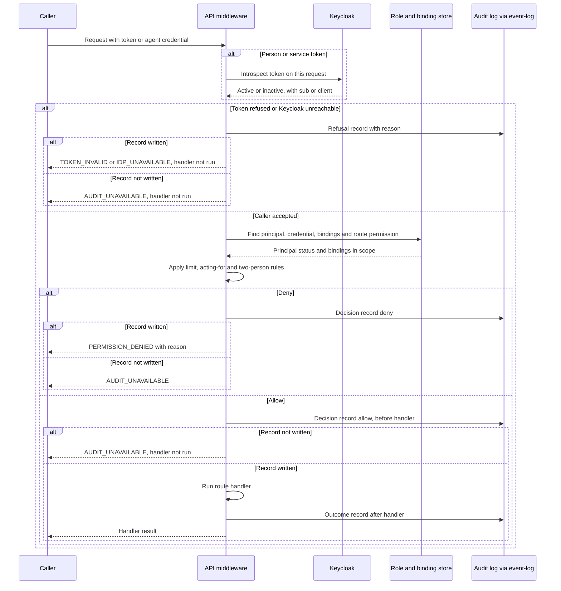

# Access control — module spec

> Part of the UMAS technical design. Main spec: [TECHNICAL-DESIGN-SPEC.md](../../TECHNICAL-DESIGN-SPEC.md) · Module map: [module map](../../TECHNICAL-DESIGN-SPEC.md#5-component-design)
> **Owns:** Principal identity, role bindings, the permission check on every API and CLI request, and the audit record of each decision.
> **Uses:** [kc-axi](../../../libs/kc-axi/README.md)
> **Depends on modules:** None in the moved text. Neighbours are listed in Detailed design, section 6.

## 8. Security Architecture

- **Secrets:** API keys in environment variables only. Never hardcoded, never committed. `.gitignore` created by `umas init`.
- **Auth:** OIDC sign-in through Keycloak; the API validates the access token. RBAC roles, permissions and bindings are in [Appendix A.5](../../TECHNICAL-DESIGN-SPEC.md#a5-rbac-data-model-and-roles). Setup and agent CLI: [libs/kc-axi/README.md](../../../libs/kc-axi/README.md).
- **Network:** All services bind to `127.0.0.1`. TLS 1.2+ for all external communication. Certificate validation enforced.
- **Agents:** Least-privilege process isolation. No agent has write access outside its worktree.
- **Audit:** 90-day retention for `events.jsonl` and database records (PRD requirement).

---

## Detailed design

This part is the operational design that implements [Appendix A.5](../../TECHNICAL-DESIGN-SPEC.md#a5-rbac-data-model-and-roles). A.5 is the decision record and stays in the main spec. Read A.5 first.

Marking in this part: a citation to another spec or lib is a fact from that document. **Decided** marks an owner answer dated 2026-10-25, with its decision number (D1, D7 to D12, D17, D21, C2 or C3). **Proposed** marks this module's reading of how the pieces fit, or a recommendation that no owner answer has accepted. A point that needs an owner answer is in section 9 as **Needs owner decision**, with its options and a recommendation.

### 1. Purpose and boundary

This module decides who may do what. It validates the caller, checks the permission for each request, and writes an audit record for each decision (A.5.7).

It does not sign people in. Keycloak does (A.5.7). It does not run agents or enforce the sandbox. [agent-execution](../agent-execution/agent-execution-spec.md) does (A.5.7). It does not review a change. [verification](../verification/verification-spec.md) owns the review. This module checks only that the approver holds the permission and is not the requester.

Non-API callers, such as the Coordinator, the Merge Queue Processor and the Watchdog, call the same `check` function as the API. Each one runs as a service principal (section 5.3). Agents act through their own credential (section 2).

No library holds RBAC. A library receives a plain `actor` string after the app authorises (A.5.7).

Terms used below:
- **Principal:** a user (`kind = user`), an agent (`kind = agent`) or a service principal (`kind = service`) (A.5.6). A service principal is one background process, named `svc:<process>` (section 5.3).
- **Binding:** a role granted to one principal at one scope (A.5.6).
- **Scope:** `system`, `project` or `worktree` (A.5.6).
- **Acting for:** an agent working for a person. The agent's `credential` row names that person (section 2, step 6).
- **Requester:** the principal that submitted a work item. It is stored as `requested_by` (section 5.4).

Phases (A.5.8):
- Phase 1: one local Admin. Deny-by-default and the check path are in place. Other roles exist as data only. Sign-in goes through Keycloak from Phase 1 (decided, D11), so Podman or Docker is a Phase 1 prerequisite. A.5.8 and A.5.2 still describe loopback trust for the CLI. D11 replaces that. The main spec needs a revision (section 9, item 16).
- Phase 2: several users, project scoping, Approver role, two-person rule, PostgreSQL.
- Phase 3: Operator and Auditor roles, audit hash chain, credential rotation.

### 2. Flow

#### Permission check on each request

Every request goes through these steps, in this order. Each refusal names one reason from section 3.2.

1. **Authenticate the caller.** A person or a service principal sends an OIDC access token. The check calls Keycloak on every request (decided, D9 A). The mechanism is token introspection at the realm's introspection endpoint (proposed). So a token that Keycloak reports as inactive is refused on the next request. This covers a disabled user and a disabled client. An agent sends its agent credential instead. That is not a Keycloak token. The check looks it up in `credential` by hash, with no Keycloak call (section 9, item 6). Refusals: `token_invalid` (inactive, or wrong `iss`, `aud` or signature), `idp_unavailable` (Keycloak does not answer), `credential_invalid` (unknown or revoked agent credential), `credential_expired` (past `expires_at`) (A.5.6).
2. **Map the caller to a principal.** The token's `sub` maps to a `principal` of kind `user`. A service token's client maps to a principal of kind `service`. The credential hash maps to a principal of kind `agent`. Refusal: `principal_disabled` when the principal's `status` is `disabled` (A.5.6, check step 1).
3. **Read the route permission.** Every route declares one `resource:action` name (A.5.7). The name must be in the seed list (section 5.1). A route with no name, or with a name outside the list, fails at startup (proposed). At run time a name outside the list gives `unknown_permission`. Deny is the default (A.5.6).
4. **Collect the bindings.** Take the bindings whose scope contains the target, in the order system, project, worktree (A.5.6, check step 2). A binding whose `expires_at` has passed is ignored (proposed).
5. **Check the grant and the limit.** Allow only if a bound role grants the permission and the role's `limit` holds for `context` (section 3.1). No grant gives `no_binding`. A limit that does not hold gives `limit_exceeded`. Deny is the default (A.5.6, check step 3).
6. **Check acting-for.** If the agent's credential row names a person (`acting_for_id`), that person's bindings must also grant the permission in the same scope. Both must allow. This is the intersection (decided, D1 A; A.5.6, check step 4). A user-less agent has no `acting_for_id`, and its own role decides alone (decided, D1). The middleware reads `acting_for_id` from the credential row. The Coordinator writes it at spawn, from `requested_by` of the work bundle (proposed). A request body cannot set it. Refusals: `principal_disabled` when the person is disabled; `intersection_denied` when the agent's role grants the permission but the person's bindings do not.
7. **Check the two-person rule.** For an approval action, `check` denies with `two_person_rule` when `requester_id` equals the principal and no `merge:approve_own` binding holds in the same scope (decided, D10 a). The approval actions are `merge:approve` and `gate:approve` (proposed). An approval action with no `requester_id` is also denied with `two_person_rule`, so the check fails closed (proposed).
8. **Record the decision before the handler runs.** The middleware writes an `audit.decision` event, allow or deny, with its reason, before any handler runs (decided, D8 A; the order is proposed). If the write fails, the caller gets `AUDIT_UNAVAILABLE`, and the handler does not run. This applies to a deny as well as an allow.
9. **Run the handler or return the refusal.** On allow, the handler runs. The middleware then writes an `audit.outcome` event, linked to the decision by `decision_id` (proposed). On deny, the caller gets `PERMISSION_DENIED` with the reason, as an error record (section 3.1).

Refusals at steps 1 and 2 are recorded too. Those records have `decision = deny`, a null `actor_id`, and `token_subject` set to the presented `sub` when it can be read (proposed). A.5.6 step 5 requires a record for every decision, so these refusals must leave a trace.

Outcome record failure (proposed). The action has already run and its decision record exists, so it can still be traced. The handler's result is returned. The failure is logged and raised as a P1 to the Admin (section 8).

Figure 1 shows the path. The Keycloak call applies to people and service principals only.

Figure 1. A request through the check. The decision is recorded before the handler runs, or the request is refused with `AUDIT_UNAVAILABLE`. An agent request skips the Keycloak call in the first branch.

#### Agent credential lifecycle

1. The Coordinator creates or reuses the `principal` row for the agent, with `kind = agent`. The identity row persists across sessions (A.5.2).
2. At spawn, the Coordinator creates a `credential` row with `kind = agent_session`. Only a hash of the key is stored (A.5.6). When the agent acts for a person, the row also carries `acting_for_id`, taken from the work bundle's `requested_by` (proposed; section 2, step 6).
3. At spawn, the Coordinator creates a `role_binding` row with `scope_type = worktree` and an `expires_at` (A.5.6). The lifetime is open (section 9, item 11).
4. At handoff or end, the Coordinator sets `revoked_at` on the credential (A.5.2, A.5.7). At a crash, and at boot recovery, the credential is revoked too (proposed; section 9, item 11).

The rule that the Coordinator issues and revokes agent credentials is in A.5.7.

#### Service principal lifecycle

1. `umas init` creates one `principal` of kind `service` for each built-in process, named `svc:<process>`. It creates one Keycloak client for each, with the client credentials grant, and one `role_binding` for its default role (section 5.3). The command is idempotent (decided, C3 B).
2. Custom processes are added through the `service_principals` list (section 4). Editing that list needs `config:write` at system scope (decided, C3 B).
3. Each service principal gets its token from Keycloak by the client credentials grant. Every request is checked as in section 2 (decided, D9 A). The client secret is kept in the environment or a secret store, never in the repo (A.5.4, secrets row). Rotation is on a schedule (A.5.2), and Phase 3 covers it (A.5.8).

#### Human sign-in

1. The person signs in with `umas auth login`, through Keycloak, with OIDC (decided, D11 A). This is the only sign-in path in every phase. Loopback trust is not used.
2. The CLI or the dashboard sends the token on each request ([main spec section 2.2](../../TECHNICAL-DESIGN-SPEC.md#22-component-communication-patterns), `dashboard_to_api`).
3. The API checks the token (section 2, step 1), then maps `sub` to a `principal`. It does not store the token (A.5.6, `credential` row note).

The token cache file that `umas auth login` writes is open (section 9, item 8).

### 3. Interfaces

Each row names one input or output. Field names come from A.5.6 and from the libs. A row marked **proposed** is not in the snapshot.

#### 3.1 Rows

| Name | Direction | Carrier | Payload | Owner |
|------|-----------|---------|---------|-------|
| Access token | in | REST `Authorization: Bearer` header. The CLI sends the same token. | JWT claims read: `sub`, `iss`, `aud`, `iat`, `exp`, `jti` (A.5.6). Role claims are ignored. The token is checked with Keycloak on each request (decided, D9). | Keycloak issues. This module checks. |
| Agent credential | in | Passed through `config` at call time, as in [agent-platform](../../../libs/agent-platform/README.md) section 5.6. | Key string, hashed on arrival and looked up in `credential` (fields in A.5.6). | This module |
| Service token | in | Keycloak client credentials grant (A.5.7). Checked as an access token. | Access token for the service principal. | Keycloak issues. This module checks. |
| Permission check | in and out | Function call `check`, inside the API and inside each process that calls it (section 6). | In: `principal_id`; `action` (permission name from section 5.1); `resource_type`; `resource_id`; `scope` (`{type, id}`); `acting_for_id` (optional, set only from the credential row); `requester_id` (optional; needed for `merge:approve` and `gate:approve`); `context` (map). For `budget:set`, `context.amount` is `{amount, currency}`, with `amount` as a decimal string and `currency` an ISO 4217 code (C2). Out: `decision` (`allow` or `deny`), `reason` (section 3.2), `status` (HTTP status), `code` (error code), `decision_id`. | This module |
| Route permission declaration | in | Code, at route definition (A.5.7). | One `resource:action` string per route, from section 5.1. | [interfaces](../interfaces/interfaces-spec.md) owns the routes. This module checks them. |
| Decision record | out | Function call to [event-log](../../../libs/event-log/README.md) `append(type, source, data, scope?, trace?)`. `type` is `audit.decision` (proposed). It matches the `[a-z0-9_.-]+` pattern (event-log section 3.1). | `data`: `decision_id`; `actor_id` (null for a refusal before the principal is known); `acting_for_id` (optional); `token_subject` (refusals at steps 1 and 2 only); `action`; `resource_type`; `resource_id`; `scope`; `decision`; `reason`; `requester_id` (approval actions only); `correlation_id` (A.5.6 fields). `source` is the actor id, or `api-middleware` for a refusal before the principal is known. | [event-log](../../../libs/event-log/README.md) stores it. This module owns the fields. |
| Outcome record | out | Function call to event-log `append`. `type` is `audit.outcome` (proposed). | `data`: `decision_id`; `outcome` (`succeeded` or `failed`); `correlation_id`. | This module |
| Denial error record | out | Error record format, [error-classifier](../../../libs/error-classifier/README.md) section 3.3. | Required fields: `schema_version`, `id`, `code`, `severity`, `recoverability`, `message`, `context.operation`, `context.timestamp`. This module sets `context.operation` to `check` or to the route name, and sets `context.correlation_id` and `context.reason`. `code`, `severity` and `recoverability` come from section 3.2. | This module raises the record. error-classifier defines the format. |
| Escalation | out | `escalate` event appended to `events.jsonl`, as in the [agent-execution](../agent-execution/agent-execution-spec.md) spec (proposed for security findings). | `event` = `escalate`, `severity`, `reason`, `code`. Used for the rows in section 3.2 marked Escalate. | [monitoring](../monitoring/monitoring-spec.md) routes it. |
| Role and binding store | in and out | SQL over the connection pool (main spec section 2.2, `agents_to_database`). | Tables in A.5.6: `principal`, `role`, `permission`, `role_permission`, `project`, `role_binding`, `credential`. The `merge:approve_own` grant is stored as described in section 9, item 2. | This module |
| Init credential | in, at `umas init` only | Keycloak admin REST API, called by `umas init` (proposed). | Admin login from the sources in section 4. It creates the realm clients and the service principals. It is not stored, and it is not read at run time. | Read from the environment or a file, never from the repo |
| kc-axi admin commands | out of runtime | CLI subprocess ([kc-axi](../../../libs/kc-axi/README.md) section 4). | Not used by runtime agents (kc-axi section 9). | [kc-axi](../../../libs/kc-axi/README.md) |

Storage rules (A.5.6):
- Permissions are fixed in code and seeded by code.
- Roles, bindings and principals are data.
- Built-in roles cannot be edited or deleted.
- Only a hash of any key is stored.

#### 3.2 Check result and reason codes

The reason list is closed. A new reason needs a change to this table. Exit codes follow the UMAS CLI convention of 0, 1 and 2 ([libs/README.md](../../../libs/README.md#cli-conventions-axi), proposed for UMAS). Exit 1 means the request was refused on its merits. Exit 2 means a dependency was unavailable. The severity and escalation columns are proposed, except where a decision is named.

| Reason | HTTP | Exit | Error code | Recoverability | Severity (proposed) | Escalate (proposed) | Effect |
|--------|------|------|-----------|----------------|---------------------|---------------------|--------|
| `allowed` | 200 | 0 | none | none | none | No | Decision is `allow`. |
| `no_binding` | 403 | 1 | `PERMISSION_DENIED` | permanent | P3 | No. The agent's step stops, and orchestration moves the bundle to `ESCALATED` (orchestration section 5.2) | The agent's step stops. |
| `intersection_denied` | 403 | 1 | `PERMISSION_DENIED` | permanent | P2 | No | The agent's action is refused, because the person it acts for lacks the permission. |
| `two_person_rule` | 403 | 1 | `PERMISSION_DENIED` | permanent | P2 | No. The approver receives the record | The approval is not recorded. |
| `limit_exceeded` | 403 | 1 | `PERMISSION_DENIED` | permanent | P3 | No. Budget pauses are set by [budget-and-models](../budget-and-models/budget-and-models-spec.md) | The agent reports blocked. |
| `principal_disabled` | 403 | 1 | `PERMISSION_DENIED` | permanent | P2 | Admin | Refused. The agent's session stops. |
| `credential_invalid` | 401 | 1 | `CREDENTIAL_INVALID` | permanent | P1 | Security finding: Project Owner, or Admin if the project has none (D7; section 9, item 9) | The agent stops. |
| `credential_expired` | 401 | 1 | `CREDENTIAL_INVALID` | permanent | P3 | No. Boot recovery handles it (section 9, item 11) | The agent's session ends. |
| `token_invalid` | 401 | 1 | `TOKEN_INVALID` | permanent | P3 | No. The person signs in again with `umas auth login` | Not applicable to agents. |
| `unknown_permission` | 500 | 2 | `UNKNOWN_PERMISSION` | permanent | P1 | Admin | Refused. A route with an unknown name fails at startup. At run time this reason means the route or the data is wrong. |
| `idp_unavailable` | 503 | 2 | `IDP_UNAVAILABLE` | transient | P1 | Admin | Agents are not affected (section 9, item 6). People and service principals are refused until Keycloak answers (section 8). |
| `store_unavailable` | 503 | 2 | `STORE_UNAVAILABLE` | transient for a lock; permanent for corruption | P1 | Admin | Every request is refused. The lock and corruption rules are in [exception-flows 6.12](../exception-flows/exception-flows-spec.md#612-database-corruption-or-lock). |
| `audit_unavailable` | 503 | 2 | `AUDIT_UNAVAILABLE` | transient | P1 | Admin | The action does not run (decided, D8 A). |

Escalation of system faults (`idp_unavailable`, `store_unavailable`, `audit_unavailable`, `unknown_permission`, `principal_disabled`) to the Admin is proposed. No owner answer names the recipient for system faults. The P0 recipient is not yet decided (section 9, item 10).

#### 3.3 Limit schema

`role_permission.limit` is optional JSON (A.5.6). Its keys depend on the permission. Keys not listed here are refused at seed time (proposed).

| Permission | Limit keys | Example | Check |
|-----------|-----------|---------|-------|
| `budget:set` | `max_amount` (decimal string), `currency` (ISO 4217) | `{"max_amount": "500.00", "currency": "USD"}` | The amount in `context.amount` must be in the same currency and must not exceed `max_amount`. A different currency gives `limit_exceeded`. Decided, C2 (money). |
| `user:manage` | `max_role` (a role name from section 5.2) | `{"max_role": "developer"}` | The role being bound must not rank above `max_role`. Decided by A.5.4 (Project Owner, up to Developer). |
| `task:write` or `agent:stop` | `own_only` (boolean) | `{"own_only": true}` | Only if section 9, item 4 chooses option (b). Otherwise not used. |

The system cap for `budget:set` is a money value held in system configuration (decided, C2). A Project Owner's `max_amount` cannot exceed it. The Admin holds `budget:set` with no limit.

### 4. Parameters

Two groups apply. The kc-axi rows set how the admin CLI reaches Keycloak. They are not API settings. The API rows set how the check works.

| Name | Type | Default | Where set | What it changes |
|------|------|---------|-----------|-----------------|
| `base_url` (kc-axi) | URL | `http://127.0.0.1:8080` | kc-axi config. Environment: `KC_AXI_BASE_URL`. | Where the admin CLI reaches Keycloak (kc-axi section 6). |
| `admin_realm` (kc-axi) | string | `master` | kc-axi config | Realm for the admin login (kc-axi section 6). |
| `runtime` (kc-axi) | `auto`, `docker` or `podman` | `auto` | kc-axi config. Environment: `KC_AXI_RUNTIME`. | Container runtime for `up`, `down` and `status` (kc-axi section 5.2). |
| `container_name` (kc-axi) | string | `keycloak-dev` | kc-axi config | Name of the dev Keycloak container. |
| `image` (kc-axi) | string | empty (`up` refuses without it) | kc-axi config | Pinned Keycloak image. kc-axi has no default tag (kc-axi section 5.3). Section 9, item 7. |
| `port` (kc-axi) | integer | `8080` | kc-axi config | Port published on `127.0.0.1`. |
| `volume` (kc-axi) | string | `keycloak-dev-data` | kc-axi config | Named volume. Empty means no persistence. |
| `KC_ADMIN_USER` and `KC_ADMIN_PASSWORD`, or `admin_password_file` | string, or a file path | not set | Environment variables, or a file outside the repo with owner-only permissions. Never on the command line (kc-axi section 5.4). | Admin login for `umas init` only (decided, C3 B). It creates the Keycloak clients and service principals. It is not stored and is not read at run time. If it is missing, `umas init` stops with `KC_CREDENTIAL_MISSING`. |
| Token issuer (`iss`) | URL | not set. Proposed: the realm URL on `127.0.0.1`, for example `http://127.0.0.1:8080/realms/<realm>` | Realm file | Only tokens from this issuer pass. Section 9, item 7. |
| Token audience (`aud`) | string | not set. Proposed: `umas-api` | Realm file (the API client) | The audience the token is issued for. Section 9, item 7. |
| Accepted signing algorithms | list | not set. Proposed: `RS256` only | Realm file | Algorithms the token check accepts. Section 9, item 7. |
| Clock skew allowance | seconds | not set. Proposed: 30 | Config | Tolerance on `exp` and `iat`. Section 9, item 7. |
| Access token lifespan | duration | not set. Suggested in D9: 15 minutes | Keycloak realm setting | Limits the use of a stolen token (A.5.6). Because each request is checked with Keycloak, a disable or revoke takes effect on the next request. Section 9, item 7. |
| Introspection endpoint | URL | From the issuer's discovery document | Derived from the issuer | Keycloak endpoint that the check calls on each request (decided, D9 A; mechanism proposed). |
| Agent credential lifetime | duration | not set. A.5.6 says the agent binding's `expires_at` is "short" | `expires_at` on the agent `role_binding` row | Limits an agent session. Section 9, item 11. |
| `service_principals` | list of `{name, role}` | empty | `umas.config.yaml` | Custom background processes only (decided, C3 B). `name` is `svc:<process>`. `role` is a role from section 5.2. Editing the list needs `config:write` at system scope. |
| `retain_days` | integer (days) | `90` | [event-log](../../../libs/event-log/README.md) config | Minimum audit retention (A.5.7). |
| Audit hash chain | on or off | off. A.5.7 makes it optional | not set | Tamper evidence in enterprise compliance mode. Phase 3 (A.5.8). Section 9, item 15. |
| Database engine | SQLite or PostgreSQL | SQLite in Phase 1. PostgreSQL in Phase 2 | not set | Stores roles, bindings and credentials (A.5.8). |
| Phase 1 bootstrap | `umas init` steps | One Admin principal at system scope, with the `merge:approve_own` grant | Section 5.6 | The only human principal in Phase 1 (A.5.8). |
| Two-person rule | rule | On. `merge:approve_own` lifts it for one principal and one scope | Grant (section 9, item 2) | Blocks self-approval (A.5.4; A.5.9 question 4). |
| Bind address | address | `127.0.0.1` | not set | Address all services bind to (Part A, the Security Architecture block). Section 9, item 12 covers TLS. |

### 5. Capabilities

#### 5.1 Permission seed list

The seed list is the one list of permission names. Access-control owns it, and other modules name their routes from it. Names are fixed in code and seeded at `umas init` (A.5.6).

Status: **Decided** marks a name from D21 (owner answer (a)), from A.5.6 or from A.5.4 without a change. **Proposed** marks a name this module adds, or a name that a caller spec or an open decision (D28, D36, D41, D47) recommends but no owner answer has accepted. Section 9, item 3 asks for the owner's answer on the whole list.

| Permission | Scope | Covers | Status |
|-----------|-------|--------|--------|
| `system:read` | system | View status and health | Proposed (interfaces) |
| `system:admin` | system | Start, stop and clean up the system; run `umas init` | Proposed (interfaces) |
| `system:restart` | system | Restart a service process (A.5.4, Operator and Watchdog) | Proposed |
| `project:read` | project | View projects | Proposed (interfaces) |
| `project:create` | system | Create a project. Admin only (A.5.4) | Proposed |
| `project:delete` | system | Delete a project. Admin only (A.5.4) | Proposed |
| `project:write` | project | Change project configuration (review and test policy) (A.5.4). Interfaces names this for project config | Proposed (interfaces) |
| `user:manage` | system or project | Manage users and role bindings, and read them (`umas access show`). The Project Owner's limit caps the role at Developer (A.5.4) | Proposed |
| `config:read` | system or project | Read configuration. The Coordinator needs it (A.5.5) | Proposed |
| `config:write` | system or project | Change system configuration at system scope, or project configuration at project scope. Also edits `service_principals` at system scope (C3 B) | A.5.6 example; the `service_principals` use is decided |
| `audit:read` | system or project | Read the audit log | A.5.6 example |
| `metrics:read` | project | View metrics and cost | Decided (D21) |
| `budget:read` | project | Read a budget. Agents read their own (A.5.5) | Proposed |
| `budget:set` | project | Set a budget. Its `limit` caps a money amount (C2) | Decided (D21) |
| `agent:read` | project | View agents | Proposed (interfaces) |
| `agent:spawn` | project | Spawn an agent | A.5.6 example |
| `agent:stop` | project | Stop or pause an agent. A Developer holds it for its own agents (section 9, item 4) | Proposed (D41 recommendation) |
| `agent:nudge` | project | Nudge an agent | Proposed (D41 recommendation; section 9, item 5) |
| `agent:restart` | project | Restart an agent | Proposed (D41 recommendation; section 9, item 5) |
| `agent:handoff` | project | Hand off a session | Decided (D21) |
| `agent:resume` | project | Resume a session | Decided (D21) |
| `task:read` | project | View tasks | Proposed (interfaces) |
| `task:write` | project | Create, assign and update tasks. "Own task" is section 9, item 4 | Proposed (interfaces) |
| `work:read` | project | View work bundles | Proposed (D28 recommendation) |
| `work:submit` | project | Submit a work request | Proposed (D28 recommendation) |
| `work:cancel` | project | Cancel a bundle | Proposed (D28 recommendation) |
| `work:retry` | project | Retry a bundle | Proposed (D28 recommendation) |
| `gate:approve` | project | Approve a playbook gate, accept an ADR, or override a review finding (A.5.4). An approval action (section 2, step 7) | Proposed (D28 recommendation) |
| `merge:read` | project | View the merge queue | Proposed (verification O14, O15; D47 recommendation) |
| `merge:submit` | project | Submit a candidate to the queue and update PR status | Proposed (verification O14, O15; D47 recommendation) |
| `merge:publish` | project | Merge to the target branch and publish. The Merge Queue Processor only (A.5.5) | Proposed (verification O14, O15; D47 recommendation) |
| `merge:approve` | project | Approve a merge. An approval action (section 2, step 7) | A.5.6 example; name confirmed in section 9, item 3 |
| `merge:approve_own` | project | Grant only. Lifts the two-person block for one principal and one scope (A.5.4). No built-in role holds it | A.5.4; storage is section 9, item 2 |
| `escalation:resolve` | project | Acknowledge or resolve a non-P0 escalation (A.5.5, Coordinator) | Proposed |
| `p0:acknowledge` | project or system | Acknowledge or resolve a P0 escalation (A.5.4) | Proposed (A.5.4 row; section 9, item 10) |
| `watchdog:reset` | system | Reset a failed watchdog node (A.5.4) | Proposed (A.5.4 row) |
| `worktree:read` | project | View worktrees | Proposed (D36 recommendation) |
| `worktree:recover` | project | Recover a worktree | Proposed (D36 recommendation) |
| `worktree:clean` | project | Clean stale worktrees | Proposed (D36 recommendation) |
| `hook:create` | project | Create a hook | Proposed (D36 recommendation) |
| `hook:commit` | worktree | Commit to a Worker's own hook branch | Proposed (D36 recommendation) |

Secrets have no permission name. No role grants access to them (A.5.4). The API can only report whether a secret is set.

#### 5.2 Roles and their grants

Human roles follow the A.5.4 matrix. Agent roles follow the A.5.5 table. Each row names the scope at which the role is bound. Grants are names from section 5.1.

| Role | Kind | Phase | Scope | Grants |
|------|------|-------|-------|--------|
| Admin | human | 1 | system | Every name in section 5.1 except `merge:approve_own`, which is granted separately (A.5.4). Holds `budget:set` at any project, with no cap |
| Project Owner | human | 1 | project | `project:read`, `project:write`, `agent:read`, `task:read`, `work:read`, `merge:read`, `metrics:read`, `work:submit`, `agent:spawn`, `agent:stop`, `budget:set` (limit caps the amount at the system cap), `config:write` (project scope), `gate:approve`, `merge:approve`, `p0:acknowledge`, `escalation:resolve`, `audit:read`, `user:manage` (limit `max_role` = `developer`) |
| Developer | human | 1 | project | `project:read`, `agent:read`, `task:read`, `work:read`, `merge:read`, `metrics:read`, `work:submit`, `agent:spawn`, `agent:stop` (own agents only, section 9, item 4) |
| Approver | human | 2 | project | `project:read`, `agent:read`, `task:read`, `work:read`, `merge:read`, `metrics:read`, `merge:approve`, `gate:approve` |
| Operator | human | 3 | system | `system:read`, `agent:read`, `task:read`, `work:read`, `merge:read`, `metrics:read`, `agent:stop`, `p0:acknowledge`, `watchdog:reset`, `system:restart` |
| Auditor | human | 3 | system | `metrics:read`, `audit:read` |
| Viewer | human | 1 | system | `project:read`, `agent:read`, `task:read`, `work:read`, `merge:read`, `metrics:read` |
| Coordinator | service (`svc:coordinator`, proposed) | 1 | project | `task:read`, `task:write`, `agent:read`, `agent:spawn`, `agent:stop`, `agent:handoff`, `agent:resume`, `agent:nudge`, `agent:restart` (section 9, item 5), `work:read`, `config:read`, `budget:read`, `escalation:resolve`, `hook:create`, `worktree:recover`, `worktree:clean` |
| Worker (Developer) | agent | 1 | worktree | `hook:commit` (own hook), `task:read`, `task:write` (own task, section 9, item 4), `budget:read` (own budget) |
| Specialist (Analyst, PM, UX, Architect) | agent | 1 | project | `task:read`, `task:write` (own task, section 9, item 4) |
| Reviewer | agent | 1 | project | `task:read`, `work:read`. Holds no approval name, so it cannot approve (A.5.5) |
| Merge Queue Processor (`svc:merge-queue`) | service | 1 | project | `merge:read`, `merge:submit`, `merge:publish`, `task:read` |
| Monitor (Triage, Patrol, Project Monitor) | service | 1 | project | `agent:read`, `task:read`, `work:read`, `merge:read`, `metrics:read`, `budget:read`. Write authority is section 9, item 5 |
| Watchdog (`svc:watchdog`) | service | 1 | system | `system:read`, `system:restart` |

Notes:
- A.5.5 text says the Coordinator and Monitors can stop another agent. The A.5.5 table gives the Monitor `restart` and `nudge` only. Section 9, item 5 covers that.
- Boot recovery uses the Watchdog role (section 5.3). Boot recovery also resumes sessions (exception-flows 6.17), so it needs `agent:resume`. That grant is proposed, and it is not in the Watchdog role above.

#### 5.3 Service principals created by `umas init`

Each built-in process gets its own service principal, with one Keycloak client and one role binding (decided, C3 B). Permissions are not written by hand. Adding a process means one entry in `service_principals` (section 4), then running `umas init` again. The command is idempotent.

| Principal | Process | Default role | Source |
|-----------|---------|--------------|--------|
| `svc:coordinator` | Coordinator | Coordinator | A.5.5 row (principal kind proposed) |
| `svc:merge-queue` | Merge Queue Processor | Merge Queue Processor | A.5.5 row |
| `svc:triage` | Triage | Monitor | A.5.5 row |
| `svc:patrol` | Patrol | Monitor | A.5.5 row |
| `svc:project-monitor` | Project Monitor | Monitor | A.5.5 row |
| `svc:watchdog` | Watchdog daemon | Watchdog | A.5.5 row (service account) |
| `svc:boot-recovery` | Boot recovery | Watchdog, plus `agent:resume` | Watchdog role proposed. Not objected to by the owner (C3, round 4). Section 9, item 11 |
| `svc:dashboard-poller` | Dashboard poller | Viewer at system scope | No A.5.5 row. Proposed. Section 9, item 14 |

The CI runner is a service account in A.5.2, but it is not a built-in process here. It is added through `service_principals` when it exists (section 9, item 14).

#### 5.4 Two-person rule and `merge:approve_own`

- Approval actions are `merge:approve` and `gate:approve` (proposed).
- The check compares `requester_id` with the principal. `requester_id` is the work item's `requested_by` (decided, D10 a). If they are the same and no `merge:approve_own` binding holds in scope, the approval is denied with `two_person_rule` (A.5.9 question 4).
- `requested_by` holds the principal that submitted the work. When an agent acts for a person, the value is the root human at the top of that chain, not the agent (decided, D10). So a person cannot approve a change that her own agent opened for her.
- The orchestration module sets `requested_by` when it creates the work item. Verification passes it as `requester_id` on each approval call (decided, D10; the caller specs must carry the change).
- `merge:approve_own` lifts the block for one principal and one scope. No built-in role holds it (A.5.4). Its storage is section 9, item 2.
- In Phase 1, the single Admin holds the grant (A.5.8). The rule cannot apply to a second person until Phase 2.
- The Merge Queue Processor runs as a system principal. The approver is a different principal, so the check passes (decided, D1 and D10).

#### 5.6 Phase 1 bootstrap

Gap 6 of the caller assessment asked for a seed procedure. `umas init` runs these steps in order, and it is idempotent (proposed; the owner has not reviewed the steps).

1. Seed the permission table from section 5.1. The names are fixed in code.
2. Seed the built-in roles (section 5.2) and their `role_permission` rows, with the limits in section 3.3.
3. Look up or create the first Admin user in Keycloak, with the admin credential from section 4. Store the Keycloak `sub` as `principal.external_id` for a `kind = user` principal (A.5.6). The Admin is the only human principal in Phase 1 (A.5.8).
4. Bind that principal to Admin at system scope.
5. Write the `merge:approve_own` grant for the same principal at system scope. Its storage is section 9, item 2. Until item 2 is answered, this step is blocked, and `umas init` stops after step 4 with `INIT_GRANT_PENDING` (exit 1, proposed).
6. Create the service principals and their Keycloak clients (section 5.3).

No binding API exists in Phase 1 (section 9, item 13). Step 4 and step 5 are therefore the only way to bind a human in Phase 1.

#### 5.5 Rules that apply to every row

- Deny by default. No binding, no access (A.5.6, check step 3).
- No agent role both writes code and merges it (A.5.5). The Worker commits to its hook branch, and only the Merge Queue Processor writes to the target branch.
- Agents cannot read or write configuration, budget limits or secrets (A.5.5). No agent role holds `config:write` or `budget:set`, and no role holds a secret name.
- Work with no requesting user (patrol, watchdog, boot recovery, the merge processor) runs as its service principal, with its own role only, and never wider. The intersection rule does not apply, because there is no user to intersect with (decided, D1; C3).

### 6. Interaction with other modules

| Neighbour | What this module sends or receives | Carrier | Sync or async |
|-----------|-----------------------------------|---------|---------------|
| [interfaces](../interfaces/interfaces-spec.md) | Receives every CLI and REST request with its token and route permission. Returns allow or deny with a reason (section 3.2). | Function call in the API middleware | Sync |
| [verification](../verification/verification-spec.md) | At merge approval, calls `check` with `action` = `merge:approve` and `requester_id` = `work.requested_by`. The Merge Queue Processor is `svc:merge-queue` (section 5.3). The Reviewer cannot approve a change it authored (A.5.5). | Function call | Sync |
| [monitoring](../monitoring/monitoring-spec.md) | Receives the escalate events and the denial records. Security findings go to the Project Owner, or to the Admin if the project has none (decided, D7). The Watchdog daemon is `svc:watchdog` (section 5.3). | `escalate` event in `events.jsonl`; denial records | Async |
| [orchestration](../orchestration/orchestration-spec.md) | The Coordinator creates and revokes agent credentials at spawn, handoff and end (A.5.2, A.5.7). It writes `acting_for_id` on the credential (section 2). It writes `requested_by` on each work item (decided, D10). | Function call at spawn. Update at handoff or end. | Sync at spawn. Async at end (proposed) |
| [agent-execution](../agent-execution/agent-execution-spec.md) | Agent sessions carry the scoped credential. The launch path is agent-execution's (decided, D12). Its launch calls `check` for `agent:spawn` as the Coordinator's principal (proposed). The harness and sandbox enforce the worktree and the provider-only network (A.5.7). | Credential in `config`. Function call. Sandbox rules. | Sync |
| [budget-and-models](../budget-and-models/budget-and-models-spec.md) | `budget:set` carries a money cap in `role_permission.limit`. The budget is money, in one currency per budget (decided, C2 and D17). Agents read their own budget with `budget:read` (A.5.5). | Function call | Sync |
| [exception-flows](../exception-flows/exception-flows-spec.md) | Boot recovery marks sessions `auth_expired` (6.17). Boot-time validation of agent credentials is section 9, item 11. A database lock or corruption affects the store (6.12). | Boot check. Store error. | Async at boot. Sync on a request. |
| [interfaces](../interfaces/interfaces-spec.md) (names to change) | Interfaces uses `budget:write` (section 3.2, `PATCH /api/v1/projects/{id}`) and `worktree:write` (`worktrees clean`, `worktrees recover`). These change in that module to `budget:set` (decided, D21) and to the `worktree:clean` and `worktree:recover` names in section 5.1 (proposed, D36). That is a change in interfaces, not here. | Name change | Not applicable |

### 7. Libraries and packs used

- [kc-axi](../../../libs/kc-axi/README.md): Keycloak set-up and the admin CLI, for the Admin and the Admin's own agent. Runtime agents never use it (kc-axi section 9). `umas init` reads the same credential sources (section 4). It can write an optional audit file (kc-axi section 6, `audit_path`).
- [event-log](../../../libs/event-log/README.md): Stores the audit events. It is append-only, with `retain_days` of 90 by default. Its `type` pattern is `[a-z0-9_.-]+`, so `audit.decision` and `audit.outcome` are valid. Its key-name redactor covers `password`, `token`, `secret`, `api_key` and `authorization`, and can be enabled (event-log section 5.6). Its failure modes are in section 7 of that README. This module maps `DiskFull` and `PermissionDenied` to `AUDIT_UNAVAILABLE` (proposed).
- [error-classifier](../../../libs/error-classifier/README.md): Gives the denial a record format with `recoverability` and `severity`. The link is data only, not an import (error-classifier section 3).
- [agent-platform](../../../libs/agent-platform/README.md): Passes credentials to a harness at call time and never stores them (section 5.6). This module relies on that rule for agent credentials.

No pack is used by this module.

### 8. Failure handling

| Condition | Behaviour | Error code | Source |
|-----------|-----------|-----------|--------|
| Token inactive, expired, or wrong `iss`, `aud` or signature | Refused before the handler runs. Refusal is recorded (section 2, step 1). A person signs in again with `umas auth login`. | `TOKEN_INVALID` | Section 2, step 1. Exception-flows [6.17](../exception-flows/exception-flows-spec.md#617-machine-shutdown-and-boot-recovery) gives the resume path: the human re-authenticates, then `umas start-all --resume`. |
| Keycloak unreachable | Every person and service principal request is refused. Agent requests are not affected, because agent credentials are checked locally (section 9, item 6). Refusals are recorded if the audit store is available. The Admin receives a P1 (proposed). There is no cached fallback (decided, D9 A). Break-glass is section 9, item 1. | `IDP_UNAVAILABLE` (exit 2) | Decided, D9 A. Section 3.2. |
| Principal disabled, or credential expired or revoked | Denied. | `PERMISSION_DENIED` or `CREDENTIAL_INVALID` | A.5.6, check step 1 |
| No binding grants the permission | Denied. The denial record names `no_binding`. An agent's step stops. A person gets the record. | `PERMISSION_DENIED` | A.5.6, check step 3. Section 3.2. |
| Acting-for person lacks the permission | Denied with `intersection_denied`. | `PERMISSION_DENIED` | Decided, D1 A. Section 2, step 6. |
| Limit does not hold | Denied with `limit_exceeded`. | `PERMISSION_DENIED` | A.5.6, check step 3 |
| Route with no permission declared | Refused at startup, because no route runs without a name. | None at run time | Deny-by-default (A.5.6). Proposed. |
| Name not in the seed list, at run time | Denied. | `UNKNOWN_PERMISSION` (exit 2) | Section 3.2. Proposed. |
| Store locked or corrupt | Every request is refused, and the error goes to a human. The lock and corruption rules are in [6.12](../exception-flows/exception-flows-spec.md#612-database-corruption-or-lock). | `STORE_UNAVAILABLE` (exit 2) | Deny-by-default (A.5.6). Proposed. |
| Audit write fails before the handler | The action does not run. This applies to a deny as well as an allow. The Admin receives a P1 (proposed). | `AUDIT_UNAVAILABLE` (exit 2) | Decided, D8 A. kc-axi section 7 takes the same position for its audit file. |
| Audit write fails after the handler | The action has run. The handler's result is returned. The failure is logged and raised as a P1 to the Admin (proposed). | None on the response | Proposed. |
| Security finding with no Project Owner | Routes to the Admin. | Not applicable | Decided, D7. A.5.9 question 7. |
| `umas init`: Keycloak admin credential missing | Stops before any change. | `KC_CREDENTIAL_MISSING` (exit 1) | Section 4. Proposed. |
| `umas init`: Keycloak admin credential refused | Stops before any change. | `INIT_KEYCLOAK_AUTH` (exit 1) | Proposed. Same case as kc-axi exit 4. |
| `umas init`: Keycloak unreachable | Stops. The run can be repeated, because `init` is idempotent. | `INIT_KEYCLOAK_UNREACHABLE` (exit 2) | Proposed. |
| Machine shutdown, or crashed agent, with a live credential | Revoke, as section 9, item 11 proposes. | Not applicable | [6.8](../exception-flows/exception-flows-spec.md#68-stale-worktrees-after-agent-crash) and [6.17](../exception-flows/exception-flows-spec.md#617-machine-shutdown-and-boot-recovery) cover the worktree and sessions. |

### 9. Open

This module decides none of the items below. Items marked **Needs owner decision** need an owner answer. The numbers are kept from the earlier draft, so other specs can cite them.

Closed by owner answers (2026-10-25). The decision is recorded in the section shown:
- Intersection for agents that act for a person (D1 A). Section 2, step 6.
- Security finding routing (D7). Sections 3.2 and 8.
- Audit write failure, refused with `AUDIT_UNAVAILABLE` (D8 A). Section 2, step 8.
- Keycloak call on every request, and its outage behaviour (D9 A). Sections 2 and 8.
- Two-person check in `check`, with `requester_id` and `two_person_rule` (D10 a). Section 5.4.
- OIDC on every call, one sign-in path (D11 A). Section 2, human sign-in.
- Launch path owned by agent-execution (D12 A). Section 6.
- Service principals created by `umas init`, with `service_principals` for custom processes only (C3 B). Sections 4 and 5.3.
- Budget names `budget:set`, `metrics:read`, `agent:handoff` and `agent:resume` (D21). Section 5.1.
- Money as the budget unit (C2). Section 3.1, `context.amount`.

1. **Break-glass access during a Keycloak outage (interfaces I-1).** Keycloak is down, and every person and service request is refused (section 8). An operator may still need to stop a runaway agent.
   - (a) No break-glass. An outage stops every command.
   - (b) A narrow local allow-list, usable only from the host's own shell. The list is the read-only status commands, `umas access show`, and the recovery commands. Every use is written to the audit log. If the write fails, the command is refused (D8).
   - (c) A local root-only override, with no restriction.
   - Consequence: (a) leaves an operator unable to stop a runaway agent during an outage. (c) removes the permission model during the outage, which the D8 audit rule does not allow.
   - **Recommendation: (b).** Needs owner decision.

2. **Storage and authority for the `merge:approve_own` grant.** A.5.4 says the grant is "a role binding that carries the permission". `role_binding` holds only `role_id` (A.5.6). A.5.4 says "An Admin or Project Owner grants it". The seed gives the Project Owner `user:manage` only up to Developer, so under the seed the Project Owner cannot grant it.
   - Storage, (a): add an optional `permission_id` to `role_binding`, used only for grants. (b): a separate grant table.
   - Authority, (i): Admin only, in Phases 1 and 2. (ii): Admin or Project Owner, as the A.5.4 text says. That needs a separate `user:manage` limit for this grant.
   - **Recommendation: (a) and (i).** Needs owner decision.

3. **Seed list (section 5.1).** D21 is decided. The other names in section 5.1 are proposed, from the caller specs and from D28, D36, D41 and D47. Those four are recommendations that no owner answer has accepted. The batch is still open (decision file, "Still open: the D23 to D48 batch"). The names affected are: `work:read`, `work:submit`, `work:cancel`, `work:retry`, `gate:approve` (D28); `worktree:read`, `worktree:recover`, `worktree:clean`, `hook:create`, `hook:commit` (D36); `agent:stop`, `agent:nudge`, `agent:restart` (D41); and the adoption of the whole list (D47 a). The other proposed names are `system:read`, `system:admin`, `system:restart`, `project:read`, `project:create`, `project:delete`, `project:write`, `user:manage`, `config:read`, `budget:read`, `agent:read`, `task:read`, `task:write`, `merge:read`, `merge:submit`, `merge:publish`, `escalation:resolve`, `p0:acknowledge`, `watchdog:reset`, `audit:read`.
   - (a) Accept section 5.1 as written (D47 a).
   - (b) Rename any item.
   - **Recommendation: (a).** Needs owner decision for the four recommendations above.

4. **"Own" capabilities.** Some rows say "own": a Worker updates its own task, a Developer stops its own agents, and a Specialist updates its own task. A grant cannot express ownership.
   - (a) The handler checks that the resource's owner is the caller, after `check` allows it.
   - (b) A `limit` key, `own_only`, read by `check`.
   - (c) No ownership check. Any holder of `task:write` or `agent:stop` can act on any resource in scope.
   - Consequence: (c) lets a Developer stop another Developer's agent.
   - **Recommendation: (a).** Needs owner decision.

5. **Monitor and Coordinator write authority (monitoring D41).** A.5.5 gives the Monitor `restart` and `nudge`, and its text also says Monitors can stop agents. D41 (b) recommends that the Coordinator acts on `escalate` and that Monitors stay read-only. D41 is not answered.
   - (a) As the A.5.5 table: the Monitor holds `agent:nudge` and `agent:restart`, and the text's "stop" is also granted to it.
   - (b) The Monitor is read-only. It writes `escalate` events, and the Coordinator holds `agent:nudge`, `agent:restart` and `agent:stop` and acts on them.
   - Consequence: (a) gives monitors write authority, which the monitoring module's assessment argues against. (b) makes the Coordinator the only actor on agents.
   - **Recommendation: (b).** Needs owner decision.

6. **Path for agent credentials under D9 and D11.** D9 says a Keycloak call on every request. D11 says OIDC on every call. Neither names agent credentials.
   - (a) Agent credentials stay local: a hash lookup in `credential`, with no Keycloak call. Keycloak issues people and service tokens only (A.5.7).
   - (b) Each agent gets a Keycloak client, and the agent authenticates by the client credentials grant.
   - Consequence: (a) keeps agents running through a Keycloak outage. (b) makes every agent spawn create a Keycloak client.
   - **Recommendation: (a).** Needs owner decision.

7. **Keycloak token settings and image pin.** Not set: issuer, audience, signing algorithms, clock skew, token lifespan, and the kc-axi `image` pin. D9 says the owner sets the lifespan, issuer and audience in the realm file.
   - Proposed defaults are in section 4: the issuer is the realm URL on `127.0.0.1`, audience `umas-api`, `RS256` only, skew 30 s.
   - Lifespan: suggested 15 minutes (D9). The owner sets it, because it sets the stolen-token window.
   - Image: pinned to an exact tag in the kc-axi config (kc-axi section 5.3).
   - **Recommendation: accept the proposed defaults, with a 15-minute lifespan.** Needs owner decision.

8. **Human token cache (interfaces).** `umas auth login` writes `~/.umas/token-cache`. A.5.6 says human sessions "are not stored here", and the cache file holds a token.
   - (a) Keep the file, with owner-only permissions and a short lifetime. Record it in A.5.6.
   - (b) Move the token to the OS keychain.
   - **Recommendation: (a).** Needs owner decision.

9. **Scope of security routing (D7).** D7 routes "security findings". A denial is not a finding unless the owner says so.
   - (a) An agent that presents an unknown, expired or revoked credential is a security finding. It is routed as P1 to the Project Owner, or to the Admin if none. Other denials are not findings.
   - (b) No denial is a security finding.
   - (c) Every denial by an agent is a security finding.
   - Consequence: (c) floods the Project Owner with routine denials.
   - **Recommendation: (a).** Needs owner decision.

10. **P0 recipient before Phase 3.** A.5.4 sends P0 to the Operator, who appears only in Phase 3 (A.5.8). Monitoring D40 and interfaces D26 both recommend the Admin in Phases 1 and 2, and the Operator from Phase 3. Neither is answered. Interfaces D26 is about P1, but the same answer is cited.
    - (a) The Admin until Phase 3, then the Operator (D40 and D26 recommendation).
    - (b) The Project Owner for a project-scoped P0, and the Admin for a system P0.
    - **Recommendation: (a).** Needs owner decision, with one answer for monitoring and interfaces.

11. **Agent credential lifetime, revocation and the boot check (exception-flows E5).**
    - Lifetime: (a) the session timeout from agent-session config, which has no value yet. (b) a fixed duration set by the owner.
    - Revocation at crash and at boot recovery: proposed (section 2).
    - Boot check, E5: (a) validate the agent credential at boot, and the human token gates human commands. (b) keep OIDC for every boot, so most boots end as `auth_expired`.
    - Boot recovery also needs `agent:resume` (section 5.2). The owner did not object to the Watchdog role (C3, round 4).
    - **Recommendation: lifetime equal to the session timeout, with the value set by the owner. Boot check (a).** Needs owner decision.

12. **Loopback and TLS (Part A, the Security Architecture block).** That block requires TLS 1.2+ for all external communication. The dev Keycloak runs on `http://127.0.0.1` in development mode (kc-axi section 5.3).
    - (a) Loopback is not external. Record that in the Security Architecture block and in kc-axi.
    - (b) Run the dev Keycloak with TLS, on loopback.
    - **Recommendation: (a).** Needs owner decision.

13. **Role and binding administration in Phase 1.** No caller spec names a command for roles or bindings, so there is no binding API in Phase 1.
    - (a) API only in Phase 1. A CLI in Phase 2.
    - (b) A CLI for bindings in Phase 1.
    - **Recommendation: (a).** Needs owner decision.

14. **Roles for the dashboard poller and the CI runner.** A.5.2 lists both as service accounts. A.5.5 has no row for either.
    - (a) Bind `svc:dashboard-poller` to the Viewer role at system scope. The CI runner is added through `service_principals` when it exists.
    - (b) A new read-only service role.
    - **Recommendation: (a).** Needs owner decision.

15. **Audit hash chain (A.5.7 optional, A.5.8 Phase 3).** No default is set.
    - (a) Off in Phases 1 and 2. Decide the scope with the Phase 3 plan.
    - (b) Decide now.
    - **Recommendation: (a).** Needs owner decision.

16. **Main spec revision for loopback trust (D11).** This is outside Part B. A.5.2 and A.5.8 still describe loopback trust for the CLI. D11 (A) replaces that with OIDC on every call. The main spec needs a revision.
    - (a) The main spec revision removes loopback trust.
    - **Recommendation: (a).** Needs the main spec revision, not an owner decision.

17. **Network call for `umas auth status` (interfaces, D9).** D9 puts a Keycloak call on every API request. Interfaces says `umas auth status` reads the token cache with no network call. The status command is a person's local view. It does not decide access.
    - (a) No network call. `status` shows what the cache holds, and the API decides (interfaces position).
    - (b) `status` calls Keycloak introspection, so it shows the same answer the API would give. It needs a network call and a valid Keycloak session.
    - **Recommendation: (a),** with the cache view labelled `checked_with: local_cache` (section AXI). Needs owner decision.
---

## AXI support

The commands in scope come from the [API specification](../interfaces/interfaces-spec.md). `umas access show` is added here, because the seed list and the principals need a review command (proposed; the owner has not confirmed it). The permission check is not a command.

| Command | Purpose | Output (proposed) | `--json` contract (proposed) |
|---------|---------|-------------------|------------------------------|
| `umas auth login` | OIDC sign-in. Writes `~/.umas/token-cache` (section 9, item 8). Required after `auth_expired`. | `AuthStatus` after sign-in | `AuthStatus` |
| `umas auth status` | Shows the cached token's state. Reads the cache only, with no network call, as interfaces states (section 3.3, the no-argument view). | `AuthStatus` | `AuthStatus` |
| `umas access show` | Lists every principal, its kind, role, scope and permissions. Read only. Needs `user:manage`. | `AccessList` | `AccessList` |

`AuthStatus` fields: `state` (`valid`, `expired` or `not_signed_in`); `valid` (boolean, true only when `state` is `valid`); `subject` (the `sub` claim, or null); `expires_at` (RFC 3339 UTC, as in the [event-log](../../../libs/event-log/README.md) timestamp rule, or null); `checked_with` (`local_cache`).

`checked_with: local_cache` says that `umas auth status` does not call Keycloak. A token shown as `valid` can still be refused by the API, because every API request is checked with Keycloak (section 2, step 1; decided, D9). The status command is for the person. The API decides. D9 applies to the API. Whether the status command also calls Keycloak is section 9, item 17.

`AccessList` fields: `principals`, an array of `{id, kind, name, role, scope, permissions}`. `permissions` is included in `--json`. The default view leaves it out. An empty list is a definitive empty state: a count of zero.

Exit codes (proposed; the libs open point on judging commands is still open):
- `umas auth status`: 0 when `state` is `valid`. 1 when `expired` or `not_signed_in`.
- `umas auth login`: 0 on success. 1 when the credentials are refused or the sign-in is cancelled. 2 when Keycloak is unreachable.
- `umas access show`: 0 on success. 1 when the caller lacks `user:manage` (`PERMISSION_DENIED`). 2 when the store or Keycloak is unavailable.

Error codes for these commands are those in section 3.2, plus `TOKEN_CACHE_UNREADABLE` (exit 2) for a cache file that cannot be read.

Principle check against [CLI Conventions (AXI)](../../../libs/README.md#cli-conventions-axi). Status is for the proposed contracts above.

1. Token-efficient output: Met (proposed). One object for status, one list for `access show`.
2. Minimal default schema: Met (proposed). The default `access show` view omits permissions. The default `auth status` view gives state, subject and expiry.
3. Truncate long content: Partly met. `access show` defaults to 25 principals, with `--all` (proposed). Low impact.
4. Pre-computed aggregates: Not applicable at this size. Status is one record.
5. Definitive empty states: Met (proposed). `not_signed_in` for status. A count of zero for `access show`.
6. Structured errors and idempotent mutations: Met (proposed). Error codes are in section 3.2. `login` replaces the cache entry, so a repeat has the same effect. `umas init` is idempotent (decided, C3).
7. Ambient context: Met (proposed). `umas auth` with no argument is read only, uses the cache, and makes no network call (interfaces section 3.3).
8. Content first: Met for these commands. The first line gives the state.
9. Contextual disclosure: Met (proposed). When `state` is not `valid`, the default view shows the next step, `run umas auth login`.
10. Consistent help: Not met. `--help` and `--version` for `umas auth` and `umas access` are owned by [interfaces](../interfaces/interfaces-spec.md).

How to build the auth and access commands for AXI. Each step is **proposed**:
- (a) `--json` contracts first: `AuthStatus` and `AccessList`, as above.
- (b) One result type for each command: `AuthStatus` for `status` and `login`, `AccessList` for `access show`.
- (c) A default-view renderer over each type. Plain key-value lines are the current kc-axi style. The TOON choice is not settled (see below).
- (d) Exit codes as listed above.
- (e) `umas auth` with no argument prints the status, read only, from the cache, with no network call (interfaces section 3.3).
- (f) Golden-file tests for the default view: status in each of the three states, `access show` with two principals, and `umas init` run twice with the same result.
- (g) `umas init` creates the service principals and their Keycloak clients from the built-in list and `service_principals` (section 5.3). Its output belongs to [interfaces](../interfaces/interfaces-spec.md). It is listed here because it is the only write path for principals.

Open points for the CLI:
- The default-view encoding is not settled. TOON or plain key-value is open. See [libs/README.md](../../../libs/README.md#open-points-for-the-axi-review), point 1.
- [kc-axi](../../../libs/kc-axi/README.md) still uses plain key-value output, stderr errors and exit codes 3 to 7. Its revision is open under the same AXI review (libs/README.md, point 1).
- The session-start hook platforms are open. See libs/README.md, point 4.
- Whether an encoder is shared between libs is open. See libs/README.md, point 5.
