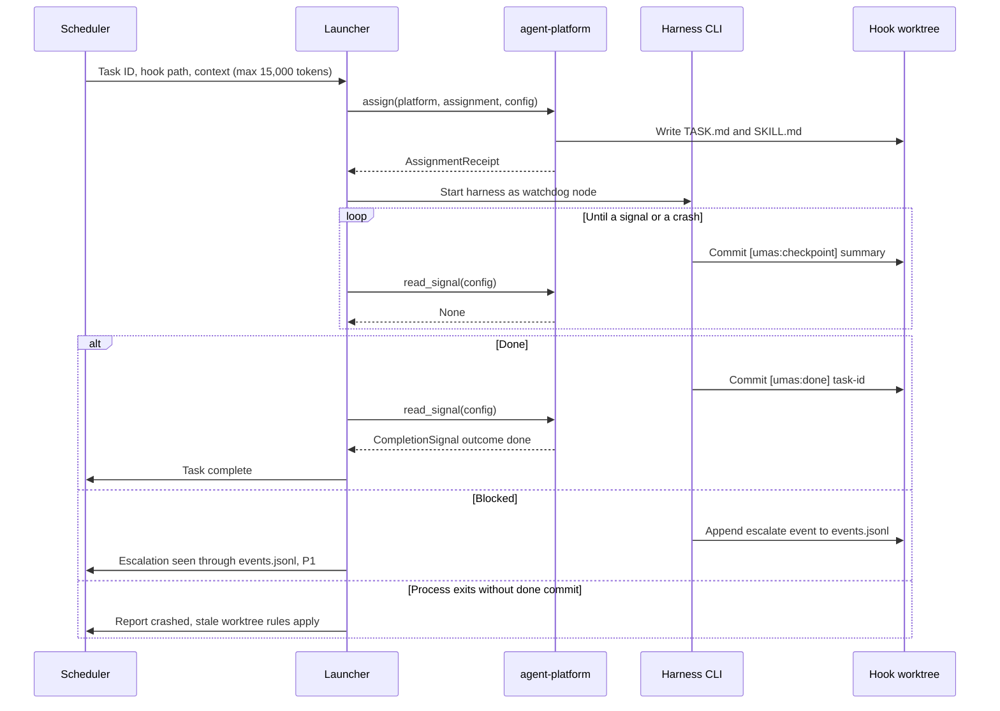

# Agent Execution — module spec

> Part of the UMAS technical design. Main spec: [TECHNICAL-DESIGN-SPEC.md](../../TECHNICAL-DESIGN-SPEC.md) · Module map: [module map](../../TECHNICAL-DESIGN-SPEC.md#5-component-design)
> **Owns:** the Worker signalling protocol and the Specialized Agent roles. The Worker launch path is proposed here (Open 1).
> **Uses:** [agent-platform](../../../libs/agent-platform/README.md), [agent-session](../../../libs/agent-session/README.md), [minimalism-ladder](../../../packs/minimalism-ladder/minimalism-ladder-spec.md), [specialist-agents](../../../packs/specialist-agents/specialist-agents-spec.md)
> **Depends on modules:** [orchestration](../orchestration/orchestration-spec.md), [context-persistence](../context-persistence/context-persistence-spec.md), [monitoring](../monitoring/monitoring-spec.md)

---

## 5.3 Agent Execution System

#### Worker Agents

- Spawned with: task ID, hook path, compressed context (≤15k tokens)
- Operate exclusively inside their assigned worktree
- Commit state at each major step
- Signal completion: `[umas:done] <task-id>` commit
- Signal blockers: append `{"event":"escalate","severity":"P1","reason":"..."}` to `events.jsonl`

**Agent signalling protocol:**

| Signal | Mechanism | Who reads it |
|--------|-----------|-------------|
| Task complete | Commit: `[umas:done] <task-id>` | Scheduler |
| Task blocked | Append to `events.jsonl`: escalate event | Coordinator |
| Checkpoint | Commit: `[umas:checkpoint] 
` | Project Monitor |
| Handoff request | Append to `events.jsonl`: handoff_request event | Scheduler |

**Minimalism ladder** (runs *after* reading relevant code, *before* writing any):

1. Does this feature need to exist?
2. Does it already exist in this codebase?
3. Is it in the standard library or platform?
4. Is it an already-installed dependency?
5. Can it be one readable line?
6. Otherwise: minimum code that works

> Standalone spec: [packs/minimalism-ladder.md](../../../packs/minimalism-ladder/minimalism-ladder-spec.md)

**Shortcut comments:** Agents may leave `// SHORTCUT: <what> — <when to fix>` to mark a deliberate deferral. Must be tracked in the project's debt ledger. All other comments require justifying "why" code exists.

**Session lifecycle:** Shared across all agent types. See [libs/agent-session.md](../../../libs/agent-session/README.md).

#### Specialized Agents

Invoked by the Router for medium/large tasks:

| Role | Responsibility | When |
|------|---------------|------|
| Analyst | Clarify requirements, surface ambiguity | All non-trivial requests |
| Product Manager | User value, PRFAQ, product decisions | Greenfield, new features |
| Architect | ADR, tech stack, system design | Medium+ complexity |
| UX Designer | Interface and interaction design | User-facing changes |
| Developer | Implementation with minimalism enforcement | All implementation |

> Prompts and output schemas: [packs/specialist-agents.md](../../../packs/specialist-agents/specialist-agents-spec.md)

#### Multi-Platform Support

UMAS supports four first-class coding agent harnesses. Each is an adapter in [agent-platform](../../../libs/agent-platform/README.md). None is built into the core, so any can be replaced by changing configuration.

| Harness | Adapter name | Notes |
|---------|-------------|-------|
| Claude Code | `claude-code` | Completion via commit-message hook |
| OpenAI Codex | `openai-codex` | Completion via commit-message hook. Runs OpenAI models and Google Gemini models; the provider is set per assignment and registered in `llm-gateway` (ADR-0002) |
| GitHub Copilot | `copilot` | Completion via file mtime (IDE tool) |

`agent-platform` handles work assignment, context packing, and completion signalling. `llm-gateway` handles inference routing. They are separate concerns at separate layers, so a harness and a provider are replaced independently.

---

## Detailed design

This part is new. It is written from the sources named in each claim. It does not add decisions.

Each claim carries one tag:

- `[S: …]` names the source. Keys: `main` is the main spec, `ap` is [agent-platform](../../../libs/agent-platform/README.md), `as` is [agent-session](../../../libs/agent-session/README.md), `lg` is [llm-gateway](../../../libs/llm-gateway/README.md), `ms` is the [minimalism-ladder](../../../packs/minimalism-ladder/minimalism-ladder-spec.md) pack, `sa` is the [specialist-agents](../../../packs/specialist-agents/specialist-agents-spec.md) pack.
- `[P]` marks a proposed claim. Proposed claims that need an owner decision appear in section 9.

### 1. Purpose and boundary

This module runs the agents that do the work. Coding Workers run as external CLI harnesses through `agent-platform`. Specialized Agents produce role outputs from prompts. `[S: main 5.3; main A.4.8]`

This module owns the Worker signalling protocol. It owns the Worker launch path. `[P: Open 1]`

This module does not own:

- Queueing, dispatch and routing of tasks. Orchestration owns them. `[S: main 5.2]`
- Checks of a Worker's output after it reports done. Verification owns them. `[S: main 5.4]`
- Token budgets and model choice. Budget and models owns them. `[S: main 5.6, 5.7]`
- Detection of stuck or crashed agents. Monitoring owns it. `[S: main 5.5]`

### 2. Flow

Happy path, one coding Worker:

1. The Scheduler claims a task and creates its hook worktree. `[P: hook creation per task, main A.7 gap 2; hs create, see section 7]`
2. The Scheduler passes the task ID, the hook path and a compressed context of at most 15,000 tokens to the launcher. `[S: main 5.3 "Spawned with"; as 6 handoff_packet_size]`
3. The launcher builds a WorkAssignment and calls `assign`. `[S: ap 4, 5.2]` `assign` writes `TASK.md` and `SKILL.md` into the worktree. It returns an AssignmentReceipt. `[S: ap 3.3]`
4. The launcher starts the harness CLI as a watchdog node. `[S: main A.4.8 Consequences] [P: the launcher is owned here, Open 1]`
5. The harness works only inside its worktree. It commits after each major step with `[umas:checkpoint] 
`. `[S: main 5.3]`
6. The launcher calls `read_signal` on a timer. `read_signal` does not block. It returns `None` until a signal exists. `[S: ap 3.4, 5.3] [P: interval, Open 13]`
7. The harness commits `[umas:done] <task-id>`. `read_signal` returns outcome `done`. The launcher reports the result to the task queue. `[S: main 5.3; ap 3.4] [P: report through complete, tq 4]`
8. Failure path A, blocked: the harness appends an escalate event to `events.jsonl`. The Coordinator reads it. `[S: main 5.3]`
9. Failure path B, process exit without a done commit: the launcher reports `crashed`. The worktree follows the stale-worktree rules. `[S: as 3.2 crashed; main 6.8] [P: launcher reports]`
10. Handoff: the Worker commits its state and appends a handoff request. The Scheduler reads it. `[S: main 5.3] [P: trigger for CLI Workers is not set, Open 6]`
11. Cross-harness handoff: the source calls `pack_context`. The target calls `unpack_context`. Then `assign` runs on the target. `[S: ap 5.4]`

The Developer role edits files. It runs through steps 1 to 11 as a coding Worker. `[S: main A.4.8 table, row Worker (Developer)]`

Specialized Agents flow:

1. The Router selects the roles for the request. `[S: main 5.2 Router; main 5.3 Specialized Agents]`
2. Roles run in the default order: Analyst, Product Manager, UX Designer, Architect, Developer. Skip rules apply. `[S: sa 5.7]`
3. Each role receives the structured output of the previous role. It does not receive the conversation. `[S: sa 5.8]`
4. Each output is validated with Pydantic v2 models at the Python boundary. Invalid output is not repaired silently. `[S: ADR-0004] [S: sa 7, retry once, then escalate]`
5. The Product Manager and Architect outputs go to decision artifacts. `[S: sa 9; main 5.1 decision artifacts]`

Where Specialized Agents run, in-process or through the launcher, is Open 7.

Figure 1 shows the happy path (steps 1 to 7) and the blocked and crash paths (steps 8 and 9).

Figure 1. Coding Worker flow: happy path, blocked path and crash path. The diagram follows steps 1 to 9 of the Worker flow.

### 3. Interfaces

| Name | Direction | Carrier | Payload (field names from the sources) | Owner | Basis |
|------|-----------|---------|----------------------------------------|-------|-------|
| Assign work | in (to harness) | function call `assign(platform, assignment, config)` | WorkAssignment: `id`, `title`, `description`, `hook_path`, `relevant_files[]`, `constraints[]`, `context_pack?`, `assigned_at` | agent-platform | ap 3.3, 4 |
| Assignment file | out | file `TASK.md` (or `TASK.json`) in the hook worktree | WorkAssignment as written for the adapter's `context_format` | agent-platform | ap 5.2 |
| Skill file | out | file `SKILL.md` in the hook worktree | Plain Markdown in the universal format. UMAS does not read its fields. | agent-platform | ap 5.8 |
| Assignment receipt | out | return value of `assign` | AssignmentReceipt: `platform_ref?`, path of the assignment file | agent-platform | ap 3.3 |
| Completion signal | out (to launcher) | return value of `read_signal` | CompletionSignal: `assignment_id`, `platform`, `outcome` (`done`, `blocked`, `escalated`, `abandoned`), `summary`, `artefact_paths[]`, `hook_path?`, `token_usage?`, `reason?`, `completed_at` | agent-platform | ap 3.4, 4 |
| Checkpoint commit | out (Worker to hook branch) | git commit message `[umas:checkpoint] 
` | `summary` text | this module | main 5.3 |
| Done commit | out (Worker to hook branch) | git commit message `[umas:done] <task-id>` | `task-id` | this module | main 5.3 |
| Escalate event | out (Worker to events log) | append to `events.jsonl` | Snapshot fields: `event` = `escalate`, `severity` (P1 in the snapshot), `reason`. Envelope fields from event-log: `v`, `id`, `ts`, `type`, `source`, `scope`, `data`. The two do not match (Open 4). | this module (payload); event-log (envelope) | main 5.3; el 3 |
| Handoff request | out (Worker to events log) | append to `events.jsonl` | Snapshot names `handoff_request`. Fields in the reference code: `reason`, `token_usage`, `token_limit`, `task_id`. Name and fields do not match agent-session (Open 4). | this module | main 5.3; as 12.1 (reference) |
| Context pack | out and in | function calls `pack_context` and `unpack_context` | ContextPack: `schema_version`, `source_platform`, `target_platform`, `assignment_id`, `task_summary`, `decisions[]`, `artefact_paths[]`, `hook_path?`, `packed_at`, `checksum` | agent-platform | ap 3.5, 5.4 |
| Hook worktree | in (from orchestration) | function call `create(name, base_branch, owner, task?)` | HookInfo | hook-store (called by orchestration) | hs 4 |
| Spawn request | in | CLI `umas agents spawn --task <id>`; REST `POST /api/v1/agents` | `--task <id>`. The REST body is not specified. | interfaces | main 7 |
| Pause signal | in (to agents) | file `<hook-path>/.pause` | `{ "v": 1, "reason": "machine_shutdown", "ts": "<RFC 3339>", "grace_seconds": 30 }` | agent-session (format); daemon (writes) | as 5.6 |
| Pause record | out | file `PAUSE.md` in the worktree root | STATE fields plus `paused_reason`, `paused_at` | agent-session | as 5.6 |
| Token usage | in | Not specified. CLI-reported usage (Open 6). | Not specified | budget-and-models | main A.4.8 |
| Ladder record | out | structured output of the Developer role | `rung`, `rung_name`, `evidence` (required for rungs 1 to 4), `notes` | minimalism-ladder pack | ms 4.2, 5 |
| Specialist output | out | structured output of each role | Fields per role in `sa` 4.2, plus `role`, `pack_version`, `based_on` | specialist-agents pack | sa 4.2 |

### 4. Parameters

| Name | Type | Default | Where set | What it changes |
|------|------|---------|-----------|-----------------|
| `platforms.<name>.enabled` | bool | `claude-code` true, `openai-codex` true, `copilot` false | consuming app config (`umas.config.yaml`) | Whether the adapter can receive assignments. `[S: ap 6]` |
| `platforms.<name>.hook_base` | path | `.umas/worktrees` | consuming app config | Root of hook worktrees. The ap 6 example uses `.hooks`; the UMAS path is `.umas/worktrees`. `[S: main 5.1; hs 227]` |
| `platforms.<name>.signal_pattern` | regex | Library default `\[(done\|blocked\|escalated)\]`. UMAS value: not set. | consuming app config | Pattern that `read_signal` matches in commit messages. The default does not match `[umas:done]` (Open 3). `[S: ap 6]` |
| `platforms.<name>.skill_file` | path | `SKILL.md` | consuming app config | Name of the skill file written beside `TASK.md`. `[S: ap 6]` |
| `commit_prefixes.done` | string | `[umas:done]` | consuming app config, set at startup | Prefix of the done commit. `[S: as 9; main 5.3]` |
| `commit_prefixes.checkpoint` | string | `[umas:checkpoint]` | consuming app config, set at startup | Prefix of checkpoint commits. The library default is `[checkpoint]`. `[S: as 6, 9]` |
| `pause_signal_file` | path | `.pause` | agent-session config | Pause file, relative to the hook path, polled at each step boundary. `[S: as 6]` |
| `shutdown_grace_seconds` | seconds | 30 seconds | agent-session config | Time an agent has to finish its step after a pause signal. `[S: as 6; main 6.17]` |
| `handoff_packet_size` | tokens | 15,000 tokens | agent-session config | Maximum size of the handoff packet and of the compressed context a Worker is spawned with. `[S: as 6; main 5.3]` |
| `handoff_threshold` | fraction | 0.90 | consuming app config | Session token share that triggers a graceful handoff. Set for in-process sessions. Worker use is Open 6. `[S: main 5.6; as 3.3]` |
| `emergency_threshold` | fraction | 0.95 | consuming app config | Session token share that triggers an emergency handoff. Same scope as above. `[S: main 5.6; as 3.3]` |
| `agents.worker.model` | llm-gateway alias | `default` (example value; the default is "same configured model") | `umas.config.yaml` | Model for Workers. The meaning for CLI Workers is open (Open 9). `[S: main 5.7]` |
| `agents.specialized.architect.model` | llm-gateway alias | `deep` (example value) | `umas.config.yaml` | Model for the Architect. `[S: main 5.7]` |
| `agents.specialized.architect.panel_enabled` | bool | false | `umas.config.yaml` | Multi-model panel for the Architect. Disabled by default. `[S: main 5.7]` |
| `max_concurrent` | agents | 30 (main 2.3); 5 for the MVP (main 5.8) | not set in the snapshot | Concurrent agent processes. The two values conflict (Open 10). `[S: main 2.3, 5.8]` |
| Agent memory limit | size | 2 GB per agent | not set in config; process model | Memory limit for each agent process. `[S: main 2.3]` |
| Agent CPU limit | cores | 2 cores | not set in config; process model | CPU limit for each agent process. `[S: main 2.3]` |
| `minimalism.level` | enum | `full` (`lite`, `full`, `ultra`) | minimalism-ladder pack config | Rungs checked. `lite` checks rungs 1 and 2 only. `[S: ms cfg]` |
| `minimalism.enforce` | bool | true | minimalism-ladder pack config | Reviewers treat a missed rung as a finding. `[S: ms cfg; as 12.2]` |
| `minimalism.record` | bool | true | minimalism-ladder pack config | Agent emits the ladder record. `[S: ms cfg]` |
| `shortcut.marker` | string | `SHORTCUT:` | minimalism-ladder pack config | Marker for a deliberate deferral. `[S: ms cfg]` |
| `max_retries` | int | 3 | reference code only (as 12.2) | In-process retry count. Its use for CLI Workers is Open 11. `[S: as 12.2]` |
| Signal poll interval | seconds | not set | not set | How often the launcher calls `read_signal`. Recommended value is in Open 13. `[S: ap 5.3]` |

### 5. Capabilities

| Capability | Who | Permission | Notes |
|------------|-----|------------|-------|
| Spawn an agent | Human | `agent:spawn` | Admin, Project Owner and Developer hold it. `[S: main A.5.4 row "Spawn an agent"; A.5.6 example]` |
| Spawn a Worker | Coordinator (agent role) | No `resource:action` string in the snapshot | The Coordinator holds spawn and stop. `[S: main A.5.5]` |
| Stop or pause an agent | Human | Named in A.5.4 ("Stop or pause an agent") without a string. Proposed string: `agent:stop` (Open 12). | Developer can act on own agents only. `[S: main A.5.4; P]` |
| Pause a session cleanly | Human | Same row as stop or pause. | Writes `PAUSE.md` and sets `machine_paused`. `[S: main 7 `umas agents pause`; as 5.6]` |
| Resume a session | Human | Not in A.5.4. Open 12. | `umas agents resume <session-id>`. `[S: main 7]` |
| Write, commit to own hook branch | Worker | Agent role column, A.5.5 | Read and write in the own worktree only. `[S: main A.5.5]` |
| Update own task | Worker | Agent role column, A.5.5 | `[S: main A.5.5]` |
| Raise P0 and P1 escalations | Worker | Agent role column, A.5.5 | `[S: main A.5.5]` |
| Write decision artifacts | Specialist | Agent role column, A.5.5 | PRFAQ, ADR, spec, glossary. `[S: main A.5.5]` |

Rules that apply to every row:

- A Worker cannot merge its own change. Only the Merge Queue Processor writes to the target branch. `[S: main A.5.5 rules]`
- An agent acting for a user needs both the agent role and the user's permission. `[S: main A.5.2; A.5.6 step 4]`
- Each agent credential is scoped to one worktree and one session. The Coordinator issues it. `[S: main A.5.2]`

### 6. Interaction with other modules

| Module | What this module sends | What this module receives | Carrier | Sync or async |
|--------|------------------------|---------------------------|---------|---------------|
| [Orchestration](../orchestration/orchestration-spec.md) | Completion, escalation and handoff signals | Task ID, hook path, compressed context, platform choice | Function call for dispatch `[P]`; commits and `events.jsonl` for signals | Dispatch: sync `[P]`. Signals: async. |
| [Context persistence](../context-persistence/context-persistence-spec.md) | State commits, `STATE.md` (Open 2) | `PAUSE.md` and `HANDOFF.md` on resume | Git commits and files | Async |
| [Budget and models](../budget-and-models/budget-and-models-spec.md) | Per-task time and checkpoint counts `[P]` | Limits; the alias for each role; CLI-reported usage | Config; CLI report (format not specified) | Async |
| [Verification](../verification/verification-spec.md) | Done branch for the Merge Queue Processor | Test-regression re-spawn with failing test names and PR diff | Git branch; function call `[S: main 6.11]` | Async |
| [Monitoring](../monitoring/monitoring-spec.md) | Checkpoint commits and heartbeat | Nudge and handoff actions from the Project Monitor | Git log; heartbeat file; process supervision by watchdog | Async, Project Monitor polls every 60 seconds `[S: main 5.5]` |
| [Interfaces](../interfaces/interfaces-spec.md) | `umas agents` command results | Spawn, status, pause and resume requests | CLI and REST `[S: main 7]` | Sync |
| [Access control](../access-control/access-control-spec.md) | Permission checks for spawn and stop | Allow or deny decision; agent credential | Function call in API middleware `[S: main A.5.7]` | Sync |
| [Exception flows](../exception-flows/exception-flows-spec.md) | Failure events named in section 8 | Recovery rules | Not a carrier. Rules only. | Not applicable |

### 7. Libraries and packs used

- [agent-platform](../../../libs/agent-platform/README.md): `assign`, `read_signal`, `pack_context`, `unpack_context`. Built-in adapters `claude-code`, `openai-codex` and `copilot`. `[S: ap 4, 5.1]`
- [agent-session](../../../libs/agent-session/README.md): file contracts for `STATE.md`, `HANDOFF.md` and `PAUSE.md`, and the `.pause` poll. Not run in-process for CLI Workers. `[S: as 3.6, 5.6; main A.4.8]`
- [hook-store](../../../libs/hook-store/README.md): creates worktrees, `find_signals` for commit signals, leases. `[S: hs 4]`
- [task-queue](../../../libs/task-queue/README.md): `claim`, `complete`, `fail` for task state. `[P: launcher calls these]` `[S: tq 4]`
- [event-log](../../../libs/event-log/README.md): `append` and `poll` for `events.jsonl`. `[S: el 4]`
- [watchdog](../../../libs/watchdog/README.md): supervises the harness process as a node. `[S: main A.4.8]`
- [budget-meter](../../../libs/budget-meter/README.md): per-task time and checkpoint limits for Workers, because token caps are not exact. `[S: main A.4.8]`
- [llm-gateway](../../../libs/llm-gateway/README.md): `complete` for non-editing Specialists, if they run as one prompt and one answer. `[P: Open 7]` `[S: lg 4, 11 Q2]`
- [decision-artifacts](../../../libs/decision-artifacts/README.md): writes PRFAQ and ADR outputs. `[S: sa 2, 9]`
- [error-classifier](../../../libs/error-classifier/README.md): optional error records for `CapabilityMissing`, `AssignmentWriteFailed` and `ChecksumMismatch`. `[S: ap 7]`
- [minimalism-ladder pack](../../../packs/minimalism-ladder/minimalism-ladder-spec.md): ladder record and pack config. `[S: ms 4.2]`
- [specialist-agents pack](../../../packs/specialist-agents/specialist-agents-spec.md): five role prompts, output schemas, sequence and skip rules. `[S: sa 4 to 6]`
- [ADR-0004](../../../docs/decisions/ADR-0004-structured-output-with-pydantic.md): Pydantic v2 validates Specialist output. `[S: ADR-0004]`

### 8. Failure handling

| Failure | Source | Handling in this module | Recovery owner |
|---------|--------|-------------------------|----------------|
| `UnknownPlatform` | ap 7 | Fails at once. No assignment is written. | Caller |
| `CapabilityMissing` | ap 7, 9 | Caller routes to another platform. Whether `assign` fails or warns is Open in ap 11 Q4. | Router (orchestration) |
| `AssignmentWriteFailed` | ap 7, 9 | Nothing is partially written. P1 escalation. | Coordinator |
| `ChecksumMismatch` | ap 7, 9 | No assignment is produced. P1 escalation. The pack is kept for inspection. | Coordinator |
| `SignalCorrupt` | ap 7 | `read_signal` returns `None`. A warning is emitted. The file is not consumed. | Launcher `[P]` |
| Worker blocked | main 5.3 | Escalate event is appended. The Coordinator handles it. | Coordinator (orchestration) |
| Worker crash or no done commit | main 6.8; as 3.2 | Worktree is marked stale by age and by dirty state. | Exception flows, section 6.8 |
| No checkpoint for more than 10 minutes | main 5.5 | Project Monitor nudges the agent, then starts a graceful handoff. | Monitoring |
| Project deleted while agents run | main 6.2 | Active sessions are marked `crashed`. | Exception flows, section 6.2 |
| Machine shutdown | main 6.17 | Clean pause through `.pause` if the harness honours it. Otherwise recovery uses `STATE.md`. | Exception flows, section 6.17. CLI Workers: Open 5. |
| Token budget exhausted | main 6.6 | In-progress Workers finish their step and commit. New dispatch pauses. | Exception flows, section 6.6 |
| LLM provider failure | main 6.7; lg 7 | Applies to coordination agents through `llm-gateway`. Failures inside a CLI Worker are not visible to UMAS (Open 6). | Exception flows, section 6.7 |
| Agent causes test regression | main 6.11 | Worker is re-spawned with failing test names and the PR diff. | Exception flows, section 6.11; verification |
| Specialist output fails validation | sa 7; ADR-0004 | Consumer retries once with the schema error. A second failure escalates. Output is not repaired silently. | Orchestration |

### 9. Open

Each item needs an owner decision. The recommendation is not a decision.

1. **Launcher owner and spec.** Gap 3 in main A.7 says nothing specifies the component that starts, supervises and stops harness CLIs. The start command line is not specified either. Recommendation: this module owns the launcher as Python UMAS glue, supervised by watchdog. `[S: main A.7 gap 3; A.4.6]`
2. **State files for CLI Workers.** agent-session runs in-process. A CLI Worker must write `STATE.md` through files. Who writes it, and how is the format checked? Recommendation: `SKILL.md` tells the harness to write `STATE.md` and to commit with `[umas:checkpoint]`. The launcher checks the file after each checkpoint commit. `[S: main A.4.8; as 3.6]`
3. **Commit signal pattern.** The library default `\[(done|blocked|escalated)\]` does not match `[umas:done]`. The main spec uses `[umas:done]` and `[umas:checkpoint]`. The state commit in main 5.1 uses `[umas] <agent-id>`. Recommendation: set `signal_pattern` to `\[umas:(done|blocked|escalated)\]` in the consuming app config, with no library change. Pick one prefix for state commits. The owner is context-persistence. `[S: ap 5.1, 6; main 5.1, 5.3; as 9]`
4. **Event names and envelope.** Main 5.3 uses `{"event":"escalate",...}` and `handoff_request`. event-log uses the envelope `v`, `id`, `ts`, `type`, `source`, `scope`, `data`. agent-session uses `session_escalated` and `handoff_initiated` (as 5.8). Recommendation: use the event-log envelope with the agent-session type names. `[S: main 5.3; el 3; as 5.8]`
5. **Pause for CLI Workers.** Agents poll `.pause` at each step boundary (as 5.6). A CLI harness does not run that code. Main 6.17 says agent-platform must honour `.pause`. ap 5.3 says the library does not poll. Recommendation: the launcher polls `.pause` and stops the process after the next checkpoint commit. Test this with each CLI before Phase 2. `[S: as 5.6; main 6.17; ap 5.3]`
6. **Handoff and token limits for CLI Workers.** Worker token use is visible only as far as each CLI reports it. The 90% and 95% thresholds need a token count. Also, the CLI usage report format is not checked. Recommendation: CLI Workers use per-task time and checkpoint limits from budget-meter. The thresholds stay for coordination agents. Owner: budget-and-models. `[S: main A.4.8; main 5.6]`
7. **Runtime of Specialized Agents.** A.4.8 places file-editing specialists in CLI harnesses. It does not place Analyst, Product Manager, UX Designer or Architect, which write documents only. Recommendation: run them through `llm-gateway` as one prompt and one answer, the coordination rule. `[S: main A.4.8; lg 11 Q2]`
8. **Capability list for `openai-codex` with Gemini.** The list was written for OpenAI models. ap 11 Q1 and ADR-0002 require a check when Gemini runs through the harness. Recommendation: test each provider (`openai`, `google-gemini`) before Phase 2. Also name the owner of the provider choice per assignment. Recommendation: the Router or budget-and-models. `[S: ap 11 Q1; ADR-0002]`
9. **Meaning of `agents.worker.model`.** The key names an `llm-gateway` alias. Workers bypass `llm-gateway`. Recommendation: for Workers, the alias maps to the harness provider and model, set per assignment. Owner: budget-and-models. `[S: main 5.7; lg 11 Q2; ADR-0002]`
10. **Concurrency cap.** Main 2.3 sets `max_concurrent: 30`. Main 5.8 sets 5 agents for the MVP with SQLite. Recommendation: use 5 for the MVP. Owner: orchestration (Scheduler). `[S: main 2.3, 5.8]`
11. **Retry count for CLI Workers.** `max_retries: 3` is in the in-process reference code only (as 12.2). Recommendation: CLI Workers use `fail(retry)` in task-queue. The in-process value does not apply to them. Owner: orchestration. `[S: as 12.2; tq 4]`
12. **Permission names for stop, pause and resume.** A.5.4 names the capabilities but not the `resource:action` strings. No row covers `umas agents resume`. Recommendation (proposed): `agent:stop` for stop and pause, and `agent:resume` for resume. Owner: access-control. `[S: main A.5.4, A.5.6]`
13. **Signal poll interval.** ap 5.3 leaves polling to the caller. The snapshot gives no interval. Recommendation: 60 seconds, the same interval as the Project Monitor. Owner: this module, with monitoring. `[S: ap 5.3; main 5.5]`
14. **Abandoned signal.** ap 3.4 includes `abandoned`. ap 11 Q2 asks whether a timeout should produce it. Recommendation: the launcher writes `abandoned` when the watchdog gives up on a Worker. Owner: this module. `[S: ap 3.4, 11 Q2]`
15. **Harness count in the Multi-Platform text.** Main 5.3 says "four first-class coding agent harnesses". Its table lists three. ADR-0002 says three. Recommendation: change the text to "three" when this module is next edited. The moved text is kept as written for now. `[S: main 5.3; ADR-0002]`

---

## AXI support

This module defines no CLI commands. The `umas agents` commands belong to [interfaces-spec](../interfaces/interfaces-spec.md) (main 7).
