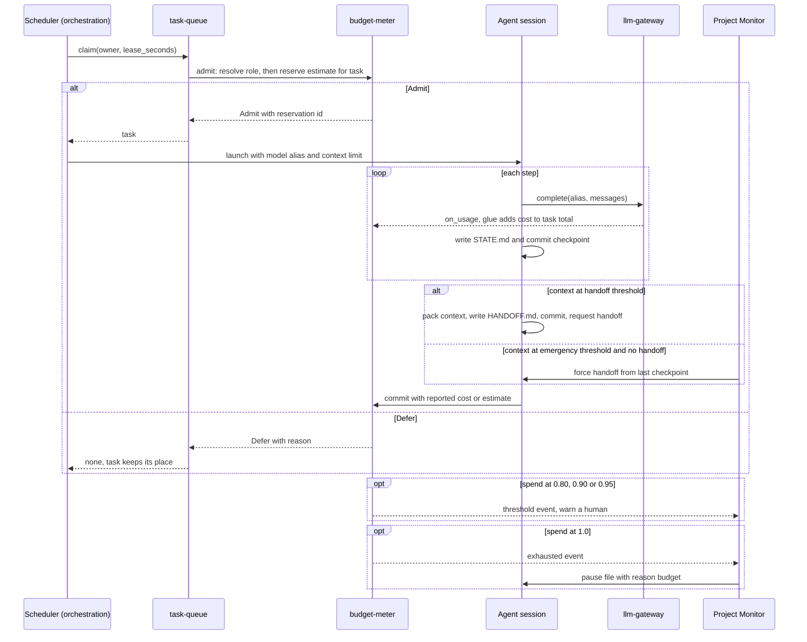

# Budget and Models — module spec

> Part of the UMAS technical design. Main spec: [TECHNICAL-DESIGN-SPEC.md](../../TECHNICAL-DESIGN-SPEC.md) · Module map: [module map](../../TECHNICAL-DESIGN-SPEC.md#5-component-design)
> **Owns:** token budget thresholds, handoff triggers and packet size, and the role-to-model alias policy.
> **Uses:** [budget-meter](../../../libs/budget-meter/README.md), [llm-gateway](../../../libs/llm-gateway/README.md)
> **Depends on modules:** [context-persistence](../context-persistence/context-persistence-spec.md) (`STATE.md`), [monitoring](../monitoring/monitoring-spec.md) (forced handoff)

## 5.6 Token Budget and Handoff

**Handoff triggers:**

| Trigger | Type | Action |
|---------|------|--------|
| Session token usage ≥ 90% | Graceful | Agent commits state, requests handoff |
| Session token usage ≥ 95% | Emergency | Monitor forces handoff from last checkpoint |
| Daily project budget ≥ 80% | Warning | Alert human |
| Daily project budget = 100% | Exhaustion | Queue new work; do not fail in-progress work |

**Context compression on handoff** — full context (~175k tokens) compressed to handoff packet (~15k tokens):

- Current task and progress percentage
- Last 10 decisions
- Explicit next steps
- Pointers to relevant files (path + line range, not content)

The incoming agent reads the handoff packet and the worktree's `STATE.md`. It does not re-read the full conversation history.

> Standalone spec: [libs/budget-meter.md](../../../libs/budget-meter/README.md)

---

## 5.7 Model Policy

**Default:** All roles use the same configured model — minimal setup, no per-role overhead.

**Opt-in role mapping** via `umas.config.yaml`:

| Role | Override key |
|------|-------------|
| Coordinator | `agents.coordinator.model` |
| Worker | `agents.worker.model` |
| Architect | `agents.specialized.architect.model` |
| Reviewer | `agents.specialized.reviewer.model` |

**Multi-model panels** are opt-in and reserved for decisions with irreversible consequences (architecture, security, data migrations). Disabled by default.

```yaml
agents:
  worker:
    model: default                # llm-gateway alias, not a model ID
  specialized:
    architect:
      model: deep                 # llm-gateway alias, not a model ID
      panel_enabled: true
```

---

## Detailed design

Each claim carries a label. **Decided** means the owner decided it on 2026-10-25, and the decision number is given (see [decisions-pending](../../../docs/decisions-pending-2026-10-25.md)). **Source** cites the main spec or a library or pack README. **Proposed** means this spec's recommendation, not yet decided. Items needing an owner decision are in section 9.

Bare section numbers such as 5.6 or 6.6 refer to the main spec. Library sections name the library.

### 1. Purpose and boundary

This module decides when work can start, when a session must hand off, and which model alias each role uses. It keeps two measures apart, because they have different units and different actions.

| | Spend | Context |
|---|-------|---------|
| Unit | Money, one currency per budget. Tokens stay in the ledger as detail | Tokens |
| Limit | The project daily budget (`--budget`) | The model context window, `context_limit`, from config |
| Thresholds | `spend_thresholds` 0.80, 0.90 and 0.95 (warnings). `exhausted` at 1.0 | `handoff_threshold` 0.90 and `emergency_threshold` 0.95, as fractions of `context_limit` |
| Action | Warn, defer new work, pause (section 9, Open 1) | Graceful handoff, then forced handoff |
| Metered by | [budget-meter](../../../libs/budget-meter/README.md) | [agent-session](../../../libs/agent-session/README.md) |

**Decided:** money is the budget unit (D17). A context window is a size in tokens, so the handoff trigger stays in tokens (D22).

This module does not do the following:

- It does not count tokens in text. The caller supplies the counter. **Source:** budget-meter section 2.
- It does not call a model or summarise text. `pack()` only fits content the agent writes. **Source:** budget-meter section 2.
- It does not retry or fail over provider calls. [llm-gateway](../../../libs/llm-gateway/README.md) does. **Source:** llm-gateway section 2.
- It does not stop or pause a worker. The library reports, and the caller acts. **Source:** budget-meter section 2.
- It does not enforce the Worker wall-clock cap. The launcher stops the harness at the cap. **Decided:** D14.

Owners of neighbouring work:

| Responsibility | Owner |
|----------------|-------|
| Dispatch loop and the `admit` callback registration | [orchestration](../orchestration/orchestration-spec.md) |
| Launching the harness, session loop, `handoff()` call, Worker wall-clock cap | [agent-execution](../agent-execution/agent-execution-spec.md). **Decided:** D12 |
| `STATE.md`, `HANDOFF.md`, checkpoint commits | [context-persistence](../context-persistence/context-persistence-spec.md) |
| Forced handoff, alerts to a human, dispatch resume | [monitoring](../monitoring/monitoring-spec.md) |
| Retry table, failover, circuit breaker | llm-gateway. See [6.7](../exception-flows/exception-flows-spec.md#67-llm-provider-failure-mid-task) |
| Budget glue: `resolve`, the `admit` body, usage wiring, reservation store, `budget_paused` status | This module, as UMAS code (not a library). **Decided:** D19 for the status owner |

**Worker spend is an estimate until harnesses report usage.** Workers run as external CLI harnesses. A Worker with no usage report is charged its reserved estimate, not zero. **Decided:** D18. **Source:** [A.4.8](../../TECHNICAL-DESIGN-SPEC.md#a48-agent-execution-model-decision).

### 2. Flow

**Metering rule.** **Decided (D17 a):** task work uses `reserve` then `commit`, in money. `record` is used only for Coordinator calls made outside a task. The two paths never count the same spend.

**Task total.** **Proposed:** the glue adds each task gateway call cost to a task total in the reservation store. At close, `commit` receives that total, or the harness report cost if one exists (Open 5).

Main flow, in order:

1. The Scheduler calls `claim` on [task-queue](../../../libs/task-queue/README.md). The concurrency cap is checked first. Then the `admit` callback runs. **Source:** task-queue sections 5.1 and 4.
2. The `admit` body runs in this order. **Proposed.**
   1. Call `resolve(role)`. It fails if the alias has no price or no context window.
   2. If the task already has a hold, call `release` on it.
   3. Call `reserve(<project>/day, estimate, actor, ref)`. `estimate` is the role estimate in money. `ref` is the task id.
   4. On `admit`, store the reservation id keyed by task id. Return `admit`.
   5. On `defer` or an error, return `defer(reason)`. Section 8 lists the reasons.
3. On `defer`, task-queue emits `deferred` and tries the next candidate. The task keeps its place in the queue. **Source:** task-queue sections 5.1 and 8 (item 9).
4. The launcher reads the reservation id by task id. It starts the session with the model alias for the role. An in-process agent also gets `context_limit`. A Worker also gets the wall-clock cap. **Source:** 5.7; [agent-session](../../../libs/agent-session/README.md) section 3.3. **Proposed:** the store read.
5. Each gateway call reports through `on_usage`. The glue computes `cost(usage, price_table)` and adds it to the task total. Failed attempts that report usage count. If a cost cannot be computed, the glue appends `usage_unpriced` and raises P1. It never records zero. **Source:** llm-gateway section 4; budget-meter 5.6. **Proposed:** the event and the task total.
6. After each step, the session writes `STATE.md` and commits a checkpoint. **Source:** agent-session 5.1.
7. When `context_tokens` reaches `handoff_threshold` times `context_limit`, the session packs its context, writes `HANDOFF.md`, commits, and requests a handoff. The session acts at its own threshold. **Decided:** D22. **Source:** agent-session 5.1.
8. When the context reaches `emergency_threshold` times `context_limit` with no handoff, the Project Monitor forces a handoff from the last checkpoint. The Monitor is the backstop. **Decided:** D22. Who sends the forced handoff is Open 9.
9. The successor reads `HANDOFF.md` and `STATE.md`. It does not read the full history. The task keeps one hold across sessions. **Source:** 5.6.
10. When the harness stops, the launcher closes the reservation. It calls `commit(reservation, actual)` if the harness ran. It calls `release(reservation)` if the harness never started. **Decided:** D18 for `actual`. The glue deletes the store row and appends `usage_committed` with `basis: reported` or `basis: estimate`. Who owns completion is Open 10.

Failure paths:

- **Spend reaches 0.80, 0.90 or 0.95.** budget-meter emits a threshold event. The Monitor warns a human. **Decided:** D22 (values). **Source:** budget-meter 5.1, 3.3.
- **Spend reaches 1.0.** budget-meter emits `exhausted`. New `reserve` calls return `defer`. The glue writes the pause file with reason `budget` to each active hook. Each agent finishes its current step, commits `[umas] budget-pause — state committed`, and the glue sets status `budget_paused`. **Decided:** D19. **Source:** [6.6](../exception-flows/exception-flows-spec.md#66-token-budget-exhausted-mid-task). Pause threshold is Open 1.
- **A human raises the limit.** `umas project config <name> --budget <amount>` takes effect on the next `reserve`, which returns `admit`. The Project Monitor resumes dispatch within 60 seconds. A human resumes each `budget_paused` session with `umas agents resume <session-id>`. **Source:** 6.6, budget-meter 5.3. **Decided:** D21 (`agent:resume`).
- **A `budget_paused` session waits 24 hours.** The outcome is Open 20. **Proposed:** mark the session `crashed`, release the task without counting an attempt, and raise P2.
- **A Worker reaches the wall-clock cap.** The launcher stops the harness, then closes the reservation as in step 10. **Decided:** D14, D18.
- **A Worker lease expires.** task-queue emits `lease_expired`. The glue releases the old hold. The next `claim` reserves again. **Proposed.** **Source:** task-queue 5.2.
- **The provider fails.** llm-gateway retries by error class, then fails over. A missing fallback raises P1. An auth error raises P0. **Source:** [6.7](../exception-flows/exception-flows-spec.md#67-llm-provider-failure-mid-task).

**Proposed:** the Monitor receives threshold and `exhausted` events through `subscribe` in process, or through `poll_events(cursor)` across processes. budget-meter names `poll_events` in prose only (Open 14).

Figure 1 shows admission, usage, handoff and budget exhaustion. Provider failure is in 6.7.



*Figure 1. Admission, usage, handoff and budget exhaustion.*

### 3. Interfaces

Direction is from this module's point of view. An amount is a number in the budget currency.

| Name | Dir | Carrier | Payload | Owner | Basis |
|------|-----|---------|---------|-------|-------|
| Budget definition | in | CLI `umas project config <name> --budget <amount>`. REST `PATCH /api/v1/projects/{id}`. Function `define(budget)` | `{ id: "<project>/day", kind: "period", limit: amount, unit: "cost", window: { type: "calendar", tz: "UTC" }, thresholds: [0.80, 0.90, 0.95] }`. The currency is the price table currency | interfaces; budget-meter | Decided: D17, D22. The REST body field is `budget_amount`, not `budget_tokens` (interfaces 3.2 still says `budget_tokens`; Open 26) |
| Role resolution | in | Function `resolve(role)` | Returns `{ alias, price_version, context_limit, estimate, currency }`. Raises `ConfigError` if the alias has no price or no window | This module | Proposed |
| Admission | in | `admit(task, context)` set by `set_admit(fn)`. Calls `reserve(budget, estimate, actor, ref)` | Input: estimate (amount), actor, ref (task id). Output: `admit` or `defer(reason)` | orchestration (registration); this module (body) | Source: task-queue 4; budget-meter 4. Decided: D17 |
| Reservation store | in, out | Table `task_reservations` (Open 8) | `{ task_id, reservation_id, budget, estimate, task_total_cost, created_at }`. Written by the `admit` body; read by the launcher; deleted at close | This module (writer); agent-execution (reader) | Proposed |
| Reservation close | in | `commit(reservation, actual)` or `release(reservation)` | `actual: { cost, price_version, model, tokens? }`. Tokens appear only when a report or the ledger has them | agent-execution (launcher) | Source: budget-meter 4. Decided: D18 |
| Usage record | in | `record(budget, usage, actor, ref)`, for Coordinator calls outside a task | `usage: { input_tokens, output_tokens, cached_tokens, model, cost, price_version }` | This module (glue) | Decided: D17. Gateway fields: Open 13 |
| Gateway usage | in | `on_usage` callback from llm-gateway | `{ alias, provider, model, usage, latency_ms, outcome }`. No budget, actor or ref (Open 13) | llm-gateway | Source: llm-gateway 4 |
| Harness usage | in | Harness usage report, per CLI | Format not checked (Open 3) | agent-execution | Source: A.4.8 |
| Threshold event | out | `subscribe(callback)` in process. `poll_events(cursor)` across processes (Open 14) | `{ budget, threshold, direction, used, limit, at }`, plus `exhausted` and `window_reset`. `used` and `limit` are amounts | monitoring (consumer) | Source: budget-meter 3.3, 4 |
| Budget status | out | CLI `budget-meter status [budget] --json`; function `status(budget)` | `{ used, reserved, available, percent, thresholds_crossed[], reset_at, warnings[] }`. `warnings[]` carries the stale price notice | budget-meter | Source: budget-meter 4, 5.6 |
| Session limits | out | `SessionConfig` | `{ context_limit, handoff_threshold, emergency_threshold, checkpoint_every, handoff_packet_size, decisions_in_packet, compression_level }` | agent-execution (agent-session) | Decided: D22 replaces `token_limit`. Source: agent-session 3.3 |
| Handoff request | out | Event appended to the event log | Event name is Open 15. Proposed payload: `{ session_id, task_id, reason: context_graceful \| context_emergency \| wall_clock, context_used, context_limit, packet: HANDOFF.md }` | orchestration (reads it) | Source: agent-session 5.8; agent-execution 3 |
| Packing call | in | `pack(sections, limit, counter)` | Section: `{ name, content, priority, mode, truncate }`. Result manifest: `{ included[], truncated[], dropped[], tokens }` | agent-execution (caller) | Source: budget-meter 5.5 |
| Handoff packet | out | File `HANDOFF.md` in the worktree root | `{ session_id, task_id, task_summary, progress, next_steps[], decisions[], file_pointers[], context_used, context_limit, packed_at }` | agent-session (schema); context-persistence (file) | Source: agent-session 3.5. Decided: D22 renames the two fields |
| Pause signal | out | File `.pause` in the hook, polled at each step boundary | Reason `budget`. Field names not yet defined | agent-execution (reads) | Source: agent-session 5.6, config `pause_signal_file`. Proposed: reason `budget` |
| Session status | out | Column `agent_sessions.status` set to `budget_paused`; commit `[umas] budget-pause — state committed` | Set by the glue. The `agent_sessions` token columns change (Open 26) | context-persistence (data model) | Decided: D19. Source: 6.6; main spec 4 |
| Model choice | in | Config keys in `umas.config.yaml` | Alias name (string). See section 4 | access-control (who can edit) | Source: 5.7 |
| Model call | out | `llm-gateway` `complete(request)` | `{ alias, messages[], tools[]?, max_output_tokens?, metadata{} }`. Proposed `metadata` keys: `project`, `role`, `actor`, `ref` | llm-gateway | Source: llm-gateway 3.1 |
| Price table | in | File next to the alias table | `{ version, as_of, currency, models: { <alias>: { input, output, cached } } }`. Rates are per million tokens | Admin (`config:write`) | Decided: D17 |
| Context windows | in | Config key `context_windows.<alias>` (Open 26) | Integer tokens per alias | Admin (`config:write`) | Decided: D22 (window from config) |
| Token and cost metrics | out | CLI `umas metrics tokens`, `umas metrics cost`. REST `GET /api/v1/metrics/tokens` and `/cost` | `TokenMetrics`, `CostMetrics` | interfaces | Source: interfaces 7; budget-meter 9 |

### 4. Parameters

Defaults come from the main spec, from the owner decisions, or from the library README named under "Where set". `not set` means no source gives a default.

| Name | Type | Default | Where set | What it changes |
|------|------|---------|-----------|-----------------|
| `--budget <amount>` | amount | not set | CLI `umas project config` | Daily (period) limit for one project, in the budget currency. Takes effect on the next `reserve`. Decided: D17 |
| `budget.currency` | ISO currency code | not set | `umas.config.yaml` | The one currency for all budgets. Must equal the price table `currency` |
| `spend_thresholds` | float list | `[0.80, 0.90, 0.95]` | budget definition; budget-meter `defaults.thresholds` | Warning levels for spend. `exhausted` fires at 1.0 with no entry. Decided: D22 |
| `handoff_threshold` | float | 0.90 | `SessionConfig` | Fraction of `context_limit` that starts a graceful handoff. The owner decision names this trigger `context_threshold` (Open 27) |
| `emergency_threshold` | float | 0.95 | `SessionConfig` | Fraction of `context_limit` that starts a forced handoff. Source: agent-session 6 |
| `context_limit` | int (tokens) | not set. Taken from `context_windows.<alias>` | Model config, next to the price table | The model context window. Replaces `token_limit`. For an alias with a fallback, use the smaller window (Open 17). Decided: D22 |
| `handoff_packet_size` | int (tokens) | 15000 | `SessionConfig` | Size limit passed to `pack()`. Source: agent-session 6 |
| `decisions_in_packet` | int | 10 | `SessionConfig` | Number of recent decisions in the packet. Source: agent-session 6 |
| `compression_level` | `lite`, `full` or `ultra` | `lite` | `SessionConfig` | Passed to the packet text (Open 22) |
| `budget.estimates.<role>` | amount | not set. `budget.estimates.default` is required | `umas.config.yaml` | Money reserved at admission for each role. A role with no entry uses `default`. Start-up validation fails if `default` is missing. Values: Open 2. Decided: D17, D18 |
| Price table | file | not set | Next to the alias table | `version`, `as_of`, `currency` and rates per alias. A price change is a new `version`, applied from the next call. Decided: D17 |
| `price_staleness_days` | int | 90 | budget-meter config | `status` warns when `as_of` is older than this. The owner chose no value. The parent chose 90, and the owner can change it |
| Worker wall-clock cap | seconds | not set | Launcher config | The launcher stops the harness at this time. Decided: D14. Value is Open 4 |
| Window `type` and `tz` | `calendar`, tz name | `calendar`, `UTC` | Budget definition | When the daily budget resets. Source: 6.6 (UTC midnight) |
| `reservation_ttl_seconds` | int | 900 | budget-meter config | Time before an unused hold expires. Source: budget-meter 6. Open 11 covers the lease link |
| `hysteresis_points` | int | 2 | budget-meter config | Points below a threshold before it re-arms. Source: budget-meter 3.3 |
| `ledger_dir` | path | `.budget` | budget-meter config | Location of the shared ledger. Source: budget-meter 6 |
| `fsync`, `snapshot_every_entries` | bool, int | `false`, 1000 | budget-meter config | Ledger durability and start-up speed. Source: budget-meter 6 |
| `max_claimed` | int | 5 | task-queue config | Concurrency cap checked before `admit`. Source: task-queue 6 |
| `admit_scan_limit` | int | 10 | task-queue config | Candidates tried after a `defer`. Source: task-queue 6 |
| `default_lease_seconds` | int | 300 | task-queue config | Lease length. Source: task-queue 6. This module needs only that `lease_expired` releases the hold |
| Dispatch resume delay | seconds | 60 | Project Monitor | Time to resume dispatch after a budget raise. Source: 6.6 |
| `agents.default.model` | alias | `default` | `umas.config.yaml` | The one model all roles share, unless a role key is set. Proposed key (Open 25) |
| `agents.coordinator.model` | alias | `agents.default.model` | `umas.config.yaml` | Coordinator model. Source: 5.7 |
| `agents.worker.model` | alias | `agents.default.model` | `umas.config.yaml` | Worker model. Meaning for a harness is Open 23 |
| `agents.specialized.architect.model` | alias | `agents.default.model`. The example uses `deep` | `umas.config.yaml` | Architect model. Source: 5.7 |
| `agents.specialized.reviewer.model` | alias | `agents.default.model` | `umas.config.yaml` | Reviewer model. Source: 5.7 |
| `agents.specialized.architect.panel_enabled` | bool | `false` | `umas.config.yaml` | Multi-model panel for irreversible decisions. Source: 5.7 |

Provider timeouts, retry schedules, breaker and rate-limit values belong to llm-gateway. This module does not read them.

**Alias contract.** The alias names are `default` and `deep`. Both exist in llm-gateway section 3.2. **Decided:** D2 and D20. `resolve(role)` returns an alias, never a model id. Start-up validation fails with `ConfigError` if any alias in use has no price or no context window. **Decided:** D17 (price rule). The test that every alias in llm-gateway section 3.2 has a price is part of that rule.

### 5. Capabilities

Permission names follow the `resource:action` form of [A.5.6](../../TECHNICAL-DESIGN-SPEC.md#a56-data-model). Four names are decided (D21). A.5.4 and A.5.6 do not list them yet (Open 26). The access-control spec owns the single permission list (A.5.7).

| Capability | Who holds it | Permission | Basis |
|------------|--------------|------------|-------|
| Set a project budget | Admin (any amount). Project Owner (up to the system cap) | `budget:set`. The cap is a money value in `role_permission.limit`. The cap value is Open 2 | Decided: D21. Source: A.5.4 "Set a project budget" |
| Change providers, model mapping, limits, price table, context windows | Admin | `config:write` | Source: A.5.4 "Change system configuration" |
| View token and cost metrics | Admin, Operator, Auditor and Viewer system-wide. Project Owner, Developer and Approver in their projects | `metrics:read` | Decided: D21. Source: A.5.4 "View metrics and cost" |
| Read budget status | Coordinator and Monitors read it. A Worker reads only its own budget | Agent role column "Config and budget" | Source: A.5.5. Proposed: the launcher gives a Worker only its own view |
| Request a graceful handoff | The session itself | `agent:handoff` | Decided: D21, D22 |
| Force a handoff at the emergency threshold | Project Monitor as backstop | `agent:handoff`. A.5.5 gives Monitors restart and nudge, not handoff. Holder is Open 9 | Decided: D21, D22. Source: A.5.5 |
| Resume a `budget_paused` session | Admin and Operator. A.5.3 says Operator can "pause or resume agents". Command `umas agents resume <session-id>` | `agent:resume`. A.5.4 and A.5.6 do not list it yet (Open 26) | Decided: D19, D21. Source: 6.6; A.5.3 |
| Resume dispatch after a budget raise | Project Monitor, automatic | No human permission. The raise itself needs `budget:set` | Source: 6.6 |

The libraries hold no access control. The application checks permissions first, then passes a plain `actor` string. budget-meter writes that string to the ledger. **Source:** A.5.7.

### 6. Interaction with other modules

| Module | This module sends or receives | Carrier | Sync |
|--------|-------------------------------|---------|------|
| [orchestration](../orchestration/orchestration-spec.md) | Receives the `admit` body. Sends `admit` or `defer(reason)`. Reads the handoff request event | Function call in process; event log | Sync for `admit`; async for events |
| [agent-execution](../agent-execution/agent-execution-spec.md) | Receives `commit` and `release` from the launcher, and `pack` from the session. Sends the reservation id, `context_limit` and the alias per role. Receives harness usage. Owns the wall-clock cap | Function calls; reservation store; `SessionConfig` | Sync |
| [context-persistence](../context-persistence/context-persistence-spec.md) | Packet written to `HANDOFF.md`. Successor reads it with `STATE.md`. Budget pause commits state | Files in the worktree; git commit | Async |
| [monitoring](../monitoring/monitoring-spec.md) | Sends threshold and `exhausted` events. Receives the forced-handoff action and the dispatch resume | `subscribe` or `poll_events(cursor)` | Async |
| [exception-flows](../exception-flows/exception-flows-spec.md) | Owns 6.6 and 6.7. Section 6.17 names `Paused by: budget` | Cross-reference | Not applicable |
| [interfaces](../interfaces/interfaces-spec.md) | `umas project config --budget`, `umas metrics tokens`, `umas metrics cost`, and the project and metrics REST routes | CLI; REST | Sync |
| [access-control](../access-control/access-control-spec.md) | Who can set a budget and change model mapping | Check before each call | Sync |

### 7. Libraries and packs used

| Part | What this module uses it for |
|------|------------------------------|
| [budget-meter](../../../libs/budget-meter/README.md) | Money budgets, reservations, thresholds, admission, ledger, `cost()` with the versioned price table, `pack()` |
| [llm-gateway](../../../libs/llm-gateway/README.md) | Alias table (`default`, `deep`), retry and failover, the `on_usage` callback |
| [task-queue](../../../libs/task-queue/README.md) | The `admit` hook, the deferred-task rule, the `lease_expired` event |
| [agent-session](../../../libs/agent-session/README.md) | `context_limit` and its thresholds, `handoff()`, `HANDOFF.md`, packing |
| [metrics-store](../../../libs/metrics-store/README.md) | Its budget-meter adapter turns ledger entries into metric rows |

[ADR-0003](../../../docs/decisions/ADR-0003-llm-gateway-wraps-provider-sdks.md): llm-gateway wraps the provider SDKs. A provider swap is an edit to the alias table, the price table and the context window entry. Model IDs never appear in this spec or in code.

### 8. Failure handling

Each outcome names its recipient.

| Failure | Handling | Recipient | Basis |
|---------|----------|-----------|-------|
| Spend reaches 0.80 or 0.90 | Threshold event. Warn | Project Owner, or Admin if none. Severity is Open 19 | Decided: D22 (values) |
| Spend reaches 0.95 | Threshold event. Warn. Dispatch stays open | Project Owner; Coordinator. Severity is Open 19 | Decided: D22 |
| Spend reaches 1.0 | `defer` new work. In-progress agents finish the step, commit and pause. The glue sets `budget_paused` | Coordinator; Project Owner raises the limit | Decided: D19. Source: 6.6 |
| Overdraft (`used` above `limit`) | `commit` records true usage. `over_limit` is reported. Further `reserve` calls defer until reset or a raise | Monitor | Source: budget-meter 5.2 |
| Context reaches `handoff_threshold` | Graceful handoff by the session | Scheduler (reads the handoff request) | Decided: D22 |
| Context reaches `emergency_threshold` with no handoff | Forced handoff by the Monitor from the last checkpoint | Scheduler | Decided: D22. Holder is Open 9 |
| `RequiredTooLarge` in `pack()` | `pack` fails and lists sizes per section. Proposed: fall back to the last `STATE.md` checkpoint, flag the handoff as degraded, raise P2 (Open 18) | Coordinator | Source: budget-meter 7 |
| Provider failure | Handled by llm-gateway. See [6.7](../exception-flows/exception-flows-spec.md#67-llm-provider-failure-mid-task) | Coordinator (P1); Admin (P0 for auth) | Source: 6.7 |
| Role alias has no price or no window | `resolve` raises `ConfigError`. `admit` returns `defer` with reason `price_missing` or `window_missing`. Start-up validation fails | Coordinator (P1) | Decided: D17. Proposed: reason codes |
| `cost()` fails when recording (alias removed after start-up) | The call already ran. The glue appends `usage_unpriced` with the token counts and raises P1. It never records zero | Coordinator; Admin | Decided: D17. Proposed: event |
| Price table older than `price_staleness_days` | `status` shows a warning | Admin | Decided: D17 |
| Project has no budget | `reserve` raises `UnknownBudget`. `admit` returns `defer` with reason `unknown_budget` | Project Owner; Coordinator (P1) | Source: budget-meter 4, 7. Proposed: reason code |
| `admit` throws | The glue catches typed errors and returns a coded reason. An unexpected exception reaches task-queue, which treats it as `defer` with `admit_error` and logs it | Scheduler | Source: task-queue 7 (`admit` throws). Proposed: coded reasons |
| Worker reports no usage | `commit` records the estimate. `usage_committed` shows `basis: estimate` | Metrics | Decided: D18 |
| Worker wall-clock cap reached | The launcher stops the harness, then closes the reservation as in flow step 10 | Scheduler (through the launcher) | Decided: D14, D18 |
| Process dies holding a reservation | Release on `lease_expired`. If no event arrives, the hold expires at `reservation_ttl_seconds` | Budget | Source: budget-meter 5.4. Proposed: release on `lease_expired` |
| Task re-admitted with an old hold | The `admit` body releases the old hold before reserving. `reserve` is not idempotent (Open 11) | Budget | Proposed |
| `commit` after the hold expired | The library does not say. Open 12 | Budget | Source: budget-meter 4 |
| `budget_paused` for 24 hours with no resume | Outcome is Open 20 | Coordinator | Proposed |
| Unreadable ledger line, lock timeout, clock skew | Skip and warn. Retry on lock timeout. Never reopen a closed window. `rebuild` repairs | Monitor | Source: budget-meter 7 |
| Unknown alias or missing credentials | `ConfigError` at start-up through `validate()` | Admin | Source: llm-gateway 7 |

### 9. Open

Each item states the decision needed and a recommendation. This spec does not settle them.

**Decided by the owner (2026-10-25).** Alias names `default` and `deep` (D2, D20). Money as the budget unit, with the price-table rule (D17). Worker spend as an estimate until harnesses report usage (D18). The UMAS glue sets `budget_paused`, a person resumes sessions, and the Monitor resumes dispatch (D19). Permission names (D21). The session acts at its own threshold, and the Monitor is the backstop (D22). Spend thresholds 0.80, 0.90 and 0.95 (D22). The wall-clock cap for Workers (D14). The launcher owns launch (D12).

**Set by the parent. The owner can change it.** Price staleness window of 90 days (section 4).

**Open, needing a decision:**

1. **Which threshold pauses dispatch.** D22 says the spend thresholds trigger `budget_paused`. 6.6 and D19 pause at 100%. Options: (a) pause at 1.0. (b) pause at each spend threshold. Recommendation: (a). budget-meter 5.2 says in-flight work is not cut off, and a pause at 0.95 leaves 5% unused. The owner must confirm, because D22 reads the other way.
2. **Money values.** No source gives `budget.estimates.default`, the role estimates, or the Project Owner cap for `budget:set`. Recommendation: the owner sets conservative values before Phase 1. Then tune them from `umas metrics cost`, which shows `basis: reported` against `basis: estimate`.
3. **CLI usage report format.** A.4.8 and agent-execution Open 6 say the format is not checked. Recommendation: test each CLI before Phase 2. Until then each Worker is charged its estimate.
4. **Wall-clock cap value and unit.** D14 sets the cap. Its value is not set. The budget-meter `time` unit is a library change that waits for batch-1 acceptance. Recommendation: the launcher runs a timer until the library change lands.
5. **How `actual` combines usage.** With gateway usage and no harness report, the spec does not say which `actual` applies. Recommendation: commit the computed total whenever any usage exists, and commit the estimate only when none exists.
6. **Coordinator calls inside a task.** D17 says `record` is for Coordinator calls outside a task. Recommendation: confirm that a Coordinator call made for a task goes into the task total, not `record`.
7. **Calls with no project.** Router, Triage and Patrol calls belong to no project. Recommendation: an Admin-defined `system/day` budget in the same currency.
8. **Reservation store.** `task_reservations` is not in the main spec data model (section 4). Recommendation: add it there. It is small and keyed by task id.
9. **Holder of the forced handoff.** D22 names the Monitor as backstop. monitoring D41 recommends that the Coordinator acts on `escalate`, and A.5.5 gives Monitors no handoff right. Recommendation: follow D41. The Coordinator holds `agent:handoff`, and the Monitor escalates.
10. **Owner of completion.** D24 gives it to the launcher. D35 gives it to the Scheduler. The owner decides which one calls `commit` and `release`. Recommendation: D24.
11. **`reserve` idempotence.** Two calls with the same `(budget, actor, ref)` hold twice. Recommendation: make `reserve` idempotent on that trio and require `ref`. This is a budget-meter change (its section 4.1 open point). Until then the glue releases the old hold.
12. **`commit` after the hold expired.** budget-meter is silent. Recommendation: the library records the true amount, as its overdraft rule says. This is a library change.
13. **`on_usage` carries no budget, actor or ref.** Recommendation: llm-gateway echoes `metadata` in the callback. This is a library change. Until then the glue sets a context value that the callback reads.
14. **`poll_events(cursor)` has no signature.** budget-meter names it in prose only. Recommendation: define it in the library as returning the events after `cursor` and a new cursor.
15. **Handoff event name and payload.** Main spec 5.3 and agent-execution use `handoff_request`. agent-session emits `handoff_initiated`. Recommendation: one name, `handoff_request`, with the payload in section 3. The owner confirms because agent-execution Open 4 is also open.
16. **Context measure.** agent-session tracks only cumulative `token_used`. The handoff trigger needs the current context size. This spec adds `context_tokens`, the size after the last call. Recommendation: accept. agent-session now has the field. A CLI Worker has no such measure (Open 3).
17. **Fallback alias price and window.** Prices and windows are keyed by alias. After failover the fallback model can differ. Recommendation: add an optional `fallback` entry. Until then use the higher rate and the smaller window.
18. **Outcome of `RequiredTooLarge`.** Recommendation: fall back to the last `STATE.md` checkpoint, flag the handoff as degraded, and raise P2.
19. **Alert severity.** 5.6 gives no severity. Recommendation: P2 at 0.80 and 0.90, and P1 at 0.95 and 1.0.
20. **Outcome of 24 hours paused.** D19 requires an outcome. Recommendation: mark the session `crashed`, release the task without counting an attempt, and raise P2. The budget can stay exhausted, so the task must return to the queue.
21. **Pausing a CLI Worker.** A harness does not poll `.pause` (agent-execution Open 5). Recommendation: the launcher waits for the next checkpoint commit up to the grace period, then stops the harness. The glue then sets `budget_paused`.
22. **Packet register and compression level.** communication-modes sends agent-to-agent notes to compact register. agent-session's `compression_level` values `lite`, `full` and `ultra` are passed to `pack()`, which has no such parameter. Recommendation: plain register for the successor packet, compact only inside one task. Map the three levels to 1, 2 and 3, or drop the field.
23. **Meaning of `agents.worker.model`.** Workers bypass llm-gateway. Recommendation: the launcher resolves the alias from the alias table and passes provider and model to the harness config.
24. **Where a panel runs.** A panel is N `complete` calls plus synthesis, and synthesis is not gateway logic. Recommendation: UMAS Python code in the Coordinator path, outside the gateway. Each panel call goes through `record`.
25. **Config key for the default model.** 5.7 says all roles share one model and names no key. Recommendation: `agents.default.model`, as section 4 uses it.
26. **Edits to other specs.** These still use tokens or old names, and this task does not edit them. The main spec 5.6, 4 and 7 and A.5.4 and A.5.6. The interfaces spec, which uses `budget_tokens` and `budget:write`. The orchestration spec, which uses `coordinator_config.token_limit` and assumes tokens in `admit`. The agent-execution spec, which uses `token_limit` in `handoff_request`. Recommendation: edit them in the revision pass.
27. **Name of the handoff trigger.** D22 names the trigger `context_threshold`. This spec and agent-session use the two keys `handoff_threshold` and `emergency_threshold`. Recommendation: keep the two keys, and use `context_threshold` only in prose. The owner confirms.

## AXI support

The commands in scope are the `budget-meter` CLI that this module calls, and the `umas` commands that front it. The `umas` commands belong to [interfaces](../interfaces/interfaces-spec.md). The rules are in [CLI Conventions (AXI)](../../../libs/README.md#cli-conventions-axi). The `budget-meter` CLI section is [4.1](../../../libs/budget-meter/README.md).

How this module uses the `budget-meter` CLI, from its section 4.1 "How to use it":

- **Agent checking headroom (proposed use):** `budget-meter status` before a large task. The Coordinator and Monitors read it.
- **Orchestrator:** `budget-meter reserve --json` inside the `admit` callback. The callback reads `result`. **Source:** budget-meter 4.1.
- **Session start (application choice):** the no-argument view from a session hook. **Source:** budget-meter 4.1. No hook is built (AXI principle 7).

| Command | Purpose | Output today | `--json` contract |
|---------|---------|--------------|-------------------|
| `budget-meter` (no arguments) | `status` for every budget | `budgets[N]{id,used,available,percent}` rows, `crossed:`, `resets:`, `help[N]` lines | Full records for `status` |
| `budget-meter status [budget]` | Headroom and reset time | Same view for one budget; `--fields reserved,limit,reset_at,unit` adds columns | `{ used, reserved, available, percent, thresholds_crossed[], reset_at }` |
| `budget-meter reserve` | Admission | `result: admit` with `reservation`, or `result: defer` with `reason`, `retry_after`. Exit 0 | Not specified in the lib. Field names `result`, `reservation`, `reason`, `retry_after` are from 4.1. Used by the `admit` callback |
| `budget-meter commit`, `release` | Close a hold | A repeat call prints `already committed` and exits 0. The output of a first call is not shown in the lib | Not stated |
| `budget-meter define` | Set a budget | `unchanged` for an identical budget. Exit 0 | Not specified in the lib (proposed: budget record) |
| `budget-meter pack`, `cost` | Fit context; compute cost | A summary. `pack --full` lists kept, truncated and dropped sections | Not specified in the lib (proposed: the manifest `{ included[], truncated[], dropped[], tokens }` and the amount) |
| `umas project config <name> --budget <amount>` | Set the daily limit, in money | Not defined in the main spec | None |
| `umas metrics tokens`, `umas metrics cost` | Read usage and cost | Not defined in the main spec | None |

Rating of the `budget-meter` CLI against the ten AXI principles, as this module uses it:

1. Token-efficient output: partly met. The 4.1 example uses a header with fields, then rows. The encoding is open point 1.
2. Minimal default schema: partly met. Four fields and `--fields` are specified. A default `--limit` is not.
3. Truncate long content: partly met. `status` never prints the ledger. `max_cell_chars` is not stated.
4. Pre-computed aggregates: met. Percent, crossed thresholds and time to reset are computed.
5. Definitive empty states: met. `budgets: none defined` with a `help` line.
6. Structured errors, idempotent mutations: partly met. `commit`, `release` and `define` are idempotent. `reserve` is not. The stream for errors is not stated.
7. Ambient context: partly met. The no-argument view is read-only and safe for a session hook. No hook is built.
8. Content first: met. No arguments show live state.
9. Contextual disclosure: met. Hints appear on a threshold crossing and on a defer.
10. Consistent help: partly met. `bin:` and `description:` are shown. `--help` and `--version` are not stated.

The `umas project config` and `umas metrics` commands are not rated. The main spec defines no output for them.

How to build the CLI support, in order:

1. **`--json` contract first.** Fix the payloads for `status`, `reserve`, `commit` and `pack`. Carry `schema_version`. The `admit` callback calls the function in process. External harnesses and non-Python callers use `--json`. **Source:** [libs/README.md](../../../libs/README.md) "How to use it" and [A.4.8](../../TECHNICAL-DESIGN-SPEC.md#a48-agent-execution-model-decision).
2. **One result type per command.** `reserve` returns one type with a `result` field set to `admit` or `defer`. Both exit 0.
3. **A default-view renderer** over each result type. It adds no data that `--json` lacks.
4. **Exit codes.** `0` success, empty, `admit` or `defer`. `1` typed error. `2` usage.
5. **No-argument view as session-start state.** The application hook runs `budget-meter` for the session's project at the start of a Coordinator or Worker session. A Worker sees only its own budget. **Proposed.**
6. **Golden-file tests** for the default view: two budgets, none defined, a deferred `reserve`, and a typed error. These match acceptance criteria 7, 8 and 9 in the lib.

Open points, from [libs/README.md](../../../libs/README.md) "Open points for the AXI review":

- Point 1: the default encoding is not settled. This spec does not choose TOON.
- Point 3: `reserve` exits 0 on `Deferred`. Recommendation: keep 0, because `admit` callers read `result`.
- Point 4: which platforms run the session-start hook. Claude Code lists `hooks_support` in section 1.3. The other harnesses are not checked.
- Point 5: encoder shared or copied per library.
- The `budget-meter` open point on idempotent `reserve` (Open 11 above).
