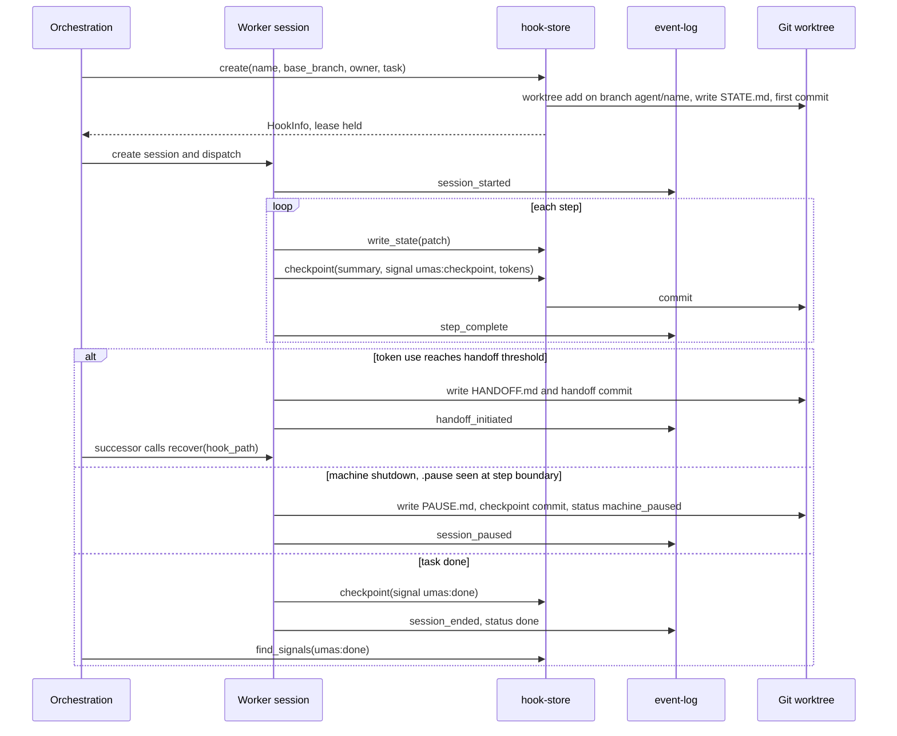

# Context Persistence — module spec

> Part of the UMAS technical design. Main spec: [TECHNICAL-DESIGN-SPEC.md](../../TECHNICAL-DESIGN-SPEC.md) · Module map: [module map](../../TECHNICAL-DESIGN-SPEC.md#5-component-design)
> **Owns:** durable per-work state: hook worktrees, state and checkpoint commits, the event log, handoff and pause files, and decision artifacts.
> **Uses:** [hook-store](../../../libs/hook-store/README.md) · [event-log](../../../libs/event-log/README.md) · [decision-artifacts](../../../libs/decision-artifacts/README.md)
> **Depends on modules:** none in the moved text (it links only to libs). The neighbours in Part B are listed in section 6.

---

## 5.1 Context Persistence System

**Storage:** Each agent gets a Git worktree inside `.umas/worktrees/<hook-name>/`. The worktree is linked to the main repo but is a separate working directory — agents commit state directly to their worktree branch.

**State commit protocol:**
- Agent commits after every major step
- Commit message format: `[umas] <agent-id> <step-summary> [tokens: N]`
- A `STATE.md` file in the worktree root holds: current task, recent decisions (last 10), explicit next steps, and references to relevant files

**Session discovery:** All agent operations are appended to `.umas/events.jsonl` (append-only, one JSON object per line). On handoff or restart, the incoming agent queries this log filtered by `hook_path`.

```json
{ "ts": "2024-01-15T10:23:01Z", "agent": "alice", "hook": "auth-login/", "event": "step_complete", "summary": "validation logic done, email check pending" }
```

**Decision artifacts location:**

| Artifact | Location |
|----------|----------|
| PRFAQ | `docs/product/<feature>.prfaq.md` |
| ADR | `docs/decisions/ADR-<NNN>-<title>.md` |
| Spec | `docs/specs/<feature>.spec.md` |
| GLOSSARY | `GLOSSARY.md` (repo root) |

**Standalone libs:** [hook-store](../../../libs/hook-store/README.md) · [event-log](../../../libs/event-log/README.md) · [decision-artifacts](../../../libs/decision-artifacts/README.md)

---

## Detailed design

Tags used below. **src** = the claim is in the main spec snapshot or a lib README, with the section cited. **proposed** = my reading of how the pieces fit. Every open point is in section 9 and is not decided here.

### 1. Purpose and boundary

This module keeps each unit of work resumable from files and git alone. The hook (a git worktree) holds the working state, the event log holds what happened, and decision artifacts hold durable choices. A successor agent, a restarted daemon or a person can rebuild context from these without a database. (src: main §2.1 Context Persistence Layer; hook-store §1; agent-session §5.5.)

Files and git are the record. The `agent_sessions` row in the database is a UMAS-side index. UMAS reads the files to update it. (src: agent-session §9.) The row shape is the Agent Sessions table in [main §4](../../TECHNICAL-DESIGN-SPEC.md#agent-sessions). Events are scoped by `task_id`, which is the work bundle's task. The Projects and Work Bundles tables are in [main §4](../../TECHNICAL-DESIGN-SPEC.md#4-data-model). This module reads `hook_path` and `task_id` from them and does not change them.

This module does not:
- Schedule, assign or dispatch work. That is [orchestration](../orchestration/orchestration-spec.md). (src: hook-store §2 non-goals.)
- Merge hook branches. That is [verification](../verification/verification-spec.md) and the [merge-queue](../../../libs/merge-queue/README.md) lib.
- Decide what to do with a stale or dirty hook. It reports facts (`list`, `recover`). The rules are in [exception-flows §6.8](../exception-flows/exception-flows-spec.md#68-stale-worktrees-after-agent-crash). (src: hook-store §5.5, "The library provides ... but never decides".)
- Detect or ladder-restart stuck agents. That is [monitoring](../monitoring/monitoring-spec.md). (src: main §5.5.)
- Set token thresholds or allocate budget. That is [budget-and-models](../budget-and-models/budget-and-models-spec.md). This module builds the handoff packet from `budget-meter.pack()`. (src: main §5.6.)
- Authorise anything. The consuming application checks access first, then passes an `actor` string into the events. (src: main Appendix A.5.7, "Standalone libs".)
- Call an LLM. (src: agent-session §2 non-goals.)

### 2. Flow

Happy path, then the failure paths the main spec describes.

1. Orchestration calls `create(name, base_branch, owner, task)` in hook-store. hook-store adds the worktree at `.umas/worktrees/<name>/` on branch `agent/<name>`, writes `STATE.md`, commits it with summary `hook created`, and takes the lease. (src: hook-store §4, §5.1; main §1.2, §5.1.)
2. Orchestration calls `create(config, task, hook_path, event_log_dir)` in agent-session. The session writes its first `STATE.md` and appends `session_started`. (src: agent-session §4.)
3. The worker calls `execute(session, execute_step_fn)`. For each step it adds the step's tokens to `token_used`, then calls `checkpoint`. That writes `STATE.md`, makes a checkpoint commit and appends `step_complete`. The default `checkpoint_every` is 1, so every step commits. (src: agent-session §5.1, §5.2, §6; main §5.1 "Agent commits after every major step".)
4. The lease is renewed with `heartbeat` while the worker runs. The renewal point is at each step boundary. (proposed. hook-store §3.3 and §4 define the call; the cadence is not in the source. See Open 9.)
5. When the task is done, `done(session, step)` writes the final `STATE.md`, makes the done commit and appends `session_ended` with `status: done`. The Scheduler sees the done commit with `find_signals("umas:done")`. (src: agent-session §4, §5.3; hook-store §4, §12 known consumers.) Releasing the lease with `complete(name)` is proposed as a step after the done commit. The caller is not named in the source. See Open 18.



Failure paths, in text:

6. **Token threshold (handoff).** At 90 % of `token_limit` the session writes a graceful handoff. At 95 % it writes an emergency handoff. `handoff(session)` packs the registered sections with budget-meter, writes `HANDOFF.md`, makes a `[handoff]` commit and appends `handoff_initiated`. A successor starts with `recover(hook_path, event_log_dir, task_id)`. It reads `PAUSE.md` first if it exists, then `STATE.md`, then `HANDOFF.md`. It folds the `step_complete` events for the task. (src: agent-session §5.1, §5.5; main §5.6.) Who triggers the 95 % handoff is open. See Open 13.
7. **Machine shutdown, clean pause.** The daemon writes `<hook-path>/.pause`. Each agent sees it at the next step boundary and calls `pause(session, reason)`. That writes `PAUSE.md` and `STATE.md`, makes a checkpoint commit, sets status `machine_paused`, appends `session_paused` and deletes the heartbeat file. The grace window is 30 s. An agent that does not finish in time is recovered from its last `STATE.md`. No committed data is lost. (src: agent-session §5.6; main §6.17 "Pre-shutdown: clean pause".)
8. **Boot recovery.** `umas start-all` reads sessions in `active`, `machine_paused` or `auth_expired`. If the token is expired, the session becomes `auth_expired` and waits for a human. If the token is valid and `PAUSE.md` exists, the session is recovered and dispatch resumes. If `PAUSE.md` does not exist, the session is treated as crashed and [exception-flows §6.8](../exception-flows/exception-flows-spec.md#68-stale-worktrees-after-agent-crash) applies. (src: main §6.17 "Boot recovery".)
9. **Crash without pause.** The lease stops being live when its `heartbeat_at` is older than `lease_ttl`. The hook status becomes `idle`, then `stale` after `stale_after`. A dirty stale hook is never removed automatically. `umas worktrees recover <name>` uses `recover` and `transfer`. (src: hook-store §3.3, §3.4, §5.4; main §6.8.)

### 3. Interfaces

| Name | Direction | Carrier | Payload (fields and types) | Owner |
|------|-----------|---------|----------------------------|-------|
| Create hook | in, from orchestration | function call, `hook-store.create` | `name`, `base_branch`, `owner`, `task?`. Returns `HookInfo`: `name, path, branch, status, dirty, owner, lease_live, last_commit, last_activity_at, age, base_branch` (src: hook-store §3.5) | this module (lib: hook-store) |
| Open hook | in, from orchestration | function call, `open` | `name`, `owner`. Fails `LeaseHeld` if another live lease exists (src: hook-store §4) | this module |
| Write state | in, from agent-execution | function call, `write_state` | Front matter fields: `task`, `owner`, `progress_percent`, `decisions[]` (`at`, `decision`, `rationale`), `next_steps[]`, `refs[]` (`path`, `lines`) (src: hook-store §3.2). See Open 1 | this module |
| State file | out | file, `STATE.md` in worktree root | Front matter (above) plus free Markdown body. Body sections in agent-session §3.6: Current task, Progress, Next steps, Recent decisions, Relevant files. See Open 1 | this module |
| Checkpoint commit | out | git commit, via `checkpoint(name, summary, signal?, files?)` | Subject either `[umas] <agent-id> <step-summary> [tokens: N]` (main §5.1) or `[umas:checkpoint] <summary>` (main §5.3). Open 2 and 3 choose one. Trailers: `Hook`, `Owner`, `Tokens` (src: hook-store §5.2) | this module |
| Done commit | out | git commit, `signal = "umas:done"` | Subject `[umas:done] <task-id>` (src: main §5.3) | this module. Read by the Scheduler in orchestration |
| Find signal | in, from orchestration and monitoring | function call, `find_signals(name, pattern, since?)` | Returns commits whose subject or trailers match `pattern` (src: hook-store §4) | this module |
| Hook recovery | in, from successor or exception-flows | function call, `recover(name)` | `{ last_committed_state, last_commit, dirty, uncommitted_diff_stat, lease }`. Read only (src: hook-store §4) | this module |
| Session recovery | in, from successor agent | function call, `recover(hook_path, event_log_dir, task_id)` | `RecoveredContext`, the same shape as the first `execute_step_fn` input (src: agent-session §4, §5.5) | this module |
| Lease file | out and in | file, `<root>/.leases/<hook>.json`, not in the worktree | `{ schema_version, hook, owner, pid, host, acquired_at, heartbeat_at }` (src: hook-store §3.3) | this module |
| Event append | out | file, `.umas/events.jsonl`, via `append` | Envelope `{ v, id, ts, type, source, scope?, trace?, data }`. `scope` = `task_id`, `source` = `event_source` (src: event-log §3.1; agent-session §5.8). Event types: Open 4 | this module |
| Event poll | in, from orchestration and monitoring | function call, `poll(cursor?, filter?, limit?)` | Returns `{ events, cursor }`. Each consumer keeps its own cursor (src: event-log §4, §5.2) | this module |
| Pause signal | in, to agent | file, `<hook-path>/.pause` | `{ "v": 1, "reason": "machine_shutdown", "ts", "grace_seconds": 30 }` (src: agent-session §5.6) | written by the application (see exception-flows §6.17); read here at each step boundary |
| Pause file | out | file, `PAUSE.md` in worktree root | Format defined in [exception-flows §6.17](../exception-flows/exception-flows-spec.md#617-machine-shutdown-and-boot-recovery). Field names differ. See Open 14 | exception-flows (format); this module (writer) |
| Handoff file | out | file, `HANDOFF.md` in worktree root | `HandoffPacket`: `schema_version, session_id, task_id, task_summary, progress, next_steps[], decisions[], file_pointers[], token_used, token_limit, packed_at` (src: agent-session §3.5) | this module |
| Decision artifact | out, from specialists; in, from all agents | file, under `docs/`, via `create`, `get`, `list` | Front matter: `schema_version, kind, id, title, status, author, created, updated, supersedes, superseded_by, links` (src: decision-artifacts §3.2) | this module (lib: decision-artifacts) |
| Hook status | out, to interfaces | function call, `list(filter?)`; CLI `umas worktrees list` | `HookInfo[]`. Status: `active`, `idle`, `stale`, `completed`, `abandoned`. `dirty` is a separate boolean (src: hook-store §3.4) | this module; command surface in [interfaces](../interfaces/interfaces-spec.md#cli-commands) |

### 4. Parameters

Defaults come from the main spec snapshot. Where the snapshot has no default, the cell says `not set`, and the item is in Open.

| Name | Type | Default | Where set | What it changes |
|------|------|---------|-----------|-----------------|
| `worktree_base_path` (hook-store `root`) | path | `.umas/worktrees/` | config (main §1.2) | Where hook worktrees are created |
| `branch_prefix` | string | `agent/` | config (main §1.2) | Branch name `agent/<hook>`. hook-store's own default is `hook`. See Open 6 |
| `events file` | path | `.umas/events.jsonl` | config, UMAS contract (main §5.1) | Event log location. See Open 5 |
| `event_source` | string | `""`, set to `agent_id` by the caller | caller (agent-session §3.3, §6) | Written as `source` on every event |
| `commit template` | string | `[umas] <agent-id> <step-summary> [tokens: N]` | config (main §5.1) | Checkpoint commit subject. See Open 3 |
| `commit_prefixes.done` | string | `[umas:done]` | config, set at startup (main §5.3; agent-session §9 says UMAS sets it at startup) | Done signal prefix. Library default is `[done]`. See Open 2 |
| `commit_prefixes.checkpoint` | string | `[umas:checkpoint]` | config, set at startup (main §5.3; agent-session §9) | Checkpoint signal prefix. Library default is `[checkpoint]`. See Open 2 |
| `state_file` | filename | `STATE.md` | config (agent-session §6) | Name of the state file in the worktree root |
| `handoff_file` | filename | `HANDOFF.md` | config (agent-session §6) | Name of the handoff packet |
| `pause_file` | filename | `PAUSE.md` | config (agent-session §6) | Name of the clean-pause file |
| `pause_signal_file` | filename | `.pause` | config (agent-session §6) | Written by the daemon, read at each step boundary |
| `checkpoint_every` | int | `1` | `SessionConfig` (agent-session §3.3, §6) | Commit `STATE.md` every N steps. See Open 15 |
| `shutdown_grace_seconds` | int | `30` | config (main §6.17; agent-session §6) | Time an agent has to reach a pause checkpoint |
| `decisions_in_state` (= hook-store `max_decisions`) | int | `10` | config (main §5.1; agent-session §6; hook-store §3.2) | Recent decisions kept in `STATE.md`. Older ones are dropped |
| `decisions_in_packet` | int | `10` | config (agent-session §6) | Recent decisions in `HANDOFF.md` |
| `handoff_packet_size` | int (tokens) | `15000` | config (agent-session §3.3, §6; main §5.6) | Size cap on the handoff packet |
| `compression_level` | string | `lite` | `SessionConfig` (agent-session §3.3, §6) | Passed to budget-meter `pack()` |
| `handoff_threshold` | float | `0.90` | `SessionConfig`; owned by budget-and-models (main §5.6) | Soft handoff trigger |
| `emergency_threshold` | float | `0.95` | `SessionConfig`; owned by budget-and-models (main §5.6) | Emergency handoff trigger |
| `token_limit` | int | `200000` | `SessionConfig` (main §5.2 coordinator config; agent-session §6) | Per-session token ceiling |
| `stale_after_hours` | int | `24` | hook-store config (main §6.8 gives 24 h) | Age at which a non-live hook becomes `stale` |
| `prune_stale_after_hours` | int | `168` | hook-store `gc` (main §6.8 gives 7 days) | Age before a clean stale hook may be removed |
| `gc.auto_remove` | bool | `false` | hook-store `gc` (implied by main §6.8, "prompt for deletion") | Off means removal needs a human |
| `lease_ttl_seconds` | int | `not set` (lib default 300) | hook-store config (hook-store §6) | Lease live window. See Open 10 |
| `abandon_after_hours` | int | `not set` (lib default 168) | hook-store config (hook-store §6) | Age at which a stale hook may be marked `abandoned`. See Open 10 |
| `git_lock_timeout_seconds` | int | `not set` (lib default 10) | hook-store config (hook-store §6) | Wait for `index.lock`. See Open 10 |
| `durability` | enum | `not set` (lib default `buffered`) | event-log config (event-log §6) | `buffered` or `fsync` per append. See Open 8 |
| `retain_days` | int | `90` | event-log config (main §8; §6.16; event-log §6) | Segments older than this are pruned |

The other event-log keys (`max_line_bytes`, `rotate_bytes`, `rotate_daily`, `compress_after_days`, `partial_grace_seconds`) keep their library defaults (event-log §6). The UMAS config does not set them in the source.

### 5. Capabilities

Permission names are the ones in main Appendix A.5. A.5.4 gives human permissions per role and A.5.5 gives agent capabilities per role. Neither names a `resource:action` for hook or worktree operations. Those rows say so and point to Open 17.

| Capability | Who | Permission | Source |
|-----------|-----|-----------|--------|
| Commit state and done signals to own hook branch | Worker (Developer) agent | none named. Role: "read, write, commit to own hook branch" | A.5.5 |
| Create a hook (worktree, branch, lease) | Coordinator | none named. Role: "spawn, stop" and "create, assign" tasks | A.5.5 |
| Append events | Worker, Coordinator, Specialist, Monitor agents | none named. Role: "append" | A.5.5 "Events" column |
| Write decision artifacts (PRFAQ, ADR, spec, glossary) | Specialist agents (Analyst, PM, UX, Architect) | none named. Role: "write" | A.5.5 |
| Read the audit log (events) | Admin (S), Project Owner (P), Auditor (S) | `audit:read` | A.5.4, "Read the audit log" |
| View hooks and agent state (`umas worktrees list`, `umas debug context`) | Admin, Project Owner, Developer, Approver, Operator, Viewer | none named. Scope S or P as in A.5.4 | A.5.4 row "View agents, tasks, work bundles, merge queue". Hooks are not named in that row; this mapping is proposed |
| Pause an agent (`umas agents pause`) | Admin (S), Project Owner (P), Developer (own), Operator (S) | none named | A.5.4, "Stop or pause an agent" |
| Recover or clean stale hooks (`umas worktrees recover`, `clean --stale`) | Not in A.5.4 | none defined. See Open 17 | — |
| Boot recovery (`umas start-all`) | Daemon (service account) | none defined. Watchdog daemon has "restart processes" | A.5.2, A.5.5 |

No capability in this table lets an agent write outside its own worktree. (src: main §8 "Agents"; A.5.5 rules.)

### 6. Interaction with other modules

| Neighbour | What this module sends or receives | Carrier | Sync or async |
|-----------|-------------------------------------|---------|---------------|
| [orchestration](../orchestration/orchestration-spec.md) | Receives `create`/`open` calls. Sends done and checkpoint commits. Serves `find_signals` and `poll` to the Scheduler and Coordinator | function call; git commit; event file | Calls: sync. Signals: async, read by polling |
| [agent-execution](../agent-execution/agent-execution-spec.md) | Receives `execute_step_fn` results. Writes `STATE.md`, checkpoint, handoff and pause files. Reads `.pause` at each step. Receives `recover` on resume | function call; files in the worktree | Sync per step |
| [verification](../verification/verification-spec.md) | Hook branches are the input to the merge queue. This module does not merge them | git branch | Async |
| [monitoring](../monitoring/monitoring-spec.md) | Project Monitor reads the age of the last `STATE.md` commit, the `last_activity_at` of each hook, and events. Triage and Patrol read hook status | git read; `list`; event poll | Async, polled every 60 s (main §5.5) |
| [exception-flows](../exception-flows/exception-flows-spec.md) | §6.3 corrupted event log: proposed mapping to event-log `verify` and `repair` (main §6.3 does not name them; Open 16). §6.8 uses `list`, `recover`, `transfer`, `gc`. §6.16 relies on atomic writes and ENOSPC handling. §6.17 uses `PAUSE.md`, `recover` and the `.pause` signal | function call; files | Sync for the operator actions; async for detection |
| [budget-and-models](../budget-and-models/budget-and-models-spec.md) | Receives thresholds and `token_limit`. Sends `token_used` as commit tags and events. Uses budget-meter `pack()` for the handoff packet | function call; commit trailer; event | Sync |
| [access-control](../access-control/access-control-spec.md) | Writes the `actor` string into every event. Audit reads come from the event log under `audit:read`. The agent identity is the `source` field | event field; permission check in the caller | Sync |
| [interfaces](../interfaces/interfaces-spec.md) | CLI commands read hook status and events, and `debug context` reads session context. The REST list in main §7 has no hook or event endpoint. See Open 19 | CLI; REST | Sync |
| [agent-platform](../../../libs/agent-platform/README.md) (lib) | Each harness adapter must honour `.pause` at step boundaries (main §6.17 "Standalone lib impact") | file poll | Async |

### 7. Libraries and packs used

- **[hook-store](../../../libs/hook-store/README.md):** worktrees, the `STATE.md` front matter, the lease, checkpoint and done commits, `find_signals`, `recover`, `list`, `gc`, `transfer`. This module's storage layer.
- **[event-log](../../../libs/event-log/README.md):** the `events.jsonl` envelope, atomic appends, cursor `poll`, `fold` for session context, `verify` and `repair`, `prune` with 90-day retention.
- **[agent-session](../../../libs/agent-session/README.md):** session lifecycle, `STATE.md` body, `HANDOFF.md`, `PAUSE.md` writing, `recover`, the commit prefixes and event types.
- **[decision-artifacts](../../../libs/decision-artifacts/README.md):** PRFAQ, ADR, spec and glossary files, numbering, `check`, and the shortcut ledger.
- **[budget-meter](../../../libs/budget-meter/README.md):** `pack()` builds the handoff packet from registered sections.
- **[error-classifier](../../../libs/error-classifier/README.md):** optional error record vocabulary. UMAS maps the typed errors below to records (hook-store §7, event-log §7, agent-session §7).

### 8. Failure handling

Each row names the failure, the item in main §6 or the lib that defines it, and what this module does.

- **Corrupted `events.jsonl`** (main §6.3; event-log §5.4). event-log `verify` finds bad lines. `repair` moves bad lines to `quarantine/` and never reorders events. Unreadable file: moved aside, new segment started, a `log.repaired` event is written. This differs from §6.3, which starts an empty log. See Open 16.
- **Stale or dirty hook after a crash** (main §6.8; hook-store §5.4). A dirty stale hook is never removed. Facts come from `list` and `recover`. The decision is the operator's.
- **Disk full on commit** (main §6.16; hook-store §7 `DiskFull`; event-log §7 `DiskFull`). The previous committed state is kept. The commit is retried once after 5 s, then a P0 escalation is appended. Events and decision artifacts are never removed (main §6.16).
- **Machine shutdown and boot** (main §6.17; agent-session §5.6). Clean pause writes `PAUSE.md`. An unclean stop leaves `STATE.md` as the recovery surface. `auth_expired` waits for a human. No timeout applies to `machine_paused` or `auth_expired`.
- **Concurrent writers** (main §6.13). hook-store takes a repo-level lock with `GitBusy` after `git_lock_timeout`. Per-hook writes need the lease, else `NotOwner`. `LeaseHeld` stops a second owner.
- **Database failure** (main §6.12). **proposed:** this module keeps working, because files and git are the record. The `agent_sessions` row is UMAS's index and can lag.
- **Step raises an exception** (agent-session §5.1, §7 `StepFnError`). The session writes `STATE.md` with `crashed`, appends `session_ended` with `status: crashed`, and re-raises.
- **Commit fails** (agent-session §7 `CommitFailed`). The state is kept. The commit is retryable.
- **Event append fails** (agent-session §7 `EventLogWriteFailed`). Execution continues. The state is still in the worktree.
- **Recovery has no state** (agent-session §7 `RecoveryIncomplete`). A minimal `RecoveredContext` is built from the task. It is flagged `recovery_degraded: true`.
- **Handoff section too large** (agent-session §7 `RequiredSectionTooLarge`). `handoff()` fails with sizes. The caller shrinks the required sections or raises `handoff_packet_size`.
- **Hook name or branch exists** (hook-store §7 `AlreadyExists`). Fail, nothing changed.
- **Worktree missing** (hook-store §7 `WorktreeMissing`). `list` reports `missing`. Only `gc` runs `git worktree prune`.
- **Line too large, invalid type, permission, lock timeout** (event-log §7). Reject, or fail with `LockTimeout` as retryable.

### 9. Open

Each item states the decision it needs and a recommendation. Nothing here is decided.

1. **STATE.md shape.** hook-store §3.2 defines YAML front matter and an opaque body. agent-session §3.6 defines Markdown with `**Status:**` lines and no front matter. Both claim the file. *Decision needed:* one schema. *Recommendation:* front matter for machine fields (hook-store), body sections for people (agent-session), and agent-session's status line moved into front matter as `status`.
2. **Signal prefixes.** main §5.3 uses `[umas:done]` and `[umas:checkpoint]`. agent-session §6 defaults are `[done]`, `[checkpoint]`, `[handoff]`. agent-platform uses `[done]` and `[blocked]` (main §14 Q8, still pending). *Decision needed:* one prefix set. *Recommendation:* the `umas:` prefixes of main §5.3, set at startup as agent-session §9 plans, and align agent-platform to them.
3. **Checkpoint message template.** main §5.1 uses `[umas] <agent-id> <step-summary> [tokens: N]`. agent-session §5.2 uses `[checkpoint] <agent_id> step <N>: <summary> [tokens: <n>]`. hook-store §5.2 uses `<signal> <summary>` with a `Tokens:` trailer. *Decision needed:* one template. *Recommendation:* hook-store format, with the `umas:` signal and `Tokens` as a trailer.
4. **Event type names.** Escalation is `escalate` in main §5.2 and §5.3 and event-log §9, but `session_escalated` in agent-session §5.8. Handoff is `handoff_request` in main §5.3 and event-log §9, but `handoff_initiated` in agent-session §5.8. event-log §12.2 has older names (`escalation_triggered`, `decision_made`). *Decision needed:* one event catalogue. event-log §10 says it belongs to the UMAS Tier 0 contract. *Recommendation:* `escalate` and `handoff_request` for signals that consumers poll for, and agent-session names for lifecycle events.
5. **Event log file name.** main §5.1 uses `.umas/events.jsonl`. event-log §10 notes that the legacy design also uses `.umas/.events.jsonl`. *Decision needed:* confirm the name in the Tier 0 contract. *Recommendation:* `events.jsonl`, as main §5.1 says.
6. **Branch prefix.** main §1.2 uses `agent/`. hook-store's default is `hook`. hook-store §12 (legacy) uses `agent/<agent>/<task>`. *Decision needed:* one prefix. *Recommendation:* `agent/`, set in hook-store config.
7. **ADR number width.** The §5.1 table above says `ADR-<NNN>`. decision-artifacts §3.1 uses `ADR-<NNNN>`. The repository's own files are `ADR-0001` to `ADR-0004`. *Decision needed:* width. *Recommendation:* four digits. The table is Part A and stays verbatim until the decision is made. The fix is then a one-line edit in this file.
8. **Event durability.** event-log §5.1 defaults to `buffered`. The audit requirement (main §8; A.5.7) and the low event volume (one event per step) favour `fsync`. *Decision needed:* durability for `events.jsonl`. *Recommendation:* `fsync`.
9. **Lease heartbeat cadence and liveness signal.** hook-store §3.3 uses a lease file with TTL. agent-session §5.6 deletes "the agent's heartbeat file", and watchdog §3.2 uses a heartbeat JSON. Two liveness signals exist. *Decision needed:* which one the Project Monitor and the watchdog read, and how often a worker renews. *Recommendation:* the lease for hook liveness, the heartbeat file only for process supervision. Renew at each step boundary.
10. **Lease TTL and abandon timing are not in the snapshot.** `lease_ttl_seconds`, `abandon_after_hours` and `git_lock_timeout_seconds` have library defaults only. *Decision needed:* confirm or set. *Recommendation:* keep the library defaults and record them in UMAS config.
11. **Branch deletion for abandoned hooks.** hook-store §11 Q3. *Decision needed:* may `gc` delete branches? *Recommendation:* manual only. Branches hold committed work, and main §6.8 leaves recovery to the human.
12. **Multi-host leases.** hook-store §11 Q2. Lease liveness uses pid checks, which work only on one host. *Decision needed:* is TTL-only acceptable on shared filesystems? *Recommendation:* not needed for the single-host MVP (main §5.8). Record the limit.
13. **Who triggers the 95 % emergency handoff.** agent-session §5.1 has the session call `handoff` at `emergency_threshold`. main §5.6 says the Project Monitor forces it. main §5.5 has the Monitor force it when no handoff request is seen. *Decision needed:* the trigger owner. *Recommendation:* the session at its own threshold, with the Monitor as the backstop when the session is unresponsive.
14. **PAUSE.md format and commit message.** agent-session §5.6 writes `paused_reason` and `paused_at`, and commits `[umas:checkpoint] <agent_id> — machine shutdown [tokens: <n>]`. main §6.17 uses `**Paused at:**`, `**Paused by:**` (values `machine_shutdown`, `user`, `budget`) and `[umas:checkpoint] <summary> — machine shutdown`. *Decision needed:* one format. exception-flows owns §6.17. *Recommendation:* the §6.17 format, with the `[tokens]` trailer agent-session writes.
15. **Checkpoint granularity and emergency checkpoints.** agent-session Open 1 (checkpoint by steps or tokens) and Open 4 (force a checkpoint above 80 % when no checkpoint exists). *Decision needed:* as agent-session states. *Recommendation:* defer to agent-session's owner.
16. **Corrupt-log recovery.** §6.3 backs up the whole file and starts an empty log. event-log §5.4 quarantines bad lines, or moves an unreadable file aside and records a `log.repaired` event. *Decision needed:* which behaviour the UMAS contract adopts. *Recommendation:* event-log §5.4, which keeps the history. Confirm in exception-flows.
17. **Permission names for hook operations.** A.5.4 and A.5.5 give capabilities per role, but no `resource:action` name for create hook, checkpoint, recover, clean or `worktrees recover`. A.5.6 says permissions are fixed in code. *Decision needed:* the names. *Recommendation (proposed):* `hook:create`, `hook:commit`, `worktree:recover`, `worktree:clean`.
18. **Who releases the lease at done.** hook-store §4 has `complete(name)`. The source does not say whether the Scheduler or the worker calls it. *Decision needed:* the caller. *Recommendation:* the worker calls `done`, then the Scheduler calls `complete` after it sees the done signal. The Scheduler owns the completion path.
19. **Viewer access to state content.** A.5.4 gives Viewer read access to agents, tasks and metrics, and says nothing about `STATE.md` text, decisions or events. *Decision needed:* what Viewer may read. *Recommendation (proposed):* hook status and event metadata for Viewer. Decisions, `next_steps` and event `data` need Developer or Auditor.
20. **Read endpoints for hooks and events.** main §7 REST list has agents, tasks, work bundles and metrics, but no hooks or events. The dashboard (ADR-0001) and `umas watch` need hook status and an event tail. *Decision needed:* add endpoints in the interfaces spec. *Recommendation (proposed):* `GET /api/v1/hooks` and `GET /api/v1/events?scope=`.
21. **Scheduler dispatch glue.** main §14 Q2 says the dispatch loop and per-task hook creation need a UMAS-side spec. The caller of `create` is therefore not yet fixed. *Decision needed:* owner of the create call. *Recommendation:* orchestration owns it, as Part B section 2 step 1 assumes.
22. **Concurrent sessions on one task.** agent-session Open 2. Only one active session per `task_id` is assumed. *Decision needed:* enforce in the library or in orchestration. *Recommendation:* orchestration.

AXI: this module defines no CLI commands of its own. The `umas` commands that read its data are in the [interfaces spec](../interfaces/interfaces-spec.md#cli-commands), which carries the AXI assessment.
