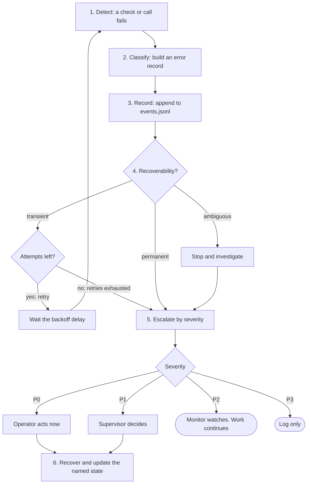

# Exception flows — module spec

> Part of the UMAS technical design. Main spec: [TECHNICAL-DESIGN-SPEC.md](../../TECHNICAL-DESIGN-SPEC.md) · Module map: [module map](../../TECHNICAL-DESIGN-SPEC.md#5-component-design)
> **Owns:** The 17 exception flows in section 6, as one cross-cutting view of trigger, detection, recovery and the state each flow leaves.
> **Uses:** [agent-session](../../../libs/agent-session/README.md) · [watchdog](../../../libs/watchdog/README.md) · [llm-gateway](../../../libs/llm-gateway/README.md) · [agent-platform](../../../libs/agent-platform/README.md)
> **Depends on modules:** [monitoring](../monitoring/monitoring-spec.md) · [verification](../verification/verification-spec.md) · [orchestration](../orchestration/orchestration-spec.md) · [budget-and-models](../budget-and-models/budget-and-models-spec.md)

## 6. Exception Flows

### 6.1 Force-Deleted Project

**Scenario:** `rm -rf ~/projects/my-api` while the project is still registered.

**Detection:** Lazy — on any UMAS operation referencing the project. Proactively during `umas health-check` and `umas project list`.

**Recovery:**

```
my-api  [ORPHANED — path not found: /Users/you/projects/my-api]

Options:
  1. Remove from database
  2. Re-register at new path
  3. Ignore for now

Choice [1-3]:
```

Option 3 sets status = `orphaned`. After 30 days unresolved, `umas health-check` escalates P2. Records are never auto-deleted.

---

### 6.2 Mid-Task Project Deletion (Agents Running)

**Detection:** Project Monitor's next health poll (within 60 s).

**Recovery:**
1. Mark all active sessions `crashed`
2. Escalate to System Patrol as P1
3. Mark in-flight bundles `failed: project_path_missing`
4. Notify human with worktree branch recovery instructions

Worktree branches committed before deletion still exist in the Git object store.

---

### 6.3 Corrupted `.umas/` Directory

**Detection:** On `umas init --project` and `umas health-check`.

**Recovery:** `umas init --project` is idempotent — recreates missing pieces without touching existing files.

- Missing files → recreated
- Corrupted `config.yaml` → backed up as `.bak`, replaced with defaults
- Corrupted `events.jsonl` → backed up, new empty log started (history loss warned)
- If the Git hook chain is broken → repaired automatically

---

### 6.4 Project Moved or Renamed

**Detection:** Same as [§6.1](#61-force-deleted-project).

**Recovery:** Orphaned prompt offers "Re-register at new path". Validates `git` repo and `.umas/` at new path. Only the `path` column is updated — all history is preserved.

---

### 6.5 Git Hook Conflict

| Detected type | Action |
|--------------|--------|
| `none` | Install UMAS hook directly |
| `plain_shell` | Prepend UMAS call |
| `husky` | Add UMAS hook in `.husky/pre-commit` |
| `lefthook` | Add UMAS step to `lefthook.yml` |
| `pre-commit-framework` | Add as local hook in `.pre-commit-config.yaml` |
| `binary` | Cannot chain — warn, skip, polling-only mode |

On `umas update`, only the `# umas-managed` marker line is replaced; all other hook entries are left untouched.

---

### 6.6 Token Budget Exhausted Mid-Task

**Behaviour:** In-progress agents complete their current atomic step and commit state. New dispatch is paused.

Agent steps when budget signal received:
1. Complete current atomic step
2. Commit: `[umas] budget-pause — state committed`
3. Set status `budget_paused`

When budget is increased via `umas project config --budget <N>`, Project Monitor resumes dispatch within 60 s — does not wait for UTC midnight.

---

### 6.7 LLM Provider Failure Mid-Task

**Retry policy:**

| Error type | Retry |
|-----------|-------|
| 429 Rate limit | Exponential backoff: 5s, 15s, 45s, then failover |
| 5xx Server error | 3 immediate retries, then failover |
| Timeout (>30s) | 2 retries, then failover |
| 401/403 Auth | No retry — P0 escalation immediately |

**Failover:** Uses `STATE.md` compressed context (same as handoff packet). Task does not restart from zero.

**No fallback configured:** P1 escalation. Recovery is human-initiated: `umas agents resume <session-id>`.

> Retry and circuit-breaker details: [libs/llm-gateway.md](../../../libs/llm-gateway/README.md)

---

### 6.8 Stale Worktrees After Agent Crash

| Age | Action |
|----|--------|
| < 24 h | Keep — agent may be recoverable |
| 24 h – 7 days | Mark `stale`, surface in `umas health-check` |
| > 7 days | Prompt for deletion |

If uncommitted changes are found, the worktree is tagged `stale-dirty` and never cleaned automatically. `umas worktrees recover <name>` spawns a triage agent to commit or discard the diff.

---

### 6.9 Merge Queue Bisect Finds No Clean Subset

All PRs moved to `blocked: failed_in_isolation`. Originating agents re-spawned to fix. Default retry limit: 3 consecutive failures per PR. Beyond that: P1 escalation, no further auto-spawning. Human resets with `--reset-retries`.

---

### 6.10 Dependency Deadlock in Work Bundle

**At creation time:** Coordinator runs cycle detection and dangling-reference check. Rejected bundles must be fixed before submission.

**At runtime:** If a blocking task is already `completed`, the Scheduler moves the blocked task to `ready_queue` on its next `on_task_complete` pass (self-healing, no escalation).

---

### 6.11 Agent Causes Test Regression

Merge Queue bisect isolates the offending PR. Agent is re-spawned with: failing test names, PR diff, and instruction to fix implementation (not the test). If the failing test has a `test_flaky` history, the suite re-runs once before escalating.

---

### 6.12 Database Corruption or Lock

**Lock:** Wait 5 s, then surface the holding PID and exit with instructions to remove WAL files.

**Corruption:** Daily backup at `database.db.bak` (also written on `umas update`). User prompted to restore. If no backup: fresh database, re-register projects. Worktree branches in Git are unaffected.

---

### 6.13 Concurrent CLI Processes

SQLite WAL: one writer, multiple readers. Advisory file lock (`~/.umas/.lock`) for write operations. Write commands wait up to 5 s for the lock.

Running `umas start-all` twice detects the existing PID in `daemon.pid` and exits cleanly.

---

### 6.14 `umas update` While Agents Are Active

Policy: **non-disruptive by default** — never terminates active sessions.

- Default: activate on next `umas start-all` after all sessions complete
- `--now`: all sessions checkpoint and pause → update applies → sessions resume
- Breaking schema change: migration runs automatically with `database.db.bak` written first

---

### 6.15 Dashboard / CLI Showing Stale State

`umas watch` shows a staleness warning when `last_heartbeat` delta > 2 min. Project Monitor reconciles stale sessions within 60 s. Manual: `umas agents reconcile`.

SQLite WAL sub-second read lag is not a bug — `umas watch` refreshes every 2 s.

---

### 6.16 Disk Space Exhaustion

| Free space | Action |
|-----------|--------|
| < 2 GB | P2 warning |
| < 500 MB | P1 — new dispatch paused |
| < 100 MB | P0 — all agents checkpointed and paused immediately |

`umas cleanup --dry-run` shows recoverable space. Decision artifacts (ADRs, PRFAQs, specs) and the last 90 days of `events.jsonl` are never removed.

If `git commit` fails `ENOSPC`: retry once after 5 s, then append P0 escalation to `events.jsonl`.

---

### 6.17 Machine Shutdown and Boot Recovery

> **Issue:** [#6 — agent pause feature](https://github.com/plaktoz/agentzero-v2-dev/issues/6) · daily laptop shutdown; must resume on next boot.

#### The problem

When the host machine is shut down, the OS kills processes without guaranteeing `SIGTERM` delivery before power-off. The daemon and all agents die. On next boot, nothing auto-resumes; sessions that were `active` are indistinguishable from crashed sessions. Additionally, OIDC access tokens (Keycloak JWT, default 5–15 min) expire while the machine is off — even sessions that checkpointed cleanly cannot re-authenticate without human action.

Two distinct sub-scenarios, two distinct statuses:

| Scenario | Status on detection | Resume path |
|----------|--------------------|----|
| Machine shut down while sessions were `active` | `machine_paused` | `umas start-all` on next boot auto-resumes |
| OIDC token expired (machine was off > token TTL) | `auth_expired` | Human re-authenticates; `umas auth login` then `umas start-all --resume` |

#### Pre-shutdown: clean pause (best case)

The daemon listens for `SIGTERM` and OS shutdown events (`systemd PreStop` / launchd `StopSignal`). When received:

1. Broadcast a `pause` signal to all active agents by writing `<hook-path>/.pause` (agents poll this file at each step boundary).
2. Each agent completes its current atomic step, commits `[umas:checkpoint] <summary> — machine shutdown`, sets status `machine_paused`, and writes `PAUSE.md` in the worktree root (same fields as `STATE.md` plus `paused_reason: machine_shutdown`).
3. Daemon writes `~/.umas/daemon.pid` with `status: paused` and exits cleanly.

Shutdown grace window: 30 seconds (configurable). Agents that do not checkpoint within the window have their last `STATE.md` treated as the recovery surface (graceful degradation, no data loss because all prior steps were committed).

#### Boot recovery: what `umas start-all` does

```
1. Daemon starts.
2. Read all sessions with status in {active, machine_paused, auth_expired}.
3. For each session:
   a. Check if an OIDC token is available and valid.
      - Valid  → status = active (re-attach to the worktree via agent-platform)
      - Expired → status = auth_expired; emit event; surface to human
   b. Check if PAUSE.md exists in the worktree.
      - Yes → clean pause: recover via recover(hook_path) → resume dispatch
      - No  → unclean shutdown: treat as crashed; follow [§6.8](#68-stale-worktrees-after-agent-crash) stale-worktree rules
4. Resume dispatch for all sessions that cleared step (a) and (b).
5. Emit a boot_recovery summary event to events.jsonl.
```

**`umas start-all` is idempotent.** Running it when the daemon is already up detects the existing PID and skips recovery.

#### Auth expiry recovery

```bash
umas auth login               # re-authenticate via OIDC; updates ~/.umas/token-cache
umas start-all --resume       # daemon starts, picks up auth_expired sessions,
                              # re-validates tokens, promotes to active, resumes dispatch
```

Sessions with `auth_expired` status are never auto-promoted without a fresh token. The human controls when to re-authenticate.

#### `PAUSE.md` format

Written to the worktree root alongside `STATE.md` on any clean pause (machine shutdown, `umas stop-all`, or manual `umas agents pause <id>`).

```markdown
# PAUSE: <task_id>

**Paused at:** <RFC 3339 UTC>
**Paused by:** <machine_shutdown | user | budget>
**Agent:** <agent_id>
**Session:** <session_id>
**Token usage at pause:** <token_used> / <token_limit>

#### State at pause
<same fields as STATE.md — current task, next steps, recent decisions, file pointers>
```

#### Session state additions

The `machine_paused` and `auth_expired` statuses slot into the existing state machine between `active` and the resumable states:

```
active → machine_paused → active           (boot recovery, token still valid)
active → machine_paused → auth_expired     (token expired during downtime)
auth_expired → active                      (after umas auth login + umas start-all --resume)
```

Sessions that were `spawned` (never started) at shutdown time are reset to `pending` in the task queue — they had no state to lose.

#### No timeout for `machine_paused` / `auth_expired`

Unlike `budget_paused` (24-hour timeout), these statuses have **no expiry**. A laptop that stays off for a week resumes cleanly. `umas health-check` surfaces them as informational (`machine_paused`) or actionable (`auth_expired`) — never as failures.

> **Standalone lib impact:** `agent-session` adds `machine_paused` and `auth_expired` to `SessionStatus` and a `pause()` operation ([§3.2](../../../libs/agent-session/README.md#32-sessionstatus), [§4](../../../libs/agent-session/README.md#4-interface)). `watchdog` adds a boot-time stale-detection rule ([§7](../../../libs/watchdog/README.md#7-failure-modes)). `agent-platform` must honour `<hook-path>/.pause` polling at step boundaries.

---

## Detailed design

Each claim is **from source** (the section or lib README is cited) or **proposed** (the spec author's reading of how the pieces fit). Proposed content is listed in Open where an owner must decide. Table cells with no mark come from Part A section 6 or from the lib named in the row.

### 1. Purpose and boundary

- This module gives one view of the 17 flows in section 6: trigger, detection, recovery and state. **From source:** section 6.
- It sets one shared recovery pattern that each flow follows (see 2.2 below). **Proposed.**
- It does not change any flow. Each flow stays in section 6. Each owner module runs its own detection and recovery (Part A, section 6). **Proposed.**
- It does not classify with a model. Classification is rule-based. **From source:** [error-classifier](../../../libs/error-classifier/README.md) section 5.1.

### 2. Flow

#### 2.1 Flow register

Severity comes from section 6 where section 6 names one. Recoverability comes from a retry rule in section 6, or from the examples in [error-classifier](../../../libs/error-classifier/README.md) section 3.2 (marked **proposed**). Otherwise the cell says "not given".

| Flow | Trigger | Detected by | Recovered by | State left behind | Error class |
|------|---------|-------------|--------------|-------------------|-------------|
| 6.1 Force-deleted project | Project path removed while still registered | Any UMAS operation; `umas health-check`; `umas project list` | Human at the prompt: remove, re-register or ignore | Status `orphaned` (ignore option). No records deleted | P2 after 30 days unresolved. Recoverability not given |
| 6.2 Mid-task project deletion | Project path missing while agents run | Project Monitor poll, within 60 s | Escalation to System Patrol as P1. Human gets a notice | Sessions `crashed`. Bundles `failed: project_path_missing`. P1 escalation | P1. Recoverability not given |
| 6.3 Corrupted `.umas/` directory | Missing or corrupt files | `umas init --project`; `umas health-check` | `umas init --project`, which is idempotent | Missing files recreated. Bad `config.yaml` saved as `.bak`. Bad `events.jsonl` saved, and an empty log started | Not given |
| 6.4 Project moved or renamed | Project path changed | As 6.1 | Re-register at the new path | `path` column updated. History kept | Not given |
| 6.5 Git hook conflict | Existing hook manager found | `umas init --project`; `umas update` | UMAS installs or chains its hook by hook type | `# umas-managed` line in the hook file. Polling-only mode for `binary` | Not given |
| 6.6 Token budget exhausted mid-task | Daily project budget at 100% | Budget signal | Agents finish the current step. New dispatch paused. Dispatch resumes within 60 s after the budget rises | Commit `[umas] budget-pause — state committed`. Status `budget_paused` | Not given |
| 6.7 LLM provider failure mid-task | 429, 5xx, timeout over 30 s, or 401/403 | [llm-gateway](../../../libs/llm-gateway/README.md) error classes | Retry, then failover. With no fallback, human runs `umas agents resume <session-id>` | `STATE.md` in the worktree. P0 escalation (401/403) or P1 escalation (no fallback) | 401/403: P0. No fallback: P1. 429, 5xx and timeout: transient. 401/403: permanent (from source: llm-gateway section 3.3) |
| 6.8 Stale worktrees after agent crash | Agent crash leaves a worktree. Age 24 h, then 7 days | `umas health-check`, by age | Human, or `umas worktrees recover <name>` (triage agent) | Worktree marked `stale`. Tagged `stale-dirty` if uncommitted changes. Never cleaned automatically when dirty | Not given |
| 6.9 Merge queue bisect finds no clean subset | Bisect finds no passing subset | Merge queue bisect | Originating agents re-spawned. After 3 consecutive failures per PR: P1 escalation. Human resets with `--reset-retries` | PR `blocked: failed_in_isolation`. Retry count | P1 beyond 3 failures. Recoverability not given |
| 6.10 Dependency deadlock in work bundle | Cycle or dangling reference at creation. Blocking task already `completed` at runtime | Coordinator (creation). Scheduler (runtime) | Creation: bundle rejected. Runtime: task moved to `ready_queue` | Rejected bundle. Task in `ready_queue` | Not given |
| 6.11 Agent causes test regression | Bisect isolates one PR | Merge queue bisect | Agent re-spawned with failing tests, diff and "fix the implementation, not the test". Suite re-run once if the test is flaky | Re-spawned agent. Flaky history | Not given |
| 6.12 Database corruption or lock | Lock held, or database corrupt | Write command waits 5 s for the lock. Corruption check not named | Lock: human removes WAL files. Corruption: restore `database.db.bak`, or start fresh and re-register projects | `database.db.bak`. Fresh database when no backup | Lock: transient (from source: error-classifier section 3.2 example, "brief file lock"). Corruption: not given |
| 6.13 Concurrent CLI processes | Two write commands, or a second `umas start-all` | Write lock wait (5 s). `daemon.pid` check | Write waits up to 5 s. Second `start-all` exits cleanly | Lock released. `daemon.pid` unchanged | Transient (**proposed**; event-log maps `LockTimeout` to transient) |
| 6.14 `umas update` while agents are active | `umas update` with active sessions | `umas update` | Default: apply at next `umas start-all`. `--now`: checkpoint, pause, update, resume | `database.db.bak` before a schema migration. No commit stated | Not given |
| 6.15 Dashboard or CLI showing stale state | `last_heartbeat` delta over 2 min | `umas watch` staleness warning | Project Monitor reconciles within 60 s. Manual `umas agents reconcile` | Reconciled session state | Not given |
| 6.16 Disk space exhaustion | Free space under 2 GB, 500 MB or 100 MB. Or `git commit` fails with ENOSPC | Free-space check (method not named) | Under 2 GB: P2 warning. Under 500 MB: pause new dispatch. Under 100 MB: checkpoint and pause all agents. ENOSPC: retry once after 5 s, then P0 | P0 escalation appended to `events.jsonl` on ENOSPC. `umas cleanup --dry-run` shows recoverable space | P2, P1 or P0 by threshold. ENOSPC: P0. Recoverability: `ambiguous` (from source: event-log and hook-store, Error records in section 7) |
| 6.17 Machine shutdown and boot recovery | Shutdown signal (SIGTERM or OS event). Boot with sessions in `active`, `machine_paused` or `auth_expired` | Daemon on shutdown signal. `umas start-all` at boot | Pause: agents write `PAUSE.md`. Boot: resume, or `auth_expired` until `umas auth login` | `.pause` file. `PAUSE.md`. Statuses `machine_paused` and `auth_expired`. Boot summary event | Not given |

#### 2.2 Shared recovery flow (proposed)

1. Detect. A check or a call returns a failure. The owner module of the flow detects it.
2. Classify. Map the raw failure to an error record with `classify(raw, context, opts)`. The record has a code, a severity and a recoverability. **From source:** error-classifier section 4.
3. Record. Append the record to `events.jsonl`. Escalations use the `escalate` event. **Proposed:** every record is appended.
4. Decide by recoverability. **From source:** error-classifier section 5.3.
   - `transient`: call `retry_plan`. On `retry`, wait the delay and go to step 1. On `stop` with `retries_exhausted`, go to step 5.
   - `permanent`: go to step 5.
   - `ambiguous`: stop, investigate, and go to step 5.
5. Escalate by severity. **From source:** error-classifier section 3.1. P0: operator. P1: supervisor. P2: monitor watches. P3: log only. The register names no responder for each flow. See Open 1.
6. Recover and update state. Run the recovery steps of the flow. Write the state named in the register.

Retry counts and delays come from the flow. Section 6.7 and section 6.16 name them. When a flow names none, the error-classifier default applies: 3 attempts, 5 s base, factor 3, 300 s maximum (error-classifier section 6).



### 3. Interfaces

Carrier names come from sections 5 and 6. Rows marked **proposed** are new.

| Name | Direction | Carrier | Payload | Owner |
|------|-----------|---------|---------|-------|
| Error record | out | Function call: `classify(raw, context, opts) -> Record` (**proposed** use) | `schema_version`, `id`, `code`, `severity`, `recoverability`, `message`, `context.operation`, `context.timestamp`, `cause`, `recovery` | Consumer maps its errors to the record. Library: [error-classifier](../../../libs/error-classifier/README.md) |
| Escalate event | out (from agent), in (Coordinator) | Event in `events.jsonl`, written with `append` | `type: escalate`, `source`, `data: {severity, reason}`. **From source:** section 5.2 example | Writer: [agent-execution](../agent-execution/agent-execution-spec.md). Reader: [orchestration](../orchestration/orchestration-spec.md) |
| Pause signal | in (to agent) | File `<hook-path>/.pause` | `{v, reason, ts, grace_seconds}`. **From source:** [agent-session](../../../libs/agent-session/README.md) section 5.6 | Writer: daemon (**from source**, Part A 6.17). Reader: agents |
| Clean-pause record | out | File `PAUSE.md` in the worktree root | Fields in the `PAUSE.md` format (6.17). Names differ from agent-session (Open 3) | [context-persistence](../context-persistence/context-persistence-spec.md) (**proposed**) |
| Committed state | out | File `STATE.md` in the worktree root | Current task, progress, last 10 decisions, next steps, file references (section 5.1) | [context-persistence](../context-persistence/context-persistence-spec.md) |
| Session status | out | Database row | `status`: `active`, `machine_paused`, `auth_expired`, `budget_paused`, `crashed`. `provider_failed` (from source: agent-session section 3.2; its use for 6.7 is Open 11). Project `status`: `orphaned` | Main spec, [data model](../../TECHNICAL-DESIGN-SPEC.md#4-data-model) |
| Boot summary | out | Event `boot_recovery` in `events.jsonl` | Payload not given in section 6 (Open 5) | [interfaces](../interfaces/interfaces-spec.md) |
| Daemon status | out | File `~/.umas/daemon.pid` | `status: paused` after a clean stop | Daemon (**from source**, 6.17). Module owner (**proposed**): [interfaces](../interfaces/interfaces-spec.md) |
| Recovery commands | in | CLI | `umas health-check`, `umas init --project`, `umas start-all [--resume]`, `umas auth login`, `umas agents pause`, `umas agents resume <session-id>`, `umas agents reconcile`, `umas worktrees recover <name>`, `umas work-bundle retry <id> [--reset-retries]`, `umas update [--now]`, `umas cleanup --dry-run` | [interfaces](../interfaces/interfaces-spec.md) |

### 4. Parameters

Every value comes from section 6 or from a lib that section 6 uses. A value with no config key is marked "text only" (Open 13).

| Name | Type | Default | Where set | What it changes |
|------|------|---------|-----------|-----------------|
| Orphan escalation age | duration | 30 days | Text only (6.1) | Age at which `umas health-check` escalates an unresolved orphan to P2 |
| Project Monitor poll | duration | 60 s | Text only (6.2, section 5.5) | Interval for finding a deleted project and reconciling sessions |
| Staleness threshold | duration | 2 min | Text only (6.15) | Heartbeat age that shows a staleness warning in `umas watch` |
| Watch refresh | duration | 2 s | Text only (6.15) | Refresh interval of `umas watch` |
| Lock wait | duration | 5 s | Text only (6.12, 6.13) | Time a write waits for `~/.umas/.lock` before it fails |
| ENOSPC retry delay | duration | 5 s | Text only (6.16) | Wait before the one retry of a failed `git commit` |
| Disk thresholds | size | 2 GB, 500 MB, 100 MB | Text only (6.16) | Free space that raises P2, P1 and P0 |
| Budget exhausted | percent | 100% | Text only (6.6; budget-meter thresholds, section 5.1) | Usage that starts the exhaustion path |
| Provider backoff | seconds | 5, 15, 45 | [llm-gateway](../../../libs/llm-gateway/README.md) policy (section 3.3) | Delay between 429 retries |
| Provider timeout | seconds | 30 | [llm-gateway](../../../libs/llm-gateway/README.md) `timeout` (section 3.3) | Wait before the 2 timeout retries |
| Provider 5xx retries | count | 3 | [llm-gateway](../../../libs/llm-gateway/README.md) policy (section 3.3) | Immediate retries before failover |
| Merge retry limit | count | 3 | [merge-queue](../../../libs/merge-queue/README.md) `max_attempts` (section 6) | Consecutive failures per PR before P1 |
| Shutdown grace | seconds | 30 | [agent-session](../../../libs/agent-session/README.md) `shutdown_grace_seconds` (section 6) | Time an agent has to finish its step after `.pause` |
| Boot grace | seconds | 60 | [watchdog](../../../libs/watchdog/README.md) `startup_grace_seconds` (section 6) | Grace period for nodes at boot. Section 6.17 gives no boot limit (Open 12) |
| Stale age | hours | 24 (stale), 168 (prune) | [hook-store](../../../libs/hook-store/README.md) `stale_after_hours`, `prune_stale_after_hours` (section 6) | Age at which a worktree is `stale` (6.8) |
| Event retention | days | 90 | [event-log](../../../libs/event-log/README.md) `retain_days` (section 6) | Age before a segment can be pruned (6.16) |

### 5. Capabilities

No permission name in the snapshot covers most of these actions. The table gives the A.5.4 role row where one exists. Permission names are Open 14.

| Capability | Who can do it | Permission |
|------------|---------------|------------|
| Resolve an orphaned project: remove, re-register or ignore (6.1, 6.4) | Human. Create or delete a project is Admin only (A.5.4) | Not named |
| Pause an agent: `umas agents pause <session-id>` | Developer (own agent), Project Owner, Operator, Admin (A.5.4) | Not named |
| Start after a reboot: `umas start-all [--resume]` | Human | Not named |
| Sign in again after `auth_expired`: `umas auth login` | Human, through Keycloak sign-in ([access-control](../access-control/access-control-spec.md)) | None. Keycloak authenticates |
| Resume a session after provider failure: `umas agents resume <session-id>` | Human | Not named |
| Acknowledge a P0 escalation | Admin, Project Owner, Operator (A.5.4) | Not named |
| Reset a failed watchdog node or restart a service | Admin, Operator (A.5.4) | Not named |
| Retry a work bundle with `--reset-retries` | Human (not in the A.5.4 table) | Not named |
| Set a project budget: `umas project config --budget` | Admin, Project Owner up to the system cap (A.5.4) | Not named |
| Recover a stale worktree: `umas worktrees recover <name>` | Human, through a triage agent (6.8) | Not named |
| Commit a checkpoint and write `PAUSE.md` on pause | Agent, in its own worktree (A.5.5) | Agent role scope. No permission name |

### 6. Interaction with other modules

Owner assignments are **proposed** unless the section 6 text names the owner. Carriers and timing come from sections 5 and 6.

| Module | Exception flows it owns | What the flows exchange | Carrier | Sync or async |
|--------|-------------------------|-------------------------|---------|---------------|
| [interfaces](../interfaces/interfaces-spec.md) | 6.1, 6.3, 6.4, 6.5, 6.13, 6.14 | Commands run recovery. `umas start-all` writes the boot summary and `daemon.pid` | CLI, file | Sync |
| [monitoring](../monitoring/monitoring-spec.md) | 6.2, 6.15, 6.16 | Project Monitor detects a deleted project and reconciles sessions. P1 escalation to System Patrol | Poll (60 s), `escalate` event | Async |
| [verification](../verification/verification-spec.md) | 6.9, 6.11 | Bisect result, PR retry state, flaky flag | Merge queue state, event | Async |
| [orchestration](../orchestration/orchestration-spec.md) | 6.10 | Rejects a bundle at creation. Moves a task to `ready_queue`. Reads `escalate` events | Function call, event poll | Sync at creation. Async at runtime |
| [budget-and-models](../budget-and-models/budget-and-models-spec.md) | 6.6 | Budget signal. Dispatch pause. Status `budget_paused` | budget-meter events, database row | Async |
| [agent-execution](../agent-execution/agent-execution-spec.md) | 6.7 (Open 9). Pause poll in 6.17 | Provider errors in. Pause signal out | llm-gateway result, `.pause` file | Sync for provider calls. Async, polled at each step, for pause |
| [context-persistence](../context-persistence/context-persistence-spec.md) | 6.8, 6.17 (state files) | Worktree tags. `PAUSE.md` and `STATE.md` for recovery | Git commits and files in the worktree | Async |
| [access-control](../access-control/access-control-spec.md) | 6.17 (auth expiry part) | Token check at boot. Status `auth_expired` | Keycloak token (OIDC) | Sync at boot |
| Main spec, [data model](../../TECHNICAL-DESIGN-SPEC.md#4-data-model) | 6.12 (Open 10) | Database rows and statuses for 6.1, 6.2, 6.6 | SQLite database | Sync |

6.17 has no single owner. See Open 19.

### 7. Libraries and packs used

- [agent-session](../../../libs/agent-session/README.md): `pause()` writes `PAUSE.md` and sets `machine_paused`. `recover()` reads `PAUSE.md` first. Sections 3.2, 5.5, 5.6.
- [watchdog](../../../libs/watchdog/README.md): a node is `paused` when `PAUSE.md` exists and `.pause` does not. Boot-time `boot_stale` rule. Sections 6 and 7.
- [llm-gateway](../../../libs/llm-gateway/README.md): error classes and retry policy for 6.7. Sections 3.3, 5.1 to 5.3.
- [agent-platform](../../../libs/agent-platform/README.md): must honour `.pause` at step boundaries (from the 6.17 impact note). The README does not mention pause yet (Open 15).
- [error-classifier](../../../libs/error-classifier/README.md): record shape, P0 to P3, recoverability, `retry_plan`. Sections 3.1 to 3.3, 5.3.
- [hook-store](../../../libs/hook-store/README.md): `STATE.md`, the `stale` status and `dirty` flag, `recover`, `gc`. Sections 3.2, 3.4, 5.4, 5.5. Used by 6.8.
- [event-log](../../../libs/event-log/README.md): `events.jsonl` appends, `repair`, retention. Sections 5.3, 5.4, 9. Used by 6.3, 6.16.
- [budget-meter](../../../libs/budget-meter/README.md): thresholds and the `exhausted` event. Sections 3.3, 5.1. Used by 6.6.
- [merge-queue](../../../libs/merge-queue/README.md): block reasons, `rerun_on_fail`, `flaky_suspected`. Sections 3.3, 5.3. Used by 6.9, 6.11.
- [task-queue](../../../libs/task-queue/README.md): cycle and unknown-dependency rejection. Section 5.4. Used by 6.10.

No pack is used by these flows.

### 8. Failure handling

- **6.17, grace window missed.** The last `STATE.md` is the recovery surface. Boot step 3b then treats the session as crashed. See Open 2.
- **6.12, lock held.** The write fails after 5 s. The human removes the WAL files. No retry beyond the wait.
- **6.16, ENOSPC.** One retry after 5 s, then a P0 event. The P0 append itself can fail on a full disk. See Open 17.
- **6.7, no fallback.** P1 escalation. No automatic retry. Section 5.2 of [llm-gateway](../../../libs/llm-gateway/README.md) forbids blind retry loops.
- **6.9, retries exhausted.** P1 after 3 consecutive failures per PR. No auto-spawning after that.
- **6.2, project deleted mid-task.** Sessions become `crashed`. Nothing restarts them. The human decides.
- **Retries exhausted.** The record keeps its severity ([error-classifier](../../../libs/error-classifier/README.md) section 5.3). Whether a repeated `ambiguous` error raises severity is open in that lib (its section 11, item 4).

### 9. Open

1. **Open. P1 responder conflict.** Section 6.2 sends P1 to System Patrol. Appendix A.5.4.1 keeps P1 inside the agent layer, with the Coordinator. Decision: one P1 responder per flow. Recommendation: the Coordinator for work-level P1 (6.7, 6.9). System Patrol for monitor-level P1 (6.2). Record the choice in the register.
2. **Open. Missed grace window.** Section 6.17 treats the last `STATE.md` as the recovery surface when the window is missed. Boot step 3b treats a session without `PAUSE.md` as crashed and does not resume it (step 4). Decision: resume from `STATE.md`, or follow 6.8. Recommendation: resume when the worktree is clean. Follow 6.8 when it is dirty.
3. **Open. `PAUSE.md` field names.** Section 6.17 uses `Paused at` and `Paused by`. [agent-session](../../../libs/agent-session/README.md) section 5.6 uses `paused_at` and `paused_reason`. Decision: one set of names. Recommendation: the agent-session names, with the 6.17 values `machine_shutdown | user | budget`.
4. **Open. Escalation event name.** Sections 5.2 and 5.3 use `escalate`. [agent-session](../../../libs/agent-session/README.md) section 5.8 uses `session_escalated`. [event-log](../../../libs/event-log/README.md) section 9 uses `escalate`. Its section 12 sample uses `escalation_triggered`. Recommendation: `escalate` with `data: {severity, reason}`.
5. **Open. Boot summary event.** Section 6.17 writes `boot_recovery`. Agent-session section 5.8 writes `session_resumed` per session. Recommendation: keep both. `session_resumed` per session. `boot_recovery` once per boot. Confirm the payload.
6. **Open. Corrupt `events.jsonl`.** Section 6.3 backs up the file and starts an empty log, with the history loss warned. [event-log](../../../libs/event-log/README.md) section 5.4 moves the file to quarantine and records a `log.repaired` event. Recommendation: 6.3 uses `event-log repair`, so the loss stays in the log.
7. **Open. Merge queue naming.** Section 6.9 uses `blocked: failed_in_isolation` and `--reset-retries`. [merge-queue](../../../libs/merge-queue/README.md) section 3.3 uses the reasons `test_failure` and `max_attempts`. Its `requeue(id)` keeps attempts (section 4). Recommendation: keep `max_attempts` as the reason. Make the human reset clear attempts.
8. **Open. Stale numbering in libs.** [hook-store](../../../libs/hook-store/README.md) section 9 cites "exception flow 4.8". [merge-queue](../../../libs/merge-queue/README.md) section 9 cites "4.11". These are now 6.8 and 6.11. Recommendation: the lib README owners update the links. This module does not edit them.
9. **Open. Owner of 6.7.** Proposed: [agent-execution](../agent-execution/agent-execution-spec.md), because section 5.3 (Multi-Platform Support) names the llm-gateway provider registry. Alternative: [budget-and-models](../budget-and-models/budget-and-models-spec.md), which owns the model policy (5.7). Recommendation: agent-execution.
10. **Open. Owner of 6.12 and 6.16.** No module owns the database or free-space checks. The API process owns the relational store (Appendix A, [A.4.6](../../TECHNICAL-DESIGN-SPEC.md#a46-language-decision)). Recommendation: 6.12 stays with the main spec data model. 6.16 detection goes to monitoring.
11. **Open. Provider session status.** Section 6.7 names no status. Agent-session section 3.2 has `provider_failed`. Recommendation: use `provider_failed` for 6.7.
12. **Open. Missing check values.** Section 6.12 gives no corruption check. Section 6.16 gives no free-space check interval. Section 6.17 gives no boot time limit. Recommendation: use the watchdog `startup_grace_seconds` (60 s) for the boot limit. Use 60 s for the free-space check, matching the Project Monitor poll. Both are **proposed**.
13. **Open. Text-only parameters.** Section 4 lists values with no config key. Decision: which values become keys, and in which file. Recommendation: one recovery block in the [interfaces](../interfaces/interfaces-spec.md) config.
14. **Open. Permission names.** Section 5 lists actions with no permission name in Appendix A.5.4 and A.5.6. Decision: names for pause, resume, P0 acknowledge, node reset, budget and worktree recovery. Recommendation: [access-control](../access-control/access-control-spec.md) defines them in `resource:action` form. This module does not invent names.
15. **Open. `.pause` in agent-platform.** Section 6.17 assigns `.pause` polling to agent-platform. The [agent-platform](../../../libs/agent-platform/README.md) README does not mention pause. Recommendation: its owner adds the rule. Or [agent-execution](../agent-execution/agent-execution-spec.md) states it.
16. **Open. Budget commit prefix.** Section 6.6 commits `[umas] budget-pause`. Agent-session sections 5.2 to 5.4 define `[checkpoint]`, `[done]` and `[handoff]`, with no budget prefix. Decision: the prefix for a budget pause. Recommendation: add a `[budget-pause]` prefix to agent-session as a configuration parameter, as it does for the other prefixes.
17. **Open. P0 append on a full disk.** Section 6.16 appends the P0 event to `events.jsonl` after an ENOSPC. That append also needs disk space. Decision: a fallback location for the P0 record. Recommendation: a separate small file on the same volume, written first. Mark **proposed**.

18. **Open. Checkpoint prefix.** Section 6.17 commits `[umas:checkpoint] <summary> — machine shutdown`. Agent-session section 5.2 uses `[checkpoint]`, and section 5.6 uses `[umas:checkpoint]`. Decision: one checkpoint prefix. Recommendation: one prefix for every checkpoint commit, set in the agent-session configuration.
19. **Open. Owner of 6.17.** The daemon, `umas start-all` and the pause step have no single module. Decision: the owner of each step. Recommendation: [interfaces](../interfaces/interfaces-spec.md) owns `umas start-all` and the boot steps. [agent-execution](../agent-execution/agent-execution-spec.md) owns the pause step.

## AXI support

This module has no CLI of its own. The `umas` commands that run these flows are specified in [interfaces-spec.md](../interfaces/interfaces-spec.md).
