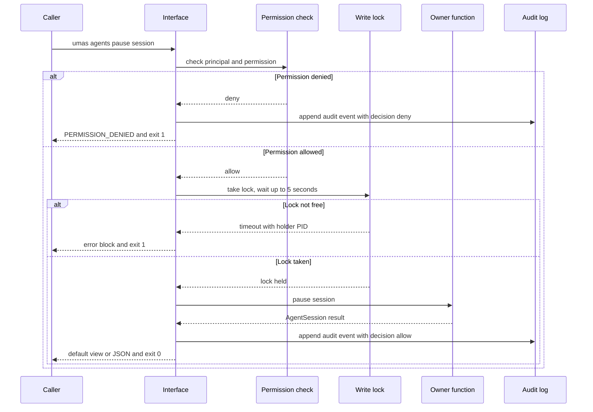

# Interfaces — module spec

> Part of the UMAS technical design. Main spec: [TECHNICAL-DESIGN-SPEC.md](../../TECHNICAL-DESIGN-SPEC.md) · Module map: [module map](../../TECHNICAL-DESIGN-SPEC.md#5-component-design)
> **Owns:** the `umas` command surface, the REST API that serves it and the dashboard, the default view and `--json` output, the exit codes, and the permission check at the entry point.
> **Uses:** none in the moved text. Part B lists the libs it calls in section 7.
> **Depends on modules:** none in the moved text. Part B lists each neighbour in section 6.

---

### 5.9 CLI Design

#### `umas init` vs `umas init --project`

| Command | Scope | What it does |
|---------|-------|-------------|
| `umas init` | Machine-wide (once) | Creates `~/.umas/`, initialises `database.db`, applies user defaults |
| `umas init --project` | Per-repo | Creates `.umas/`, installs Git hooks, updates `.gitignore` |

`umas init` runs automatically if `umas init --project` is called first. Both commands are fully idempotent.

#### `umas project register`

Registration only — writes to `database.db`. Does not touch the filesystem.

```bash
# Full onboarding flow:
mkdir my-api && cd my-api && git init
umas init --project                    # filesystem
umas project register my-api           # database
umas request "Build a REST API for…"  # submit work
```

Running `umas project register` before `umas init --project` fails with a clear error.

---

## 7. API Specifications

### CLI Commands

```bash
# System
umas init
umas init --project
umas start-all                    # start daemon; auto-resumes machine_paused sessions if token valid
umas start-all --resume           # start daemon + re-check auth_expired sessions after umas auth login
umas stop-all                     # graceful pause: checkpoints all active sessions before stopping
umas status
umas health-check
umas update
umas cleanup [--dry-run]

# Project
umas project register <name>
umas project list
umas project switch <name>
umas project config <name> --budget <tokens>

# Agents
umas agents list
umas agents spawn --task <id>
umas agents status <agent-id>
umas agents handoff <from> <to>
umas agents reconcile
umas agents resume <session-id>
umas agents pause <session-id>    # manual clean pause (writes PAUSE.md + machine_paused status)

# Work
umas request "<description>" [--route simple|medium|large|greenfield]
umas work-bundle show <id>
umas work-bundle retry <id> [--reset-retries]
umas watch

# Worktrees
umas worktrees list
umas worktrees clean --stale
umas worktrees recover <name>

# Metrics
umas metrics tokens
umas metrics cost
umas metrics quality
umas metrics agents

# Auth
umas auth login                   # OIDC sign-in; updates ~/.umas/token-cache; required after auth_expired
umas auth status                  # show current token validity and expiry time

# Debug
umas debug replay --session <id>
umas debug context --session <id>
umas logs --agent <id>
```

### REST API Endpoints

```
GET    /api/v1/agents
POST   /api/v1/agents
GET    /api/v1/agents/{id}
DELETE /api/v1/agents/{id}

GET    /api/v1/tasks
POST   /api/v1/tasks
GET    /api/v1/tasks/{id}
PATCH  /api/v1/tasks/{id}

GET    /api/v1/work-bundles
POST   /api/v1/work-bundles
GET    /api/v1/work-bundles/{id}

GET    /api/v1/metrics/tokens
GET    /api/v1/metrics/cost
GET    /api/v1/metrics/quality

WebSocket: /ws/events   (Phase 4 only)
```

---

## Detailed design

Each claim is marked **from source** (with a section reference) or **proposed**. Section 9 lists what the sources leave open. Section 9 does not decide any item.

### 1. Purpose and boundary

This module is the entry point to the other modules. It parses a `umas` command or a REST request, checks the permission, calls one owner function and renders the result. (From source: §2.1 Human Interface Layer. [ADR-0001](../../../docs/decisions/ADR-0001-minimal-html-dashboard.md) says the page "reads from the same API definition the CLI uses".)

It owns no state, no schedule, no agent process, no merge and no budget. Section 6 names the owner of each neighbouring responsibility. (Proposed.)

Each command calls one function in an owner module. That function can call several libs. (Proposed.)

### 2. Flow

1. The caller runs a `umas` command or sends a REST request. A REST request carries an OIDC access token as a JWT Bearer token. (From source: §2.2 `cli_to_daemon` and `dashboard_to_api`. The CLI transport is Open 1.)
2. The interface parses the command and its flags. An unknown flag exits 2 and lists the valid flags. (From source: [libs/README.md](../../../libs/README.md#cli-conventions-axi), rule 6.)
3. The interface resolves the principal. REST maps the token `sub` to `external_id`. The CLI on loopback uses the local OS user. (From source: A.5.6 `principal`; A.5.7 Identity provider; A.5.8.)
4. The interface checks the permission that the route declares. The check denies by default. (From source: A.5.6 step 3; A.5.7 API middleware.)
5. A write command takes the advisory lock `~/.umas/.lock`. It waits up to 5 seconds. (From source: §6.13.)
6. The interface calls one owner function. The function returns one result type, listed in section 3.1.
7. The renderer builds the default view or the `--json` object from that result type. The REST route returns the same object. (Proposed; ADR-0001.)
8. The interface writes one `audit_event` for the decision, including a denial. (From source: A.5.6 step 5. Whether an allowed read writes an event is Open 8.)
9. The process exits with code 0, 1 or 2. (Exit codes from [libs/README.md](../../../libs/README.md#cli-conventions-axi). Their use for UMAS is proposed.)

Failure paths in Figure 1:
- Permission denied. The error is `PERMISSION_DENIED`, with recoverability `permanent`. (From source: A.5.7 Errors.)
- Lock not free after 5 seconds. The command exits 1 and prints the holding PID. Nothing changes. (From source: §6.12 Lock. The snapshot also says to print instructions to remove WAL files. This module does not print them. Open 7.)

The no-argument view runs steps 1 to 3, then reads state and renders. It skips steps 5 and 8. (Proposed. Section 3.3 gives its rules.)

Figure 1. A denied command, and a write command that cannot get the lock.



### 3. Interfaces

Carrier types follow the sibling specs: CLI command, REST endpoint, file, event, callback, function call.

| Name | Dir | Carrier | Payload | Owner |
|------|-----|---------|---------|-------|
| `umas` command | in | CLI command, parsed by typer (from source: §1.1) | Command path and flags, section 3.1 | This module |
| Default view | out | Stdout text | Fields of one result type. The layout is not a contract (from source: [libs/README.md](../../../libs/README.md#cli-conventions-axi), Two output modes) | This module |
| `--json` output | out | Stdout | The result type with `schema_version` (from source: same section) | This module |
| Error block | out | Stdout lines `error:`, `message:` and `help:` (from source: libs rule 6) | Typed code such as `PERMISSION_DENIED`, from the error record (from source: [error-classifier](../../../libs/error-classifier/README.md) §3.3) | This module. Codes from [error-classifier](../../../libs/error-classifier/README.md) |
| Exit code | out | Process status | 0, 1 or 2 (proposed for UMAS) | This module |
| REST request | in | HTTP with a JSON body and query. `Authorization: Bearer` header (from source: §2.2 `dashboard_to_api`) | Path, query and body, section 3.2 | This module |
| REST response | out | HTTP with JSON | The result type of section 3.1, the same object as `--json` (proposed; ADR-0001) | This module |
| Daemon link | in and out | Unix domain socket or named pipe. JSON-RPC 2.0, timeout 30 seconds (from source: §2.2 `cli_to_daemon`) | Methods not defined (from source: §14 item 4; A.7 item 5). Open 1 | This module calls the daemon. The daemon is owned by [monitoring](../monitoring/monitoring-spec.md) |
| Dashboard poll | in | HTTP GET, polled (from source: §1.5; ADR-0001) | GET routes in section 3.2 | This module |
| OpenAPI document | out | File or served route (proposed) | Not written yet (from source: A.7 item 5). Open 2 | This module |
| Config file | in | `umas.config.yaml` (from source: §5.7 Opt-in role mapping; §5.2 `playbook`). `config.yaml` inside `.umas/` (from source: §6.3) | Keys in section 4 | Key owner, section 4 |
| Token cache | in and out | `~/.umas/token-cache` (from source: §7 Auth; §6.17 Auth expiry recovery). Written by `umas auth login` | Format not defined. Open 13 | [access-control](../access-control/access-control-spec.md) |
| Audit event | out | Append through `event-log` (from source: A.5.7 Audit) | `id`, `ts`, `actor_id`, `acting_for_id`, `action`, `resource_type`, `resource_id`, `scope`, `decision`, `reason`, `correlation_id` (from source: A.5.6 `audit_event`) | [access-control](../access-control/access-control-spec.md) |
| Daemon state | in | File `~/.umas/daemon.pid` (from source: §6.13). Writes `status: paused` on a clean stop (from source: §6.17) | `pid`, `status` (monitoring section 3 proposal) | This module reads. [monitoring](../monitoring/monitoring-spec.md) writes |
| Read-only state | in | Read-only connection to `~/.umas/database.db` (from source: §1.2 location) and `.umas/` files (proposed) | `agent_sessions` (from source: §4), budget status, merge-queue status | This module |

#### 3.1 Command groups

Terms:
- **Lib function** means a name from the lib section 4 (from source).
- **UMAS function** means a name this module proposes.

The snapshot gives no output format, field list, exit code or function name for any command. Those cells are proposed. Result type names are proposed (Open 3).

Each row gives one result type. The same type feeds the default view, the `--json` output and the REST response.

**System**

| Command | REST | Calls | Default view | `--json` result and fields | Exit | Mutates, idempotent |
|---------|------|-------|--------------|----------------------------|------|---------------------|
| `umas init` | None | UMAS `init_home()`. Creates `~/.umas/`, initialises `database.db` and applies user defaults (from source: §5.9 table) | `init: created` or `init: existed`; `home`; `database` | `InitResult`: `home`, `database`, `steps[]` with `name` and `status` | 0, 1 | Yes. Idempotent (from source: §5.9 "fully idempotent") |
| `umas init --project` | None (Open 6) | UMAS `init_project(path)`. Creates `.umas/`, installs Git hooks and updates `.gitignore` (from source: §5.9 table). Repairs a broken hook chain (from source: §6.3) | One line per step: created, existed or repaired | `InitProjectResult`: `path`, `steps[]` | 0, 1 | Yes. Idempotent (from source: §5.9) |
| `umas start-all` | `POST /api/v1/system/start-all` (proposed) | UMAS `daemon_start(resume)`. Resumes `machine_paused` sessions when the token is valid (from source: §7 comment) | `daemon: started` or `daemon: running (pid N)`; `resumed: n` | `DaemonStartResult`: `pid`, `status`, `resumed[]` | 0 for started and already running; 1 | Yes. Idempotent: a second call exits cleanly (from source: §6.13) |
| `umas start-all --resume` | Same route, body `resume: true` | Same, and re-checks `auth_expired` sessions after sign-in (from source: §7 comment; §6.17 Auth expiry recovery) | Same | Same | 0, 1 | Yes. Same as `start-all` |
| `umas stop-all` | `POST /api/v1/system/stop-all` (proposed) | UMAS `daemon_stop(grace_seconds)`. Calls agent-session `pause(session, reason)` for each active session (from source: agent-session §4). Grace is 30 seconds (from source: §6.17 Pre-shutdown: clean pause) | `daemon: stopped`; `checkpointed: n` | `DaemonStopResult`: `checkpointed[]`, `timed_out[]` | 0, 1 | Yes. Repeat call not defined (Open 9) |
| `umas status` | `GET /api/v1/status` (proposed) | UMAS `status_summary()`. Reads `daemon.pid` and `agent_sessions`. Calls budget-meter `status(budget)` and merge-queue `status()` (from source: lib section 4) | `daemon`; `agents[n of m]`; `budgets`; `merge_queue` | `SystemStatus`: `daemon`, `agents`, `budgets[]`, `merge_queue` | 0 | No |
| `umas health-check` | `GET /api/v1/health` (proposed) | UMAS `health_check()`. Calls watchdog `check_once()`, which has no side effects (from source: [watchdog](../../../libs/watchdog/README.md) §4). Adds the checks of §6.1 (orphaned projects), §6.3 (`.umas/` state) and §6.8 (stale worktrees). Disk checks are §6.16 and are not part of this command | `checks[n]`; `problems: n` | `HealthReport`: `checks[]`, `problems[]` with severity | 0, 1 | Conflict. §6.1 says the command escalates to P2 after 30 days. That write is Open 14 |
| `umas update` | `POST /api/v1/system/update` (proposed) | UMAS `update(now)`. Waits for sessions by default. `--now` checkpoints and pauses them (from source: §6.14). Writes `database.db.bak` first (from source: §6.14, §6.12) | `update: deferred (n active sessions)` or `update: applied` | `UpdateResult`: `applied`, `deferred_reason`, `active_sessions` | 0, 1 | Yes. Repeat call not defined (Open 9) |
| `umas cleanup [--dry-run]` | `POST /api/v1/system/cleanup` (proposed) | UMAS `cleanup(dry_run)`. Calls hook-store `gc(policy, dry_run=true)` and event-log `prune(retain_days)` (from source: lib section 4). Never removes decision artifacts or the last 90 days of events (from source: §6.16) | Dry run: `would remove: n worktrees, n segments`. Otherwise `removed: ...` | `CleanupReport`: `dry_run`, `worktrees[]`, `segments[]`, `bytes_recoverable` | 0, 1 | Yes, unless dry run. Default is Open 20 |

**Project**

| Command | REST | Calls | Default view | `--json` result and fields | Exit | Mutates, idempotent |
|---------|------|-------|--------------|----------------------------|------|---------------------|
| `umas project register <name>` | `POST /api/v1/projects` (proposed) | UMAS `register_project(name, path)`. Writes the `projects` row only. Does not touch the filesystem (from source: §5.9). `path` is `UNIQUE` (from source: §4 Projects) | `project: name`; `status: active` | `Project`: `id`, `name`, `status`, `path` | 0. 1 with `help: umas init --project` when init is missing (from source: §5.9) | Yes. A repeat call with the same path fails on the unique key. Idempotence not defined (Open 9) |
| `umas project list` | `GET /api/v1/projects` (proposed) | UMAS `list_projects(status)`. Detects orphans on use (from source: §6.1 Detection) | `projects[n of m]{id,status}`; `by_status` | `ProjectList`: `projects[]`, `count`, `total`, `by_status` | 0 | Detection can set `orphaned`. Open 14 |
| `umas project switch <name>` | None | No function in the sources (Open 11) | Not defined | Not defined | Not defined | Not defined (Open 11) |
| `umas project config <name> --budget <tokens>` | `PATCH /api/v1/projects/{id}` (proposed) | UMAS `set_budget(project, limit)`. Calls budget-meter `define(budget)` (from source: lib section 4). Dispatch resumes within 60 seconds (from source: §6.6) | `budget: <project>/day  limit: n  used: n` | `Project` with `budget{id, limit, used, reserved, percent}` | 0, 1 | Yes. An identical budget exits 0 with `unchanged` (from source: [budget-meter](../../../libs/budget-meter/README.md) §4.1) |

**Agents**

| Command | REST | Calls | Default view | `--json` result and fields | Exit | Mutates, idempotent |
|---------|------|-------|--------------|----------------------------|------|---------------------|
| `umas agents list` | `GET /api/v1/agents` (from source: §7) | UMAS `list_agents(filter)`. Reads `agent_sessions` (from source: §4) | `agents[n of m]{id,status,bundle_id,token_used}`; `by_status` | `AgentList`: `agents[]`, `count`, `total`, `by_status` | 0 | No |
| `umas agents spawn --task <id>` | `POST /api/v1/agents` (from source: §7) | UMAS `dispatch(task_id)`. Calls hook-store `create(name, base_branch, owner, task?)` and agent-session `create(config, task, hook_path, event_log_dir)` (from source: lib section 4). Admission is task-queue `set_admit` with budget-meter `reserve` (from source: task-queue §4; budget-meter §4) | `agent: id  status: spawned`; or `deferred: reason` | `AgentSession`. A deferral returns `SpawnResult` with `deferred_reason` | 0 for spawned and for deferred (a deferral is an answer, from source: budget-meter §4.1); 1 for an unknown task | Yes. Not idempotent. Each call creates a session (proposed) |
| `umas agents status <agent-id>` | `GET /api/v1/agents/{id}` (from source: §7) | agent-session `status(hook_path)` (from source: §4). The `hook_path` source is Open 28 | `agent: id  status  token used/limit  last_heartbeat` | `AgentSession` | 0; 1 for an unknown id | No |
| `umas agents handoff <from> <to>` | None in §7 (proposed `POST /api/v1/agents/{id}/handoff`) | agent-session `handoff(session)` (from source: §4). The function has no successor argument (Open 23) | `handoff: from to to`; `packet: HANDOFF.md` | `HandoffResult`: `packet_path`, `from`, `to` | 0, 1 | Yes. Repeat call not defined (Open 9) |
| `umas agents reconcile` | None in §7 (proposed `POST /api/v1/agents/reconcile`) | Reconciles stale sessions on demand. The Project Monitor runs the same check within 60 seconds (from source: §6.15). Owner: [monitoring](../monitoring/monitoring-spec.md) | `reconciled: n`; `stale: n` | `ReconcileResult`: `reconciled[]`, `stale[]` | 0, 1 | Yes. Repeat call not defined (Open 9) |
| `umas agents resume <session-id>` | None in §7 (proposed `POST /api/v1/agents/{id}/resume`) | agent-session `recover(hook_path, event_log_dir, task_id)` (from source: §4, §5.5). Recovery is human-initiated (from source: §6.7). A session in `auth_expired` is not promoted without a fresh token (from source: §6.17 Auth expiry recovery) | `agent: id  status: active`; or `status: auth_expired (run umas auth login)` | `AgentSession` | 0; 1 when the status is not resumable | Yes |
| `umas agents pause <session-id>` | None in §7 (proposed `POST /api/v1/agents/{id}/pause`) | agent-session `pause(session, reason)` (from source: §4). Writes `PAUSE.md` and sets `machine_paused` (from source: §7 comment) | `agent: id  status: machine_paused  pause: PAUSE.md` | `AgentSession` with `pause_file` | 0, 1 | Yes. Repeat call not defined (Open 9) |
| Agent stop (no command in §7) | `DELETE /api/v1/agents/{id}` (from source: §7) | No stop operation in agent-session (from source: §4). Open 10 | `agent: id  status: stopped` (proposed) | `AgentStopResult` (proposed) | 0, 1 | Yes. No command yet (Open 10) |

**Work**

| Command | REST | Calls | Default view | `--json` result and fields | Exit | Mutates, idempotent |
|---------|------|-------|--------------|----------------------------|------|---------------------|
| `umas request "<description>"` with `--route`, `--playbook`, `--exit-predicate` | `POST /api/v1/work-bundles` (from source: §7). The three flags have no REST field in §7 (Open 10) | UMAS `submit(request)`. The Coordinator creates the work bundle and moves from `IDLE` to `GRILLING` on a human request (from source: §5.2 state table). `--route` overrides the Router (from source: §5.2 Router). `--playbook` and `--exit-predicate` (from source: §5.2 examples) | `bundle: id  status: pending  route: r` | `WorkBundle`: `id`, `type`, `status`, `route`, `playbook` (names from §4 `work_bundles`, `type` and `status`) | 0; 1 for a rejected bundle, such as a dependency cycle (from source: §6.10) | Yes. Not idempotent. Each call creates a bundle (proposed) |
| `umas work-bundle show <id>` | `GET /api/v1/work-bundles/{id}` (from source: §7) | task-queue `get(id)` and `graph(id?)` (from source: task-queue §4) | `bundle: id  status`; `tasks[n of m]{id,state,owner}` | `WorkBundleDetail`: `bundle`, `tasks[]`, `edges[]` | 0, 1 | No |
| `umas work-bundle approve <id>` | None in §7 (proposed `POST /api/v1/work-bundles/{id}/approve`) | Resumes a bundle paused at a human gate (from source: §5.2 Playbook routing). The gate is not in §7 (Open 10) | `bundle: id  status: dispatching` | `WorkBundle` | 0, 1 | Yes. Repeat call not defined (Open 9) |
| `umas work-bundle retry <id> [--reset-retries]` | `POST /api/v1/work-bundles/{id}/retry` (proposed) | UMAS `retry(id, reset)`. For a merge candidate, merge-queue `requeue(id)` (from source: merge-queue §4). The default limit is 3 consecutive failures, and a human resets it (from source: §6.9) | `bundle: id  status: pending  retries: n of 3` | `WorkBundle` | 0, 1 | Yes. Repeat call not defined (Open 9). Reset scope is Open 25 |
| `umas watch` | None in §7. The dashboard polls GET routes instead (from source: ADR-0001) | Refreshes status every 2 seconds. Warns when `last_heartbeat` is more than 2 minutes old (from source: §6.15) | A stream. Warning line format not defined | None defined (Open 17) | 0 on interrupt (proposed); 1 | No |

**Worktrees**

| Command | REST | Calls | Default view | `--json` result and fields | Exit | Mutates, idempotent |
|---------|------|-------|--------------|----------------------------|------|---------------------|
| `umas worktrees list` | None in §7 (proposed `GET /api/v1/worktrees`) | hook-store `list(filter?)` (from source: hook-store §4). Reads take no locks (from source: hook-store §5.3) | `worktrees[n of m]{name,status,dirty}`; `by_status` | `WorktreeList`: `worktrees[]` of `HookInfo` (from source: hook-store §3.5), `count`, `total` | 0 | No |
| `umas worktrees clean --stale` | None in §7 (proposed `POST /api/v1/worktrees/clean`) | hook-store `gc(policy, dry_run=true)` and `remove(name, force=false)` (from source: hook-store §4). A `stale-dirty` worktree is never cleaned automatically (from source: §6.8) | `would remove: n`; `kept (stale-dirty): n` | `CleanReport`: `removed[]`, `kept[]` with `reason` | 0, 1 | Yes, unless dry run (Open 20) |
| `umas worktrees recover <name>` | None in §7 (proposed `POST /api/v1/worktrees/{name}/recover`) | hook-store `recover(name)`, which is read-only (from source: hook-store §4). Then spawns a triage agent to commit or discard the diff (from source: §6.8) | `worktree: name  dirty: yes`; `triage: agent id` | `RecoverResult`: `recovery`, `triage_agent_id` | 0, 1 | Yes, because it spawns an agent. Not idempotent (proposed) |

**Metrics**

The metrics-store lib gives the query for each `umas metrics` command (from source: [metrics-store](../../../libs/metrics-store/README.md) §9 Known Consumers). Metric names come from §3.2. Each command returns the lib's `QueryResult` (from source: metrics-store §3.4 and §5.2). The named type below wraps it (proposed).

| Command | REST | Calls | Default view | `--json` result and fields | Exit | Mutates, idempotent |
|---------|------|-------|--------------|----------------------------|------|---------------------|
| `umas metrics tokens` | `GET /api/v1/metrics/tokens` (from source: §7) | `query` on `token.input` and `token.output`, sum, grouped by `agent_id`, `since` 7 days (from source: metrics-store §9) | `token.input n`; `token.output n` per group; `window` | `TokenMetrics`: `window`, `groups[]` with `tags`, `count` and values | 0 | No |
| `umas metrics cost` | `GET /api/v1/metrics/cost` (from source: §7) | `query` on `token.cost` in USD, grouped by `project` and `model` (from source: metrics-store §9) | `cost: n USD` per group; `window` | `CostMetrics`: `window`, `groups[]` | 0 | No |
| `umas metrics quality` | `GET /api/v1/metrics/quality` (from source: §7) | `query` on `test.coverage_pct`, `merge_queue.success_rate` and `error.p1_count`, average (from source: metrics-store §9) | One line per metric; `window` | `QualityMetrics`: `window`, `metrics[]` | 0 | No |
| `umas metrics agents` | None in §7 (proposed `GET /api/v1/metrics/agents`) | `query` on `task.duration_ms`, p95, grouped by `agent_id` (from source: metrics-store §9) | One row per agent | `AgentMetrics`: `window`, `groups[]` | 0 | No |

**Auth**

| Command | REST | Calls | Default view | `--json` result and fields | Exit | Mutates, idempotent |
|---------|------|-------|--------------|----------------------------|------|---------------------|
| `umas auth login` | None. CLI only (proposed) | UMAS `login()`. OIDC sign-in with Keycloak (from source: A.5.2; A.5.7 Identity provider) | `auth: signed in; expires <time>` | `AuthStatus` after sign-in | 0, 1 | Yes. Replaces `~/.umas/token-cache` (from source: §7). Repeat call not defined (Open 13) |
| `umas auth status` | `GET /api/v1/me` (proposed) | UMAS `token_status()`. Reads the token cache only, with no network call (proposed) | `auth: valid, expires <time>`; or `auth: expired (run umas auth login)` | `AuthStatus`: `valid` (boolean), `subject` (the `sub` claim), `expires_at` (RFC 3339 UTC). Field set from [access-control](../access-control/access-control-spec.md) section 9 | 0 when valid; 1 when expired or missing (proposed; Open 13) | No |

**Debug**

| Command | REST | Calls | Default view | `--json` result and fields | Exit | Mutates, idempotent |
|---------|------|-------|--------------|----------------------------|------|---------------------|
| `umas debug replay --session <id>` | None in §7 (proposed `GET /api/v1/debug/sessions/{id}/replay`) | event-log `read(filter, limit, order)` with `scope` set to the session (from source: [event-log](../../../libs/event-log/README.md) §4). Newest first (from source: event-log §4.1) | `events[n of m]{ts,type,source}`; `by_type`; `range` | `EventReplay`: `events[]`, `count`, `total` | 0, 1 | No |
| `umas debug context --session <id>` | None in §7 (proposed `GET /api/v1/agents/{id}/context`) | agent-session `recover(hook_path, event_log_dir, task_id)` (from source: agent-session §4, §5.5) | `task`; `progress`; `next_steps` | `RecoveredContext` (from source: agent-session §5.5 step 5). The return type conflicts with §4 (Open 24) | 0, 1 | No. A Viewer cannot see raw agent prompts (from source: A.5.3) |
| `umas logs --agent <id>` | None in §7 (proposed `GET /api/v1/agents/{id}/logs`) | event-log `read(filter)` with `source` set to the agent (from source: event-log §4). The source of logs is Open 12 | `logs[n of m]{ts,type,summary}`. Summary cut at 200 characters (from source: [libs/README.md](../../../libs/README.md#cli-conventions-axi) rule 3) | `LogLines`: `lines[]`, `count`, `total` | 0, 1 | No |

#### 3.2 REST endpoints

Rows marked **src** come from the REST list in §7. All other rows are **proposed**. Each route declares one permission (from source: A.5.7 API middleware). The snapshot names these permissions: `agent:spawn`, `merge:approve`, `config:write`, `audit:read` and `merge:approve_own`. Other names are proposed (Open 15).

| Method and path | CLI command | Status | Parameters | Permission | Result |
|-----------------|-------------|--------|------------|------------|--------|
| `GET /api/v1/status` | `umas status` | proposed | None | `system:read` (proposed) | `SystemStatus` |
| `GET /api/v1/health` | `umas health-check` | proposed | None | `system:read` (proposed) | `HealthReport` |
| `POST /api/v1/system/start-all` | `umas start-all [--resume]` | proposed | Body `resume`, boolean, default `false` | `system:admin` (proposed) | `DaemonStartResult` |
| `POST /api/v1/system/stop-all` | `umas stop-all` | proposed | Body `grace_seconds`, default 30 (from source: §6.17) | `system:admin` (proposed) | `DaemonStopResult` |
| `POST /api/v1/system/update` | `umas update [--now]` | proposed | Body `now`, boolean, default `false` | `config:write` at system scope (proposed; Open 29) | `UpdateResult` |
| `POST /api/v1/system/cleanup` | `umas cleanup [--dry-run]` | proposed | Body `dry_run`, default not set (Open 20) | `system:admin` (proposed) | `CleanupReport` |
| `GET /api/v1/projects` | `umas project list` | proposed | Query `status`: `active`, `orphaned` or `archived` (from source: §4 Projects) | `project:read` (proposed) | `ProjectList` |
| `POST /api/v1/projects` | `umas project register <name>` | proposed | Body `name`; `path` (Open 11) | `project:write` (proposed) | `Project` |
| `PATCH /api/v1/projects/{id}` | `umas project config <name> --budget` | proposed | Path `id`; body `budget_tokens` | `budget:write` (proposed) | `Project` |
| `GET /api/v1/agents` | `umas agents list` | src | Query `status`, `project_id`, `limit` (proposed) | `agent:read` (proposed) | `AgentList` |
| `POST /api/v1/agents` | `umas agents spawn --task <id>` | src | Body `task_id` (name proposed) | `agent:spawn` (named in A.5.6; the route mapping is proposed) | `AgentSession` |
| `GET /api/v1/agents/{id}` | `umas agents status <agent-id>` | src | Path `id` | `agent:read` (proposed) | `AgentSession` |
| `DELETE /api/v1/agents/{id}` | None (Open 10) | src | Path `id` | `agent:stop` (proposed) | `AgentStopResult` (proposed) |
| `POST /api/v1/agents/{id}/pause` | `umas agents pause <session-id>` | proposed | Path `id`; body `reason`, default `user` (proposed) | `agent:stop` (proposed) | `AgentSession` |
| `POST /api/v1/agents/{id}/resume` | `umas agents resume <session-id>` | proposed | Path `id` | `agent:spawn` (proposed) | `AgentSession` |
| `POST /api/v1/agents/{id}/handoff` | `umas agents handoff <from> <to>` | proposed | Path `id`; body `to` (Open 23) | `agent:spawn` (proposed) | `HandoffResult` |
| `POST /api/v1/agents/reconcile` | `umas agents reconcile` | proposed | None | `agent:stop` (proposed) | `ReconcileResult` |
| `GET /api/v1/agents/{id}/context` | `umas debug context --session <id>` | proposed | Path `id` | `audit:read` (named in A.5.6; the mapping is proposed) | `RecoveredContext` |
| `GET /api/v1/agents/{id}/logs` | `umas logs --agent <id>` | proposed | Path `id`; query `limit`, `since` (proposed) | `audit:read` (proposed mapping) | `LogLines` |
| `GET /api/v1/debug/sessions/{id}/replay` | `umas debug replay --session <id>` | proposed | Path `id`; query `limit`, `order` (proposed) | `audit:read` (proposed mapping) | `EventReplay` |
| `GET /api/v1/tasks` | None (Open 10) | src | Query `state`, `tag`, `owner` (from task-queue §4 filters) | `task:read` (proposed) | `TaskList` (proposed) |
| `POST /api/v1/tasks` | None (Open 10) | src | Body `payload`, `tags`, `priority`, `depends_on` (from task-queue §3.1) | `task:write` (proposed; A.5.5 gives task creation to the Coordinator role) | `Task` (proposed) |
| `GET /api/v1/tasks/{id}` | None (Open 10) | src | Path `id` | `task:read` (proposed) | `Task` (proposed) |
| `PATCH /api/v1/tasks/{id}` | None (Open 10) | src | Path `id`; body fields not named in the snapshot | `task:write` (proposed) | `Task` (proposed) |
| `GET /api/v1/work-bundles` | None (Open 10) | src | Query `project_id`, `status` (proposed) | `work:read` (proposed) | `WorkBundleList` (proposed) |
| `POST /api/v1/work-bundles` | `umas request "<description>"` | src | Body `description`, `project_id`, `route`, `playbook`, `exit_predicate` (names proposed from the flags in §5.2) | `work:submit` (A.5.4 row "Submit a work request"; name proposed) | `WorkBundle` |
| `GET /api/v1/work-bundles/{id}` | `umas work-bundle show <id>` | src | Path `id` | `work:read` (proposed) | `WorkBundleDetail` |
| `POST /api/v1/work-bundles/{id}/approve` | `umas work-bundle approve <id>` | proposed | Path `id` | Not named (Open 15) | `WorkBundle` |
| `POST /api/v1/work-bundles/{id}/retry` | `umas work-bundle retry <id> [--reset-retries]` | proposed | Path `id`; body `reset_retries`, default `false` | `work:retry` (proposed) | `WorkBundle` |
| `GET /api/v1/worktrees` | `umas worktrees list` | proposed | Query `status`, `project_id` | `worktree:read` (proposed) | `WorktreeList` |
| `POST /api/v1/worktrees/clean` | `umas worktrees clean --stale` | proposed | Body `stale`, default `true`; `dry_run` | `worktree:write` (proposed; Open 16) | `CleanReport` |
| `POST /api/v1/worktrees/{name}/recover` | `umas worktrees recover <name>` | proposed | Path `name` | `worktree:write` (proposed; Open 16) | `RecoverResult` |
| `GET /api/v1/metrics/tokens` | `umas metrics tokens` | src | Query `since`, `until`, `group_by` (proposed; metrics-store §4 `query` fields) | `metrics:read` (proposed) | `TokenMetrics` |
| `GET /api/v1/metrics/cost` | `umas metrics cost` | src | Query `since`, `until`, `group_by` (proposed) | `metrics:read` (proposed) | `CostMetrics` |
| `GET /api/v1/metrics/quality` | `umas metrics quality` | src | Query `since`, `until`, `group_by` (proposed) | `metrics:read` (proposed) | `QualityMetrics` |
| `GET /api/v1/metrics/agents` | `umas metrics agents` | proposed | Query `since`, `until`, `group_by` (proposed) | `metrics:read` (proposed) | `AgentMetrics` |
| `GET /api/v1/me` | `umas auth status` | proposed | None | Any authenticated principal (proposed) | `AuthStatus` |
| `WS /ws/events` | None | src (Phase 4 only) | None | None defined | Event stream |
| `GET /` | None | proposed. Serves the static page (from source: §1.5; ADR-0001) | None | None | HTML page |

#### 3.3 No-argument view

Running `umas` with no arguments shows live state (from source: [libs/README.md](../../../libs/README.md#cli-conventions-axi) rule 8). It renders the `SystemStatus` result type (proposed). Its first two lines are `bin: umas` and `description:` (from source: rule 10). Up to three `help:` lines follow, with real IDs (from source: rule 9).

The view must follow the rules of libs rule 7 and the no-argument view of the libs:
- It reads files and the database only. It reads `daemon.pid`, heartbeats and `database.db` through a read-only connection (proposed).
- It takes no write lock. Read lag under WAL is expected (from source: §6.15).
- It makes no network call. It does not call Keycloak, the REST API or any other host. It reads token expiry from the token cache (proposed).
- It starts nothing. It does not start or stop the daemon. It does not run `gc`, `prune`, `repair` or `reconcile` (proposed).
- It writes nothing. It appends no event and no audit event (proposed; Open 8).
- It prints no secret and no token (from source: A.5.4, "Read or write secrets through the API: never").
- It does not call `umas health-check`, because that command can write (Open 14).

The view is fast. Its output has a fixed set of fields, so an agent can read it at session start (proposed).

### 4. Parameters

| Name | Type | Default | Where set | What it changes |
|------|------|---------|-----------|-----------------|
| `--json` | Flag | Off | CLI flag, every command (proposed) | Prints the result type as JSON. REST always returns JSON (from source: libs rule "Two output modes") |
| `--full` | Flag | Off | CLI flag, list and log commands (proposed) | Removes the cut at `max_cell_chars` |
| `--fields` | Field list | Each command's default fields, section 3.1 (proposed) | CLI flag (proposed) | Adds fields to the default view |
| `--limit` | Integer | 20 for libs (from source: libs rule 2). Not set for UMAS (Open 5) | CLI flag, list commands | Rows shown. The total still counts all rows |
| `max_cell_chars` | Integer | 200 (from source: libs rule 3) | `umas.config.yaml` (proposed key) | Length at which free text is cut. The cut ends with `… (N chars total)` |
| `--route` | Enum | Not set. The Router chooses when absent (Open 27) | CLI flag, `umas request` (from source: §5.2 Router) | Chooses a route: `simple`, `medium`, `large` or `greenfield` |
| `--playbook` | Name | `null` (from source: §5.2 `playbook: null`) | CLI flag, `umas request`; `umas.config.yaml` (from source: §5.2) | Selects a playbook. `none` forces the default implicit workflow (from source: §5.2 examples) |
| `--exit-predicate` | String | Not set (Open 10) | CLI flag, `umas request` (from source: §5.2 example) | Exit condition for a playbook, for example `"tests pass"` |
| `--reset-retries` | Flag | Off (proposed) | CLI flag, `umas work-bundle retry` (from source: §6.9) | Resets the consecutive failure count |
| `--resume` | Flag | Off (from source: §7) | CLI flag, `umas start-all` | Re-checks `auth_expired` sessions |
| `--now` | Flag | Off (from source: §6.14 default is wait) | CLI flag, `umas update` | Checkpoints and pauses active sessions before the update |
| `--dry-run` | Flag | Not set (Open 20) | CLI flag, `umas cleanup`, `umas worktrees clean` | Reports what would be removed. Removes nothing |
| `--stale` | Flag | Not set | CLI flag, `umas worktrees clean` (from source: §7) | Selects stale hooks |
| `--budget` | Integer, tokens | Not set. Required by `umas project config` (from source: §7) | CLI flag | Project budget limit, written through budget-meter `define` |
| `--task`, `--session`, `--agent` | Identifier | None. Required by the command | CLI flags (from source: §7) | Target of the command |
| `--project` | Flag | Off | CLI flag, `umas init` (from source: §5.9) | Runs the per-repo init instead of the machine-wide init |
| Home folder | Path | `~/.umas/` (from source: §5.9) | Fixed | Machine-wide state |
| Database | Path | `~/.umas/database.db` (from source: §1.2) | Fixed | SQLite database in WAL mode (from source: §6.13) |
| Write lock | Path | `~/.umas/.lock` (from source: §6.13) | Fixed | Advisory lock for write commands |
| Lock wait | Seconds | 5 (from source: §6.13) | Fixed | How long a write command waits for the lock |
| Daemon PID file | Path | `~/.umas/daemon.pid` (from source: §6.13) | Fixed | Detects a running daemon |
| Token cache | Path | `~/.umas/token-cache` (from source: §7) | Fixed | Holds the OIDC token, written by `umas auth login` |
| CLI to daemon timeout | Seconds | 30 (from source: §2.2) | Fixed | Timeout for one JSON-RPC call (Open 1) |
| CLI process timeout | Seconds | 300 (from source: §2.3) | Fixed | Maximum life of one CLI process |
| `watch` refresh | Seconds | 2 (from source: §6.15) | Fixed | Interval of `umas watch` |
| Staleness threshold | Seconds | 120 (from source: §6.15) | Fixed | Age of `last_heartbeat` that triggers the warning |
| Shutdown grace | Seconds | 30 (from source: §6.17 "Shutdown grace window") | Not set. The config key is not named (Open 31) | Time an agent has to checkpoint on pause |
| `retain_days` | Days | 90 (from source: [event-log](../../../libs/event-log/README.md) §6) | Event-log config | Age after which event segments are pruned (from source: event-log §5.3) |
| OIDC issuer and client ID | String | Not set (Open 13) | `umas.config.yaml` (proposed `auth` block) | Sign-in endpoint for `umas auth login` |
| REST bind address and port | String | Not set (Open 13). The snapshot trusts the local OS user on loopback only (from source: A.5.8) | `umas.config.yaml` (proposed) | Where the REST API listens |

Keys owned by other modules, such as `agents.coordinator.model` in §5.7, stay in their module specs.

### 5. Capabilities

Permission names come from Appendix A.5. A.5.4 gives human permissions in words, not as `resource:action` names. The snapshot names these permissions. `agent:spawn` and `audit:read` appear in A.5.6. `merge:approve` appears in the A.5.6 example and the A.5.4 text. `config:write` appears in the A.5.6 example. `merge:approve_own` appears in the A.5.4 text. Every other name in this section is proposed (Open 15).

The "Who" column gives the A.5.4 roles that hold the capability. `S` means system scope and `P` means project scope (from source: A.5.4 legend).

| Capability | Who (from source: A.5.4) | Permission | Commands |
|-----------|--------------------------|-----------|----------|
| View agents, tasks, work bundles and the merge queue | Admin S, Project Owner P, Developer P, Approver P, Operator S, Viewer S. Auditor no | None named. Proposed `agent:read` and `work:read` | `status`, `watch`, `agents list`, `agents status`, `work-bundle show` |
| View metrics and cost | Admin S, Project Owner P, Developer P, Approver P, Operator S, Auditor S, Viewer S | None named. Proposed `metrics:read` | `metrics *` |
| Submit a work request | Admin S, Project Owner P, Developer P | None named. Proposed `work:submit` | `request` |
| Spawn an agent | Admin S, Project Owner P, Developer P. Only the Coordinator role spawns agents in the agent roles (from source: A.5.5) | `agent:spawn` | `agents spawn`, `agents resume`, `agents handoff` |
| Stop or pause an agent | Admin S, Project Owner P, Developer P (own agents), Operator S. The Coordinator and Monitors stop agents in the agent roles (from source: A.5.5) | None named. Proposed `agent:stop` | `agents pause`, `agents reconcile`, `DELETE` route |
| Approve a merge | Admin S, Project Owner P, Approver P | `merge:approve` | Not in this module. Owned by [verification](../verification/verification-spec.md) |
| Approve one's own change | No built-in role. Granted by an Admin or Project Owner (from source: A.5.4 Self-approval) | `merge:approve_own` | Not in this module |
| Set a project budget | Admin S (any project), Project Owner P (up to the system cap) | None named. Proposed `budget:write` | `project config --budget` |
| Change project configuration | Admin S, Project Owner P | `config:write` (named in A.5.6 example) | Not used by a command in §7. Open 29 |
| Change system configuration | Admin S only (from source: A.5.4 row "Change system configuration") | None named. Proposed `config:write` at system scope (Open 29) | `umas update` |
| Create or delete a project | Admin S only | None named. Proposed `project:write` | `project register` |
| Read the audit log | Admin S, Project Owner P, Auditor S | `audit:read` | `debug replay`, `debug context`, `logs` |
| Host setup, daemon start and stop, cleanup | Not in A.5.4. Phase 1 trusts the local OS user on loopback (from source: A.5.8) | None named. Proposed `system:admin` | `init`, `start-all`, `stop-all`, `cleanup` |
| Clean or recover worktrees | Not in A.5.4 (Open 16) | None defined. Proposed `worktree:write` | `worktrees clean`, `worktrees recover` |
| Sign in | Any human. Authentication only (from source: A.5.2) | None | `auth login` |
| Read own identity and token expiry | Any authenticated principal (proposed) | None named (proposed) | `auth status`, `GET /api/v1/me` |
| Read or write secrets | Nobody (from source: A.5.4 "never") | None | None. The API reports only whether a secret is set (from source: A.5.4 Secrets) |

**How permission checks apply to the CLI and the REST API.**
- Every REST route declares one permission. The middleware resolves the principal and checks it before the handler runs (from source: A.5.7 API middleware).
- The CLI calls the same API, so it runs the same checks (from source: A.5.7 CLI). The transport decision is Open 1.
- The check follows the order in A.5.6. It resolves the principal, collects bindings and allows only on a grant. It then writes an audit event (from source: A.5.6).
- A disabled, expired or revoked principal is denied (from source: A.5.6 step 1).
- An agent that acts for a user needs both permissions (from source: A.5.6 step 4). Whether the rule is the intersection is Open 26.
- In Phase 1 the CLI trusts the local OS user on loopback (from source: A.5.8). REST needs an access token (from source: A.5.2; A.5.7 Identity provider).
- A denied call returns `PERMISSION_DENIED`. The error is permanent. An audit event records the denial (from source: A.5.7 Errors).
- A Viewer cannot see raw agent prompts (from source: A.5.3). The `debug context` and `logs` outputs must respect this.

### 6. Interaction with other modules

| Neighbour | What this module sends or receives | Carrier | Sync or async |
|-----------|------------------------------------|---------|---------------|
| [orchestration](../orchestration/orchestration-spec.md) | Sends request submission, dispatch, retry and approval. Receives `WorkBundle` and `AgentSession` results | Function call (proposed) | Sync |
| [agent-execution](../agent-execution/agent-execution-spec.md) | Sends pause, resume, handoff and status for agent sessions. Receives `AgentSession` and `RecoveredContext` | Function call, agent-session lib | Sync |
| [context-persistence](../context-persistence/context-persistence-spec.md) | Reads hooks with `list` and `recover`. Runs `gc` for clean. Reads events for replay and logs | Function call, hook-store and event-log libs | Sync for commands. `watch` reads on each refresh |
| [verification](../verification/verification-spec.md) | Reads queue state with `status`. Sends `requeue` for retry. Creates the merge-queue worktree with `init` (Open 6) | Function call, merge-queue lib | Sync |
| [monitoring](../monitoring/monitoring-spec.md) | Starts and stops the daemon. Runs watchdog `check_once` for health. Reads heartbeats for the staleness warning. Requests reconcile | IPC to the daemon (Open 1), function call, file read | Sync for commands. The daemon runs async |
| [budget-and-models](../budget-and-models/budget-and-models-spec.md) | Sends the project budget with `define`. Reads budget status for `status` and metrics | Function call, budget-meter lib | Sync. A new limit applies on the next call (from source: §6.6) |
| [exception-flows](../exception-flows/exception-flows-spec.md) | Shows the states and next commands that section 6 defines. The flows own the rules | Reads only | Sync |
| [access-control](../access-control/access-control-spec.md) | Runs the permission check on every route. Writes audit events. Owns sign-in for `auth login` | Function call, event append | Sync |

### 7. Libraries and packs used

- **[event-log](../../../libs/event-log/README.md):** `read` for `debug replay` and `logs`. `prune(retain_days)` for `cleanup` (from source: event-log §4 and §5.3).
- **[hook-store](../../../libs/hook-store/README.md):** `list`, `recover`, `gc` and `remove` for the worktree commands. `create` for `agents spawn` (from source: hook-store §4).
- **[agent-session](../../../libs/agent-session/README.md):** `create`, `status`, `pause`, `handoff` and `recover` for the agent commands and `debug context` (from source: agent-session §4).
- **[task-queue](../../../libs/task-queue/README.md):** `get`, `graph` and `list` for `work-bundle show` and the task routes. `set_admit` gates `agents spawn` (from source: task-queue §4).
- **[merge-queue](../../../libs/merge-queue/README.md):** `status` for the queue line in `status`. `requeue` for retry. `init` for the merge-queue worktree (from source: merge-queue §4).
- **[budget-meter](../../../libs/budget-meter/README.md):** `define` for `project config --budget`. `status` for budget lines. `reserve` in the admission callback (from source: budget-meter §4).
- **[metrics-store](../../../libs/metrics-store/README.md):** `query` for all `metrics` commands (from source: metrics-store §9).
- **[watchdog](../../../libs/watchdog/README.md):** `check_once` for `health-check`. It has no side effects (from source: watchdog §4).
- **[error-classifier](../../../libs/error-classifier/README.md):** The error record and typed codes for the error block (from source: error-classifier §3.3).
- **[kc-axi](../../../libs/kc-axi/README.md):** Not used by `umas`. It is the Keycloak set-up tool for the Admin (from source: A.5.7 Identity provider). Its output and exit codes do not apply here (see [AXI support](#axi-support)).
- **Packs:** This module calls no pack directly. `--route` and `--playbook` pass to orchestration. Orchestration uses [router-heuristic](../../../packs/router-heuristic/router-heuristic-spec.md), [grilling](../../../packs/grilling/grilling-spec.md) and [playbook-runner](../../../packs/playbook-runner/playbook-runner-spec.md) (from source: §5.2).

### 8. Failure handling

| Failure | Source | Behaviour in this module |
|---------|--------|--------------------------|
| Write lock held by another process | §6.12 Lock; §6.13 | Waits 5 seconds, then exits 1 and prints the holding PID. Nothing changes. The snapshot also says to print instructions to remove WAL files. This module does not print them (Open 7) |
| Database corruption | §6.12 Corruption | The output names the restore step. The snapshot has a restore prompt, which Open 7 covers |
| Second `start-all` | §6.13 | Exits 0 with `already running`. Nothing changes |
| Orphaned project | §6.1 Force-Deleted Project; §6.4 Project Moved | `project list` and `health-check` show `orphaned`. The output lists each option with its command. The snapshot has a choice prompt, which Open 7 covers |
| Stale or dirty worktree | §6.8 | `worktrees list` shows `dirty`. `clean --stale` keeps `stale-dirty` hooks |
| Update while sessions are active | §6.14 | `update` waits unless `--now` is given. The output lists the active sessions |
| Disk full | §6.16 | A write command exits 1 with the disk error. `cleanup --dry-run` shows the recoverable space |
| Budget exhausted | §6.6 | `project config --budget` raises the limit. Dispatch resumes within 60 seconds |
| Provider failure with no fallback | §6.7 | `agents resume` is the human recovery. It exits 1 when the session is not resumable |
| Merge bisect finds no clean subset | §6.9 | `work-bundle retry --reset-retries` resets the failure count (Open 25) |
| Dependency deadlock or rejected bundle | §6.10 | `request` exits 1 and names the cycle or the dangling reference |
| Session paused by shutdown or expired token | §4 Agent Sessions; §6.17 | Sessions in `machine_paused` or `auth_expired` are resumable, not failures. `start-all --resume` and `auth login` lead to recovery |
| Permission denied | A.5.7 Errors | Exits 1 with `PERMISSION_DENIED`. An audit event records the denial |
| Mutating command with no daemon | Not in the sources | Not defined (Open 22) |

### 9. Open

Each item states the decision it needs and a recommendation. No item is decided here.

**Open 1.** Transport from CLI to daemon. §2.2 defines JSON-RPC 2.0 over a Unix socket. §7 and A.5.7 say the CLI calls the REST API. Decision: one transport or two. Recommendation: the CLI calls the REST API on loopback. The daemon gets no second RPC surface.

**Open 2.** The OpenAPI document is not written (from source: A.7 item 5). Decision: write it. Recommendation: generate it from the routes in section 3.2, so the CLI and the page read one file.

**Open 3.** Result type names and fields are proposed. Decision: accept the names. Recommendation: accept them. Keep field names from §4 where a table exists.

**Open 4.** Default view encoding: TOON or plain key-value. This is libs open point 1. Decision: the encoder format. Recommendation: use key-value in examples until that point closes. This spec does not settle it.

**Open 5.** Default `--limit` for UMAS lists. The snapshot sets none. Decision: the value. Recommendation: 20, as the libs rule 2 default.

**Open 6.** `umas init --project` has no REST route. §5.9 lists three effects, but verification O19 and merge-queue §4 `init` also create the permanent merge-queue worktree. Decision: local only or a REST route, and whether the worktree is a listed step. Recommendation: local only, with no REST route. Add the merge-queue `init` step to §5.9 (owner: this module with verification).

**Open 7.** The snapshot has three prompts. They are the orphan choice (§6.1), the restore question (§6.12) and the stale deletion prompt (§6.8). §6.12 also says to print instructions to remove WAL files. Libs rule 6 says no command ever prompts. Decision: keep or remove the prompts, and the WAL instruction. Recommendation: remove the prompts. Print each choice with its command, then exit. Do not print WAL removal steps, because removing WAL files can lose data. Print the holder PID only.

**Open 8.** Audit events for allowed reads. A.5.6 step 5 says to write an audit event for every decision. Libs rule 7 says the no-argument view writes nothing. Decision (owner: access-control): whether an allowed read writes an event. Recommendation: write events for mutations and denials. Do not write for allowed reads.

**Open 9.** Idempotence is not stated for these mutations: `project register`, `agents spawn`, `agents handoff`, `agents resume`, `agents pause`, `agents reconcile`, `work-bundle approve`, `work-bundle retry`, `worktrees recover`, `cleanup`, `update` and `stop-all`. The list is long, so each one needs a rule. Decision: the rule for each. Recommendation: a repeat call of a finished action exits 0 and prints `already ...`. `spawn` and `request` create records, so they are not idempotent.

**Open 10.** Commands and routes missing from §7. These are the human gate `work-bundle approve` (in §5.2, Playbook routing, but not §7). They also include `--exit-predicate` and `--playbook` on `request`. §5.2 shows them, but the REST body does not carry them. Other gaps are `update --now` (§6.14), agent stop (the `DELETE` route has no command) and the task and work-bundle list routes. Decision: add the commands and routes. Recommendation: add them in one change, using the proposed rows in section 3.

**Open 11.** `project register` takes no path in §7, but §4 Projects has a `path` column. `project switch` has no purpose or storage in the sources. Decision: how the path is given, and what `switch` does. Recommendation: `register` takes `--path`, and the current folder is the default. Remove `switch`, or define it as a default project stored in `~/.umas/`.

**Open 12.** `logs --agent` has no source in §7. Decision: where logs come from. Recommendation: return event-log events filtered by `source`. Raw agent output stays out of the default view.

**Open 13.** Phase 1 identity and bind settings are not set. Decisions needed:
- The mapping from OS user to principal.
- The REST bind address and port.
- The OIDC issuer and client ID (from source: A.5.9 question 2).
- The token cache format.
- What `auth login` does when a token exists. Recommendation: bind REST to loopback. Map the OS user to the seeded Admin principal. Put OIDC values in an `auth` block of `umas.config.yaml`. Treat replacing a token as a normal refresh.

**Open 14.** `health-check` can write. §6.1 says it escalates to P2 after 30 days. Watchdog `check_once` has no side effects (from source: watchdog §4). Decision: whether `health-check` writes, and its exit codes. Recommendation: keep it read-only. Move the 30-day escalation to the monitoring owner. Exit 1 only for a P0 or P1 problem.

**Open 15.** Permission names in section 5 are proposed. A.5.6 names four, and `merge:approve_own` appears in the A.5.4 text. Decision (owner: access-control): add the names and confirm each mapping. Recommendation: adopt `resource:action` names as proposed.

**Open 16.** Worktree clean and recover have no permission in A.5.4 (context-persistence Open 17 raises this). Decision (owner: access-control). Recommendation: `worktree:write`, held by Admin and Project Owner.

**Open 17.** `umas watch` is a stream. Its frame format and interrupt exit code are not defined. Recommendation: keep `watch` for people. Agents call `status` once instead.

**Open 18.** The dashboard polling interval is not set. Recommendation: 2 seconds, the same as `watch` (from source: §6.15).

**Open 19.** Metrics window. The lib's `Query` default `since` is 90 days (from source: metrics-store §3.3). The §9 map uses 7 days for tokens. Decision: the default window for `umas metrics`. Recommendation: 7 days for the CLI, and the 90 days lib default for the API.

**Open 20.** `cleanup` and `worktrees clean` have no default for dry run. The hook-store `gc` default is `dry_run=true` (from source: hook-store §4). Decision: whether a bare command removes anything. Recommendation: dry run is the default, as hook-store does.

**Open 21.** Commands that act on a session or hook can run twice on a retry. Decision: whether requests carry an idempotency key. Recommendation: no key for now. Use the rules in Open 9.

**Open 22.** A mutating command runs with no daemon. The snapshot does not say what happens. Decision: the behaviour. Recommendation: exit 1 with `help: umas start-all`. The command does not start the daemon.

**Open 23.** `agents handoff <from> <to>` names a successor. agent-session `handoff(session)` has no successor argument (from source: agent-session §4). Decision: how the successor is named. Recommendation: the successor calls `recover` on the handoff packet (from source: agent-session §5.5).

**Open 24.** Return type of `recover`. agent-session §4 says `RecoveredSession`, and §5.5 step 5 says `RecoveredContext`. Decision (owner: agent-execution): which type. Recommendation: `RecoveredContext` for `debug context`, because §5.5 returns it.

**Open 25.** Retry reset scope. merge-queue `requeue` keeps `attempts` (from source: merge-queue §4). §6.9 says a human resets the count with `--reset-retries`. Decision: where the reset applies. Recommendation: reset the orchestration failure count, and leave merge-queue attempts unchanged.

**Open 26.** Agents acting for a user use the intersection of permissions. The snapshot asks for confirmation (from source: A.5.9 question 5; §14 item 1). Decision (owner: access-control). Recommendation: adopt the intersection, as A.5.9 recommends.

**Open 27.** Route default. The snapshot gives four route values and no default. Decision: the default. Recommendation: the Router chooses when `--route` is absent (from source: §5.2 Router).

**Open 28.** `hook_path` for `agents status`. The `agent_sessions` table in §4 has no `hook_path` column. `work_bundles` has one (from source: §4). Decision (owner: orchestration): where the session finds its hook path. Recommendation: add `hook_path` to `agent_sessions`, or read it from the bundle row.

**Open 29.** Permission for `umas update` and system configuration. A.5.4 gives "Change system configuration" to Admin only, with no name. `config:write` is named in A.5.6 without a scope. Decision (owner: access-control): the name and scope. Recommendation: `config:write` at system scope.

**Open 30.** Dispatch resumes within 60 seconds after a budget change (from source: §6.6). Decision: none. This item records that the 60-second rule is an upper bound from the Project Monitor poll. Recommendation: keep the rule as the spec states it.

**Open 31.** The shutdown grace window is 30 seconds (from source: §6.17), and "configurable". The config key is not named. Decision: the key and its file. Recommendation: `grace_seconds` in `umas.config.yaml`, under a `daemon` block.

## AXI support

Scope: every command in §7 and the no-argument view. The rules come from [CLI Conventions (AXI)](../../../libs/README.md#cli-conventions-axi).

**Commands in scope.**

| Command or group | Purpose | Output today (from the snapshot) | `--json` contract |
|------------------|---------|----------------------------------|-------------------|
| `umas` (no argument) | Live state at session start | None. The snapshot has no no-argument view | None. Proposed `SystemStatus` (section 3.3) |
| `init`, `init --project` | Set up the machine or the project | None. Idempotence is stated (§5.9) | None |
| `start-all`, `stop-all`, `update`, `cleanup` | Daemon and maintenance | None. Prompts appear only in the flows (Open 7) | None |
| `status`, `health-check` | State and health | None. §6.15 names a staleness warning but no format | None |
| `project register`, `list`, `switch`, `config` | Project records and budget | None. §6.1 shows an orphan prompt | None |
| `agents list`, `spawn`, `status`, `handoff`, `reconcile`, `resume`, `pause` | Agent sessions | None | None |
| `request`, `work-bundle show`, `approve`, `retry`, `watch` | Work | None. §6.15 names a staleness warning | None |
| `worktrees list`, `clean --stale`, `recover` | Worktrees | `stale-dirty` tag only (from source: §6.8) | None |
| `metrics tokens`, `cost`, `quality`, `agents` | Metrics | None. Metric names are in [metrics-store](../../../libs/metrics-store/README.md) §3.2 | None |
| `auth login`, `auth status` | Sign-in and token | `auth status` shows "current token validity and expiry time" with no format (from source: §7) | None |
| `debug replay`, `debug context`, `logs` | Event and context review | None | None |

**The ten principles.**

1. Token-efficient output: **not met.** The snapshot defines no output format for any command.
2. Minimal default schema: **not met.** No command names default fields. Section 3.1 proposes them.
3. Truncate long content: **partly met.** Event payloads are capped at 64 KiB (from source: event-log §3.1). No cut length is set for UMAS output.
4. Pre-computed aggregates: **partly met.** Metrics aggregate by design (from source: metrics-store §4). No list states `count: shown of total`, because no list output is defined.
5. Definitive empty states: **not met.** The snapshot defines no empty result.
6. Structured errors and idempotent mutations: **partly met.** Idempotence is stated for `init`, `init --project` and `start-all` (from source: §5.9, §6.13). The prompts in §6.1, §6.8 and §6.12 break the no-prompt rule. Errors on stdout are not defined.
7. Ambient context: **not met.** The snapshot has no no-argument view. Its state surface is `watch`, which is a stream.
8. Content first: **not met.** No `bin:` line or no-argument view is defined. Section 3.3 proposes them.
9. Contextual disclosure: **not met.** No output defines a `help:` line.
10. Consistent help: **partly met.** §7 groups commands into eight groups. No `--version`, per-command help or `description:` line is defined.

**Build order for this CLI.**

(a) The `--json` contract first. Define each result type in section 3.1, with `schema_version`. The REST response uses the same object (from source: [ADR-0001](../../../docs/decisions/ADR-0001-minimal-html-dashboard.md)).

(b) One result type per command. Section 3.1 names them. Commands that share a result type, such as `AgentSession`, share the renderer.

(c) A default-view renderer over each result type. Build one encoder at the output boundary (from source: libs "Two output modes"). The encoder lives in UMAS, because a lib cannot import UMAS (from source: libs independence rules 1 and 2). Libs open point 5 covers a shared package.

(d) Exit codes. Use 0, 1 and 2 only. A command that answers a decision, such as `deferred`, exits 0 (from source: budget-meter §4.1). Do not copy the kc-axi codes 3 to 7 (from source: kc-axi §4.2).

(e) The no-argument view as the session-start state view. Build it before the other default views. The consuming application runs it from a session hook (from source: libs "How to use it"). Section 3.3 gives its rules.

(f) Golden-file tests for each default view. Use fixtures for an empty state and a non-empty state. Cover `umas`, `status`, `agents list`, `worktrees list` and `metrics cost`. Each fixture stores the default view text (from source: libs "How to use it").

**Open points for the AXI review.** These refer to [libs/README.md open points](../../../libs/README.md#open-points-for-the-axi-review).

1. Encoding, TOON or plain key-value. This is libs open point 1. It is Open 4 in this spec. The default view encoding is not settled.
2. Exit 1 for a judging command. This is libs open point 2. `health-check` is the judging command here (Open 14). Not decided.
3. Deferred admission. This is libs open point 3. `agents spawn` returns `deferred` as an answer with exit 0 (section 3.1). Not decided.
4. Session-start hook platforms. This is libs open point 4. The consuming application installs the hook. Which agent platform gets it is not decided here.
5. Shared encoder package. This is libs open point 5. For UMAS, build step (c) uses a local encoder.
6. Medium-fit libs adopting the rules. This is libs open point 6. Not relevant to this module.

Kc-axi already differs from the rules. Its errors go to stderr. Its exit codes are 0 and 2 to 7. Its default list limit is 3 (from source: kc-axi §4.2 and its CLI section, the list default at line 80). That lib is a Keycloak tool for the Admin. It is not part of `umas`.
