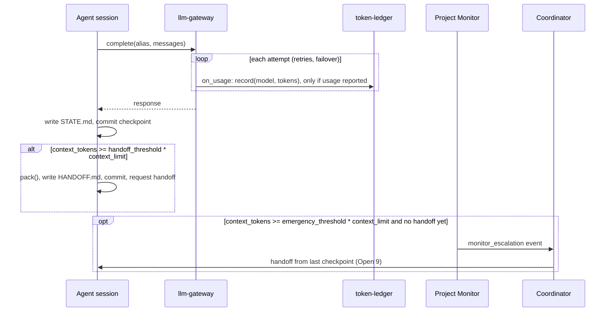

# Models and usage — module spec

> Part of the UMAS technical design. Main spec: [TECHNICAL-DESIGN-SPEC.md](../../TECHNICAL-DESIGN-SPEC.md) · Module map: [module map](../../TECHNICAL-DESIGN-SPEC.md#5-component-design)
> **Date:** 2026-11-09 · **Status:** Revised for [ADR-0005](../../../docs/decisions/ADR-0005-track-token-usage-only.md). Round 1 caller assessment (2026-11-09) rejected; revised for round 2 ([report](../../../docs/assessments/caller-assessment-token-usage-2026-11-09.md)). The 2026-10-25 assessment is history.
> **Owns:** the role-to-model alias policy, usage recording for each LLM call, and the context-window handoff settings.
> **Uses:** [token-ledger](../../../libs/token-ledger/README.md), [llm-gateway](../../../libs/llm-gateway/README.md), [agent-session](../../../libs/agent-session/README.md) (handoff and "Context packing"), [metrics-store](../../../libs/metrics-store/README.md)
> **Depends on modules:** [context-persistence](../context-persistence/context-persistence-spec.md) (`STATE.md`, `HANDOFF.md`), [monitoring](../monitoring/monitoring-spec.md) (backstop handoff)
> **Decided:** ADR-0005 (2026-11-09). UMAS tracks tokens used, the model and the time for each LLM call. The alias names `default` and `deep` are decided (D2, D20).

## 5.6 Context Handoff

Handoff protects a session from overflowing its model's context window. A handoff moves the task to a fresh session. (ADR-0005)

**Handoff triggers:**

| Trigger | Type | Action |
|---------|------|--------|
| Context tokens ≥ `handoff_threshold` (0.90) × `context_limit` | Graceful | Session packs its context, writes `HANDOFF.md`, commits, and requests a handoff |
| Context tokens ≥ `emergency_threshold` (0.95) × `context_limit`, no handoff yet | Emergency | Monitor appends a `monitor_escalation` event; the Coordinator sends a handoff from the last checkpoint (backstop, Open 9) |

**Context compression on handoff** — full context (~175k tokens) compressed to handoff packet (~15k tokens). The packet is built by `pack()`, which `handoff()` calls. `pack()` is described in [agent-session](../../../libs/agent-session/README.md), section "Context packing":

- Current task and progress percentage
- Last 10 decisions
- Explicit next steps
- Pointers to relevant files (path + line range, not content)

The incoming agent reads the handoff packet and the worktree's `STATE.md`. It does not re-read the full conversation history.

> Standalone specs: [agent-session](../../../libs/agent-session/README.md) (handoff, "Context packing") · [token-ledger](../../../libs/token-ledger/README.md) (usage)

---

## 5.7 Model Policy

**Aliases.** Roles name an [llm-gateway](../../../libs/llm-gateway/README.md) alias, never a model ID. The alias table is in llm-gateway section 3.2:

| Alias | Use in UMAS | Fallback |
|-------|-------------|----------|
| `default` | The default for every role | Set in the alias table |
| `deep` | The Architect example (section 4) | Set in the alias table |
| `planner` | No role maps to it by default. A role uses it only by config | None in llm-gateway section 3.2 |

**Default:** All roles use the same configured model (`agents.default.model`). Minimal setup, no per-role overhead.

**Opt-in role mapping** via `umas.config.yaml`:

| Role | Override key |
|------|-------------|
| Coordinator | `agents.coordinator.model` |
| Worker | `agents.worker.model` |
| Architect | `agents.specialized.architect.model` |
| Reviewer | `agents.specialized.reviewer.model` |

**Failover and replacement.** Failover is the alias's `fallback` in the llm-gateway alias table, and llm-gateway runs it (section 5.1 of that spec). Replacing a provider or model is an edit to that table, not a code change ([ADR-0003](../../../docs/decisions/ADR-0003-llm-gateway-wraps-provider-sdks.md)). Model IDs never appear in this spec or in code. Every LLM provider, including the one a harness uses for a Worker, is set by config.

**Multi-model panels** are opt-in and reserved for decisions with irreversible consequences (architecture, security, data migrations). Disabled by default. Each panel call is recorded like any other call (section 2).

```yaml
agents:
  worker:
    model: default                # llm-gateway alias, not a model ID
  specialized:
    architect:
      model: deep                 # llm-gateway alias, not a model ID
      panel_enabled: true
```

---

## Detailed design

Each claim carries a label. **Decided** means the owner decided it, with the date or decision number given. **Source** cites the main spec or a library README. **Proposed** means this spec's recommendation, not yet decided. Items needing an owner decision are in section 9.

Bare section numbers such as 5.6 or 6.7 refer to the main spec. Library sections name the library.

### 1. Purpose and boundary

This module decides which model alias each role uses, records the tokens each LLM call used, and sets the context-window thresholds that make a session hand off before its window overflows.

Usage is recorded, not limited. **Decided:** ADR-0005 (2026-11-09).

This module does not do the following:

- It does not pause or defer work because of usage. A context handoff moves the task to a fresh session. **Source:** ADR-0005; [agent-session](../../../libs/agent-session/README.md) section 5.1.
- It does not estimate usage. A call with no usage report is not recorded. **Decided:** ADR-0005.
- It does not count tokens in text. The caller supplies the counter. **Source:** agent-session 3.3 (`counter`).
- It does not call a model or summarise text. `pack()` only fits content the agent writes. **Source:** agent-session "Context packing".
- It does not retry or fail over provider calls. [llm-gateway](../../../libs/llm-gateway/README.md) does. **Source:** llm-gateway section 2.

Owners of neighbouring work:

| Responsibility | Owner |
|----------------|-------|
| Dispatch loop and task readiness | [orchestration](../orchestration/orchestration-spec.md). Dispatch depends on readiness and the concurrency cap only (ADR-0005) |
| Launching the harness, session loop, `handoff()` call, recording a harness usage report | [agent-execution](../agent-execution/agent-execution-spec.md). **Decided:** D12 |
| `STATE.md`, `HANDOFF.md`, checkpoint commits | [context-persistence](../context-persistence/context-persistence-spec.md) |
| Backstop: escalation of a session that has not handed off to the Coordinator (Open 9) | [monitoring](../monitoring/monitoring-spec.md) |
| Retry table, failover, circuit breaker | llm-gateway. See [6.7](../exception-flows/exception-flows-spec.md#67-llm-provider-failure-mid-task) |
| Usage wiring: the `on_usage` glue that calls `record`, and the config that sets the aliases and thresholds | This module, as UMAS code (not a library) |

**Worker usage is what the harness reports.** Workers run as external CLI harnesses. The total and the model come from the completion signal's `token_usage` (agent-platform 3.4) and the model the launcher resolved (Open 23). A run whose CLI reports no usage produces no ledger entry, and the spec does not estimate it (Open 3).

### 2. Flow

**Usage recording rule.** Every LLM call with a usage report is recorded: `record(model, tokens)` in [token-ledger](../../../libs/token-ledger/README.md). `model` is the LLM model name (for example `opus`, `sol` or `luna`), never the gateway alias (D-1). `tokens` is `usage.input_tokens + usage.output_tokens` (llm-gateway 3.1). Cached-token fields are not added. A call or attempt that reports no usage writes no entry. The ledger never estimates. **Decided:** ADR-0005; 2026-11-09 owner decisions D-1, B2. **Source:** llm-gateway section 9 (Known Consumers, token accounting).

Gateway calls, in order:

1. A role resolves to an alias with `resolve(role)` (section 3). The caller calls `complete(alias, ...)` on llm-gateway.
2. llm-gateway retries and fails over by its own rules (llm-gateway 5.1). It calls `on_usage` once per attempt, successful or failed.
3. The `on_usage` glue calls `record(model, tokens)` when `usage` is present. `model` is the payload's `model`, the model that answered that attempt, so failover is included. A failed attempt that reports usage is recorded, because the provider charged for it. If the callback raises (for example, `record` fails and the glue lets the error through), the gateway catches, logs and ignores it, and the outcome of `complete` does not change (llm-gateway 5.7). **Source:** llm-gateway 4 and 5.1.
4. `record` is not idempotent (token-ledger 4.1). Each attempt is recorded once, by the glue that receives its callback. A retry is a new attempt and gets its own entry if it reports usage.

Harness calls, in order:

5. The launcher resolves the role's alias from the alias table to a harness provider and model, and passes them to the harness config. The resolved model is the `model` recorded for the run (Open 23, Decided).
6. When the harness run ends, the launcher calls `record(model, tokens)` once, if the completion signal carries `token_usage`. `tokens` is `token_usage.input + token_usage.output`; cached tokens are excluded (llm-gateway 3.1). A run with no `token_usage` writes nothing (Open 3). A crash between the run and this call can lose that run's line (section 8).

Context handoff, in order (applies to sessions that have a `context_tokens` value: the Coordinator and in-process agents. CLI Workers have none, so the 90 % and 95 % rules do not apply to them; agent-execution Open 6):

7. After each step, the session writes `STATE.md` and commits a checkpoint. **Source:** agent-session 5.1.
8. When `context_tokens` reaches `handoff_threshold` times `context_limit`, the session packs its context, writes `HANDOFF.md`, commits, and requests a handoff. `context_tokens` of a step is defined in llm-gateway 3.1 (B3): the input, cached and output tokens of that step's last call. It is the window size after the call, not a running total. The session acts at its own threshold. **Source:** agent-session 5.1; ADR-0005 (kept).
9. When the context reaches `emergency_threshold` times `context_limit` with no handoff yet, the Project Monitor appends a `monitor_escalation` event, and the Coordinator sends a handoff from the last checkpoint. The Monitor reads `context_tokens` and `context_limit` from the session row (monitoring). The Monitor is the backstop. **Decided:** Open 9 (M1, M2); event name monitoring Open 26.
10. The successor reads `HANDOFF.md` and `STATE.md`. It does not read the full history. **Source:** 5.6.

Reporting:

11. `umas metrics tokens` sums `token.used` rows in [metrics-store](../../../libs/metrics-store/README.md), grouped by `model`. The default window is all time (M5). The rows come from `ingest_token_ledger` on the ledger. The daemon calls it every `ingest.interval_seconds` (300) (B5). **Source:** metrics-store 9; ADR-0005.

**Consequences (ADR-0005).** A run or call with no usage is not shown and not counted, and `umas metrics tokens` gives no count of such runs (Decided). The ledger has no `outcome` field, so a failed attempt that reports usage counts like a success. The ledger file has no access control: any local process that can write the file can append a line. The ledger is kept forever (M6). `umas metrics tokens` reads metrics-store, which keeps 90 days by default, so for usage older than that the view can show less than `token-ledger` totals.

**Failure paths:** see section 8.

Figure 1 shows usage recording and handoff.



*Figure 1. Usage recording and context handoff.*

### 3. Interfaces

Direction is from this module's point of view.

| Name | Dir | Carrier | Payload | Owner | Basis |
|------|-----|---------|---------|-------|-------|
| Model choice | in | Config keys in `umas.config.yaml` | Alias name (string). See section 4 | access-control (who can edit) | Source: 5.7 |
| Role resolution | in | Function `resolve(role)` | Returns `{ alias, context_limit }`. Raises `ConfigError` if the alias has no `context_windows` entry | This module | Decided: B4 (2026-11-09) |
| Model call | out | `llm-gateway` `complete(request)` | `{ alias, messages[], tools[]?, max_output_tokens?, metadata{} }`. This module does not use `metadata{}`; the ledger records no actor, project or task (ADR-0005) | llm-gateway | Source: llm-gateway 3.1 |
| Gateway usage | in | `on_usage` callback from llm-gateway | `{ alias, provider, model, usage, latency_ms, outcome }`. `model` is recorded; `alias` is not (D-1). Called when `usage` is present, for successful and failed attempts | llm-gateway | Source: llm-gateway 4, 5.1 |
| Harness usage | in | `CompletionSignal.token_usage` (`{ input, output, cached }`, best-effort) and the launcher's resolved `model` | Total = `input + output`, cached excluded. Absent when the CLI reports no usage (Open 3) | agent-execution (launcher) | Source: agent-platform 3.4; llm-gateway 3.1; B2, D-1 |
| Usage record | out | Function `record(model, tokens, ts?)` on token-ledger | One line `{ v: 1, ts, model, tokens }`. `model` is the LLM model name, never the alias. `tokens` is `input + output` | token-ledger | Source: token-ledger 3.1, 4; ADR-0005 |
| Session limits | out | `SessionConfig` | `{ context_limit, handoff_threshold, emergency_threshold, checkpoint_every, handoff_packet_size, decisions_in_packet, counter, event_source }` | agent-execution (agent-session) | Source: agent-session 3.3; ADR-0005 (kept) |
| Handoff request | out | Event appended to the event log | `handoff_request`. Payload `{ session_id, task_id, reason: context_graceful \| context_emergency, context_used, context_limit, packet: HANDOFF.md }` | orchestration (reads it) | Decided: D-3 (2026-11-09). Source: agent-session 5.8, 3.5 |
| Packing call | out (from `handoff()`) | `pack(sections, limit, counter)` in [agent-session](../../../libs/agent-session/README.md), section "Context packing", called by `handoff()`. `limit` is `handoff_packet_size`; `counter` is `SessionConfig.counter`. The caller registers sections only | Section: `{ name, content, priority, mode, truncate }`. Result manifest: `{ included[], truncated[], dropped[], tokens }` | agent-session (function and call) | Source: agent-session "Context packing"; M3 |
| Handoff packet | out | File `HANDOFF.md` in the worktree root | `{ session_id, task_id, task_summary, progress, next_steps[], decisions[], file_pointers[], context_used, context_limit, packed_at }` | agent-session (schema); context-persistence (file) | Source: agent-session 3.5 |
| Context windows | in | Config key `context_windows.<alias>` in `umas.config.yaml` | Integer tokens per alias. No default. A missing value for an alias in use is `ConfigError` at start-up | Admin (`config:write`) | Decided: B4 (2026-11-09). Source: agent-session 3.3 |
| Token metrics | out | CLI `umas metrics tokens`; REST `GET /api/v1/metrics/tokens` | `TokenMetrics`: `token.used` summed per `model`, with `window` (default all time) | interfaces | Source: interfaces 7; metrics-store 9; ADR-0005; M5 |

### 4. Parameters

Defaults come from the main spec, from the owner decisions, or from the library README named under "Where set". `not set` means no source gives a default.

| Name | Type | Default | Where set | What it changes |
|------|------|---------|-----------|-----------------|
| `handoff_threshold` | float | 0.90 | `SessionConfig` | Fraction of `context_limit` that starts a graceful handoff by the session. Source: agent-session 3.3; ADR-0005 (kept) |
| `emergency_threshold` | float | 0.95 | `SessionConfig` | Fraction of `context_limit` that starts an emergency handoff. The session acts first at `handoff_threshold`; the Monitor is the backstop (Open 9). Source: agent-session 3.3, 5.1 |
| `context_limit` | int (tokens) | not set. Read from `context_windows.<alias>` | `SessionConfig`, read from the model config | The model context window. The thresholds are fractions of it. For an alias with a fallback, use the smaller window (Open 17). Source: agent-session 3.3 |
| `context_windows.<alias>` | int (tokens) | not set. Required for each alias in use | `umas.config.yaml` | The context window of the alias's model. Missing for an alias in use: `ConfigError` at start-up. Read by orchestration and context-persistence. Decided: B4 (2026-11-09) |
| `checkpoint_every` | int | 1 | `SessionConfig` | Commit `STATE.md` after every N steps, so a handoff has a recent checkpoint. Source: agent-session 3.3 |
| `handoff_packet_size` | int (tokens) | 15000 | `SessionConfig` | Size limit passed to `pack()`. Source: agent-session 3.3 |
| `decisions_in_packet` | int | 10 | `SessionConfig` | Number of recent decisions in the packet. Source: agent-session 6 |
| `token_ledger.ledger_path` | path (absolute) | not set (required) | `umas.config.yaml` | The one ledger file. `record` appends to it, `ingest_token_ledger` reads it, and the launcher and the gateway glue use this same value. Relative or missing path: `ConfigError`. Source: token-ledger 6; M4 |
| `ingest.interval_seconds` | int | 300 | `umas.config.yaml` | How often the daemon calls `ingest_token_ledger`. Source: B5; metrics-store 9 |
| `agents.default.model` | alias | `default` | `umas.config.yaml` | The one model all roles share, unless a role key is set. Open 25 |
| `agents.coordinator.model` | alias | `agents.default.model` | `umas.config.yaml` | Coordinator model. Source: 5.7 |
| `agents.worker.model` | alias | `agents.default.model` | `umas.config.yaml` | Worker model. For a CLI harness, the launcher resolves it (Open 23, Decided) |
| `agents.specialized.architect.model` | alias | `agents.default.model`. The example uses `deep` | `umas.config.yaml` | Architect model. Source: 5.7 |
| `agents.specialized.reviewer.model` | alias | `agents.default.model` | `umas.config.yaml` | Reviewer model. Source: 5.7 |
| `agents.specialized.architect.panel_enabled` | bool | `false` | `umas.config.yaml` | Multi-model panel for irreversible decisions. Source: 5.7 |

Provider timeouts, retry schedules, breaker and rate-limit values belong to llm-gateway. This module does not read them.

**Alias contract.** The alias names are `default`, `deep` and `planner`, all in llm-gateway section 3.2. `default` and `deep` are decided (D2, D20). `resolve(role)` returns an alias, never a model ID. **Decided (B4):** start-up validation fails with `ConfigError` if an alias in use has no `context_windows` entry. Unknown aliases and missing credentials also fail at start-up (llm-gateway 7).

### 5. Capabilities

Permission names follow the `resource:action` form of [A.5.6](../../TECHNICAL-DESIGN-SPEC.md#a56-data-model). `metrics:read` and `agent:handoff` are decided (D21). `config:write` is from A.5.4. The access-control spec owns the single permission list (A.5.7).

| Capability | Who holds it | Permission | Basis |
|------------|--------------|------------|-------|
| Change providers, model mapping, context windows | Admin | `config:write` | Source: A.5.4 "Change system configuration" |
| View token metrics | Admin, Operator, Auditor and Viewer system-wide. Project Owner, Developer and Approver in their projects | `metrics:read` | Decided: D21. Source: A.5.4 metrics row |
| Request a graceful handoff | The session itself | `agent:handoff` | Decided: D21. Source: agent-session 5.1 |
| Send the backstop (emergency) handoff | Coordinator holds it. Project Monitor appends a `monitor_escalation` event for the Coordinator (Open 9) | `agent:handoff`. A.5.5 gives Monitors restart and nudge, not handoff | Source: A.5.5; Open 9 (M1) |

The libraries hold no access control. The application checks permissions first, then passes a plain `actor` string where it needs one. token-ledger records no actor (ADR-0005).

### 6. Interaction with other modules

| Module | This module sends or receives | Carrier | Sync |
|--------|-------------------------------|---------|------|
| [orchestration](../orchestration/orchestration-spec.md) | Uses the model aliases (5.7), and `context_limit` from `context_windows.<alias>` for the Coordinator. Reads the `handoff_request` event | Config; event log | Sync for config; async for events |
| [agent-execution](../agent-execution/agent-execution-spec.md) | Receives the alias per role and `SessionConfig`. Records a harness usage report with `record` (once per run). Calls `handoff()` through the session loop | Config; function calls; `SessionConfig` | Sync |
| [context-persistence](../context-persistence/context-persistence-spec.md) | Packet written to `HANDOFF.md`. Successor reads it with `STATE.md`. Handoff commit | Files in the worktree; git commit | Async |
| [monitoring](../monitoring/monitoring-spec.md) | Backstop: appends a `monitor_escalation` event for a session at `emergency_threshold` that has not handed off. Reads `context_tokens` and `context_limit` from the session row (M2). The Coordinator sends the handoff (M1, Open 9) | Event log; agent action | Async |
| [exception-flows](../exception-flows/exception-flows-spec.md) | Owns 6.7 (provider failure). Section 6.6 is dropped; 6.7 keeps its number | Cross-reference | Not applicable |
| [interfaces](../interfaces/interfaces-spec.md) | `umas metrics tokens` and its REST route. Project and metrics routes | CLI; REST | Sync |
| [access-control](../access-control/access-control-spec.md) | Who can change model mapping and context windows, and who can read token metrics | Check before each call | Sync |
| [metrics-store](../../../libs/metrics-store/README.md) | `ingest_token_ledger` turns ledger entries into `token.used` rows. Called by the daemon every `ingest.interval_seconds` (B5) | Library adapter | Async |

### 7. Libraries and packs used

| Part | What this module uses it for |
|------|------------------------------|
| [token-ledger](../../../libs/token-ledger/README.md) | `record(model, tokens)`, one line per call; `totals` for the no-argument view |
| [llm-gateway](../../../libs/llm-gateway/README.md) | Alias table (`default`, `deep`, `planner`), retry and failover, the `on_usage` callback |
| [agent-session](../../../libs/agent-session/README.md) | `context_limit` and its thresholds, `handoff()`, `HANDOFF.md`, `pack()` ("Context packing") |
| [metrics-store](../../../libs/metrics-store/README.md) | `token.used` rows for `umas metrics tokens` |

[ADR-0003](../../../docs/decisions/ADR-0003-llm-gateway-wraps-provider-sdks.md): llm-gateway wraps the provider SDKs. A provider swap is an edit to the alias table and the `context_windows` entry. Model IDs never appear in this spec or in code.

### 8. Failure handling

Each outcome names its recipient.

| Failure | Handling | Recipient | Basis |
|---------|----------|-----------|-------|
| Context reaches `handoff_threshold` | Graceful handoff by the session | Scheduler (reads the handoff request) | Source: agent-session 5.1; ADR-0005 (kept) |
| Context reaches `emergency_threshold` with no handoff | Monitor appends a `monitor_escalation` event. The Coordinator sends a backstop handoff from the last checkpoint | Coordinator (sends it), Scheduler | Source: agent-session 5.1. Decided: Open 9 (M1) |
| `RequiredSectionTooLarge` from `handoff()` (`handoff()` re-raises `pack()`'s `RequiredTooLarge`; agent-session 5.1, 7) | Session builds the packet from the last `STATE.md` checkpoint, writes it to `HANDOFF.md` with `manifest.degraded: true`, takes status `handoff`, and emits `handoff_request`. It raises a P2 escalation. Decided: Open 18 (M10) | Coordinator (P2) | Source: agent-session 5.1, 7 |
| Provider failure | Handled by llm-gateway. See [6.7](../exception-flows/exception-flows-spec.md#67-llm-provider-failure-mid-task) | Coordinator (P1); Admin (P0 for auth) | Source: 6.7 |
| Attempt or run reports no usage | Not recorded. Never estimated. Totals are lower than real use | None | Decided: ADR-0005 |
| Launcher crashes after a harness run and before `record` | That run's line is lost. There is no atomic store and no re-read of the signal to record it. Accepted (M9) | None | Decided: ADR-0005; M9 |
| `on_usage` callback raises | The gateway catches and logs the exception, ignores it, and does not change the outcome of `complete`. No retry or failover is caused by the callback | Admin (log) | Source: llm-gateway 5.7 (M7) |
| `record` fails (`InvalidEntry`, `LedgerUnreadable`, `LedgerWriteFailed`, `LockTimeout`) | The call has already run. The glue logs the error, does not write a zero or an estimate, does not retry, and does not record the call twice. Default: raise P2 when the file is unreadable | Admin | Source: token-ledger 7 (`LedgerWriteFailed`, M8). Proposed: P2 |
| Corrupt ledger line | token-ledger skips it and counts it in `check()`. Other lines are still totalled | Admin (through `check()`) | Source: token-ledger 5.1, 7 |
| Role alias has no context window | `resolve` raises `ConfigError`. Start-up validation fails | Admin | Source: agent-session 3.3. Decided: B4 (2026-11-09) |
| Unknown alias or missing credentials | `ConfigError` at start-up through `validate()` | Admin | Source: llm-gateway 7 |

### 9. Open

Each item states the decision needed and a recommendation, or records the decision once made. This spec does not settle the items still open. Gaps in the numbering are removed items; the other numbers are kept so that references stay valid.

**Decided.** ADR-0005 (2026-11-09): tokens, model and time only; context handoff kept. Aliases `default` and `deep` (D2, D20). The launcher owns launch (D12). Permission names `metrics:read` and `agent:handoff` (D21). Owner decisions of 2026-11-09 (D-1 to D-4, B2 to B5, M1 to M10) are recorded in [the task file](../../../docs/tasks-token-usage-2026-11-09.md#resolved-decisions-owner-2026-11-09). Items 9, 15, 17, 18 and 23 are decided below; items 13, 16, 26 and 27 are closed.

**Open, needing a decision.** Each item states the default this spec uses until the owner answers.

3. **CLIs that report no usage.** Default: a harness run whose completion signal carries no `token_usage` writes no ledger entry, and its tokens are not counted. Recommendation: test each CLI before Phase 2 and record which ones report usage in agent-execution.
9. **Decided (M1, M2).** The Project Monitor appends a `monitor_escalation` event for a session at `emergency_threshold` that has not handed off (monitoring Open 26). The Coordinator, which holds `agent:handoff`, sends the handoff from the last checkpoint. The session acts first at `handoff_threshold`.
13. **Closed.** `record` takes `model` and `tokens` only. The callback payload carries `usage` (llm-gateway 4, 3.1), and `tokens` is computed from it as `input_tokens + output_tokens`.
15. **Decided (D-3).** The handoff event is `handoff_request`, with the payload in section 3 and `reason` values `context_graceful` and `context_emergency`.
16. **Closed.** The context measure. llm-gateway 3.1 defines `context_tokens` of a step (B3). agent-session 5.1 uses it as the handoff trigger.
17. **Decided (B4).** Fallback alias context window: use the smaller `context_limit` of the primary and fallback models. The config owner is Admin. If a fallback model has a different window, a later revision may add an optional fallback entry to the alias table.
18. **Decided (M10).** Outcome of a failed handoff (`RequiredSectionTooLarge`): fall back to the last `STATE.md` checkpoint, flag the packet as degraded, and raise P2.
23. **Decided (D-1).** Meaning of `agents.worker.model`. Workers bypass llm-gateway. The launcher resolves the alias from the alias table to a harness provider and model, passes them to the harness config, and records the resolved model for each run.
24. **Where a panel runs.** Default: panel synthesis is UMAS Coordinator code outside the gateway. Each panel call's usage is recorded like any other call.
25. **Config key for the default model.** Default: `agents.default.model`, as section 4 uses it.
26. **Closed.** Caller specs in section 6 use the ADR-0005 terms and no removed interface names.
27. **Closed.** Name of the handoff trigger. The keys `handoff_threshold` and `emergency_threshold` are kept (ADR-0005 terminology map). The prose name `context_threshold` is not used.

## AXI support

The commands in scope are the `token-ledger` CLI that this module uses, and the `umas metrics tokens` command that reads it through metrics-store. The `umas` commands belong to [interfaces](../interfaces/interfaces-spec.md). The rules are in [CLI Conventions (AXI)](../../../libs/README.md#cli-conventions-axi). The `token-ledger` CLI is specified in its section 4.1.

| Command | Purpose | Output | Source |
|---------|---------|--------|--------|
| `token-ledger` (no arguments) | Totals by model, all time | `totals[N]{model,tokens,calls}` rows and `help` line. `totals: none recorded` when empty | token-ledger 4.1 |
| `token-ledger totals --json` | Totals for scripts and non-Python callers | JSON `Total[]` | token-ledger 4 |
| `umas metrics tokens` | Token totals by model over a window (all time by default) | `token.used` sums per `model` (metrics-store 9) | interfaces 7; ADR-0005; M5 |

This module adds no CLI of its own. `pack()` is not a CLI here; it is a function in agent-session. Commands that remain are rated in token-ledger 4.1.
