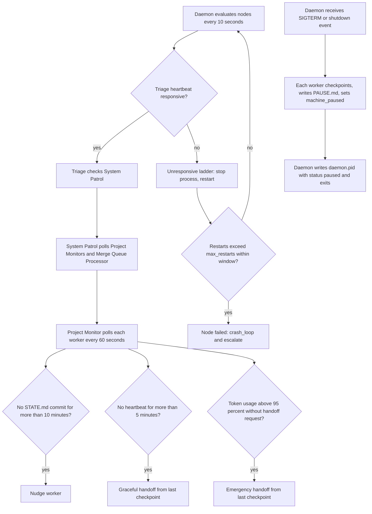

# Monitoring — module spec

> Part of the UMAS technical design. Main spec: [TECHNICAL-DESIGN-SPEC.md](../../TECHNICAL-DESIGN-SPEC.md) · Module map: [module map](../../TECHNICAL-DESIGN-SPEC.md#5-component-design)
> **Owns:** Supervision of UMAS processes (three-tier watchdog) and stuck-agent detection by the Project Monitors.
> **Uses:** [watchdog](../../../libs/watchdog/README.md) (Part A); [event-log](../../../libs/event-log/README.md), [error-classifier](../../../libs/error-classifier/README.md), [agent-session](../../../libs/agent-session/README.md), [budget-meter](../../../libs/budget-meter/README.md), [llm-gateway](../../../libs/llm-gateway/README.md), [merge-queue](../../../libs/merge-queue/README.md) (Detailed design, section 7)
> **Depends on modules:** none in the moved text. Neighbours are in Detailed design, section 6.

## 5.5 Monitoring System

**Three-tier watchdog:**

```
Tier 1 — Daemon (Python, OS process)
  Heartbeats Triage Agent every 3 min
  No response → restart Triage Agent

Tier 2 — Triage Agent (Python, always running)
  Monitors System Patrol
  Stuck → investigates, restarts

Tier 3 — System Patrol (Python, always running)
  Polls all Project Monitors and Merge Queue Processors
  Dispatches maintenance workers for detected issues
```

**Project Monitor** (one per active project, polls every 60 seconds):

| Heuristic | Threshold | Action |
|-----------|-----------|--------|
| No `STATE.md` commit | > 10 min | Agent may be stuck → nudge |
| No heartbeat | > 5 min | Agent likely crashed → graceful handoff |
| Token usage without handoff request | > 95% | Emergency handoff from last checkpoint |

Recovery order: Nudge → Graceful handoff → Emergency handoff

> Standalone spec: [libs/watchdog.md](../../../libs/watchdog/README.md)

---

## Detailed design

Tags: **[S]** means from source. The tag cites the snapshot section or the lib README section. **[P]** means proposed: this spec's reading, not a decision. Items in section 9 are **Open**. The Mermaid block is checked by reading only. No Mermaid renderer ran.

Lib action names (`nudge`, `terminate`, `restart`, `escalate`) keep the lib's wording in code font.

### 1. Purpose and boundary

- The module keeps UMAS processes running and finds stuck or crashed worker agents. [S §5.5]
- The module does not restart the Daemon. The OS service manager restarts it. [S A.4.6]
- The module does not dispatch work. Work dispatch belongs to [orchestration](../orchestration/orchestration-spec.md). [P]
- Recovery cases belong to [exception-flows](../exception-flows/exception-flows-spec.md). Token thresholds belong to [budget-and-models](../budget-and-models/budget-and-models-spec.md). [S §6, §5.6]

### 2. Flow

Happy path, one monitoring cycle:

1. The OS service manager starts the Daemon. The Daemon runs the `watchdog` library. [S A.4.6; watchdog §9]
2. The Daemon evaluates each node every tick. The default tick is 10 seconds. [S watchdog §5.1]
3. Triage checks System Patrol. [S §5.5]
4. System Patrol polls every Project Monitor and the Merge Queue Processor. [S §5.5]
5. Each Project Monitor polls its project every 60 seconds. [S §5.5]
6. For each worker, the Project Monitor reads the last `STATE.md` commit, the heartbeat and token usage. [S §5.5; heartbeat source is Open 1]
7. The Project Monitor applies the three heuristics. Each heuristic maps to one recovery action. [S §5.5]
8. A worker that passes all three checks needs no action.
9. System Patrol dispatches maintenance workers for each issue. [S §5.5; Open 9]

Failure path A, Triage unresponsive:

1. A heartbeat is responsive when its age is less than `interval * miss_threshold`. [S watchdog §3.2]
2. The Daemon runs the unresponsive ladder: `terminate`, then `restart`, then `escalate`. [S watchdog §3.5]
3. Each restart counts toward the crash-loop window. [S watchdog §5.2]
4. When restarts exceed `max_restarts` in `window`, the node state becomes `failed`. The library stops restarting. It emits `crash_loop` and `escalate`. [S watchdog §5.2, §7]

Failure path B, machine shutdown and boot recovery:

1. The Daemon listens for SIGTERM and OS shutdown events. [S §6.17]
2. UMAS writes `<hook-path>/.pause`. Each worker checkpoints at its next step boundary, writes `PAUSE.md` and sets `machine_paused`. [S agent-session §5.6]
3. The Daemon writes `~/.umas/daemon.pid` with `status: paused` and exits. [S §6.17]
4. On boot, `umas start-all` reads sessions in `active`, `machine_paused` and `auth_expired`. [S §6.17, step 2]
5. A node marked `machine_pause_aware` emits `boot_stale`. The library skips the unresponsive ladder for one `startup_grace`. [S watchdog §7]

Figure 1. Monitoring flow. The solid path is the happy path. The branches show failure paths A and B. Names follow the snapshot and the lib READMEs. Thresholds come from section 4.



### 3. Interfaces

| Name | Direction | Carrier | Payload (fields and types) | Owner |
|------|-----------|---------|----------------------------|-------|
| Heartbeat file [S watchdog §3.2] | out (worker or Triage writes), in (Daemon reads) | File, written by atomic rename | `v: int`, `name: str`, `pid: int`, `ts: str`, `seq: int`, `status: ok\|busy\|degraded`, `note: str` | [watchdog](../../../libs/watchdog/README.md) (format); this module (path). Direction is Open 3. |
| `[checkpoint]` commit [S agent-session §5.2] | in | Git commit | `[checkpoint] <agent_id> step <N>: <summary> [tokens: N]`. Prefix is configurable. | [agent-execution](../agent-execution/agent-execution-spec.md). Prefix is Open 2. |
| `STATE.md` commit [S §5.1] | in | Git commit | `[umas] <agent-id> <step-summary> [tokens: N]` | [context-persistence](../context-persistence/context-persistence-spec.md) |
| Session row [S §4 Agent Sessions] | out (Project Monitor), in (`umas watch`) | API over the relational store | `status`, `last_heartbeat`, `paused_at` | [interfaces](../interfaces/interfaces-spec.md) (API). Writer is Open 8. |
| `escalate` event [S §5.2, §5.3] | out | Event in `events.jsonl` [S event-log §9] | `append(type="escalate", source, data={severity, reason})`. `severity` is `P0` to `P3`. | [event-log](../../../libs/event-log/README.md). Read by [orchestration](../orchestration/orchestration-spec.md). |
| Node events [S watchdog §4] | out | Callback (`on_event`) | `node_state_changed`, `ladder_action`, `restarted`, `crash_loop`, `escalate`, `boot_stale` | [watchdog](../../../libs/watchdog/README.md) |
| Nudge and stop signals [S watchdog §3.5] | out | File `<name>.nudge` or `<name>.stop`, or signal | No payload | This module [P] |
| Pause signal [S agent-session §5.6] | out | File `<hook-path>/.pause` | `v: 1`, `reason: "machine_shutdown"`, `ts: str`, `grace_seconds: 30` | This module writes it. [agent-execution](../agent-execution/agent-execution-spec.md) reads it. |
| `daemon.pid` [S §6.17] | out | File `~/.umas/daemon.pid` | `pid`, `status` (`running` or `paused`) | This module |
| Budget threshold event [S budget-meter §3.3] | in | Callback (`subscribe`) or ledger cursor (`poll_events`) | `{ budget, threshold, direction, used, limit, at }` | [budget-meter](../../../libs/budget-meter/README.md). Owner: [budget-and-models](../budget-and-models/budget-and-models-spec.md). |
| Merge queue state [S merge-queue §4] | in | CLI `merge-queue status --json` [S merge-queue §4] | `state`, `pending[]`, `last_report` | [verification](../verification/verification-spec.md) |
| Model call for Triage [S A.4.8] | out | Function call | `complete(request) -> Response` [S llm-gateway §4] | [llm-gateway](../../../libs/llm-gateway/README.md) |
| Error record [S error-classifier §3.3] | out | Record wrapping an `escalate` event | `code`, `severity`, `recoverability`, `message`, `context` | [error-classifier](../../../libs/error-classifier/README.md) |
| `umas status`, `umas health-check`, `umas watch`, `umas agents reconcile` [S §7] | in (request), out (result) | CLI | Not defined in the snapshot | [interfaces](../interfaces/interfaces-spec.md) |
| Dashboard read [S ADR-0001; §7] | out (page reads REST) | REST `GET /api/v1/agents`, `GET /api/v1/metrics/*` | No monitor or node endpoint exists. See Open 14. | [interfaces](../interfaces/interfaces-spec.md) |

### 4. Parameters

| Name | Type | Default | Where set | What it changes |
|------|------|---------|-----------|-----------------|
| Triage heartbeat interval | duration | 3 minutes [S §5.5] | Watchdog config `heartbeat.interval_seconds`. Value 180 [P]. | Heartbeat cadence |
| Triage miss threshold | integer | not set. Open 4. | Watchdog config `heartbeat.miss_threshold` | Responsive window: `interval * miss_threshold` [S watchdog §3.2] |
| Tick | duration | 10 seconds [S watchdog §5.1] | Watchdog config `tick_seconds` | How often each node is evaluated |
| Startup grace | duration | 60 seconds [S watchdog §5.2] | Watchdog config `startup_grace_seconds` | No health judgement after start |
| Restart backoff | duration range | 5 seconds to 5 minutes [S watchdog §5.2] | Watchdog config `restart.backoff` | Wait between restarts |
| Max restarts and window | integer, duration | not set. Lib example: 5 in 600 seconds [S watchdog §5.2]. Open 4. | Watchdog config `restart.max_restarts`, `restart.window_seconds` | Crash-loop threshold |
| Kill grace | duration | not set. Lib example: 10 seconds [S watchdog §6]. Open 4. | Watchdog config `kill_grace_seconds` | Wait between SIGTERM and SIGKILL |
| Project Monitor poll | duration | 60 seconds [S §5.5] | Snapshot, fixed | Interval between checks of each worker |
| Stalled threshold | duration | 10 minutes without a `STATE.md` commit [S §5.5] | Snapshot, fixed | Starts nudge |
| Unresponsive threshold | duration | 5 minutes without a heartbeat [S §5.5] | Snapshot, fixed | Starts graceful handoff |
| Emergency threshold | percent | 95 percent [S §5.5]. Comparison is Open 18. | Agent-session config `emergency_threshold: 0.95` [S agent-session §6]. Budget-meter `hard` level [S budget-meter §5.1]. | Starts emergency handoff |
| Checkpoint prefix | string | `[checkpoint]` [S agent-session §6]. Snapshot uses `[umas:checkpoint]` (§5.3, §6.17). | Agent-session config `commit_prefixes.checkpoint` | Which commits count as checkpoints. Open 2. |
| Pause signal file | string | `.pause` [S agent-session §6] | Agent-session config `pause_signal_file` | Name of the pause file under the hook path |
| Shutdown grace | duration | 30 seconds [S agent-session §6; §6.17] | Agent-session config `shutdown_grace_seconds` | Time workers have to finish a step |
| Daemon memory limit | size | 512 MB [S §2.3] | Deployment (outside this spec) | Process resource limit |
| Daemon CPU limit | cores | 1 core [S §2.3] | Deployment (outside this spec) | Process resource limit |
| Daemon restart policy | enum | `always` [S §2.3] | OS service manager | Restart after exit |
| Daemon PID file | path | `~/.umas/daemon.pid` [S §6.17] | Snapshot, fixed | Detects a running Daemon [S §6.13] |
| Disk thresholds | size | 2 GB (P2), 500 MB (P1), 100 MB (P0) [S §6.16] | Snapshot, fixed | Disk severity levels. Owner is Open 15. |
| Escalation routing, P0 | rule | Operator [S A.5.4] | Access-control config | Who receives P0 |
| Escalation routing, security finding | rule | Project Owner, or Admin if none [S A.5.4] | Access-control config | Who receives a security finding. Status is Open 13. |
| Escalation routing, P1 | rule | not set. Open 5. | Not set | Who receives P1 |

### 5. Capabilities

Each row quotes the snapshot wording. The snapshot gives no `resource:action` name for these actions (Open 11). The `resource:action` format is in [A.5.6](../../TECHNICAL-DESIGN-SPEC.md#a56-data-model) [S].

| Capability | Who holds it (snapshot) | Snapshot wording | Source |
|------------|-------------------------|------------------|--------|
| Stop or pause an agent | Admin (S), Project Owner (P), Developer (P, own), Operator (S) | "Stop or pause an agent" | [S A.5.4] |
| Restart processes | Watchdog daemon | "restart processes" | [S A.5.5] |
| Restart or nudge a worker | Monitor (Triage, System Patrol, Project Monitor) | "restart, nudge" | [S A.5.5] |
| Read agent state and merge queue | Admin (S), Project Owner (P), Developer (P), Approver (P), Operator (S), Viewer (S) | "View agents, tasks, work bundles, merge queue" | [S A.5.4] |
| Raise P0 | Coordinator, Worker, Monitor, Watchdog daemon | "raise P0" | [S A.5.5] |
| Raise P1 | Worker, Specialist, Merge Queue Processor, Monitor | "raise P0, P1" or "raise P1" | [S A.5.5] |
| Raise P0 for a security finding | Reviewer | "raise P0 (security)" | [S A.5.5] |
| Acknowledge or resolve a P0 escalation | Admin (S), Project Owner (P), Operator (S) | "Acknowledge or resolve a P0 escalation" | [S A.5.4] |
| Reset a failed watchdog node, restart a service | Admin (S), Operator (S) | "Reset a failed watchdog node, restart a service" | [S A.5.4] |

Escalation routing [S A.5.4]:

- P0 goes to the Operator.
- A security finding goes to the Project Owner. The Admin receives it if no Project Owner exists.
- P1 stays inside the agent layer with the Coordinator [S A.5.4]. Open 5 records the conflict with §6.2.

The Daemon and the Watchdog daemon run as service accounts. Service accounts use a long-lived key kept in a secret store [S A.5.2].

### 6. Interaction with other modules

| Neighbour | What this module sends or receives | Carrier | Sync or async |
|-----------|------------------------------------|---------|---------------|
| [orchestration](../orchestration/orchestration-spec.md) | Sends `escalate` events. An `escalate` event moves the bundle to `ESCALATED` [S §5.2]. Receives maintenance worker requests [P, Open 9]. | Event (`events.jsonl`) | Async. The Coordinator polls with its own cursor [S event-log §9]. |
| [context-persistence](../context-persistence/context-persistence-spec.md) | Reads `STATE.md` commits and `PAUSE.md` files. Emits the `boot_recovery` summary event [S §6.17, step 5]. | Git commits, files, event | Async |
| [agent-execution](../agent-execution/agent-execution-spec.md) | Writes `.pause`, nudge and stop files. Reads the worker heartbeat and checkpoint commits. Workers poll `.pause` at each step boundary [S agent-session §5.6]. | Files, git commits | Async |
| [verification](../verification/verification-spec.md) | Reads merge queue state. The Patrol polls the Merge Queue Processor [S §5.5]. | CLI `merge-queue status --json` [S merge-queue §4] | Sync read |
| [budget-and-models](../budget-and-models/budget-and-models-spec.md) | Receives token usage and threshold events. Starts emergency handoff at 95 percent [S §5.5]. The budget exhausted path pauses dispatch and sets `budget_paused` [S §6.6]. | Callback or ledger cursor | Async |
| [interfaces](../interfaces/interfaces-spec.md) | Serves `umas status`, `umas health-check`, `umas watch` and `umas agents reconcile` [S §7, §6.15]. The dashboard reads the REST API [S ADR-0001]. | CLI and REST | Sync for reads |
| [access-control](../access-control/access-control-spec.md) | Each Monitor action passes the API permission check [S A.5.7]. The check for watchdog actions is [P]. | API middleware | Sync |
| [exception-flows](../exception-flows/exception-flows-spec.md) | Detects the conditions in §6.2, §6.6, §6.7, §6.13, §6.15, §6.16 and §6.17. Section 6 defines each response [S §6]. | Events and callbacks | Async |

### 7. Libraries and packs used

- [watchdog](../../../libs/watchdog/README.md): supervision ladder, heartbeat file, crash loop and the `boot_stale` rule [S watchdog §3, §5, §7].
- [event-log](../../../libs/event-log/README.md): `events.jsonl` for escalations and the Coordinator's cursor [S event-log §9].
- [error-classifier](../../../libs/error-classifier/README.md): severity levels and the error record that wraps an escalation [S error-classifier §3.1, §3.3].
- [agent-session](../../../libs/agent-session/README.md): checkpoint commits, `.pause` file, `machine_paused` status [S agent-session §3.2, §5.2, §5.6].
- [budget-meter](../../../libs/budget-meter/README.md): threshold events and threshold levels [S budget-meter §3.3, §5.1].
- [llm-gateway](../../../libs/llm-gateway/README.md): model calls for the Triage Agent [S A.4.8; llm-gateway §4].
- [merge-queue](../../../libs/merge-queue/README.md): `status()` state read by System Patrol [S merge-queue §4].

No pack is used. [P] The snapshot names no pack for this module.

### 8. Failure handling

| Failure | How this module handles it | Reference |
|---------|----------------------------|-----------|
| Triage Agent unresponsive | Daemon runs the unresponsive ladder, then escalates. Failure path A. | [S watchdog §3.5, §9] |
| Triage restart fails | Escalate. Severity is Open 5 and 6. | [S watchdog §12.2 (legacy reference)] |
| Worker stalled or crashed | Project Monitor runs the three heuristics. Recovery order: nudge, graceful handoff, emergency handoff. | [S §5.5] |
| Project deleted mid-task | Project Monitor detects it on its next poll, within 60 seconds. Marks sessions `crashed`. Escalates as P1. | [S §6.2] |
| Token budget exhausted | New dispatch pauses. In-flight agents finish the current step and commit. Status becomes `budget_paused`. Dispatch resumes within 60 seconds of a budget raise. | [S §6.6] |
| LLM provider 401 or 403 | Escalate P0 at once. No retry. | [S §6.7] |
| Stale state in dashboard or CLI | Project Monitor reconciles stale sessions within 60 seconds. `umas agents reconcile` runs the same check on demand. | [S §6.15] |
| Disk space below 100 MB | All agents checkpoint and pause at once. P0 escalation. Owner of the check is Open 15. | [S §6.16] |
| Git commit fails with `ENOSPC` | Retry once after 5 seconds. Then append a P0 escalation. | [S §6.16] |
| Machine shutdown | Failure path B. Boot recovery follows. | [S §6.17] |
| Second Daemon start | Detects the PID in `daemon.pid` and exits cleanly. | [S §6.13] |
| Crash loop | Library stops restarting. Emits `crash_loop` and `escalate`. | [S watchdog §5.2, §7] |
| Start command fails at once | Counts toward the crash-loop window. | [S watchdog §7] |
| Clock jump | One false `unresponsive`. The `seq` counter detects it. | [S watchdog §7] |
| Heartbeat file unreadable or partial | Treated as no change. | [S watchdog §7] |
| Session in `machine_paused` or `auth_expired` | Not a failure. Never promoted to `crashed`. | [S agent-session §3.2] |

### 9. Open

Each item is **Open**. Each recommendation is [P]. The owner decides each item.

1. **Open.** Worker heartbeat source. The snapshot uses "heartbeat" for two signals: the `[checkpoint]` commit [S agent-session §5.2] and the heartbeat file [S watchdog §3.2]. Decide which drives "no heartbeat for more than 5 minutes". Recommendation [P]: checkpoint commits for workers, heartbeat file for Triage and the Daemon.
2. **Open.** Checkpoint commit prefix. Snapshot uses `[umas:checkpoint]` [S §5.3, §6.17] and `[umas] <agent-id>` [S §5.1]. Agent-session uses `[checkpoint]` [S agent-session §5.2]. Decide one prefix. Recommendation [P]: agent-session default, set in config, and update the snapshot.
3. **Open.** Heartbeat direction. Snapshot §5.5 says the Daemon heartbeats Triage. The lib model has the supervised process write the file and the supervisor read it [S watchdog §3.2]. The Python Triage reference sends heartbeats to the Daemon [S watchdog §12.2]. Decide the direction. Recommendation [P]: lib model.
4. **Open.** Triage heartbeat and restart limits. Snapshot gives a 3-minute interval only. Lib examples use 30 seconds with `miss_threshold: 3` and 5 restarts in 10 minutes [S watchdog §6, §5.2]. Lib §10 shows a 60-second check against a 180-second interval [S watchdog §10]. Decide `miss_threshold`, `max_restarts`, `window` and `kill_grace`. Recommendation [P]: 3 minutes with 2 misses, and the lib example restart limit.
5. **Open.** P1 receiver. Snapshot §6.2 sends P1 to System Patrol [S §6.2]. Appendix A.5.4 keeps P1 with the Coordinator [S A.5.4]. Decide the receiver. Recommendation [P]: Coordinator, as in A.5.4. §6.2 then needs a wording change.
6. **Open.** P0 responder label. Error-classifier §3.1 names `operator` for P0. Its §9 lists `human` for the same level [S error-classifier §3.1, §9]. Decide one label. Recommendation [P]: `operator`, as in A.5.4. Fix error-classifier §9.
7. **Open.** Wait between ladder rungs. Lib §3.5 requires a `wait` per rung. Snapshot gives the order only [S watchdog §3.5; §5.5]. Decide each wait. Recommendation [P]: one Project Monitor poll (60 seconds) per rung.
8. **Open.** Who writes session status. A.4.6 makes the API the sole writer of the relational store [S A.4.6]. §6.2 says the Project Monitor marks sessions `crashed` [S §6.2]. Decide the writer. Recommendation [P]: the Project Monitor calls the API with its service account.
9. **Open.** Maintenance workers. The snapshot does not name them or their spawn path [S §5.5]. The CLI launcher is gap 3 [S A.7; A.4.8]. Decide the workers with orchestration. Recommendation [P]: define them in orchestration with gap 3.
10. **Open.** Triage prompt and model contract. The snapshot gives no prompt [S §5.5]. Triage calls a model through `llm-gateway` [S A.4.8]. Decide where the prompt contract lives. Recommendation [P]: this spec, after the Triage design is written.
11. **Open.** Permission names for monitor actions. The snapshot gives no `resource:action` name [S A.5.4, A.5.6]. Decide the names. Recommendation [P]: add names in access-control, for example `agent:stop` and `agent:restart`.
12. **Open.** Intersection rule. A.5.9 question 5 is "To confirm". Its recommendation is the intersection for user-triggered actions, and the own role for Patrol and Watchdog [S A.5.9]. Decide before access-control is built.
13. **Open.** Security finding routing. A.5.4 says it "awaits confirmation (A.5.9, question 7)". The A.5.9 table marks question 7 "Decided (owner, 2026-10-25)" with no answer text [S A.5.4, A.5.9]. Decide the status. Recommendation [P]: confirm, then align A.5.4.
14. **Open.** Monitor state for the dashboard. Section 7 has no REST endpoint for node or monitor state [S §7]. Decide whether the dashboard reads `agents` only or a new endpoint is added. Recommendation [P]: add a read endpoint in interfaces.
15. **Open.** Owner of the disk check. §6.16 gives thresholds but no owner [S §6.16]. Decide the owner. Recommendation [P]: the Daemon checks free space on each tick.
16. **Open.** Heartbeat and state folder. The lib example uses `.run/` [S watchdog §6]. UMAS uses `~/.umas/` [S §6.17]. Decide the folder. Recommendation [P]: `.umas/run/`.
17. **Open.** Severity for a worker that exhausts its ladder. A.5.5 gives P0 only to the Watchdog daemon [S A.5.5]. Decide the severity for workers. Recommendation [P]: P1.
18. **Open.** Threshold comparison. Snapshot says "> 95%" [S §5.5]. Budget-meter calls 95 percent the `hard` level [S budget-meter §5.1]. Decide "above" or "at or above". Recommendation [P]: at or above 95 percent.
19. **Open.** Windows support. Process groups and signals differ [S watchdog §11, item 1]. Decide whether Windows is in scope for the first release. A.4.6 names a Windows service [S A.4.6]. Recommendation [P]: decide with the Phase 3 scope.
20. **Open.** Human-visible status file. CLI `status` must work when the watchdog is down [S watchdog §11, item 3]. Decide the path and format. Recommendation [P]: the Daemon writes `~/.umas/status.json` on each tick.
21. **Open.** JSON-RPC surface. The snapshot names it [S §2; A.7, item 5] but does not specify it. Decide it with interfaces. Recommendation [P]: specify the methods that monitoring uses in the interfaces spec.
22. **Open.** Tier 3 glue. Triage, System Patrol and Project Monitors are "Not done" [S A.2.4]. Decide the build order. Recommendation [P]: build after the watchdog library is wired.
23. **Open.** Dashboard phase. §12 places the minimal HTML dashboard in Phase 3 [S §12]. A.7 item 5 says the Phase 2 placement is undecided [S A.7, item 5]. Decide the phase. Recommendation [P]: Phase 3, as §12 shows.
24. **Open.** Escalation metric names. `metrics-store` counts `error.p0_count` and `error.p1_count` from `error-classifier` [S metrics-store §4; A.7, item 6]. Decide whether this module's escalations feed those names. Recommendation [P]: check against A.7 item 6 before build.
25. **Open.** AXI decisions for watchdog. See the AXI support section, items 1, 2, 4 and 6.

## AXI support

Commands in scope: the `watchdog` CLI, defined in the lib [S watchdog §4]. The `umas` commands belong to [interfaces](../interfaces/interfaces-spec.md). This section only points to them.

| Command | Purpose | Output today | `--json` contract |
|---------|---------|--------------|-------------------|
| `watchdog check --config <file> --json` | One evaluation pass with no side effects [S watchdog §4, §8 item 5] | Not defined in the lib | Yes [S watchdog §4]. Field names are not defined. |
| `watchdog run --config <file> --json` | Blocking supervision loop [S watchdog §4] | Events go to the callback. Output not defined. | Yes [S watchdog §4] |
| `watchdog beat <path>` | Heartbeat for scripts that cannot link the lib [S watchdog §4] | Not defined | Not stated |
| `umas status`, `umas health-check`, `umas watch` | Status views [S §7] | Output not defined in the snapshot | Not defined. See [interfaces](../interfaces/interfaces-spec.md). |

The libs README rates the watchdog `check` command "Medium" fit and defers review [S libs/README.md, Fit table]. The watchdog lib has no AXI subsection. The ten principles from [libs/README.md](../../../libs/README.md) "CLI Conventions (AXI)":

1. Token-efficient output: not met. No default view is defined.
2. Minimal default schema: not met. No default fields are defined.
3. Truncate long content: not met. The heartbeat `note` field has no length cap [S watchdog §3.2].
4. Pre-computed aggregates: not met. No counts are defined.
5. Definitive empty states: not met. No empty-state output is defined.
6. Structured errors, idempotent mutations: partly met. `check_once` has no side effects [S watchdog §8, item 5]. Error output is not defined.
7. Ambient context: not met. No no-argument view is defined.
8. Content first: not met. No no-argument view is defined.
9. Contextual disclosure: not met. No help lines are defined.
10. Consistent help: not met. No `bin:` line or `--version` is defined.

Build order for the `watchdog` CLI:

- (a) `--json` contract first. [P] `NodeStatus` fields: `name`, `state`, `responsive`, `last_heartbeat_ts`, `seq`, `pid`, `ladder_rung`, `reason`. The lib names `NodeStatus` but does not list its fields [S watchdog §4].
- (b) One result type per command. [P] `CheckResult`: `tick_ts` and `nodes` (a list of `NodeStatus`).
- (c) A default-view renderer over that type. The encoding is open. See libs README open point 1.
- (d) Exit codes. [P] `check` judges health. It exits 1 when a node is not healthy, as the libs README requires for a judging command [S libs/README.md, "Two kinds of answer"]. Open point 2 in the same section applies.
- (e) No-argument view as the session-start view. The lib does not define one. The consuming application runs it from a session hook [S libs/README.md, principle 7]. See libs README open point 4.
- (f) Golden-file tests for the default view, after (c) exists [S libs/README.md, "How to use it"].

Open points, from the AXI open points in [libs/README.md](../../../libs/README.md): point 1 (default encoding; TOON is not settled), point 2 (exit code 1 for a judging command), point 4 (session-start hook per platform), point 5 (shared encoder or copy per lib), point 6 (whether medium-fit libs adopt the rules).
