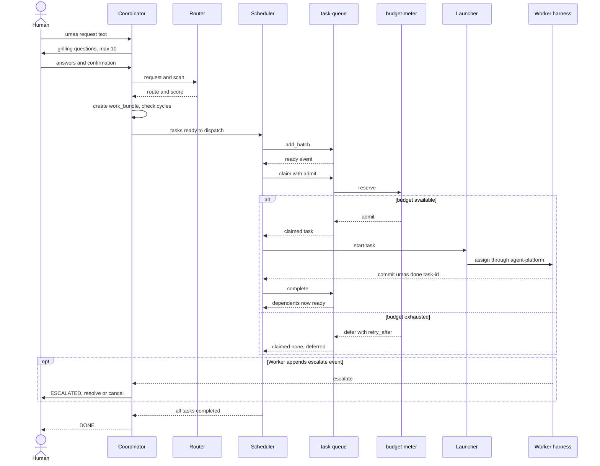

# Orchestration — module spec

> Part of the UMAS technical design. Main spec: [TECHNICAL-DESIGN-SPEC.md](../../TECHNICAL-DESIGN-SPEC.md) · Module map: [module map](../../TECHNICAL-DESIGN-SPEC.md#5-component-design)
> **Owns:** request intake, work-bundle creation, route selection and task dispatch (Coordinator, Router, Scheduler).
> **Uses:** [agent-session](../../../libs/agent-session/README.md), [task-queue](../../../libs/task-queue/README.md), [budget-meter](../../../libs/budget-meter/README.md), [router-heuristic](../../../packs/router-heuristic/router-heuristic-spec.md), [grilling](../../../packs/grilling/grilling-spec.md), [playbook-runner](../../../packs/playbook-runner/playbook-runner-spec.md)
> **Depends on modules:** none in the moved text. Neighbours are listed in the Interaction table under Detailed design.

---

## 5.2 Orchestration System

#### Coordinator

- Receives human requests via `umas request "<text>"`
- Runs grilling for human-initiated requests only — agent-to-agent handoffs execute immediately (propulsion principle)
- Creates a `work_bundle` record
- Delegates to Router for skill/workflow selection
- Delegates to Scheduler for agent dispatch
- Never writes application code

**State machine:**

```
IDLE → GRILLING → PLANNING → DISPATCHING → MONITORING → DONE
                                              ↑               |
                                              └── ESCALATED ──┘
```

| From | To | Trigger |
|------|----|---------|
| `IDLE` | `GRILLING` | Human submits request |
| `GRILLING` | `PLANNING` | Human confirms (or skipped for agent-to-agent) |
| `PLANNING` | `DISPATCHING` | Work bundle created and validated |
| `DISPATCHING` | `MONITORING` | All ready tasks dispatched |
| `MONITORING` | `DONE` | All tasks reach `completed` |
| `MONITORING` | `ESCALATED` | Any agent appends `escalate` event to `events.jsonl` |
| `ESCALATED` | `DISPATCHING` | Human resolves escalation |
| `ESCALATED` | `DONE` | Human cancels the work bundle |
| Any | `IDLE` | Bundle cancelled or all tasks failed |

Multiple concurrent bundles each have their own independent state machine. `ESCALATED` in one does not pause others.

**Coordinator config** (see also [libs/agent-session.md §12.3](../../../libs/agent-session/README.md)):

```yaml
coordinator_config:
  model: default                  # llm-gateway alias, not a model ID
  token_limit: 200000
  complexity_thresholds:
    simple:  {max_files: 3, max_lines: 100, no_architecture_change: true}
    medium:  {max_files: 10, max_lines: 500, limited_architecture_change: true}
    complex: {unlimited: true}
  grilling:
    enabled: true
    human_initiated_only: true
    max_questions: 10
    timeout_seconds: 300
  specialized_agents: {pm: true, architect: true, ux: true, analyst: true}
  session_resumable_statuses: [budget_paused, provider_failed]
  resumable_timeout_hours: 24

  # Playbook — optional. null = default implicit workflow (unchanged behaviour)
  # See packs/playbook-runner/playbook-runner-spec.md for the full schema.
  playbook: null
```

**Playbook routing:** When `playbook` is non-null the Coordinator loads the named playbook from the registry and drives a phase loop instead of the implicit sequence. Each phase step calls an existing pack, agent role, or lib op — the underlying execution is identical. Human gates pause the work bundle; the human resumes via `umas work-bundle approve <id>`. Escape hatches write a `[checkpoint]` commit and a `RESUME.md` then escalate. Without a playbook the implicit default workflow is unchanged.

```bash
# Per-request playbook override:
umas request "add login" --playbook production-gatekeeper
umas request "fix crash" --playbook autonomous-loop --exit-predicate "tests pass"
umas request "refactor" --playbook none   # force default implicit workflow
```

#### Router

Selects workflow by scoring heuristic:

| Signal | Weight |
|--------|--------|
| Files affected (estimated) | High |
| New feature / service / system | High |
| Scope is ambiguous | Medium |
| User-facing UI | Medium |
| Security / auth / payments / data migration | High |
| Bug fix with specific file/line cited | Low → simple |

| Score band | Route |
|-----------|-------|
| Low | Direct worker agent |
| Medium | Architect + worker |
| High | Full specialist panel → workers |
| Greenfield marker | PM → Architect → parallel workers |

Override: `--route simple|medium|large|greenfield`

> Standalone spec with numeric weights and test fixtures: [packs/router-heuristic](../../../packs/router-heuristic/router-heuristic-spec.md) · Grilling trigger rules: [packs/grilling](../../../packs/grilling/grilling-spec.md)

#### Scheduler

- Maintains a `ready_queue` of tasks with no unresolved dependencies, using [libs/task-queue.md](../../../libs/task-queue/README.md)
- Dispatches agents up to the concurrency limit; tasks wait in queue when at capacity (`max_claimed` plus an `admit` callback backed by `budget-meter`)
- On every task completion: marks complete → unblocks dependents → dispatches newly ready tasks

```python
def on_task_complete(task_id):
    mark_complete(task_id)
    unblock_dependents(task_id)
    check_parent_auto_complete(task_id)
    dispatch_ready_tasks()
```

---

## Detailed design

Marking used below: **from source** means the claim is in the main spec, Appendix A, or a lib or pack README (the section is cited). **Proposed** means a reading of how the pieces fit. Each proposal that needs an owner decision is listed in [Open](#open).

### Purpose and boundary

The module turns a request into a work bundle, picks a route, queues the tasks and dispatches them under a concurrency and budget limit (**from source**, 5.2). It never writes application code (**from source**, Coordinator).

It does not own these responsibilities:

| Responsibility | Owner |
|---|---|
| Running a Worker, the signal protocol, the specialist roles | [agent-execution](../agent-execution/agent-execution-spec.md#53-agent-execution-system) |
| Worktrees, `STATE.md`, `events.jsonl` | [context-persistence](../context-persistence/context-persistence-spec.md#51-context-persistence-system) |
| Money metering and price table, context-window counting and handoff, model aliases | [budget-and-models](../budget-and-models/budget-and-models-spec.md) |
| Heartbeats, stuck detection, restarts | [monitoring](../monitoring/monitoring-spec.md#55-monitoring-system) |
| Tests, review, merge | [verification](../verification/verification-spec.md#54-verification-system) |

### Flow

**Main flow (from source, 5.2, unless marked proposed):**

1. A person runs `umas request "<text>"`, with optional `--route`, `--playbook` and `--exit-predicate`. State: `IDLE` to `GRILLING`.
2. The Coordinator runs [grilling](../../../packs/grilling/grilling-spec.md). It asks at most 3 questions per turn and at most `max_questions` (10) in total. Without an answer after `timeout_seconds` (300), the pack proceeds on defaults (`on_timeout: proceed_on_defaults`). Agent-to-agent handoffs skip this step.
3. The person confirms the summary. State: `GRILLING` to `PLANNING`.
4. The Router chooses the route. A model extracts signals through `llm-gateway`. Code applies the rubric and bands ([router-heuristic](../../../packs/router-heuristic/router-heuristic-spec.md) 5.1, 5.3, 5.5). `--route` replaces the result and the decision records `overridden: true`.
5. If a playbook is set, the Coordinator loads it and drives the phase loop. Each step calls a pack, an agent role or a lib operation. A `human_approval` gate pauses the bundle until `umas work-bundle approve <id>` ([playbook-runner](../../../packs/playbook-runner/playbook-runner-spec.md) 5.1).
6. The Coordinator creates the `work_bundle` record and its tasks. It runs cycle detection and a dangling-reference check (**from source**, [6.10](../exception-flows/exception-flows-spec.md#610-dependency-deadlock-in-work-bundle)). A bad bundle is rejected before submission. Who splits the request into tasks is Open 3. State: `PLANNING` to `DISPATCHING`.
7. The Scheduler adds the tasks to `task-queue` with `add_batch`. It creates one hook per task. It sets `tags` and `payload` (**proposed**, tags and payload per [task-queue](../../../libs/task-queue/README.md) 9; hook creation is named there as glue).
8. A `ready` event from `task-queue` triggers a `claim`. The `admit` callback asks `budget-meter` to `reserve` the money estimate for the task's role (config key `agents.worker.cost_estimate` for a Worker, `agents.specialized.<role>.cost_estimate` for a specialist; D18 A). On `defer`, the task keeps its place in the queue.
9. The launcher starts the harness for the claimed task and watches for the completion signal (**proposed**, Open 1; the gap is A.4.8 and A.7 item 3).
10. The Worker commits `[umas:done] <task-id>` (**from source**, 5.3). The Scheduler runs `on_task_complete`: mark complete, unblock dependents, check the parent, dispatch ready tasks. The launcher then calls `commit` (**proposed**). The amount is the cost computed from the harness usage report if one exists. Otherwise it is the reserved estimate, never zero (D18 A). The bundle stays in `MONITORING` until all tasks complete.
11. When all tasks are `completed`, the state is `DONE`. With a playbook, the top-level `exit_predicate` must also be true (playbook-runner 5.1, rule 7).

**Failure paths:**

- **Budget exhausted** ([6.6](../exception-flows/exception-flows-spec.md#66-token-budget-exhausted-mid-task)). `admit` returns `defer`. In-flight Workers finish the current step and commit. New dispatch stops. After `umas project config --budget <N>`, where `<N>` is a money amount (D17), dispatch resumes within 60 s.
- **Worker blocked** (5.2 state table). An `escalate` event moves that bundle to `ESCALATED`. Other bundles continue. A person resolves it (`DISPATCHING`) or cancels (`DONE`).
- **Worker crash** (**from source**, task-queue 5.2). The lease expires and the task returns to `ready`. The attempt still counts. At `max_attempts` the task becomes `failed`. Dependents follow `on_dep_failed` (default `hold`). `watchdog` restarts the process in parallel.

*Figure 1. Request to done, with the budget-defer and escalation paths. The launcher (L) is proposed, see Open 1.*



### Interfaces

Carrier types: CLI command, REST endpoint, file, event, callback, function call.

| Name | Dir | Carrier | Payload | Owner |
|---|---|---|---|---|
| `umas request "<description>"` | in | CLI command | `description: string`, `--route simple\|medium\|large\|greenfield`, `--playbook <name>\|none`, `--exit-predicate <string>` (**from source**, 5.2 and section 7) | [interfaces](../interfaces/interfaces-spec.md#59-cli-design) (command), orchestration (behaviour) |
| `POST /api/v1/work-bundles` | in | REST endpoint | Body not set in the snapshot (Open 11). Proposed: the same fields as `umas request` | [interfaces](../interfaces/interfaces-spec.md#7-api-specifications) |
| `GET /api/v1/work-bundles`, `GET /api/v1/work-bundles/{id}`, `umas work-bundle show <id>` | in, out | REST endpoint, CLI command | Returns the `work_bundles` row | interfaces |
| `umas work-bundle retry <id> [--reset-retries]` | in | CLI command | `id: string`, `reset_retries: bool` (**from source**, section 7; also 6.9) | interfaces |
| `umas work-bundle approve <id>` | in | CLI command | `id: string`. Named in 5.2 but absent from the section 7 command list (Open 11) | interfaces |
| `GET/POST /api/v1/tasks`, `GET/PATCH /api/v1/tasks/{id}` | in, out | REST endpoint | Task record. Fields follow `task-queue` 3.1 (**proposed** mapping) | interfaces |
| `work_bundles` row | out | table | `id`, `project_id`, `type` (`epic\|story\|task`), `status` (`pending\|in_progress\|completed\|failed`), `parent_id`, `hook_path`, `agent_id`, `created_at`, `completed_at` ([section 4](../../TECHNICAL-DESIGN-SPEC.md#4-data-model)) | main spec |
| `playbook_state` | out | field on the bundle record | All step outputs keyed by `output_key` (playbook-runner 4.5) | playbook-runner |
| Grilling input and output | in, out | function call | In: `request`, `origin: human\|agent\|escalation`, `context`, `transcript`, `limits`. Out: turn `{action, questions[], skip_reason}` then summary `{goal, success_criteria[], constraints[], assumptions[], confirmed_by_user}` (grilling 4) | grilling |
| Router input and output | in, out | function call | In: `request`, `scan{files_estimate, touches_ui, notes}`, `override`. Out: `{score, band, route, signals, reasons[], overridden}` (router-heuristic 4) | router-heuristic |
| Task add | out | function call, `task-queue add_batch --json` | Task: `id`, `payload{}`, `tags[]`, `priority`, `depends_on[]`, `parent`. `payload` holds task type, hook path, context reference (task-queue 9) | task-queue |
| Claim, complete, fail | out | function call, `task-queue claim\|complete\|fail --json` | `claim(owner, lease_seconds, filter?)`, `complete(id, owner, result?)`, `fail(id, owner, error, retry)` (task-queue 4) | task-queue |
| `admit` callback | out | callback | `fn(task, context) -> admit \| defer(reason)`, backed by `reserve(budget, estimate, actor, ref)`. `estimate` is a money amount in the budget currency, read from the role's `cost_estimate` key (task-queue 4, budget-meter 4, D17, D18) | task-queue, budget-meter |
| `ready`, `claimed`, `completed`, `failed`, `lease_expired`, `deferred` | in | event (callback `on_event`) | Task state changes (task-queue 4) | task-queue |
| Completion signal | in | commit message | `[umas:done] <task-id>` (5.3). Prefix conflict: Open 7 | agent-execution |
| `escalate` event | in | event, line in `events.jsonl` | `{"event":"escalate","severity":"P1","reason":"..."}` (5.3) | agent-execution, [event-log](../../../libs/event-log/README.md) |
| `handoff_request` event | in | event, line in `events.jsonl` | Read by the Scheduler (5.3) | agent-execution |
| Phase result | out | event, line in `events.jsonl` | `{ts, playbook, phase, status: passed\|gate_waiting\|escaped\|failed, step_results[]}` (playbook-runner 4.5) | playbook-runner |
| Model call | out | function call | `complete(request)` with `alias: default`. Used for signal extraction and grilling (A.4.8, [llm-gateway](../../../libs/llm-gateway/README.md) 4) | llm-gateway |

### Parameters

`coordinator_config` is read as shown in 5.2. The file that holds it is not named in the snapshot (Open 5). Rows marked with a lib name take their default from that lib's configuration section (task-queue 6, budget-meter 6). The snapshot does not give those defaults.

| Name | Type | Default | Where set | What it changes |
|---|---|---|---|---|
| `coordinator_config.model` | string (alias) | `default` | config, key `agents.coordinator.model` ([5.7](../budget-and-models/budget-and-models-spec.md#57-model-policy)) | The `llm-gateway` alias for Coordinator calls |
| `coordinator_config.token_limit` | int (tokens) | 200000 | config | Size of the Coordinator context window in tokens. The handoff base (D22 A). Not a spend limit. The key name and value are Part A text (5.2); renaming it to a context key is part of the `agent-session` change |
| `coordinator_config.complexity_thresholds` | map | simple: 3 files, 100 lines; medium: 10 files, 500 lines; complex: unlimited | config | Mapped to `files_affected` before routing (router-heuristic 6) |
| `coordinator_config.grilling.enabled` | bool | `true` | config | Turns grilling on or off |
| `coordinator_config.grilling.human_initiated_only` | bool | `true` | config | Skips grilling for agent origin |
| `coordinator_config.grilling.max_questions` | int | 10 | config | Question cap per session |
| `coordinator_config.grilling.timeout_seconds` | int | 300 | config | Wait before the non-response rule applies |
| `coordinator_config.specialized_agents` | map | `{pm, architect, ux, analyst}` all `true` | config | Which specialist roles the Router can invoke |
| `coordinator_config.session_resumable_statuses` | list | `[budget_paused, provider_failed]` | config | Session states treated as resumable (Open 6) |
| `coordinator_config.resumable_timeout_hours` | int | 24 | config | Wait before a resumable session counts as failed |
| `coordinator_config.playbook` | string or null | `null` | config | Default playbook. `null` keeps the implicit workflow |
| `--route` | enum | not set | flag | Replaces the Router result |
| `--playbook` | string | not set | flag | Per-request playbook. `none` forces the implicit workflow |
| `--exit-predicate` | string | not set | flag | Checkable statement for the playbook exit |
| `on_timeout` (grilling) | enum | `proceed_on_defaults` | pack `config.yaml` | `proceed_on_defaults` or `block` |
| `max_questions_per_turn` (grilling) | int | 3 | pack `config.yaml` | Fixed |
| `weights`, `bands` (router) | map | `medium_at: 3`, `high_at: 7`, `default_when_unclear: medium` | pack `config.yaml` | Scoring and band edges |
| `default_playbook` (playbook-runner) | string or null | `null` | pack `config.yaml` | Pack-level default. Same intent as `coordinator_config.playbook` (Open 5) |
| `gate_timeout_seconds` | int | 300 | pack `config.yaml` | Auto-gate wait |
| `escape_hatch.max_attempts` | int | 3 | pack `config.yaml` | Same-step failures before checkpoint and halt |
| `max_claimed` (task-queue) | int | 5 | `task-queue` config | Concurrent claimed tasks. The MVP allows up to 5 concurrent agents ([5.8](../../TECHNICAL-DESIGN-SPEC.md#58-scalability-roadmap)). Scope (system or project) not set |
| `default_lease_seconds` | int | 300 | `task-queue` config | Time before an unrenewed claim returns to `ready` |
| `default_max_attempts` | int | 2 | `task-queue` config | Tries before `failed` |
| `on_dep_failed` | enum | `hold` | `task-queue` config, per task | `hold`, `cancel` or `ignore` |
| `admit_scan_limit` | int | 10 | `task-queue` config | Candidates tried after a `defer` |
| `reservation_ttl_seconds` (budget-meter) | int | 900 | `budget-meter` config | Life of an unused hold |
| `agents.worker.cost_estimate`, `agents.specialized.<role>.cost_estimate` | money amount | not set | `umas.config.yaml` (**proposed** name; budget-and-models does not list it yet) | Money held by `reserve` at admission for a task of that role. Worker spend is this estimate until a harness reports usage (D18 A). **Proposed:** a role with no value fails admission loudly, as `cost()` does for a missing alias (D17) |
| `spend_thresholds` (budget-meter) | list of fractions | 0.80, 0.90, 0.95 | `budget-meter` config | Fractions of the money limit. They raise warnings and `budget_paused` (D22 A). They do not trigger handoff |
| Worker time and checkpoint limits | not set | not set | not set | Backstop for Workers beside the money estimate (D14 A, A.4.8). Open 2 |
| Dispatch resume delay after a budget raise | seconds | 60 | not set (behaviour, not a key) | [6.6](../exception-flows/exception-flows-spec.md#66-token-budget-exhausted-mid-task) gives the 60 s bound |

### Capabilities

Permission names are those of [Appendix A.5](../../TECHNICAL-DESIGN-SPEC.md#a5-rbac-data-model-and-roles). The snapshot gives role tables ([A.5.4](../../TECHNICAL-DESIGN-SPEC.md#a54-human-permissions-by-role)) and agent scopes ([A.5.5](../../TECHNICAL-DESIGN-SPEC.md#a55-agent-roles)). It names few permissions. A name marked proposed is not in the snapshot (Open 10).

| Who | Capability | Permission |
|---|---|---|
| Human | Submit a work request | Admin (system), Project Owner (project), Developer (project). Name proposed: `work:submit` |
| Human | View work bundles and tasks | A.5.4 row "View agents, tasks, work bundles, merge queue". Name proposed: `work:read` |
| Human | Approve a playbook gate | Not in A.5.4. Open 10 |
| Human | Resolve an escalation, cancel a bundle, retry a bundle | Not in A.5.4 for P1. For P0, A.5.4 row "Acknowledge or resolve a P0 escalation". Open 10 |
| Human | Raise a project budget | A.5.4 row "Set a project budget". Name proposed: `budget:set` |
| Agent: Coordinator | Create and assign tasks and bundles, spawn and stop agents, append and read events, handle P1, raise P0 | A.5.5 row Coordinator |
| Agent: Worker | Update its own task, append events | A.5.5 row Worker |

Rules from A.5.5 that bind this module: only the Coordinator creates and assigns tasks. Only the Coordinator and Monitors can stop another agent. **Proposed:** a playbook gate approval uses its own permission, separate from `merge:approve`. This module does not use `merge:approve_own`.

### Interaction with other modules

| Module | This module sends or receives | Carrier | Timing |
|---|---|---|---|
| [agent-execution](../agent-execution/agent-execution-spec.md) | Sends: task assignment, hook path, context reference. Receives: `[umas:done]` commit, `escalate` and `handoff_request` events | Function call to `agent-platform`; commit; `events.jsonl` | Send is synchronous. Receive is asynchronous |
| [context-persistence](../context-persistence/context-persistence-spec.md) | Sends: hook creation per task. Receives: `events.jsonl` lines, `STATE.md` | `hook-store create`, file read | Synchronous for create. Asynchronous for events |
| [budget-and-models](../budget-and-models/budget-and-models-spec.md) | Sends: `reserve` (money estimate) through `admit`, and `commit` on completion. Receives: `admit` or `defer`, spend threshold events. Uses model aliases from 5.7 | Callback inside `claim`; `llm-gateway` call | Synchronous |
| [monitoring](../monitoring/monitoring-spec.md) | Sends: the launcher registers a `watchdog` node per Worker (proposed). Receives: stalled and dead nodes, forced handoff, resume after budget raise | `watchdog` config, heartbeat files, events | Asynchronous |
| [verification](../verification/verification-spec.md) | Sends: nothing in the snapshot. Receives: PR failure and re-spawn requests ([6.9](../exception-flows/exception-flows-spec.md#69-merge-queue-bisect-finds-no-clean-subset), [6.11](../exception-flows/exception-flows-spec.md#611-agent-causes-test-regression)). Owner of the re-spawn is not stated (Open 12) | Event or function call, not set | Asynchronous |
| [interfaces](../interfaces/interfaces-spec.md) | Receives: request and bundle commands, REST calls. Sends: bundle and task records | CLI, REST | Synchronous |
| [access-control](../access-control/access-control-spec.md) | Receives: allow or deny on each command (**proposed**: check in the API middleware, A.5.7) | Middleware | Synchronous |
| [exception-flows](../exception-flows/exception-flows-spec.md) | Sources of the failure handling listed below | Not applicable | Not applicable |

### Libraries and packs used

| Item | What it provides here |
|---|---|
| [task-queue](../../../libs/task-queue/README.md) | Dependency graph, ready queue, leased claims, concurrency cap, retry, parent completion |
| [budget-meter](../../../libs/budget-meter/README.md) | `reserve` and `commit` in money (`unit: cost`) for the `admit` rule; spend threshold events |
| [watchdog](../../../libs/watchdog/README.md) | Supervision of Worker processes started by the launcher (proposed) |
| [hook-store](../../../libs/hook-store/README.md) | One worktree per task; `find_signals` to detect completion commits |
| [event-log](../../../libs/event-log/README.md) | `events.jsonl`: escalate, handoff and phase-result lines |
| [agent-platform](../../../libs/agent-platform/README.md) | `assign` and `read_signal` for the Worker harness; it does not start processes (A.4.8) |
| [agent-session](../../../libs/agent-session/README.md) | Session lifecycle; the Coordinator config reference (12.3) |
| [llm-gateway](../../../libs/llm-gateway/README.md) | Model calls for the Coordinator and the Router (A.4.8) |
| [router-heuristic](../../../packs/router-heuristic/router-heuristic-spec.md) | Rubric, bands, classification prompt, deterministic scorer |
| [grilling](../../../packs/grilling/grilling-spec.md) | Trigger rule, question protocol, alignment summary |
| [playbook-runner](../../../packs/playbook-runner/playbook-runner-spec.md) | Playbook schema, runner rules, gates, escape hatch |
| [specialist-agents](../../../packs/specialist-agents/specialist-agents-spec.md) | Roles the routes invoke (Architect, PM, Analyst, UX, Developer) |

### Failure handling

| Failure | Handling here | Section 6 item |
|---|---|---|
| Cycle or dangling dependency in a new bundle | Coordinator rejects the bundle. `task-queue` returns `cycle` or `unknown_dependency` | [6.10 Dependency Deadlock in Work Bundle](../exception-flows/exception-flows-spec.md#610-dependency-deadlock-in-work-bundle) |
| Blocking task already `completed` | Scheduler moves the blocked task to the ready queue on the next `on_task_complete`. No escalation | 6.10 |
| Daily budget exhausted | `admit` defers. In-flight work finishes its step. Dispatch resumes on a budget raise | [6.6 Token Budget Exhausted Mid-Task](../exception-flows/exception-flows-spec.md#66-token-budget-exhausted-mid-task) |
| Provider failure on a Coordinator or Router call | `llm-gateway` retries and fails over. With no fallback: P1 and `umas agents resume <session-id>` | [6.7 LLM Provider Failure Mid-Task](../exception-flows/exception-flows-spec.md#67-llm-provider-failure-mid-task) |
| Worker crash with a claimed task | Lease expiry returns the task. Attempts are counted. Stale worktrees follow their age rules | [6.8 Stale Worktrees After Agent Crash](../exception-flows/exception-flows-spec.md#68-stale-worktrees-after-agent-crash) |
| Machine shutdown with bundles running | `umas start-all` resumes dispatch after recovery | [6.17 Machine Shutdown and Boot Recovery](../exception-flows/exception-flows-spec.md#617-machine-shutdown-and-boot-recovery) |
| Project deleted while bundles run | In-flight bundles are marked `failed: project_path_missing` | [6.2 Mid-Task Project Deletion (Agents Running)](../exception-flows/exception-flows-spec.md#62-mid-task-project-deletion-agents-running) |
| Merge failure or test regression returned to a bundle | Originating agent re-spawned. Owner not stated | [6.9](../exception-flows/exception-flows-spec.md#69-merge-queue-bisect-finds-no-clean-subset), [6.11](../exception-flows/exception-flows-spec.md#611-agent-causes-test-regression) |
| Task state lock or database lock | `task-queue` returns `lock_timeout` ([task-queue](../../../libs/task-queue/README.md) 7). The snapshot gives a 5 s wait for write commands on SQLite (6.13) | [6.13 Concurrent CLI Processes](../exception-flows/exception-flows-spec.md#613-concurrent-cli-processes), [6.12 Database Corruption or Lock](../exception-flows/exception-flows-spec.md#612-database-corruption-or-lock) |
| Playbook step fails 3 times, or a context limit is hit | Escape hatch: `[checkpoint]` commit, `RESUME.md`, bundle set to `ESCALATED` (playbook-runner 5.3) | Not in section 6 |
| Grilling gets no answer | Proceed on defaults, or block (grilling 5.4, 6) | Not in section 6 |

### Open

Each item is **Open**. None is resolved here.

1. **Open: CLI launcher.** Nothing specifies the component that starts, supervises and stops the harness CLIs (A.4.8, A.7 item 3, main spec section 14 item 4). Decision needed: its contract. Recommendation: specify it as a Python component of the Scheduler glue, not a lib. Proposed loop: on a `ready` event, `claim`; `hook-store create`; `agent-platform assign`; start the harness as a `watchdog` node; renew the lease at one third of `lease_seconds`; on the completion signal call `complete`, on a failure call `fail`. Also needed: a real completion signal and usage report for each CLI, tested before Phase 2 (A.4.8).
2. **Open: Scheduler glue.** The dispatch loop, routing tags, hook creation per task and the `admit` rule have no spec (A.7 item 2, section 14 item 2). Decision needed: the remaining rules. Recommendation: tags carry the worker kind (`coding`, `review`) from the route. The `admit` estimate is decided: a per-role money amount from `cost_estimate` in config (D18 A). The open part is the time and checkpoint limits that stay as the Worker backstop. Also decide whether `max_claimed` is per project or system-wide, and whether each project has its own queue directory.
3. **Open: who decomposes a request into tasks.** [router-heuristic](../../../packs/router-heuristic/router-heuristic-spec.md) excludes decomposition. 5.2 says the Coordinator creates the bundle but not the tasks. Recommendation: the Coordinator, with the Architect for `medium` and above, through `llm-gateway`, validated against the task schema with Pydantic ([ADR-0004](../../../docs/decisions/ADR-0004-structured-output-with-pydantic.md)).
4. **Open: source of truth for task state.** Section 4 has a `work_bundles` table with statuses `pending|in_progress|completed|failed`. The Coordinator has 7 states. `task-queue` has its own task states in files. Files are the source of truth (A.4.7). Recommendation: `task-queue` files are authoritative for tasks, and the `work_bundles` row is a projection updated from `task-queue` events. Map: `PLANNING` to `pending`; `DISPATCHING`, `MONITORING`, `ESCALATED` to `in_progress`; `DONE` to `completed`; cancel or all failed to `failed`. Map `epic|story|task` to parent and child tasks.
5. **Open: where `coordinator_config` lives, and which key sets the playbook.** 5.2 shows `coordinator_config.playbook`. playbook-runner shows `workflows.playbook` in `umas.config.yaml` and `default_playbook` in its pack config. Recommendation: one key, `workflows.playbook`, read by the Coordinator. Remove the other two.
6. **Open: `session_resumable_statuses` omits two resumable states.** Section 4 lists `machine_paused` and `auth_expired` as resumable. The Coordinator default lists only `budget_paused` and `provider_failed`. Recommendation: add both, with no timeout, as section 4 says.
7. **Open: completion signal prefix.** The spec uses `[umas:done]`. `agent-session` uses `[done]` (section 14 item 8). The Scheduler detects completion by this pattern. Recommendation: make the pattern a config value used with `hook-store find_signals`, and decide the prefix in agent-execution.
8. **Open: retry safety of the launcher.** `task-queue` `add` is not idempotent for a supplied `id` (it proposes `id_conflict`). `budget-meter reserve` is not idempotent on `(budget, actor, ref)`. A retried launcher can add or hold twice. Recommendation: adopt both open points and use the task id as `ref`.
9. **Open: at-least-once execution.** A task can run twice after a lease expiry (task-queue 5.2, open question 1). Recommendation: the launcher checks that the hook has no live lease (`hook-store open` fails `LeaseHeld`) before it starts a harness.
10. **Open: permission names and the Scheduler principal.** A.5.4 has no row for approve a playbook gate, cancel a bundle, retry a bundle or resolve a P1 escalation. The Scheduler and launcher have no row in A.5.5. Recommendation: add the rows `work:submit`, `work:read`, `work:cancel`, `work:retry`, `gate:approve`; run the Scheduler and launcher under the Coordinator principal, with the spawn scope of A.5.5.
11. **Open: missing commands and endpoints.** `umas work-bundle approve <id>` is in 5.2 and not in section 7. There is no cancel command and no approve or cancel endpoint. `POST /api/v1/work-bundles` has no body definition (A.7 item 5). Recommendation: add `approve` and `cancel` to the list, and define the body in the shared OpenAPI file.
12. **Open: who re-spawns an agent after a merge failure.** 6.9 and 6.11 say the originating agent is re-spawned and do not say by which component. Recommendation: the Scheduler, by adding a new task linked to the failed one.
13. **Open: handling of a `failed` task.** With `on_dep_failed: hold`, dependents stay `blocked`. The snapshot does not say whether this raises an `escalate` event. Recommendation: the Scheduler appends a P1 `escalate` event on any `failed` task, so the bundle moves to `ESCALATED`.

---

## AXI support

This module defines no CLI commands of its own. See [interfaces-spec.md](../interfaces/interfaces-spec.md).
