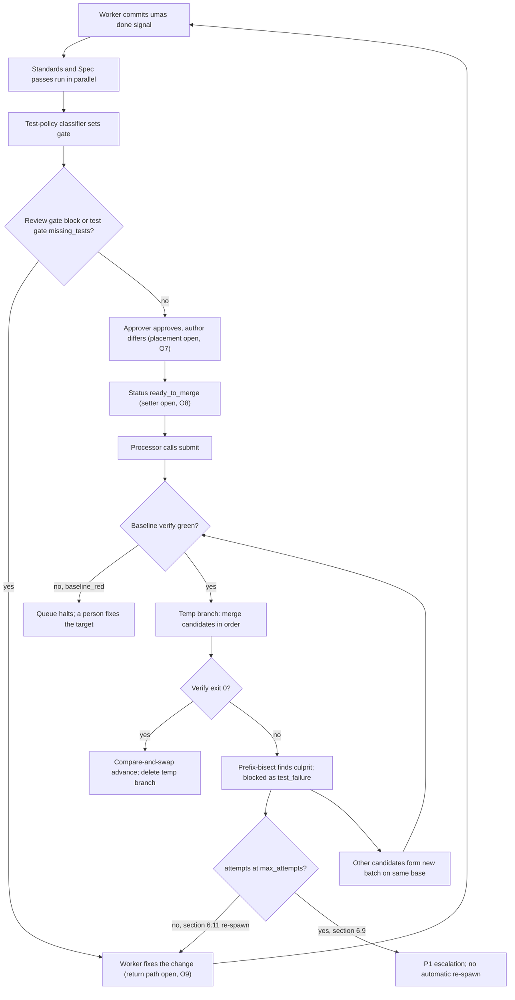

# Verification System — module spec

> Part of the UMAS technical design. Main spec: [TECHNICAL-DESIGN-SPEC.md](../../TECHNICAL-DESIGN-SPEC.md) · Module map: [module map](../../TECHNICAL-DESIGN-SPEC.md#5-component-design)
> **Owns:** merging ready changes to the target branch, the two-axis review gate and the test coverage policy.
> **Uses:** [merge-queue](../../../libs/merge-queue/README.md), [test-adapters](../../../libs/test-adapters/README.md), [two-axis-review](../../../packs/two-axis-review/two-axis-review-spec.md), [test-policy](../../../packs/test-policy/test-policy-spec.md)
> **Depends on modules:** none shown in the moved text. Neighbours are listed in Detailed design, section 6.

---

## 5.4 Verification System

#### Merge Queue Processor

Operates on a **permanent** `merge-queue` worktree created once during `umas init --project`. Only the temp test branch is created/destroyed per batch.

**Worktree states:** `IDLE → COLLECTING → TESTING → BISECTING → MERGING`

**Algorithm:**

```
1. Collect all PRs with status = ready_to_merge
2. Create temp branch: merge ALL PRs
3. Run full test suite
4. If green → merge all to main, delete temp branch
5. If red → bisect:
     Split batch, test each half
     Recurse until culprit isolated
     Merge only passing half
     Re-queue failing PR: status = blocked + reason
```

> Standalone spec: [libs/merge-queue.md](../../../libs/merge-queue/README.md)

#### Code Review (Two-Axis)

Every PR goes through two independent passes run in parallel:

- **Standards axis:** code quality, style, patterns, maintainability
- **Spec axis:** does it solve the right problem and meet task requirements

Each finding: `{ location, what, problem, fix, consequence }`. Findings without a concrete fix are not filed.

> Standalone spec: [packs/two-axis-review.md](../../../packs/two-axis-review/two-axis-review-spec.md)

#### Test Coverage Policy

| Mode | Behaviour |
|------|-----------|
| `selective` (default) | Tests required only for risky logic: branches, loops, parsers, money, security |
| `strict` | Full TDD (red-green-refactor) for every feature |

Trivial changes (renaming, formatting, config-only) require no tests under either mode.

> Policy: [packs/test-policy.md](../../../packs/test-policy/test-policy-spec.md) · Execution and results: [libs/test-adapters.md](../../../libs/test-adapters/README.md)

---

## Detailed design

> Claim marks: **[S: section]** means the claim comes from the cited source. **[P]** means proposed by this spec. Each **O** item in section 9 is open. This spec does not resolve any of them.

### 1. Purpose and boundary

- This module moves a candidate onto the target branch only after verification passes. The merge queue does the merge and the advance. [S: merge-queue §1, §2]
- It does not write application code, run Workers or Reviewers, or set approval rules. Approval rules belong to [access-control](../access-control/access-control-spec.md). [S: merge-queue §2; A.5.4.1]
- It does not dispatch work or re-spawn agents. Dispatch belongs to [orchestration](../orchestration/orchestration-spec.md#52-orchestration-system). Agent runs belong to [agent-execution](../agent-execution/agent-execution-spec.md#53-agent-execution-system). Failure routing belongs to [exception-flows](../exception-flows/exception-flows-spec.md). [S: section 5.2; section 5.3; section 6]

### 2. Flow

Happy path:

1. A Worker commits `[umas:done] <task-id>`. [S: section 5.3, Worker Agents]
2. The Standards pass and the Spec pass review the diff in parallel. Each pass returns findings and a gate. [S: section 5.4; two-axis-review §5.3]
3. The test-policy classifier assesses the diff. It sets `gate` to `ok` or `missing_tests`. [S: test-policy §4.2, §5.5]
4. A review gate of `block`, or a test gate of `missing_tests`, keeps the change out of `ready_to_merge`. [S: two-axis-review §9; test-policy §9]
5. The Approver approves the change. The approver is not the author. Where this step sits in the flow is open (O7). [S: A.5.4.1; A.5.9 Q4]
6. A component sets the status to `ready_to_merge`. Which component is open (O8). [S: section 5.4, step 1]
7. The Merge Queue Processor calls `submit` for the candidate. [S: merge-queue §9]
8. The Merge Queue Processor calls `run_once` on its schedule. [S: merge-queue §4, §9]
9. The queue verifies the baseline, which is the target as it is now. A red baseline halts the queue. The check is skipped while `baseline_ttl_seconds` holds. [S: merge-queue §5.2 step 3; §7]
10. The queue merges the pending candidates in order onto a temp branch. A conflict blocks only that candidate. [S: merge-queue §5.2 step 4]
11. The queue runs the verify command on the temp branch. Exit code 0 is green. Any other exit code is red. [S: merge-queue §5.1]
12. On green, the queue advances the target by compare-and-swap and deletes the temp branch. [S: merge-queue §5.4]

Failure path A, one regression (section 6.11):

13. The queue runs prefix-bisect and finds the culprit. The culprit is blocked as `test_failure`, and its `attempts` rises by 1. [S: merge-queue §5.3]
14. The other candidates form a new batch on the same base. The flow returns to the batch start. [S: merge-queue §5.3]
15. The Worker for the culprit is re-spawned with the failing test names, the PR diff, and an instruction to fix the implementation, not the test. The sender is open (O9). [S: section 6.11]

Failure path B, no clean subset (section 6.9):

16. If every candidate fails alone, each is blocked as `test_failure` in turn. The caller retries with failure context. [S: merge-queue §5.3, "All candidates fail"]
17. When `attempts` reaches `max_attempts` (default 3), the reason becomes `max_attempts`. Automatic re-spawn stops, and a P1 escalation is raised. [S: merge-queue §5.3, §6; section 6.9]



Figure 1. Merge flow from review to target advance. The approval placement and the return path to the Worker are proposed (O7, O9).

### 3. Interfaces

Field names come from the libs and packs. Any name not in a source is marked [P].

| Name | Direction | Carrier | Payload shape | Owner |
|------|-----------|---------|---------------|-------|
| `submit(candidate)` | In | Function call. CLI `merge-queue submit` [S: merge-queue §4, §4.1] | `{ id, ref, base_hint?, meta{}, attempts, submitted_at }` [S: merge-queue §3.1]. A duplicate `id` is rejected today [S: merge-queue §4] (O11) | merge-queue |
| `run_once()` | In | Function call. CLI `merge-queue run_once --json` [S: merge-queue §4, §4.1] | None | merge-queue |
| `requeue(id)`, `cancel(id)` | In | Function call [S: merge-queue §4] | `id` of a candidate | merge-queue |
| `BatchReport` | Out | Return value of `run_once`. The `--json` form [S: merge-queue §4] | Per candidate: the outcome, the reason, the verify log reference, and which verify runs happened [S: merge-queue §4]. Field names are not set in the lib [P] | merge-queue |
| `status()` | Out | Function call. CLI `merge-queue status` [S: merge-queue §4, §4.1] | `{ state, pending[], last_report }` [S: merge-queue §4] | merge-queue |
| Verify command | Out, child process | Shell command in the queue worktree. The lib example wraps `test-adapters run --json` [S: merge-queue §5.1, §9] | Exit code 0 only when `status` is `passed` [S: test-adapters §4]. Stdout is a `TestResult` with `schema_version`, `framework`, `status`, `total`, `passed`, `failed`, `skipped`, `errors`, `duration_ms`, `failures[]`, `coverage`, `raw`, `command` [S: test-adapters §3.2] | test-adapters (runner); merge-queue (reads the exit code) |
| Review request | In | Function call with the Standards and Spec prompts [S: two-axis-review §5.1, §5.2] | `diff`, `intent`, `conventions?`, `test_results?`, `risk_flags?` [S: two-axis-review §4.1] | two-axis-review |
| Review report | Out | JSON, `schema/review.json` [S: two-axis-review §3] | `pack_version`, `findings[]`, `notes[]`, `gate { recommend, reasons }` [S: two-axis-review §4.3] | two-axis-review |
| Test-policy request | In | Function call with the classifier prompt [S: test-policy §5.4] | `diff`, `mode`, `existing_tests`, `coverage{line_percent?, changed_lines_percent?}` [S: test-policy §4.1] | test-policy |
| Test-policy assessment | Out | JSON, `schema/assessment.json` [S: test-policy §3] | `pack_version`, `mode`, `change_class`, `units[]`, `gate`, `reasons` [S: test-policy §4.2] | test-policy |
| Target advance | Out | Git: `git update-ref refs/heads/<target> <temp_tip> <base>` [S: merge-queue §5.4] | Target ref, new SHA, expected old SHA (`base`) | merge-queue |
| Publish | Out | Shell command `publish_command` [S: merge-queue §5.4, §6] | Command string. Default `null` | merge-queue |
| P1 escalation | Out | Append to `.umas/events.jsonl` [S: section 5.3] | `{"event":"escalate","severity":"P1","reason":"..."}` [S: section 5.3] | Routing owner open (O9) |
| Flaky record | Out | Event log [S: test-adapters §9] | Flaky test names from the result [S: test-adapters §5.4, §9]. Field shape is open (O4) | event-log |
| Approval check | In | Access-control middleware checks the permission [S: A.5.7; A.5.8] | Principal, `resource:action`, decision. Each decision writes an `audit_event` [S: A.5.6] | access-control |
| Ready status | In | Not defined in the sources [P] (O8) | Candidate `id`, status `ready_to_merge` [S: section 5.4, step 1] | Open (O8) |
| Worktree creation | In | CLI `umas init --project` [S: section 5.4; merge-queue §9] | Creates the permanent `merge-queue` worktree [S: merge-queue §4, §5.7] (O19) | interfaces |

### 4. Parameters

Defaults come from the lib, pack and test-adapters configuration blocks. Each "Config file" entry names the file as open (O21).

| Name | Type | Default | Where set | What it changes |
|------|------|---------|-----------|-----------------|
| `target` | string | `main` | Config file | Branch the queue advances. [S: merge-queue §6] |
| `queue_dir` | path | `.merge-queue` | Config file | Location of the permanent queue worktree. [S: merge-queue §6] |
| `temp_prefix` | string | `mq/tmp-` | Config file | Prefix of temp branches. Crash recovery deletes branches with this prefix. [S: merge-queue §5.6, §6] |
| `verify.command` | string | `"make test"` in the lib example. No UMAS value (O1) | Config file | The verify command. [S: merge-queue §5.1, §6] |
| `verify.timeout_seconds` | integer | 1800 | Config file | Limit for one verify run. Exceeding it gives reason `timeout`. [S: merge-queue §6] (O3) |
| `verify.rerun_on_fail` | integer | 0 | Config file | A red result is re-run this many times. A green re-run sets `flaky_suspected`. [S: merge-queue §5.3, §6] |
| `baseline_ttl_seconds` | integer | 300 | Config file | A green baseline stays valid this long. A valid baseline skips the baseline run. [S: merge-queue §5.2, §6] |
| `batch_size` | integer | 10 | Config file | A batch starts at this many pending candidates. [S: merge-queue §5.2, §6] |
| `batch_timeout_seconds` | integer | 300 | Config file | A batch starts this many seconds after the first pending candidate. [S: merge-queue §5.2, §6] |
| `order` | enum | `submission` | Config file | `submission` or `files_overlap_last`. Sets the merge order. [S: merge-queue §5.5, §6] |
| `max_attempts` | integer | 3 | Config file | Attempt limit. The reason then becomes `max_attempts`. Matches the retry limit in section 6.9. [S: merge-queue §5.3, §6; section 6.9] |
| `classify_culprit` | boolean | `false` | Config file | Adds a run per culprit and tags `fails_alone` or `fails_in_combination`. [S: merge-queue §5.3, §6] (O18) |
| `publish_command` | string or null | `null` | Config file | Runs after the local advance. A failure gives `publish_failed`. [S: merge-queue §5.4, §6] |
| `log_dir` | path | `.merge-queue/logs` | Config file | Location of verify logs. [S: merge-queue §6] |
| `timeout_seconds` (test-adapters) | integer | 600 | Config file | Limit for one test run. Status `timeout` when exceeded. [S: test-adapters §6] (O3) |
| `kill_grace_seconds` | integer | 5 | Config file | Wait between SIGTERM and SIGKILL. [S: test-adapters §5.3, §6] |
| `max_output_bytes` | integer | 5242880 | Config file | Output cap for a run. The tail is kept. [S: test-adapters §5.3, §6] |
| `framework` | enum | `auto` | Config file | `auto`, or a named framework. [S: test-adapters §6] |
| `parallelism` | enum or integer | `auto` | Config file | Parallel workers for the framework. [S: test-adapters §5.3, §6] |
| `require_tests` | boolean | `true` | Config file | Zero collected tests gives status `error`. [S: test-adapters §3.1, §6] |
| `retry_failed` | integer | 0 | Config file | Re-runs failed tests. Tests that pass on a re-run are listed as flaky. [S: test-adapters §5.4, §6] (O4) |
| `coverage` | boolean | `false` | Config file | Collects coverage into the result. [S: test-adapters §5.5, §6] |
| `command_overrides.pytest` | string or null | `null` | Config file | Replaces the generated pytest command. [S: test-adapters §6] |
| `mode` | enum | `selective` | Config file | `selective` tests risky logic only. `strict` tests every feature. [S: test-policy §5.1, §6] |
| `coverage_target` | number 0 to 100, or null | `null` (O6) | Config file | Coverage threshold. `null` disables it. [S: test-policy §5.6, §6] |
| `coverage_scope` | enum | `changed_lines` | Config file | `changed_lines` or `project`. [S: test-policy §5.6, §6] (O5) |
| `exempt_globs` | list of globs | `["docs/**", "*.md", "*.lock", "config/**"]` | Config file | Files that the pre-filter treats as trivial. [S: test-policy §5.3, §6] |
| `risky_patterns_file` | path | `risky-patterns.yaml` | Config file | Deterministic risky patterns per language. [S: test-policy §3, §6] |
| `axes` | list | `[standards, spec]` | Config file | Review axes. [S: two-axis-review §6] |
| `gate.block_on` | list | `[critical, high]` | Config file | Severities that give `block`. [S: two-axis-review §5.6, §6] |
| `gate.warn_on` | list | `[medium]` | Config file | Severities that give `warn`. [S: two-axis-review §5.6, §6] |
| `require_fix` | boolean | `true` | Config file | A finding without a fix moves to `notes`. [S: two-axis-review §4.2, §6] |
| `production_checklist` | boolean | `true` | Config file | Runs the production-impact checklist for risk-flagged changes. [S: two-axis-review §5.4, §6] |
| `max_findings_per_axis` | integer | 25 | Config file | Limit on findings per axis. [S: two-axis-review §6] |

### 5. Capabilities

Permission names are as written in the snapshot. A name that the snapshot does not give is marked open.

| Capability | Who can do it | Permission | Source |
|------------|---------------|------------|--------|
| Approve a merge | Admin, Project Owner, Approver. The Approver role is Phase 2 | None named in the A.5.4 row (O14). `merge:approve` is the A.5.6 example | [A.5.4](../../TECHNICAL-DESIGN-SPEC.md#a54-human-permissions-by-role); [A.5.8](../../TECHNICAL-DESIGN-SPEC.md#a58-phasing) |
| Approve a change the same person authored | Principal with the `merge:approve_own` grant. No built-in role holds it (O16) | `merge:approve_own` | [A.5.4](../../TECHNICAL-DESIGN-SPEC.md#a54-human-permissions-by-role). Without the grant, the two-person rule applies: [A.5.9 Q4](../../TECHNICAL-DESIGN-SPEC.md#a59-questions-and-answers) |
| Override a review finding | Admin, Project Owner, Approver | None named in the A.5.4 row (O14) | [A.5.4](../../TECHNICAL-DESIGN-SPEC.md#a54-human-permissions-by-role) |
| Change review or test policy | Admin, Project Owner | None named. `config:write` is the A.5.6 example (O14) | [A.5.4](../../TECHNICAL-DESIGN-SPEC.md#a54-human-permissions-by-role); [A.5.6](../../TECHNICAL-DESIGN-SPEC.md#a56-data-model) |
| Read queue state and results | Admin, Project Owner, Developer, Approver, Operator, Viewer. Not Auditor | None named (O15) | [A.5.4](../../TECHNICAL-DESIGN-SPEC.md#a54-human-permissions-by-role) |
| Submit and run candidates; requeue and cancel [P] | Merge Queue Processor, a service account | None named (O15) | [A.5.2](../../TECHNICAL-DESIGN-SPEC.md#a52-principals); merge-queue §9 |
| Merge to the target branch and publish | Merge Queue Processor only | None named (O15) | [A.5.5](../../TECHNICAL-DESIGN-SPEC.md#a55-agent-roles) |
| Re-spawn a Worker with failure context | Coordinator, which can spawn agents | `agent:spawn` is the A.5.6 example. Sender open (O9) | [A.5.5](../../TECHNICAL-DESIGN-SPEC.md#a55-agent-roles); [section 6.11](../exception-flows/exception-flows-spec.md#611-agent-causes-test-regression) |
| Raise a P1 escalation | Merge Queue Processor | None named (O15) | [A.5.5](../../TECHNICAL-DESIGN-SPEC.md#a55-agent-roles) |

Rules that apply to every row:

- Deny by default. Every decision writes an `audit_event`, including denials. Storage is through `event-log`. [S: A.5.6 steps 3 and 5; A.5.7]
- An agent acting for a user needs both the agent role and the user's permission. [S: A.5.6 step 4]. Agent permission is the intersection of role and user permission (A.5.2). Q5 is still to confirm (O15).
- No agent role both writes code and merges it. Only the Merge Queue Processor writes the target branch. [S: A.5.5 rules]
- A Reviewer cannot commit to the branch under review and cannot approve a change it authored. [S: A.5.5 rules]
- Two-person rule: the Approver cannot be the person who submitted the request. The exception is the `merge:approve_own` grant. [S: A.5.4.1 normal flow; A.5.9 Q4, decided 2026-10-25]

### 6. Interaction with other modules

The sync or async column is proposed [P]. Each row gives the carrier named in the source.

| Neighbour | This module sends | This module receives | Carrier | Sync or async [P] |
|-----------|-------------------|----------------------|---------|-------------------|
| [orchestration](../orchestration/orchestration-spec.md#52-orchestration-system) | Blocked reasons with attempt counts. P1 escalations [S: merge-queue §9; A.5.5] | Ready status [P] (O8). Re-spawn decisions [S: section 6.9; section 6.11] | Event log file [S: section 5.3]. Function call for `submit` and `run_once` [S: merge-queue §4] | Async for events. Sync for queue calls |
| [agent-execution](../agent-execution/agent-execution-spec.md#53-agent-execution-system) | Failing test names and PR diff for a re-spawn [S: section 6.11] | `[umas:done]` commit [S: section 5.3]. Reviewer runs as an external harness [S: A.4.8] (O10) | Git commits. Event log file | Async |
| Reviewer harness, inside agent-execution | Diff, intent, Standards and Spec prompts [S: two-axis-review §4.1, §5] | Review report JSON [S: two-axis-review §4.3] | Harness call through `agent-platform` [S: A.4.8] | Async |
| [access-control](../access-control/access-control-spec.md) | Approval checks. An `audit_event` for each decision [S: A.5.6; A.5.7] | Allow or deny for approve and for target write [S: A.5.7] | Middleware check. Audit through `event-log` | Check: sync. Audit: async |
| [exception-flows](../exception-flows/exception-flows-spec.md) | Entry into sections 6.9 and 6.11 [S: section 6.9; section 6.11] | Human reset with `umas work-bundle retry <id> [--reset-retries]` [S: section 7] | CLI. Event log file | Async |
| [monitoring](../monitoring/monitoring-spec.md#55-monitoring-system) | `status()` when polled [S: section 5.5] | Poll request from System Patrol [S: section 5.5] | Function call or CLI | Async |
| [interfaces](../interfaces/interfaces-spec.md#59-cli-design) | Nothing outbound | `umas init --project` creates the worktree [S: section 5.4; merge-queue §9] (O19) | CLI | Sync |
| [event-log](../../../libs/event-log/README.md) | Flaky history and audit events [S: test-adapters §9; A.5.6] | Nothing | Append to file | Async |

### 7. Libraries and packs used

- [merge-queue](../../../libs/merge-queue/README.md): the queue, batches, prefix-bisect, compare-and-swap advance and crash recovery. [S: merge-queue §1, §5]
- [test-adapters](../../../libs/test-adapters/README.md): runs the test command and returns a `TestResult`. Exit code 0 only on pass. [S: test-adapters §1, §4]
- [two-axis-review](../../../packs/two-axis-review/two-axis-review-spec.md): the Standards and Spec passes, the finding schema and the gate. [S: two-axis-review §1, §4, §5.6]
- [test-policy](../../../packs/test-policy/test-policy-spec.md): selective and strict modes, risky units and the `missing_tests` gate. [S: test-policy §1, §4, §5.5]
- [event-log](../../../libs/event-log/README.md): flaky history and audit events. Its interface is not quoted here [P].
- [anti-slop](../../../packs/anti-slop/anti-slop-spec.md): not in the merge flow. The Standards pass can cite its code rules. [S: two-axis-review §9; anti-slop §5.4]

Language: Python for every component. [S: A.4.6; A.5.9 stack table]

### 8. Failure handling

Section 6 item names link to the owning module. Items without a section 6 entry are marked "None" and listed in section 9.

| Failure | Handling in this module | Section 6 item |
|---------|-------------------------|----------------|
| Every candidate fails alone | Each is blocked as `test_failure`. The caller retries with failure context up to `max_attempts`. Then the reason is `max_attempts`. [S: merge-queue §5.3] | [Merge Queue Bisect Finds No Clean Subset](../exception-flows/exception-flows-spec.md#69-merge-queue-bisect-finds-no-clean-subset) (section 6.9) |
| A Worker change breaks a test | Prefix-bisect isolates the culprit. The Worker is re-spawned with failing names and diff. [S: merge-queue §5.3; section 6.11] | [Agent Causes Test Regression](../exception-flows/exception-flows-spec.md#611-agent-causes-test-regression) (section 6.11) |
| Flaky failure | With `rerun_on_fail: 1`, a red run is re-run once. A green re-run sets `flaky_suspected`. [S: merge-queue §5.3]. Section 6.11 names a `test_flaky` history instead (O12) | [Agent Causes Test Regression](../exception-flows/exception-flows-spec.md#611-agent-causes-test-regression) (section 6.11) |
| Baseline red | The queue halts. Candidates stay pending. A person fixes the target. [S: merge-queue §5.2, §7] | None (O13) |
| Target moved during a batch | The batch is discarded without merging. It restarts on the new base. [S: merge-queue §5.4, §7] | None (O13) |
| Candidate conflict | The candidate is blocked as `conflict`. The batch continues. [S: merge-queue §5.2 step 4, §7] | None |
| Candidate ref missing | The candidate is blocked as `ref_missing`. This reason appears in section 7 only, not in the section 3.3 reason list. [S: merge-queue §7] | None |
| Verify timeout | The run is treated as red. If it is the culprit run, the candidate is blocked as `timeout`. [S: merge-queue §3.3, §7] | None |
| Verify tool fault (`status: error`, usage exit 2) | Read as red. Candidates can be blamed for a setup fault. [S: merge-queue §5.1; test-adapters §4]. A wrapper is open (O2) | None |
| Publish fails | The local advance is kept. Reason `publish_failed`. Retried on the next `run_once`. [S: merge-queue §5.4, §7] | None |
| Git lock busy | Retry with backoff, then fail. Reason `git_busy`. [S: merge-queue §7] | None |
| Disk full during a git commit | Retry once after 5 seconds, then a P0 escalation. [S: section 6.16]. Applying this to queue commits is [P] | [Disk Space Exhaustion](../exception-flows/exception-flows-spec.md#616-disk-space-exhaustion) (section 6.16) |
| Machine stops during a batch | `recover()` reads `queue.json` and restarts the batch. [S: merge-queue §5.6]. Shutdown flow is related [P] | [Machine Shutdown and Boot Recovery](../exception-flows/exception-flows-spec.md#617-machine-shutdown-and-boot-recovery) (section 6.17), related [P] |
| Reviewer model provider fails | Provider failure handling covers model calls. Whether it covers the Reviewer harness is [P] (O10) | [LLM Provider Failure Mid-Task](../exception-flows/exception-flows-spec.md#67-llm-provider-failure-mid-task) (section 6.7), related [P] |
| Approver rejects | The change returns to the Developer. [S: A.5.4.1 diagram] | None |
| Security finding in review | Routes to the Project Owner of the project, or to the Admin if there is none. [S: A.5.4.1 Escalation]. Status is open (O17) | None |

### 9. Open

Each item is open. The "Recommendation" column is proposed. No item is resolved here.

| ID | Open point | Source | Decision needed | Recommendation |
|----|-----------|--------|-----------------|----------------|
| O1 | `verify.command` has no UMAS value. The section 5.4 text says "run full test suite" with no command. | [section 5.4]; [merge-queue §6] | Command for each project. | Set it per project. Do not copy the lib example `make test` as a UMAS default. |
| O2 | Verify exit 1 covers `failed`, `error` and `timeout`. Exit 2 is a usage error. The queue reads any non-zero code as red. A tool fault can blame candidates. A broken tool that also fails the baseline halts the queue. | [test-adapters §4]; [merge-queue §5.1]; [libs AXI open point 2] | Whether a wrapper halts the queue on `error` and exit 2. | Add a verify wrapper. It reads `status` from the JSON. It halts on `error` and on exit 2, as for `baseline_red`. Keep test-adapters exit codes until AXI open point 2 is decided. |
| O3 | Two timeouts. test-adapters allows 600 seconds per run. The queue allows 1800 seconds per verify. | [test-adapters §6]; [merge-queue §6] | Which limit governs. | Keep both. The test-adapters limit applies per run. The queue limit is the backstop. |
| O4 | `retry_failed` can turn a flake into a pass, so the queue never sees it. The source also disagrees on the flaky shape: test-adapters §3.2 gives a `flaky` flag per failure, and §5.4 and §9 give a `flaky` list. | [test-adapters §3.2, §5.4, §9]; [merge-queue §5.3] | Whether the verify run uses `retry_failed`, and the flaky field shape. | Set `retry_failed` to 0 in the verify run. Use `rerun_on_fail` in the queue. Pick one flaky shape in test-adapters. |
| O5 | `coverage_scope: changed_lines` needs a changed-line figure. test-adapters gives project and per-file percentages only. | [test-policy §4.1, §5.6]; [test-adapters §3.2] | Who computes the changed-line figure. | The caller computes it from the diff and per-file data. Use `project` scope until this exists. |
| O6 | `coverage_target` has no default. test-policy §5.6 notes the source conflict of 80 and 95. The main spec's 90%+ (section 10, unit tests) and 95%+ (section 13, key metric) are different measures. | [test-policy §5.6, §6]; [main spec §10, §13] | Whether either measure becomes `coverage_target`, and its value per project. | Keep `null` until decided. Then set one value per project and name its measure. |
| O7 | Approval placement. A.5.4.1 puts the Approver gate after the Merge Queue Processor prepares the merge. The queue has no hook between verify and advance. | [A.5.4.1 diagram, G4 then P1]; [merge-queue §5.4] | Approve before `submit`, or add a hook inside the queue run. | Approve before `submit`. Record the change in A.5.4.1. |
| O8 | Who sets `ready_to_merge`. Section 5.4 uses the status. No Section 4 table holds PR status, and `work_bundles.status` has no such value. | [section 4]; [section 5.4] | The component that sets it, and when. | Orchestration sets it when the review gate is not `block`, the test gate is `ok`, and approval is recorded. Queue membership stays in `queue.json`. |
| O9 | Who runs the queue loop, calls `run_once` on a schedule, and sends findings and re-spawns to the Worker. | [merge-queue §4, §9]; [section 6.11]; [A.4.8] | Owner of the loop and of the re-spawn message. | The queue is a plain process under the service manager [A.4.8]. Orchestration sends findings and re-spawns. |
| O10 | Reviewer runtime. A.4.8 runs the Reviewer as an external CLI harness. The two-axis reference code calls an LLM client directly. The reference code is non-normative. | [A.4.8]; [two-axis-review §12.1] | How the pack prompts reach the harness. | Send the prompts to the harness through `agent-platform`. Do not route review through `llm-gateway`. A.4.8 limits the gateway to coordination agents. |
| O11 | `submit` rejects a duplicate `id` today. Re-entry after a fix needs a rule. | [merge-queue §4]; [merge-queue §4.1, open point] | Accept the idempotent form in merge-queue §4.1, and how `ref` resolves. | Accept the §4.1 form: same `id` and `ref` is a no-op. A different `ref` is an error. Resolve `ref` at batch time. |
| O12 | Names differ across sources. Section 6.9 uses `blocked: failed_in_isolation`. Section 6.11 uses `test_flaky`. The lib uses `test_failure` and `flaky_suspected`. The lib's v1 references (4.9, 4.11) predate section 6. | [section 6.9]; [section 6.11]; [merge-queue §3.3, §5.3, §9] | One vocabulary. | Use the lib names. Update sections 6.9 and 6.11 in the exception-flows spec. Update the lib's v1 references. |
| O13 | `baseline_red` and `target_moved` have no section 6 item. | [section 6]; [merge-queue §7] | Whether to add items. | Add section 6 items for both. |
| O14 | Permission names for approve, override and policy change. The A.5.4 row names none. A.5.6 gives `merge:approve` and `config:write` as examples. | [A.5.4]; [A.5.6] | Confirm the names. | Access-control names each action in the permission seed. |
| O15 | Permission names for the Merge Queue Processor: submit, run, requeue, cancel, target write, publish and escalate. A.5.5 names actions only. Q5 is still open. | [A.5.5]; [A.5.9 Q5] | Names for each action. Whether Q5 applies to service accounts. | Name each action. Q5 changes agent permissions, and the processor is a service account [A.5.2]. |
| O16 | Who grants `merge:approve_own`. The A.5.4 text says Admin or Project Owner. The A.5.4 row for managing role bindings limits Project Owner to members up to Developer. | [A.5.4] | Who can grant it. | Admin-only grant in Phase 1, when one Admin principal holds it [A.5.8]. |
| O17 | Routing of security findings. A.5.9 Q7 shows "Decided". The A.5.4.1 text says the routing "awaits confirmation". The Auth row of the stack table says Q5 and Q7 await confirmation. | [A.5.9 Q7]; [A.5.4.1]; [A.5.9 stack table, Auth row] | Confirm one status. | Access-control records one status. |
| O18 | `classify_culprit` default. The lib config says `false`. The lib's open question 3 asks whether it should be on by default. | [merge-queue §6, §11]; [merge-queue §5.3] | Default value. | Keep `false` until its cost is measured. |
| O19 | Section 5.9 lists what `umas init --project` does. It does not list the merge-queue worktree that section 5.4 and merge-queue §9 say it creates. | [section 5.4]; [section 5.9]; [merge-queue §9] | Whether to add the worktree to section 5.9. | Add it to section 5.9. This is the interfaces owner's change. |
| O20 | Commit signal format. Section 14, item 8, says the spec uses `[umas:done]` and `[umas:checkpoint]`, and agent-platform uses `[done]` and `[blocked]`. The decision is pending. Flow step 1 assumes `[umas:done]`. | [section 14, item 8]; [section 5.3] | One format. | The agent-execution owner decides. This module follows the result. |
| O21 | Config file. The sources name no UMAS config file. The test-policy pack has `config.yaml` for mode and target [test-policy §3]. Its non-normative code names `umas.config.yaml` [test-policy §12.1]. | [test-policy §3, §12.1] | One file name and location. | One project config file. Set in the interfaces module, section 5.9. |
| O22 | Adopt-or-build evaluation for merge-queue is missing. | [A.7, item 5] | Whether to evaluate existing tools before the build. | Record the evaluation in `libs/merge-queue` before the build starts. |
| O23 | Section 5.4 algorithm differs from the lib. The main spec splits the batch in half and merges only the passing half. The lib uses prefix-bisect. The lib notes the half split can merge an untested union. | [section 5.4]; [merge-queue §10] | Which algorithm governs. | The lib governs. The moved text stays verbatim. The main-spec owner revises section 5.4 after this decision. |
| O24 | `requeue` keeps `attempts`. Section 6.9 uses `umas work-bundle retry <id> --reset-retries` to reset retries. The lib has no reset operation. | [merge-queue §4]; [section 6.9]; [section 7] | Whether a reset op exists in the lib, and who calls it. | Add a reset to the lib interface. The CLI calls it when `--reset-retries` is given. |
| O25 | Primary checkout on the target branch. `update-ref` leaves a checked-out primary working tree behind the ref. | [merge-queue §11, item 1] | Which option the project takes: require another branch, fast-forward when clean, or document. | Require the primary checkout to be on another branch while the queue runs. Document it. |
| O26 | Speculative parallel batches. | [merge-queue §11, item 2] | Whether v1 supports them. | Defer. The design assumes a small number of candidates. |

Count: 26 open items (O1 to O26).

---

## AXI support

This module builds no CLI of its own. It composes two lib CLIs: `merge-queue` and `test-adapters`. Its own code is the verify wrapper in O2 [P]. The two packs have no CLI in their specs. [S: merge-queue §4.1; test-adapters §4.2; two-axis-review §2; test-policy §2]

The snapshot has no output examples for these commands. The "Output today" column comes from each lib's section 4.1 or 4.2 examples, which are illustrative. [S: merge-queue §4.1; test-adapters §4.2]

### Commands in scope

| Command | Purpose | Output today (lib example) | `--json` contract |
|---------|---------|----------------------------|-------------------|
| `merge-queue status` | Read queue state. Read-only, no lock. | State line, `pending[n]` rows with `id,position,attempts`, `last_batch` counts, help line [S: merge-queue §4.1] | `status() -> { state, pending[], last_report }` [S: merge-queue §4] |
| `merge-queue submit` | Add a candidate. | Position [S: merge-queue §4]. Duplicate `id` is rejected today. The AXI form, `already queued, position 2` with exit 0, is proposed in the lib [S: merge-queue §4.1] (O11) | `submit(candidate) -> Position` [S: merge-queue §4] |
| `merge-queue run_once` | Process one batch. | Outcome list with reasons [S: merge-queue §4.1] | `BatchReport` [S: merge-queue §4] |
| `merge-queue requeue`, `cancel` | Return a blocked candidate to pending, or remove a pending one. | `already removed` with exit 0 for cancel of a removed candidate [S: merge-queue §4.1] | Not stated in the sources [P] |
| `merge-queue report <id>` | Show the verify log reference and bisect steps. | Named in the help line only, not in the section 4 interface [S: merge-queue §4.1] | Not stated in the sources [P] |
| `test-adapters run` | Run tests, or a subset with `--select`. | Status, summary, failures, flaky line, help lines [S: test-adapters §4.2] | `--json`. Exit 0 only when `status` is `passed` [S: test-adapters §4] |
| `test-adapters` (no arguments) | Detect the framework and check its reporter. Runs no tests. | Detection and doctor output [S: test-adapters §4.2] | Not stated in the sources [P] |

### The ten AXI principles

Each line uses the rule text in [CLI Conventions (AXI)](../../../libs/README.md#cli-conventions-axi) for a library CLI.

| Principle | Status | Reason |
|-----------|--------|--------|
| 1. Token-efficient output | Partly met | Both lib examples use the tabular layout. The encoder is not built. TOON is open (AXI open point 1). |
| 2. Minimal default schema | Partly met | `test-adapters` failures show 4 fields and cap at 20. `merge-queue` rows show 3 fields, but the `pending` list states no default limit. |
| 3. Truncate long content | Met | `test-adapters` cuts messages at 200 characters with `--full` to lift the cut. `merge-queue` gives a log path and `--full` for the last 40 lines. |
| 4. Pre-computed aggregates | Met | `test-adapters` gives a summary line and `failures[n of total]`. `merge-queue` gives the state line and `last_batch` counts. |
| 5. Definitive empty states | Met | `failures: none`, `flaky: none`, `pending: none (...)` and `blocked: none` are specified. |
| 6. Structured errors, idempotent mutations | Partly met | `cancel` and `requeue` are idempotent. `submit` with a duplicate `id` is rejected, not a no-op (O11). Error output for `merge-queue` is not stated. |
| 7. Ambient context | Partly met | `merge-queue status` is read-only with no lock. `test-adapters` with no arguments runs no tests. Network use and run time are not stated for either. |
| 8. Content first | Met | Both no-argument views show live state, not help text. |
| 9. Contextual disclosure | Met | Help lines with real ids appear after a block, a failure or a truncation. |
| 10. Consistent help | Partly met | The `merge-queue` no-argument view starts with `bin:` and `description:`. The `test-adapters` example does not show `bin:`. Neither spec names a `--version` behaviour. |

### How to build the lib CLIs for AXI

Build in this order. Each step depends on the one before it. The steps apply to the two lib CLIs. This module needs each step done.

- (a) `--json` contract. Specified for both libs [S: merge-queue §4; test-adapters §4]. The verify command reads this contract.
- (b) One result type per command. `BatchReport` for `run_once`, the `status()` payload for `status`, and `TestResult` for `run` [S: merge-queue §4; test-adapters §3.2].
- (c) Default-view renderer over that type. Shown by example in both libs [S: merge-queue §4.1; test-adapters §4.2]. Not built. The encoding is open (AXI open point 1).
- (d) Exit codes. Documented for both libs [S: merge-queue §4.1; test-adapters §4.2]. Open cases are O2, and AXI open point 2 for test-adapters.
- (e) No-argument view as the session-start state view. `merge-queue status` and test-adapters with no arguments [S: merge-queue §4.1; test-adapters §4.2]. Installing the session hook belongs to the application (AXI open point 4).
- (f) Golden-file tests for each default view. The libs README requires them [S: libs/README.md, How to use it]. Neither lib spec names a golden-file test. [P] Add them as acceptance cases for this module.

### Exit codes in the merge flow

The queue reads only the exit code of the verify command. Exit 0 is green. Any other code is red. [S: merge-queue §5.1]

test-adapters exits 1 for `failed`, `error` and `timeout`, and exits 2 for a usage error. [S: test-adapters §4]

| Verify result | test-adapters exit | Queue reads | Effect |
|---------------|--------------------|-------------|--------|
| `status: passed` | 0 | Green | Advance the target. |
| `status: failed` | 1 | Red | Bisect. The culprit is blocked as `test_failure`. Correct use of exit 1. |
| `status: error` (tool missing, collection error, no tests) | 1 | Red | Bisect can blame candidates for a setup fault. [P] (O2) |
| `status: timeout` | 1 | Red | The culprit is blocked as `timeout`. [S: merge-queue §3.3, §7] (O3) |
| Usage error (unknown flag) | 2 | Red | Bisect can blame candidates for a wrong command. [P] (O2) |
| Flake passes on a re-run (`retry_failed`) | 0 | Green | The flake is hidden from the queue. [P] (O4) |

The exit-code rule matters to the merge flow because the queue reads exit 1 as "a test failed". That reading lets bisect blame the right candidate. If test-adapters exit 1 meant "the tool errored", a tool fault would blame candidates. Libs AXI open point 2 keeps exit 1 for this reason. [S: libs/README.md, open point 2] The fix for `error` and exit 2 belongs in the verify wrapper (O2), not in test-adapters.

`merge-queue run_once` exits 0 when a batch finishes, even if candidates are blocked. It exits 1 only when the run cannot finish, such as a git error or `baseline_red`. [S: merge-queue §4.1] The scheduler reads `BatchReport` for blocked candidates, not the exit code.

### Who calls which command

| Caller | Command | Output read | Why |
|--------|---------|-------------|-----|
| Coding agent in a loop | `test-adapters run --select <files>` | Default view | Fix loop. Use `--full` only when a message is cut mid-explanation [S: test-adapters §4.2]. |
| Scheduler or hook | `merge-queue run_once --json` | `BatchReport` JSON | Scheduler contract [S: merge-queue §4.1, §9]. |
| Verify wrapper, run by the queue | `test-adapters run --json` | Exit code, then JSON in the verify log | The queue reads only the exit code [S: merge-queue §5.1]. |
| Agent that submitted a change | `merge-queue status` | Default view | Wait for `merged` or `blocked`, then act on the reason [S: merge-queue §4.1]. |

### Open points for AXI in this module

These refer to the open points at the end of the AXI section in `libs/README.md`.

- AXI open point 1: TOON or key-value as the default encoding. Not settled here. The examples in the libs are illustrative. [S: libs/README.md]
- AXI open point 2: exit 1 for a failed test run. Relevant to O2 and to the exit-code table above. [S: libs/README.md]
- AXI open point 4: which platforms get the session-start hook. Relevant to step (e). [S: libs/README.md]
- AXI open point 5: a shared encoder package. This module adds no encoder. [S: libs/README.md]
- AXI open point 6 (medium-fit libs) does not apply. Neither lib is medium-fit. [S: libs/README.md, Fit table]
- merge-queue §4.1 open point: `submit` with a duplicate `id` (O11). [S: merge-queue §4.1]
